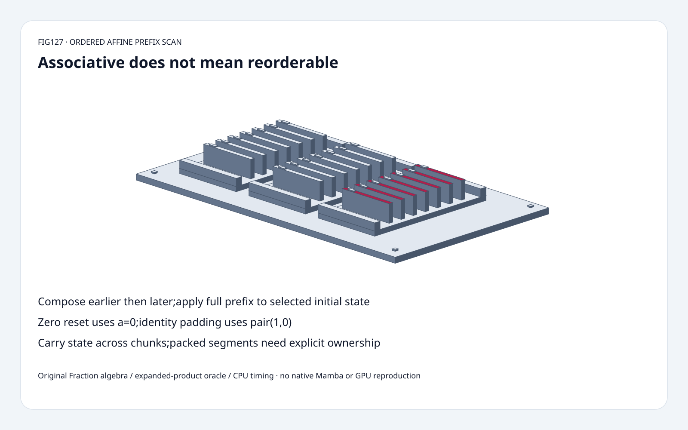
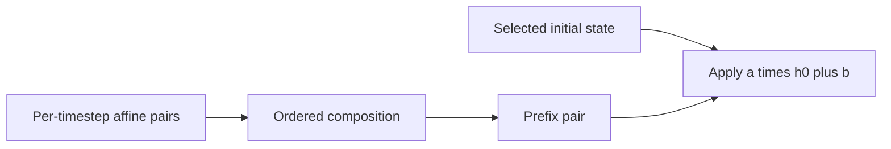
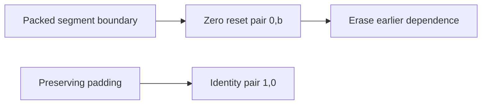
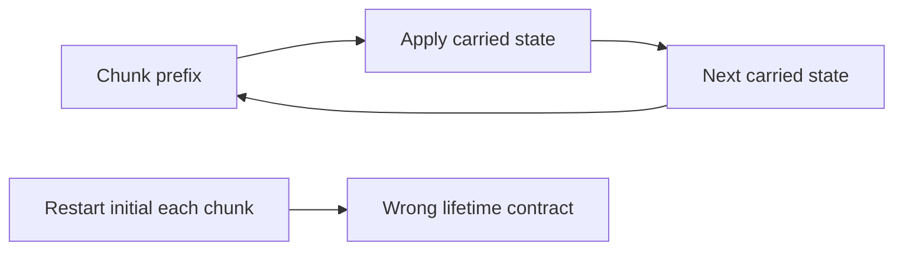

# Selective Recurrence FAQ：Ordered Affine Scan、Segment Reset 与 State Carry

> **语言**：中文 | [English](ordered-affine-prefix-scan-segment-reset-selection-faq.en.md)
>
> **Round127 · 2026-11-14 · 白班第4轮** · [SVG](../../assets/svg/ordered-affine-prefix-scan-segment-reset-selection-faq-summary.svg) · [H5](../reports/ordered-affine-prefix-scan-segment-reset-sizer.html) · [七卡](../reports/ordered-affine-prefix-scan-segment-reset-selection-cards.html) · [Data](../../experiments/affine_scan_contract_selection/report.json)
>
> **Synthetic，`independently_reproduced=false`。** 原创 exact scalar affine
> recurrence/tree scan、独立 product-expansion oracle、单独 CPU float timing。
> 不复现 native Mamba/discretization/gating/backward/GPU。



## 一、结论速览：Associative 不代表 Reorderable

原创 pairs`(2,1),(3,4),(4,2),(5,3)`，
`h[t]=a[t]*h[t-1]+b[t]`、initial7；
serial/ordered scan/independent expansion 都是
**[15,49,198,993]**。
反向 composition 得 **[15,51,189,933]**，
仅 **1/4** states匹配。

Index2前明确zero reset变 **[15,49,2,13]**；
identity padding`(1,0)`保持993，
zero pair`(0,0)`清成0。
正确chunk carry结束993，每two-element chunk重启initial7结束153。

固定classic Mamba header是既有ordered affine operator；
最新所读tree七月Mamba3Blackwell fix属于不同kernel，
非11月新scan理论、未执行。

## 二、架构师 Q&A：Algebra、Order、Segments 与 Chunks

### Q1：Recurrence 如何变成 Prefix Scan？

每 timestep是affine map`F(x)=a*x+b`。
Earlier`(a,b)`、later`(c,d)`：

```text
later(earlier(x)) = c*(a*x+b)+d
ordered pair = (c*a,c*b+d)
identity = (1,0)
```

Exact scalars下function composition可结合，
tree能改变parenthesization，但不能乱temporal order。
它 **不交换**，reverse通常改变b；
source classicselectivescan正是此方向。

原创Hillis-Steele每doubling stride读取完整previous-round buffer；
不能同round混用新旧prefix。
Parallel dependency pattern不是任意in-place read许可。

### Q2：Prefix Pair的b就是State吗？

仅selectedinitial0时。
本例fullprefix **(120,153)**，
initial7：`120*7+153=993`。
漏a或忘nonzeroinitial就误得153。

独立oracle展开：

```text
h[t] = h0*product(a[0:t+1])
     + sum_j b[j]*product(a[j+1:t+1])
```

不是重复同一compositionloop。
Scalarone-lanealgebra非完整Mamba parameterdiscretization、
selectivecoefficients、complexlanes、gates、outputprojection/backward。

### Q3：Packed-segment Zero Reset怎样入Algebra？

在 **原创显式extension** 中，
reset前将该pair`(a,b)`改`(0,b)`；
state=b，切断earliersegment依赖，后续composition不能恢复。

Index2前reset得2再13；漏reset则previoussegment泄漏、结束993。
若要nonzeroreset targetr，constant项应明确推成`a*r+b`；
H5仅zero-resetcontrol。

不宣称fixednativeAPI接受这些resetflags，
也不认证nativepackedsequenceisolation；
ownership需由实际representation/caller定义。

### Q4：为什么`(0,0)`不是无害Padding？

它把任意state映到0；保持state的padding是`(1,0)`。
即使visibleoutputs被mask，
若读取paddedlaststate作为nextchunkcarry，结果仍不同。

原创paddingcontrol明确消费paddedlaststate；
realnative可能valid-lengthguard/另选state，
不以toy推断其行为。

Chunkprefix要作用于实际carriedstate；
sourcecallback维持orderedrunningprefix，
不意味着eachchunk可重启originalinitial。

### Q5：Exact Associativity证明Float Bitwise与Speedup吗？

不。Regrouping改变floatintermediate rounding；
dtype/FMA/complex/underflow/overflow/topology需独立验证。
Fraction仅证明selectedalgebra，非nativebitwise；
originalfloattiming只对选定.5coefficientdata检查tolerance。

Hillis-Steeledependencyrounds是logarithmic，
但work/copies增加，原创serialPython执行反而慢；
不推断nativeGPUspeed。

选定batch8/length4096/channels64/statewidth16/float32：
laststate **32,768bytes**，
materializedallstates **134,217,728bytes**，
oneaffineprefixpair **65,536bytes**。
不同logicalalternatives，非peak，
不宣称fusednative必存allstates。

## 三、三张架构图：Composition、Segment Ownership、Carry







## 四、选型矩阵：先保State Semantics，再优化Span

| 选择 | 适合 | Gate |
| :--- | :--- | :--- |
| Sequentialrecurrence | Reference/statefulupdate | Lineardependency |
| Orderedprefixscan | Associativeaffinemaps | Operandorder/initialstate |
| Zero-resetpair | 原创packedstatecontrol | 非nativeAPI承诺 |
| Identitypadding | 保持carry | `(1,0)`非zeropair |
| Chunkcarry | Longsequencechunks | Fullprefix/state |
| Floattree | Nativeoptimization审计 | 数值/吞吐单独证据 |

## 五、动手证据：Exact Expansion、Reset、Padding与CPU

```powershell
python -m experiments.affine_scan_contract_selection.run --check
python -m unittest discover -s tests -p test_affine_scan_contract_selection.py -q
```

8tests：多length/initial对productexpansion、
associativity/noncommutativity、segmentindependence、
identity/zeropadding、chunkboundaries、
invalid/budget、Nodeparity、sealedmedians。

| Length | OriginalSerial（ms） | OriginalPythonTree（ms） |
| :--- | ---: | ---: |
| 32 | 0.002200 | 0.021633 |
| 128 | 0.009433 | 0.130967 |
| 512 | 0.040567 | 0.711967 |
| 2,048 | 0.171167 | 4.067567 |

2warmups、7alternatingrepeats、3ops/sample，
medianrepeatmeans；
Pythonfloatloops/copies，非GPUparallel；
排除nativeMamba/discretization/backward。
H5 boundedexactintegers/rangeerrors，
未做浏览器视觉验收。

## 六、来源、许可、溯源与Readiness

- [固定classic scan/prefixcallback](https://github.com/state-spaces/mamba/blob/e9594ce1c732d97440f0332fdc43170a2294dbfa/csrc/selective_scan/selective_scan_common.h)：orderedaffine/runningprefix。
- [2024年6月headerchange](https://github.com/state-spaces/mamba/commit/3c77dcf7cae77022f74f48ebfe3dd121b1764f99)：ROCmsupport，非11月发明。
- [2026年7月treechange](https://github.com/state-spaces/mamba/commit/e9594ce1c732d97440f0332fdc43170a2294dbfa)：Mamba3Blackwellfix，不同kernel、未执行。
- [Apache-2.0LICENSE](https://github.com/state-spaces/mamba/blob/e9594ce1c732d97440f0332fdc43170a2294dbfa/LICENSE)：上游权利保留。
- [原创实验](../../experiments/affine_scan_contract_selection/README.md)：equations/oracle/data/exclusions。

实现/oracle/视觉原创，未复制upstream；
nativelatency/floatbitwise/modelquality/peakHBM保持未测或null。
