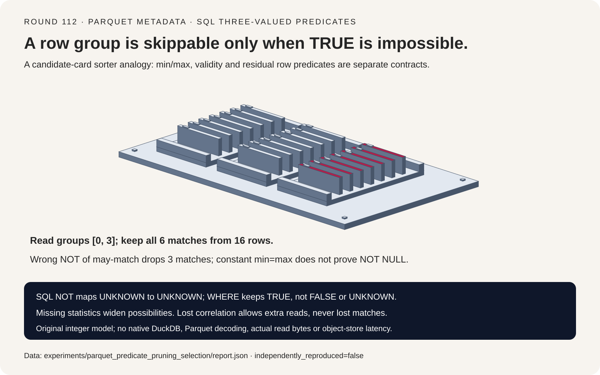
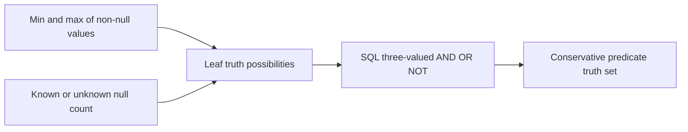
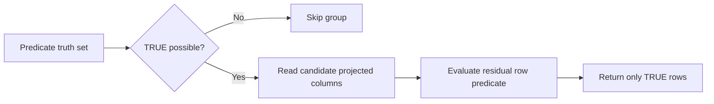
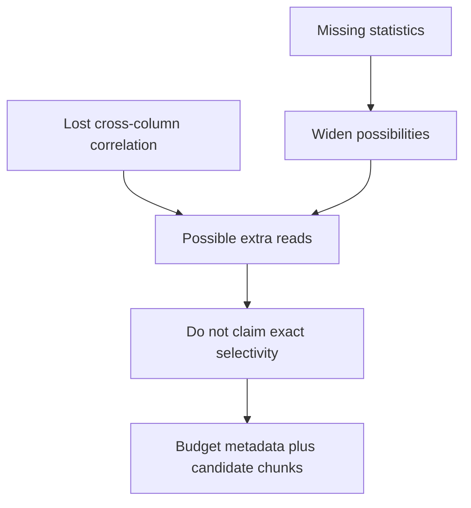

# Parquet pruning FAQ: min/max, SQL NULL and conservative row-group gates

> **Language**: [中文](parquet-sql-null-row-group-pruning-selection-faq.md) | English
>
> **Round 112 · 2026-11-14 (twenty-first round of the November 13 night)** · [SVG](../../assets/svg/parquet-sql-null-row-group-pruning-selection-faq-summary.svg) · [7-card report](../reports/parquet-sql-null-row-group-pruning-selection-cards.html) · [H5](../reports/parquet-sql-null-row-group-pruning-sizer.html) · [Sealed report](../../experiments/parquet_predicate_pruning_selection/report.json)
>
> **Synthetic, `independently_reproduced=false`.** Only original Python metadata-gated and full row scans were timed. No DuckDB execution, actual Parquet decoding, object-store IO, native throughput or peak-memory measurement.



## 1. Executive summary: “might contain TRUE” is the right exclusion boundary

The inspected DuckDB reader is pinned to November 11, 2026. A November 5
change concerns scratch-buffer allocation/pinning; it does not invent
predicate pruning. The source also explicitly keeps value bounds and
nullability separate, including the constant-string statistics path.
This is a current architecture study, not a daily-popularity ranking or
an independently reproduced upstream performance/failure report.

For four nullable integer groups, `WHERE NOT(x > 9)` can read only
groups **0 and 3**, reducing candidate rows from **16 to 8** while
retaining **all six true matches**. A shortcut that negates a single
“may match” bit instead loses **three qualifying rows**.

| Contract | Preserve | Do not infer |
| :--- | :--- | :--- |
| WHERE | Retain only TRUE | UNKNOWN is TRUE or FALSE |
| Min/max | Conservative bounds on non-null values | Equal bounds prove no nulls |
| Missing statistics | Widen possible values/validity | No statistics means no matches |
| Candidate gate | Skip only if TRUE is impossible | A retained group definitely contains a match |

Scope is trusted integer/null metadata and a small original SQL
three-valued predicate interpreter, not the native optimizer.

## 2. Architect Q&A: what information is sufficient for safe skipping?

### Q1: Why does NOT of “may match” lose rows?

The fixture is:

| Group | Values | Possible results of `NOT(x > 9)` | Action |
| :--- | :--- | :--- | :--- |
| 0 | `[1,2,NULL,3]` | TRUE, UNKNOWN | Read; three matches |
| 1 | `[10,NULL,11,12]` | FALSE, UNKNOWN | Skip |
| 2 | `[NULL,NULL,NULL,NULL]` | UNKNOWN | Skip |
| 3 | `[5,6,7,10]` | TRUE, FALSE | Read; three matches |

Group 3 might satisfy `x > 9`, but it also might satisfy its negation.
`NOT(exists a true row)` and `exists a row with NOT true` have different
quantifiers. Wrong Boolean negation keeps groups 0/2 and discards group 3.
An all-null group then causes extra reads, while three legitimate
matches disappear from the mixed group.

The original interpreter instead propagates sets drawn from
`{TRUE,FALSE,UNKNOWN}`. NOT maps TRUE→FALSE, FALSE→TRUE and
UNKNOWN→UNKNOWN. AND/OR combine their SQL truth tables over all
possible child outcomes. A WHERE gate skips only when TRUE is absent.

### Q2: Does min=max prove the column is constant and non-null?

No. Values `[7,NULL]` have min=max=7 among their non-null values.
If `null_count` is missing, `IS NULL` can still be TRUE or FALSE.
Inferring `null_count=0` loses the one null row for that query.

The inspected constant-string source path specifically sets validity
to unknown after constructing equal string bounds; a caller with an
actual null count can refine it. The original model uses an integer
analogue, not string/collation parity or a native regression reproduction.

A known zero null count permits no-null reasoning. A known null count
equal to the row count permits all-null reasoning. Missing min/max and
missing null count are independent uncertainty dimensions.

### Q3: What should missing or unusable statistics do?

The reader initializes its decision to `NO_PRUNING_POSSIBLE`.
The original model represents missing bounds/null count explicitly.
Erasing all four groups' metadata keeps all four groups, but the
final six matching rows remain unchanged after row filtering.

Unknown is not imputed as zero, an empty range or an all-null group.
An empty row group is separately represented by zero rows.
Malformed structural fields raise visibly, but a structurally valid
writer that lies about bounds is not detected by this prototype.
Soundness requires accurate, conservative metadata.

The inspected native reader separately considers floating NaN and
min/max pruning results. This integer-only study intentionally does
not generalize its ordering rules to NaN, strings/collation, truncated
string statistics, nested/repeated columns or custom expressions.

### Q4: Why can a retained group still have zero actual matches?

Consider rows `(x=1,y=0)` and `(x=0,y=1)` with query
`x=1 AND y=1`. Each column independently ranges from zero to one,
so both equality leaves may be TRUE. The product abstraction keeps
the group, while the actual matching-row count is zero.

Losing correlation is an allowed false positive: it reads extra data.
It must not become a false negative that drops qualifying rows.
The same limitation can appear between predicates on one column.
Residual row-level evaluation remains necessary after candidate gating.
This is not a join, multi-column index or constraint solver.

### Q5: How should projection and pruning IO budgets be combined?

The H5 takes selected groups as an **input assumption**, not a
predicted selectivity. Default 1024 groups, 64 stored columns,
eight projected columns and 131,072 compressed bytes/column/group give:

| Selected accounting | Bytes |
| :--- | ---: |
| All stored chunks, before metadata | 8,589,934,592 |
| Projected chunks, before pruning/metadata | 1,073,741,824 |
| 64 candidate groups' projected chunks | 67,108,864 |
| Selected metadata allowance | 1,048,576 |
| Candidate chunks plus metadata | **68,157,440** |

Zero candidate groups still retain the metadata allowance. Uniform
compressed chunk sizes are a selected arithmetic model; actual reads
also depend on footer/index/Bloom access, readahead, request rounding,
compression, caching and residual predicates. Logical bytes are not
wire bytes, billed storage requests or measured read latency.

## 3. Visual architecture: abstract predicates, candidate gates and residual scans







## 4. Selection matrix: preserve soundness before claiming fewer reads

| Choice | Good fit | Gate before adoption |
| :--- | :--- | :--- |
| Conservative min/max/null pruning | Comparable trusted metadata | Type/order/null semantics |
| Missing-stat fallback | Correctness despite weaker metadata | Broader candidates, not zero matches |
| Projection plus group pruning | Narrow column access and selective groups | Metadata/index/readahead overhead |
| Full predicate scan | Missing stats or unselective data | Decode/compute/storage budget |
| Boolean NOT of may-match | **Not safe** | Quantifier error; mixed groups lose rows |
| Min=max implies no nulls | **Not safe** | Check independent null metadata |

## 5. Hands-on evidence: same final query result, explicitly bounded CPU timing

```powershell
python -m experiments.parquet_predicate_pruning_selection.run --check
python -m unittest discover -s tests -p test_parquet_predicate_pruning_selection.py -q
```

Eight focused tests include exhaustive nullable columns of lengths
zero to three over `{NULL,-1,0,1}`, concrete-versus-abstract truth-set
containment, NOT/unknown controls, reversed rows, correlation loss,
invalid metadata and Node.js/Python exact-byte parity.

The original CPU query uses 256 rows/group and a one-in-eight
candidate profile. Both paths return the same final match count:

| Groups / rows | Metadata gate + retained rows (ms) | Full rows (ms) |
| :--- | ---: | ---: |
| 16 / 4096 | 0.255600 | 2.019900 |
| 64 / 16384 | 1.045033 | 7.444733 |
| 256 / 65536 | 4.070600 | 30.231367 |
| 1024 / 262144 | 16.659167 | 120.569433 |

Two warmups, seven alternating repeats, three complete queries per
sample; medians of repeat means. Metadata is precomputed. This is
Python predicate-work accounting, not native DuckDB, Parquet decoding,
network/object-store throughput or general selectivity speedup.
Browser visual inspection was not performed; prior refusal was respected.

## 6. Sources, provenance and readiness

- [Pinned DuckDB reader](https://github.com/duckdb/duckdb/blob/77e8a4971900bfea7161bd48e027fea589cb041e/extension/parquet/parquet_reader.cpp): no-stat fallback, false-or-null exclusion and separate NaN treatment.
- [Pinned statistics conversion](https://github.com/duckdb/duckdb/blob/77e8a4971900bfea7161bd48e027fea589cb041e/extension/parquet/parquet_statistics.cpp): independent validity, constant-string bounds and null-count refinement.
- [Pinned comparison propagation](https://github.com/duckdb/duckdb/blob/77e8a4971900bfea7161bd48e027fea589cb041e/src/optimizer/statistics/expression/propagate_comparison.cpp): absent-bound fallback and null-aware false/true outcomes.
- [November 5 allocation/pinning change](https://github.com/duckdb/duckdb/commit/e4ae2d124f430165a50caa1b9d9220e508bb3fa1): chronology only, not a pruning invention or measured native speedup.
- [MIT license](https://github.com/duckdb/duckdb/blob/77e8a4971900bfea7161bd48e027fea589cb041e/LICENSE); upstream rights remain with their owners.

All fixture data, truth-set interpreter, concrete oracle, budgets,
timing and visual assets are original. No upstream implementation,
private dataset or model weights were copied. The sealed report is
synthetic with `independently_reproduced=false`; original CPU timing
is separately marked measured. Production IO, native latency and
peak memory remain null.
