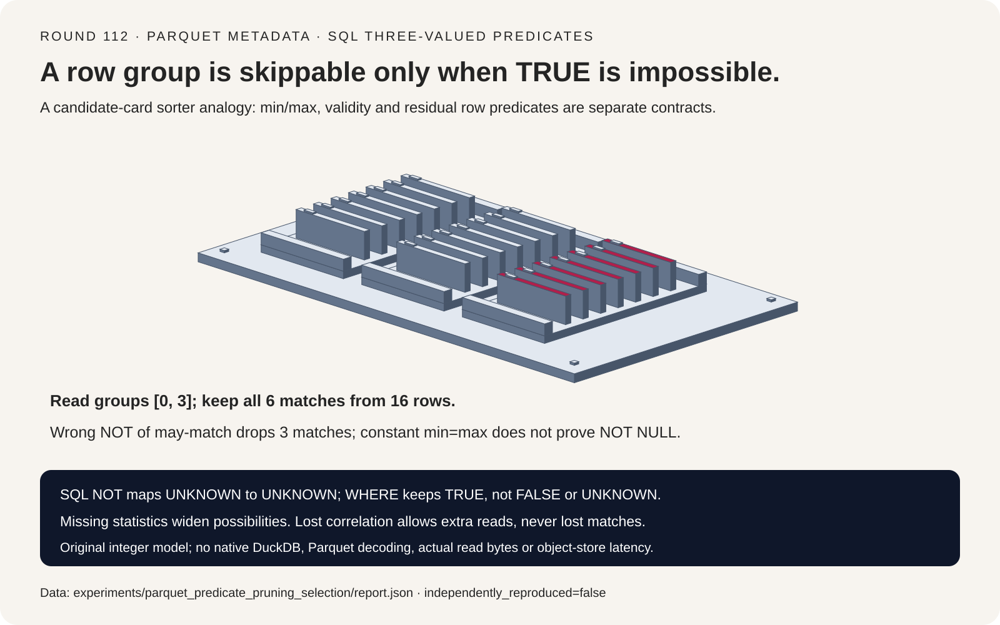
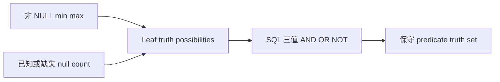
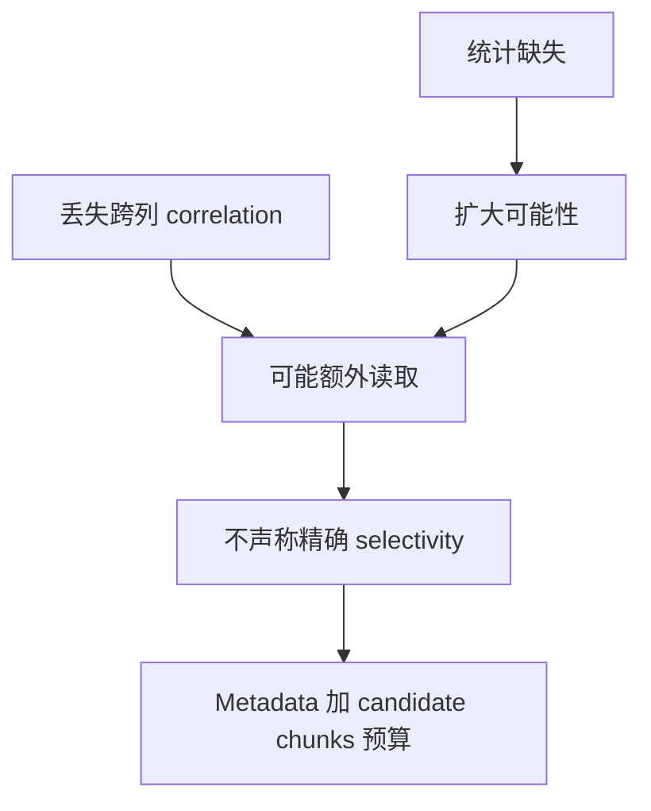

# Parquet 剪枝 FAQ：Min/Max、SQL NULL 与保守 Row Group Gate

> **语言**：中文 | [English](parquet-sql-null-row-group-pruning-selection-faq.en.md)
>
> **Round 112 · 2026-11-14（11 月 13 日夜班第 21 轮）** · [高清 SVG](../../assets/svg/parquet-sql-null-row-group-pruning-selection-faq-summary.svg) · [七卡报告](../reports/parquet-sql-null-row-group-pruning-selection-cards.html) · [H5 工作台](../reports/parquet-sql-null-row-group-pruning-sizer.html) · [封存数据](../../experiments/parquet_predicate_pruning_selection/report.json)
>
> **Synthetic，`independently_reproduced=false`。** 只实测原创 Python metadata gate＋保留行扫描与全行扫描；不包含 DuckDB、真实 Parquet 解码、object-store IO、native 吞吐或峰值内存。



## 一、先看结论：只有“不可能为 TRUE”的组才能跳过

固定检查 DuckDB **2026-11-11** reader；11 月 5 日改动涉及 scratch buffer
分配与 pinning，不是新发明 predicate pruning。源码也明确把 value bounds
与 nullability 分开，包含 constant-string statistics 的 validity 处理。
本文追踪当前架构，不声称得到每日热度排名或独立复现上游性能/故障。

四个 nullable integer groups 的 `WHERE NOT(x > 9)`，只读取 **0、3 组**，
候选行由 **16 降至 8**，仍保留 **全部 6 条匹配行**。若把 `may-match` 位
简单取反，则会漏掉 **3 条合法结果**。

| 契约 | 必须保留 | 不能推断 |
| :--- | :--- | :--- |
| WHERE | 仅 TRUE 保留 | UNKNOWN 等于 TRUE 或 FALSE |
| Min/max | 非 NULL 值的保守边界 | min=max 就没有 NULL |
| 缺失统计 | 扩大 value/validity 可能性 | 没统计就没结果 |
| Candidate gate | 只排除不可能 TRUE 的组 | 留下的组一定有匹配行 |

范围是可信整数/null 统计与原创 SQL 三值解释器，不是 native optimizer。

## 二、架构师 Q&A：哪些信息足以安全排除一组数据？

### Q1：为什么 NOT(may-match) 会漏行？

| Group | 原始值 | `NOT(x > 9)` 可能值 | 动作 |
| :--- | :--- | :--- | :--- |
| 0 | `[1,2,NULL,3]` | TRUE、UNKNOWN | 读取；3 条匹配 |
| 1 | `[10,NULL,11,12]` | FALSE、UNKNOWN | 跳过 |
| 2 | `[NULL,NULL,NULL,NULL]` | UNKNOWN | 跳过 |
| 3 | `[5,6,7,10]` | TRUE、FALSE | 读取；3 条匹配 |

Group 3 既可能满足 `x>9`，也可能满足它的否定。`NOT(存在一行命中)`
与 `存在一行满足 NOT` 的量词不同。错误 Boolean gate 会保留 0/2，
丢掉 3：全 NULL 组多读了，混合组的三条合法结果却消失。

原创实现传播 `{TRUE,FALSE,UNKNOWN}` 的子集。NOT 把 TRUE/FALSE 互换，
但 UNKNOWN 仍为 UNKNOWN；AND/OR 按 SQL 三值表组合可能结果。
只有集合中不存在 TRUE，WHERE 才能安全排除该组。

### Q2：min=max 是否证明整列恒定且非 NULL？

不是。`[7,NULL]` 的非 NULL min=max=7。缺失 `null_count` 时，
`IS NULL` 仍可能 TRUE 或 FALSE。错误补出 `null_count=0`，
会在这个查询中漏掉一条 NULL 行。

固定源码的 constant-string path 在构造相同字符串边界之后，专门把
validity 设为 unknown，之后再由已知 null count 收紧。本文用整数
analogue 说明独立契约，不声称 string/collation parity 或 native 回归复现。

明确 null_count=0 才能做 no-null 推断；明确 null_count=总行数才能做
all-null 推断。缺少 min/max 与缺少 null_count 是两种独立的不确定性。

### Q3：Missing/unusable statistics 应当返回什么？

源码 reader 默认 `NO_PRUNING_POSSIBLE`。原创模型显式表示缺失边界和
null count；把四组统计全部抹去，会保留四组，但逐行过滤后仍是六条匹配。
Unknown 不补成 0、空区间或全 NULL；空组由 rows=0 单独表示。

结构字段错误会明确抛错，但原型无法识别“格式合法、内容撒谎”的 writer
统计。Soundness 的前提是准确、保守的 metadata，不是任意损坏文件都安全。

源码对浮点 NaN 与 min/max 分别判断后再合并能否剪枝。本文刻意只实现
整数/null，不把结论机械扩展到 NaN、字符串排序、truncated stats、
nested/repeated columns 或任意 custom expressions。

### Q4：为什么“需要读取”仍可能零匹配？

两行 `(x=1,y=0)`、`(x=0,y=1)`，查询 `x=1 AND y=1`。
每列独立范围都是 `[0,1]`，两个 equality leaf 都可能 TRUE，
所以保守乘积抽象保留该组；实际匹配却是 0。

丢失 correlation 所引入的 false positive 只是多读，不是漏结果。
同一列多个 predicate 之间也可能有这种局限。Candidate gate 之后必须保留
residual row evaluation；本文不实现 join、多列索引或通用约束求解器。

### Q5：Projection 与 Row Group 剪枝如何一起算 IO？

H5 中 selected_groups 是**用户输入假设**，不是自动预测 selectivity。
默认 1024 groups、64 存储列、8 projected columns、每列每组压缩 131,072 bytes：

| 选定口径 | 字节 |
| :--- | ---: |
| 全部存储 column chunks，未加 metadata | 8,589,934,592 |
| Projection 后、剪枝前 chunks | 1,073,741,824 |
| 64 个候选组的 projected chunks | 67,108,864 |
| 选定 metadata 预算 | 1,048,576 |
| 候选 chunks＋metadata | **68,157,440** |

零候选组也保留 metadata allowance。均匀 compressed chunk size 是模型假设；
实际 IO 还受 footer/index/Bloom、readahead、request rounding、压缩、cache
和 residual predicates 影响。Logical bytes 不等于 wire bytes、计费请求或实测延迟。

## 三、三张架构图：抽象谓词、候选 Gate 与 Residual Scan






## 四、选型矩阵：先不漏结果，再讨论少读多少

| 方案 | 适合 | 上线 Gate |
| :--- | :--- | :--- |
| 保守 min/max/null 剪枝 | 可比较且可信的 metadata | Type/order/null 语义 |
| Missing-stat fallback | 统计不完整仍保正确性 | 候选扩大，不是零匹配 |
| Projection＋group pruning | 少量列与高选择性组 | 元数据、index、readahead 成本 |
| 全 predicate scan | 无统计或低选择性 | Decode/compute/storage 预算 |
| Boolean NOT(may-match) | **不安全** | 量词错误，混合组漏行 |
| min=max 推断 no-null | **不安全** | 独立检查 null metadata |

## 五、动手证据：同一最终结果，CPU 边界单独交代

```powershell
python -m experiments.parquet_predicate_pruning_selection.run --check
python -m unittest discover -s tests -p test_parquet_predicate_pruning_selection.py -q
```

8 项 focused tests 包括 `{NULL,-1,0,1}` 上长度 0–3 的列穷举、
concrete truths 被 abstract truths 包含、NOT/unknown controls、逆序、
correlation false positive、非法统计与 Node.js/Python 精确字节一致性。

原创 CPU 查询每组 256 行、每八组一组候选；两条路径最终 count 完全相同：

| Groups / rows | Metadata gate＋保留行（ms） | 全行（ms） |
| :--- | ---: | ---: |
| 16 / 4096 | 0.255600 | 2.019900 |
| 64 / 16384 | 1.045033 | 7.444733 |
| 256 / 65536 | 4.070600 | 30.231367 |
| 1024 / 262144 | 16.659167 | 120.569433 |

2 warmups、7 次交替 repeats，每 sample 3 次完整查询，报告 repeat means 的
median。Stats 预先构造，不包含构造、Parquet 解码、filesystem/network、
native DuckDB 或 object-store 吞吐；不外推通用 selectivity speedup。
未做浏览器视觉验收，遵守此前拒绝。

## 六、来源、许可、溯源与 Readiness

- [固定 Reader](https://github.com/duckdb/duckdb/blob/77e8a4971900bfea7161bd48e027fea589cb041e/extension/parquet/parquet_reader.cpp)：缺失统计 fallback、FALSE_OR_NULL 排除与独立 NaN 判断。
- [固定 Statistics](https://github.com/duckdb/duckdb/blob/77e8a4971900bfea7161bd48e027fea589cb041e/extension/parquet/parquet_statistics.cpp)：独立 validity、constant-string bounds、null-count refinement。
- [固定 Comparison Propagation](https://github.com/duckdb/duckdb/blob/77e8a4971900bfea7161bd48e027fea589cb041e/src/optimizer/statistics/expression/propagate_comparison.cpp)：缺失 bounds 不剪枝，false/true 区分 null 可能性。
- [11 月 5 日 allocation/pinning 改动](https://github.com/duckdb/duckdb/commit/e4ae2d124f430165a50caa1b9d9220e508bb3fa1)：仅用于时间线，不称剪枝发明或 native 实测加速。
- [MIT LICENSE](https://github.com/duckdb/duckdb/blob/77e8a4971900bfea7161bd48e027fea589cb041e/LICENSE)：上游权利保留。

输入、truth-set interpreter、concrete oracle、budget、timing 与视觉资产均原创，
未复制上游实现、私有数据或模型权重。封存 report 标注 synthetic、
`independently_reproduced=false`，原创 CPU timing 单独标 measured。
生产 IO、native latency 与 peak memory 均保留 null。
