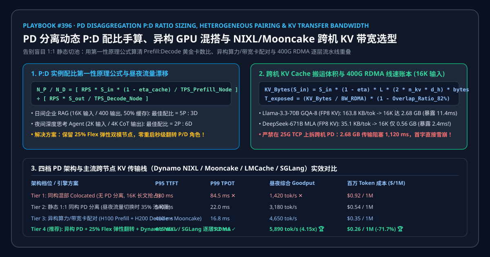
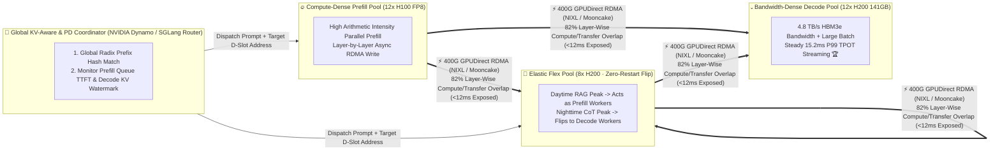

# PD Disaggregation Dynamic P:D Ratio Sizing, Heterogeneous GPU Pairing & Cross-Node KV Bandwidth Guide: `NVIDIA Dynamo (NIXL)` vs. `Mooncake Transfer Engine` vs. `vLLM Production Stack (LMCache)` vs. `SGLang PD Router`

> **Language / 语言**: **English (Current)** | [中文](./pd-disaggregation-elastic-ratio-heterogeneous-gpu-kv-bandwidth-selection-faq.md)  
> **Scope**: A production architecture and capacity sizing guide for Cloud & AI Solution Architects—free of low-level kernel code—answering three critical questions: **(1) How do you hand-calculate the optimal Prefill-to-Decode (`N_P : N_D`) instance ratio as traffic shifts between daytime RAG and nighttime Reasoning Agents? (2) How much cross-node RDMA bandwidth does KV transfer actually consume across MHA, GQA-8, and DeepSeek MLA? (3) When should you choose NVIDIA Dynamo (`NIXL`), Mooncake Transfer Engine, SGLang PD Router, or vLLM (`LMCache`)?**  
> **Provenance**: Analytical model synthesized from published disaggregated serving architectures (`provenance: synthetic + anonymized_reported`, `independently_reproduced=false`, `physical_gpu_cluster_measurement=not_measured`). See [`experiments/pd_disaggregation_elastic_ratio_heterogeneous_gpu_kv_bandwidth_selection/results.json`](../../experiments/pd_disaggregation_elastic_ratio_heterogeneous_gpu_kv_bandwidth_selection/results.json).

> 🔗 **Interactive H5 Learning Lab & Companion Tools (Zero External Dependencies)**:
> - 📱 **[Interactive H5 Study Page: PD Disaggregation P:D Ratio, KV Bandwidth & Framework Lab (`docs/h5/pd-disaggregation-ratio-kv-bandwidth-lab.html`)](../h5/pd-disaggregation-ratio-kv-bandwidth-lab.html)**
> - 🎓 **[AI Infra Panorama H5 Learning Hub (`docs/h5/index.html`)](../h5/index.html)**
> - 🧮 **[Interactive Capacity Sizer (`pd-disaggregation-elastic-ratio-heterogeneous-gpu-kv-bandwidth-selection-sizer.html`)](../reports/pd-disaggregation-elastic-ratio-heterogeneous-gpu-kv-bandwidth-selection-sizer.html)**
> - 🃏 **[7-Card 4:5 Visual Report (`pd-disaggregation-elastic-ratio-heterogeneous-gpu-kv-bandwidth-selection-cards.html`)](../reports/pd-disaggregation-elastic-ratio-heterogeneous-gpu-kv-bandwidth-selection-cards.html)**

---

## 1. 📌 Executive Summary

> **Bottom Line**: **Splitting a cluster into a static `1:1` homogeneous Prefill-Decode pool (Tier 2) leaves **`35.0%`** of GPUs stranded when enterprise workloads swing from daytime long-context RAG (`16K In / 400 Out`, Prefill-heavy) to nighttime deep-reasoning/coding agents (`2K In / 4K CoT Out`, Decode-heavy). Adopting **Tier 4 (Heterogeneous GPU Pairing [`H100 Prefill + H200 Decode`] + `25% Flex` Zero-Restart Role-Flipping Workers + `NVIDIA Dynamo NIXL / SGLang` Layer-Wise Pipelined RDMA KV Transfer)** cuts `P95 TTFT` to **`415 ms`**, holds `P99 TPOT` at **`15.2 ms`**, boosts diurnal SLA-compliant Goodput by **`4.15x`** (`1,420 -> 5,890 tok/s`), reduces stranded GPU capacity to **`3.2%`**, and lowers cost per 1M Goodput tokens by **`71.7%`** (`$0.92 -> $0.26`)!**

| Architecture Tier | Core Design & Scheduling Strategy | `P95 TTFT` | `P99 TPOT` | 32-GPU Diurnal Goodput | Stranded GPU Ratio | Cost / 1M Goodput Tokens | Architect Verdict |
| :--- | :--- | :--- | :--- | :--- | :--- | :--- | :--- |
| **🟥 Tier 1: Homogeneous Colocated** | 32 identical GPUs running mixed Prefill+Decode; 16K prompts stall active decodes | `980.0 ms` ✕ | **`84.5 ms` ✕** | `1,420 tok/s` ✕ | `38.0%` (SLA misses) | `$0.92 / 1M` ✕ | Only for `<=8 GPUs` or short prompts (`<2K`) |
| **🟨 Tier 2: Static `1:1` Homogeneous PD** | Fixed `16P : 16D` split without dynamic role switching | `540.0 ms` | `22.0 ms` ✅ | `3,180 tok/s` | **`35.0%` ✕ (Stranded)** | `$0.54 / 1M` | Acceptable only for unchanging I:O ratios |
| **🟦 Tier 3: Heterogeneous PD + Mooncake** | Compute-dense `H100` Prefill + Bandwidth-dense `H200` Decode + `Mooncake` KV Pool | `460.0 ms` ✅ | `16.8 ms` ✅ | `4,650 tok/s` ✅ | `14.5%` | `$0.35 / 1M` ✅ | Matches hardware SKU to physical bottleneck |
| **🟩 Tier 4: Heterogeneous PD + `25% Flex` + `Dynamo NIXL / SGLang` (Recommended)** | **`12P:12D` Heterogeneous Base + `8 Flex` Zero-Restart Workers + Layer-Wise RDMA** | **`415.0 ms` 🏆** | **`15.2 ms` 🏆** | **`5,890 tok/s` 🏆 (`4.15x`)** | **`3.2%` 🏆** | **`$0.26 / 1M` 🏆 (`-71.7%`)** | **Production standard for multi-workload fleets** |

---

## 2. 🎯 Architect Deep-Dive Q&A & First-Principles Hand Calculations

### Q1: How do you hand-calculate the exact Prefill-to-Decode (`N_P : N_D`) instance ratio, and why does a static split fail across day/night traffic?
* **First-Principles P:D Ratio Equation**:
  To prevent Prefill queues from exploding or Decode workers from starving, the rate of KV generation in the Prefill pool must match the rate of token generation in the Decode pool:
  $$\frac{N_P}{N_D} = \frac{\text{RPS} \times S_{\text{in}} \times (1 - \eta_{\text{cache}}) \;/\; \text{Throughput}_{P\text{-node}}(\text{tok/s})}{\text{RPS} \times S_{\text{out}} \;/\; \text{Throughput}_{D\text{-node}}(\text{tok/s})}$$
  - **Daytime Enterprise RAG (`16K In / 400 Out`, $\eta_{\text{cache}} = 50\%$ -> `8,192` uncached input tokens)**:
    - With a Prefill node processing `48,000 prefill tok/s` and a Decode node delivering `3,800 decode tok/s` at $\text{TPOT} \le 18\text{ ms}$:
    - $N_P / N_D = (8,192 / 48,000) \div (400 / 3,800) = 0.1707 \div 0.1053 = \mathbf{1.62 : 1 \approx 5\text{P} : 3\text{D}}$ (`20P : 12D` in a 32-GPU fleet).
  - **Nighttime Deep Reasoning / Coding Agent (`2K In / 4K CoT Out`, $\eta_{\text{cache}} = 50\%$ -> `1,024` uncached input tokens)**:
    - $N_P / N_D = (1,024 / 48,000) \div (4,096 / 3,800) = 0.0213 \div 1.0779 \approx \mathbf{1 : 5 \sim 1 : 3}$ (`8P : 24D` in a 32-GPU fleet).
  - **Zero-Restart Flex Workers**: Because Prefill and Decode workers hold the exact same model weights in HBM, designating `25%` of the fleet (`8 GPUs` out of `32`) as **Flex Workers** allows the router (`NVIDIA Dynamo` or `SGLang Router`) to flip their routing tag between Prefill and Decode in seconds without reloading weights.

### Q2: How do you calculate cross-node KV Cache transfer volume and required RDMA bandwidth for MHA, GQA-8, and DeepSeek MLA?
* **KV Transfer Volume & Exposed Latency Formula**:
  $$\text{KV}_{\text{bytes}}(S_{\text{in}}) = S_{\text{in}} \times (1 - \eta_{\text{cache}}) \times L \times K_{\text{elements\_per\_layer}} \times \text{Bytes}_{\text{KV}}, \qquad T_{\text{exposed}} = \frac{\text{KV}_{\text{bytes}}}{\text{BW}_{\text{link}}} \times (1 - \alpha_{\text{overlap}})$$
  For a `16,384-token` uncached prompt using `FP8 KV Cache (1 Byte)`:
  1. **Legacy MHA (70B, 80 layers, 64 KV heads)**: `1.31 MB/token` $\implies$ **`21.47 GB`** per request (impractical for cross-node PD).
  2. **Standard GQA-8 (Llama-3.3-70B, 80 layers, 8 KV heads)**: `163.84 KB/token` $\implies$ **`2.68 GB`** per request.
     - Over **`25GbE TCP` (`2.4 GB/s` effective)**: **`1,118 ms`** transfer stall (catastrophic TTFT regression!).
     - Over **`400G GPUDirect RDMA` (`47.5 GB/s` effective) with `80%` layer-wise overlap**: `56.4 ms` total wire time, only **`11.3 ms` exposed** after layer-80 completes!
  3. **DeepSeek-V3/R1 671B MLA (61 layers, `576` compressed latent elements/layer)**: Only **`35.14 KB/token`** (`4.67x` smaller than 70B GQA-8!) $\implies$ **`0.56 GB`** per `16K` request, yielding just **`2.4 ms` exposed transfer latency** over 400G RDMA!

### Q3: How should architects choose among `NVIDIA Dynamo (NIXL)`, `Mooncake Transfer Engine`, `SGLang PD Router`, and `vLLM + LMCache`?
1. **`NVIDIA Dynamo + NIXL`**: Best for enterprise multi-node NVIDIA GPU factories (`32–1,024+ GPUs`) requiring automated SLA-driven P/D scaling (`Planner`), global KV-aware routing, and unified zero-copy transfers across NVLink, InfiniBand, RoCEv2, Host DRAM, and GDS NVMe.
2. **`Mooncake Transfer Engine`**: Best for ultra-long-context (`32K–1M`) multi-turn agents that pool tens of terabytes of distributed CPU Pinned DRAM and multi-rail RDMA NICs into a global KVCache-centric storage fabric.
3. **`SGLang Disaggregated Router`**: Best for high-throughput **DeepSeek-V3/R1 671B & Qwen3 MoE** deployments combining native `RadixAttention`, `FlashMLA`, `DeepEP IBGDA`, and lightweight Rust PD routing.
4. **`vLLM Production Stack + LMCache`**: Best for cloud-managed Kubernetes (`AKS / EKS / GKE`) multi-model platforms or `50G–100G` cloud networks where cross-instance KV compression reduces network bottlenecks.

---

## 3. 🧭 Architecture & Selection Diagrams

---

## 4. 📊 Disaggregated Serving Stack Comparison Matrix

| Dimension | `NVIDIA Dynamo (NIXL)` | `Mooncake Transfer Engine` | `SGLang PD Router` | `vLLM V1 + LMCache` |
| :--- | :--- | :--- | :--- | :--- |
| **Core Philosophy** | Datacenter-scale orchestration + NIXL unified zero-copy abstraction | KVCache-Centric distributed DRAM/RDMA memory pool | Ultra-lightweight Rust router + native RadixAttention | Cloud-native K8s stack + compressed cross-replica KV sharing |
| **Transports** | NVLink, GPUDirect RDMA (IB/RoCE), Host DRAM, GDS NVMe | Multi-Rail GPUDirect RDMA, TCP fallback, Host DRAM | Native `NIXL` and `Mooncake` transfer backends | GPUDirect RDMA, TCP, Redis, local NVMe + KV compression |
| **Elastic P:D Scaling** | **Built-in SLA Planner (auto-adjusts P/D workers)** 🏆 | Early-rejection & watermark-aware scheduling | Dynamic worker registration & role tagging | Integrates with KEDA & K8s GIE Endpoint Picker |
| **Best Fit** | 32–1,024+ GPU enterprise AI factories | 32K–1M long-context RAG & multi-turn agents | DeepSeek-V3/R1 671B & Qwen3 MoE private clusters | Cloud K8s (`AKS/EKS/GKE`) multi-model MaaS |

---

## 5. 🛠️ Production Readiness Checklist

- [ ] **Entry Gate**: Enable cross-node PD disaggregation only when fleet size is **`>= 16 GPUs`**, average prompt is **`>= 4,096 Tokens`** (or `I:O >= 8:1`), and nodes have **`>= 100G–400G` GPUDirect RDMA**; otherwise stay on **Colocated + Chunked Prefill**.
- [ ] **Enforce FP8 KV Cache**: Enable `--kv-cache-dtype fp8_e4m3` across both pools to cut RDMA wire volume by `50%`.
- [ ] **Heterogeneous SKU Pairing**: Assign compute-dense GPUs (`H100 / L40S`) to Prefill and bandwidth/memory-dense GPUs (`H200 / B200 / MI325X`) to Decode.
- [ ] **Reserve `20%–30%` Flex Workers**: Dynamically flip Flex workers between Prefill and Decode based on `Prefill Queue Wait > 250 ms` vs. `Decode KV Usage > 82%`.
- [ ] **Pre-Allocate Decode KV Slots**: Reserve target Decode HBM blocks before Prefill begins to prevent cross-node KV write OOM crashes.
