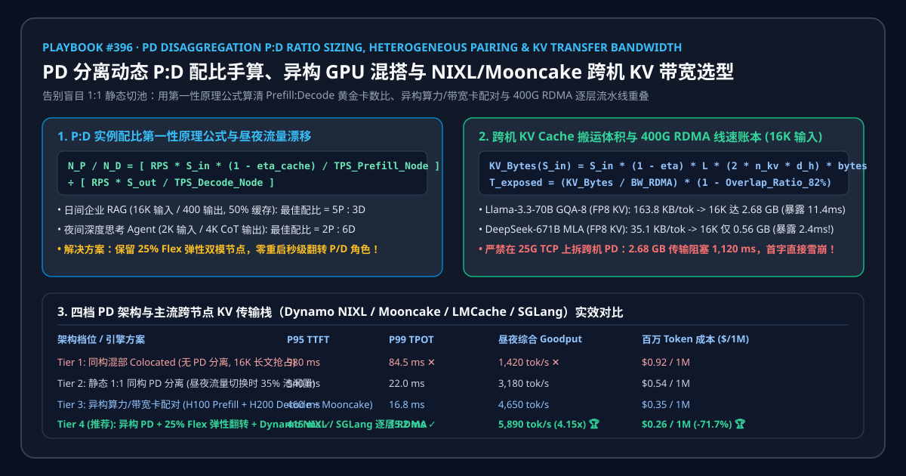
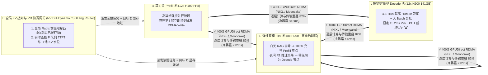
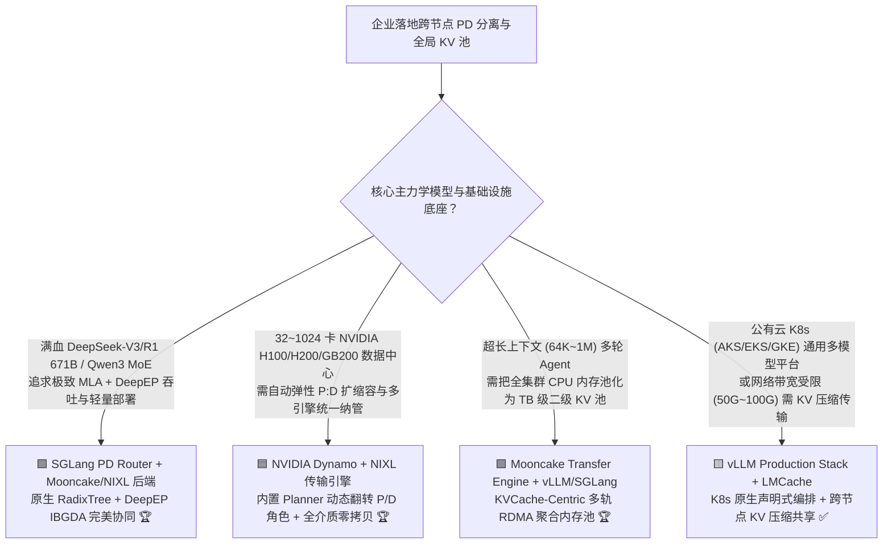

# PD 分离（Prefill-Decode Disaggregation）动态 P:D 配比手算、异构 GPU 混搭与跨机 KV 传输带宽选型指南：`NVIDIA Dynamo (NIXL)` vs. `Mooncake Transfer Engine` vs. `vLLM Production Stack (LMCache)` vs. `SGLang PD Router`

> **语言 / Language**: **中文 (当前)** | [English](./pd-disaggregation-elastic-ratio-heterogeneous-gpu-kv-bandwidth-selection-faq.en.md)  
> **文档定位**：面向 Cloud & AI Solution Architect（云与 AI 基础设施解决方案架构师）的 PD 分离生产落地深潜指南——不讲任何底层算子源码，专治 **“拆了 PD 分离后白天 Prefill 排队、晚上 Decode 爆显存，35% 的 GPU 永远有一半在空转”、“不知道怎么根据输入/输出长度和缓存命中率手算 P:D 实例配比”、“分不清 NVIDIA Dynamo NIXL、Mooncake、LMCache 与 SGLang PD Router 该选哪个”** 三大架构痛点。  
> **标定声明**：本文所引用的 SLA 达标有效吞吐（Goodput）、P95 TTFT、P99 TPOT 与百万 Token 成本基于公开发布的推理架构模型（DistServe、Mooncake、NVIDIA Dynamo NIXL、vLLM V1 / SGLang Disaggregated Serving）构建的合成定量模型（`provenance: synthetic + anonymized_reported`, `independently_reproduced=false`, `physical_gpu_cluster_measurement=not_measured`），详见 [`experiments/pd_disaggregation_elastic_ratio_heterogeneous_gpu_kv_bandwidth_selection/results.json`](../../experiments/pd_disaggregation_elastic_ratio_heterogeneous_gpu_kv_bandwidth_selection/results.json)。

> 🔗 **关联交互式 H5 精读页与工具（点击即开，零外部依赖）**：
> - 📱 **[交互式 H5 精读页：PD 分离动态配比、KV 带宽手算与四大框架对比沙盘 (`docs/h5/pd-disaggregation-ratio-kv-bandwidth-lab.html`)](../h5/pd-disaggregation-ratio-kv-bandwidth-lab.html)**
> - 🎓 **[AI Infra 全景可视化精学馆首页 (`docs/h5/index.html`)](../h5/index.html)**
> - 🧮 **[交互式容量计算器 (`pd-disaggregation-elastic-ratio-heterogeneous-gpu-kv-bandwidth-selection-sizer.html`)](../reports/pd-disaggregation-elastic-ratio-heterogeneous-gpu-kv-bandwidth-selection-sizer.html)**
> - 🃏 **[7-Card 4:5 视觉评测报告 (`pd-disaggregation-elastic-ratio-heterogeneous-gpu-kv-bandwidth-selection-cards.html`)](../reports/pd-disaggregation-elastic-ratio-heterogeneous-gpu-kv-bandwidth-selection-cards.html)**

---

## 1. 📌 核心选型结论速览（Executive Summary）

> **一句话结论**：**做 PD 分离最忌讳“一刀切按 1:1 静态划分同构 GPU 池（Tier 2）”——当企业白天跑长文档 RAG（`16K 输入 / 400 输出`，重算力 Prefill）、夜间跑深度推理/代码 Agent（`2K 输入 / 4K CoT 输出`，重带宽 Decode）时，静态 1:1 切池会导致高達 **`35.0%`** 的 GPU 因木桶短板效应处于闲置饥饿状态！通过落地 **Tier 4（异构算力/带宽卡配对 [`H100 Prefill + H200 Decode`] + `25% Flex` 弹性零重启角色翻转 + `NVIDIA Dynamo NIXL / SGLang` 逐层流水线 RDMA KV 传输）**，不仅将 `P95 TTFT` 压至 **`415 ms`**、`P99 TPOT` 稳定在 **`15.2 ms`**，更将昼夜综合达标有效吞吐（Goodput）从同构混部的 `1,420 tok/s` 拉升至 **`5,890 tok/s`（提升 `4.15 倍`）**，闲置算力浪费压降至 **`3.2%`**，每百万达标 Token 成本从 `$0.92` 暴降至 **`$0.26`（立省 `71.7%`）**！**

| 架构档位 | 核心架构组合与调度策略 | `P95 TTFT` (首字延迟) | `P99 TPOT` (吐字间隔) | 32卡昼夜综合 Goodput | 昼夜错配空转率 | 每百万达标 Token 成本 | 架构师拍板结论 |
| :--- | :--- | :--- | :--- | :--- | :--- | :--- | :--- |
| **🟥 Tier 1：同构混部 (`Colocated`)** | 32 张同构卡混跑 Prefill+Decode，16K 长输入频繁抢占阻塞流式生成 | `980.0 ms` ✕ | **`84.5 ms` ✕ (卡顿)** | `1,420 tok/s` ✕ | `38.0%` (SLA 违约废算力) | `$0.92 / 1M` ✕ | 仅适合 `<=8 卡` 或短输入 (`<2K`) 场景 |
| **🟨 Tier 2：静态 `1:1` 同构 PD 分离** | 固定拆为 `16P : 16D` 同构池，无角色热切换能力 | `540.0 ms` | `22.0 ms` ✅ | `3,180 tok/s` | **`35.0%` ✕ (木桶短板闲置)** | `$0.54 / 1M` | 流量形态单一固定时可用，昼夜混合必亏钱 |
| **🟦 Tier 3：异构 GPU 配对 + Mooncake** | Prefill 用算力型 `H100`、Decode 用高带宽大显存 `H200` + `Mooncake` KV 池 | `460.0 ms` ✅ | `16.8 ms` ✅ | `4,650 tok/s` ✅ | `14.5%` | `$0.35 / 1M` ✅ | 硬件按瓶颈精准买卡，单卡性价比跃升 `1.54x` |
| **🟩 Tier 4：异构 PD + `25% Flex` 弹性池 + `Dynamo NIXL / SGLang` (推荐)** | **异构基底 (`12P:12D`) + `8 张 Flex` 零重启秒级翻转 + 逐层 RDMA 零拷贝重叠** | **`415.0 ms` 🏆** | **`15.2 ms` 🏆** | **`5,890 tok/s` 🏆 (`4.15x`)** | **`3.2%` 🏆 (全天吃满)** | **`$0.26 / 1M` 🏆 (`-71.7%`)** | **企业级多场景共享智算集群终局标准** |

---

## 2. 🎯 架构师灵魂拷问与第一性原理手算 Q&A（Architect Deep-Dive Q&A）

### Q1：为什么 Prefill 和 Decode 混在一张卡上会“两败俱伤”？上了 PD 分离后，P 节点和 D 节点的黄金配比（`N_P : N_D`）到底怎么手算？
* **物理瓶颈冲突机理**：
  - **Prefill（读题阶段）是“算力饥渴型（Compute-Bound）”**：一次性并行处理几千个输入 Token，算术强度（Arithmetic Intensity）高达 `2,000 ~ 16,000 FLOPs/Byte`，远超 GPU 屋脊点（Ridge Point $\approx 295\text{ FLOPs/Byte}$）。它需要的是**极高的 Tensor Core TFLOPS**，且最怕大 Batch 排队拉长首字延迟（TTFT）。
  - **Decode（吐字阶段）是“显存带宽饥渴型（Memory-Bandwidth-Bound）”**：每个请求每步只生成 `1` 个 Token，却要把几十 GB 的模型权重和历史 KV Cache 完整读一遍，算术强度仅等于并发 Batch 大小 $B$（通常 `16 ~ 128 FLOPs/Byte`）。它需要的是**超大 HBM 容量（装下几百个并发会话的 KV）与超高 HBM 带宽（保住 `<=20ms` TPOT）**。
* **P:D 黄金配比第一性原理手算公式**：
  要让 Prefill 池生产 KV 的速率刚好等于 Decode 池消费 KV 的速率（既不积压排队，也不让 D 池等米下锅），所需节点/实例数之比为：
  $$\frac{N_P}{N_D} = \frac{\text{Demand}_{\text{Prefill}}}{\text{Demand}_{\text{Decode}}} = \frac{\text{RPS} \times S_{\text{in}} \times (1 - \eta_{\text{cache}}) \;/\; \text{Throughput}_{P\text{-node}}(\text{tok/s})}{\text{RPS} \times S_{\text{out}} \;/\; \text{Throughput}_{D\text{-node}}(\text{tok/s})}$$
  - **算例 A（日间企业知识库 RAG）**：平均输入 $S_{\text{in}} = 16,384$，平均输出 $S_{\text{out}} = 400$，前缀缓存命中率 $\eta = 50\%$（实际需算 Prefill 的净输入为 $8,192\text{ Tokens}$）。单台 8 卡 Prefill 节点有效吞吐为 $48,000\text{ prefill tok/s}$，单台 8 卡 Decode 节点在满足 $\text{TPOT} \le 18\text{ ms}$ 下的达标输出吞吐为 $3,800\text{ decode tok/s}$。
    - 每秒单请求 Prefill 节点耗时占比 $= 8,192 / 48,000 = 0.1707\text{ node-sec}$；
    - 每秒单请求 Decode 节点耗时占比 $= 400 / 3,800 = 0.1053\text{ node-sec}$；
    - **黄金配比**：$N_P : N_D = 0.1707 : 0.1053 \approx \mathbf{1.62 : 1 \approx 5\text{P} : 3\text{D}}$（在 32 卡集群中即 **`20 张 P 卡 : 12 张 D 卡`**）。
  - **算例 B（夜间 DeepSeek-R1 / 编程 Agent 深度推理）**：平均输入 $S_{\text{in}} = 2,048$（净算 $1,024$），平均输出（含 `<think>` 思维链）$S_{\text{out}} = 4,096$。
    - Prefill 节点耗时占比 $= 1,024 / 48,000 = 0.0213\text{ node-sec}$；
    - Decode 节点耗时占比 $= 4,096 / 3,800 = 1.0779\text{ node-sec}$；
    - **黄金配比**：$N_P : N_D \approx \mathbf{1 : 5 \sim 1 : 3}$（在 32 卡集群中反转成 **`8 张 P 卡 : 24 张 D 卡`**）！
  - **架构师洞察**：这就是为什么静态固定 `16P : 16D`（Tier 2）必亏！必须把中间 **`25% ~ 35%` 的 GPU 设为 Flex 弹性双模节点**——因为 P 和 D 节点显存里驻留的是**完全相同的模型权重**，当网关检测到 Prefill 队列长度超过阈值时，无需重新加载权重、秒级将 Flex 节点路由切换为 Prefill 角色；当 Decode KV 水位超过 `80%` 时，秒级切换回 Decode 角色！

### Q2：跨节点搬运 KV Cache 需要多大的网络带宽？为什么 MHA、GQA-8 和 DeepSeek MLA 在 PD 分离下的网络压力相差近 10 倍？
* **单请求跨机传输 KV 体积手算公式**：
  $$\text{KV}_{\text{transfer}}(S_{\text{in}}) = S_{\text{in}} \times (1 - \eta_{\text{cache}}) \times L \times K_{\text{dim\_per\_layer}} \times \text{Bytes}_{\text{KV}}$$
  让我们在同一把标尺（输入 $S_{\text{in}} = 16,384\text{ Tokens}$，未命中缓存比例 $1-\eta = 100\%$，开启生产标配 `FP8 KV Cache = 1 Byte`）下对比三代模型架构：
  1. **传统 MHA（以 70B 80 层、64 头为例）**：每 Token 每层需存 $2 \times 64 \times 128 = 16,384$ 元素，全模型每 Token **`1.31 MB`** $\implies$ `16K` 请求需跨网传输 **`21.47 GB`**（哪怕 400G RDMA 也要传 `450 ms`，根本无法做跨机 PD 分离！）。
  2. **主流 GQA-8（Llama-3.3-70B / Qwen2.5-72B，80 层、8 个 KV 头）**：每 Token 每层 $2 \times 8 \times 128 = 2,048$ 元素，全模型每 Token **`163.84 KB`** $\implies$ `16K` 请求需传输 **`2.68 GB`**。
     - 在 **普通 `25GbE TCP`（有效带宽 `2.4 GB/s`）** 上：耗时 **`1,118 ms`**（首字延迟直接爆炸，属于严禁踩坑的反模式！）。
     - 在 **单轨 `400G RDMA`（有效带宽 `47.5 GB/s`）+ 逐层边算边传（Layer-Wise Overlap `80%`）** 下：总传输 `56.4 ms`，被第 2~80 层前向计算掩盖后，**净暴露延迟仅 `11.3 ms`**！
  3. **DeepSeek-V3/R1 671B（MLA 多头潜注意力，61 层、每层压缩潜向量仅 `512 + 64 = 576` 元素）**：全模型每 Token 仅 **`35.14 KB`**（比 70B GQA 还小 **`4.67 倍`**！）$\implies$ `16K` 请求仅需传输 **`0.56 GB`**！在 `400G RDMA` 逐层重叠下，**净暴露传输耗时仅 `2.4 ms`**！因此 **DeepSeek MLA 是天生为跨机 PD 分离而生的黄金架构**！

### Q3：主流四大 PD 分离与 KV 传输开源栈（`NVIDIA Dynamo` vs. `Mooncake` vs. `vLLM + LMCache` vs. `SGLang PD Router`）该怎么选？
* **四大主流方案核心定位与架构边界对比**：
  1. **`NVIDIA Dynamo (含 NIXL 传输引擎)`**：
     - **核心强项**：NVIDIA 官方推出的全栈数据中心级推理编排框架。内置 **KV-Aware Router（全局前缀哈希路由）**、**Dynamic GPU Planner（自动根据 SLA 调整 P/D 实例配比）**，底层通过 **NIXL（NVIDIA Inference Xfer Library）** 统一抽象 NVLink、GPUDirect RDMA（IB/RoCEv2）、Host DRAM 与 GDS NVMe 存储之间的异步非阻塞零拷贝传输，且原生打通 TensorRT-LLM、vLLM 与 SGLang 后端。
     - **适用场景**：拥有 `>=32 张` NVIDIA H100/H200/B200/GB200、追求生产级自动弹性配比与多后端统一纳管的企业 AI 平台首选。
  2. **`Mooncake Transfer Engine (Kimi / 月之暗面开源)`**：
     - **核心强项**：以 **“以 KVCache 为中心（KVCache-Centric）”** 的分布式内存池化架构著称。能将集群内所有节点的闲置 CPU Host Pinned DRAM、本地 NVMe 乃至远端 RDMA 内存织成一张全局共享 KV 缓存网，支持多网卡（Multi-Rail）自动条带化并发传输与预测性早拒（Early Rejection）。已深度集成进 vLLM 与 SGLang。
     - **适用场景**：**超长上下文（`32K ~ 1M`）多轮 Agent / 代码库问答**，需要把各节点的 CPU 内存聚合成数十 TB 全局 KV 缓存池的团队首选。
  3. **`SGLang Disaggregated Serving + SGLang Router (RadixAttention)`**：
     - **核心强项**：Rust 编写的高性能轻量级 PD Router，与 SGLang 原生 **RadixAttention（基数树前缀缓存）**、**Zero-Overhead Overlap Scheduler** 及 **DeepSeek MLA + DeepEP** 结合极深。配置极简（通过 `--disaggregation-mode prefill/decode` 与 `--disaggregation-transfer-backend nixl/mooncake` 即可启动）。
     - **适用场景**：**私有化部署满血 DeepSeek-V3/R1 671B 或 Qwen3 MoE**，追求极致吞吐与最简工程落地的首选。
  4. **`vLLM Production Stack + LMCache`**：
     - **核心强项**：云原生 Kubernetes 生态最友好（Helm Chart 开箱即用），支持跨实例 KV 块压缩（如 FP8/INT4 KV 编码传输），即使在中等带宽网络（如公有云 50G/100G 虚拟网卡）上也能通过压缩降低传输耗时。
     - **适用场景**：**公有云托管 K8s（AKS / EKS / GKE）标准多模型 MaaS 平台**。

---

## 3. 🧭 直观可视化图解（Mermaid 异构弹性 PD 架构与主流框架选型树）

### 3.1 Tier 4 异构 GPU 配对 + `25% Flex` 弹性角色翻转 + 逐层 RDMA 传输架构图

### 3.2 四大开源 PD 分离与跨机 KV 传输栈选型决策树

---

## 4. 📊 四大 PD 分离与 KV 传输技术栈全方位横向选型矩阵

| 对比维度 | `NVIDIA Dynamo (NIXL)` | `Mooncake Transfer Engine` | `SGLang Disaggregated Router` | `vLLM V1 + LMCache` |
| :--- | :--- | :--- | :--- | :--- |
| **设计哲学** | 全栈数据中心级解耦编排 + NIXL 统一零拷贝抽象 | KVCache-Centric 全局分布式内存池 | 极致轻量 Rust 路由 + RadixAttention 原生耦合 | 云原生 K8s 标准服务栈 + 跨实例压缩 KV 共享 |
| **底层传输协议支持** | NVLink / GPUDirect RDMA (IB & RoCE) / Host DRAM / GDS | 多轨 GPUDirect RDMA (IB & RoCEv2) / TCP Fallback / DRAM | 原生对接 `NIXL` 与 `Mooncake` 双后端 | GPUDirect RDMA / TCP / Redis / 本地磁盘 + KV 量化压缩 |
| **动态 P:D 配比与弹性** | **原生内置 Planner（根据 TTFT/ITL 自动扩缩 P/D）** 🏆 | 提供早拒（Early Rejection）与水位感知调度 | 支持动态增删 P/D Worker 节点与角色标记 | 结合 KEDA / K8s GIE EPP 实现副本级弹性扩缩 |
| **DeepSeek MLA / MoE 优化** | 深度支持（对接 TRT-LLM / SGLang / vLLM 后端） | **极佳（与 DeepSeek V3/R1 生产同源验证）** 🏆 | **业界标杆（FlashMLA + DeepEP + MTP 全打通）** 🏆 | vLLM V1 已全面支持 MLA 与 DeepEP |
| **最适用企业场景** | 中大型企业统一 AI 算力底座（32~1024+ GPU） | 超长文本 RAG、多轮 Agent 与 CPU 内存池化卸载 | 追求最高单卡吞吐的 DeepSeek / Qwen 私有化集群 | 公有云 K8s 多模型 MaaS 与混合网络环境 |

---

## 5. 🛠️ 生产落地核对清单（SA Production Readiness Checklist）

- [ ] **准入门禁核查**：确认集群规模 **`>= 16 张 GPU`**（或单机 8 卡 NVLink 内部验证）、业务具备明显非对称特征（平均输入 **`>= 4,096 Tokens`** 或 `Input : Output >= 8 : 1`），且节点间具备 **`>= 100 Gbps`（推荐 `200G / 400G`）GPUDirect RDMA（InfiniBand 或无损 RoCEv2）**；若仅有普通 `10G / 25G TCP` 网卡，**强制保持单机混部 + Chunked Prefill**。
- [ ] **KV 精度强制降半**：在 Prefill 与 Decode 节点统一开启 **`FP8 E4M3 KV Cache`（`--kv-cache-dtype fp8_e4m3`）**，使跨机 KV 传输字节数直接减半且精度无损。
- [ ] **异构硬件配对（FinOps 降本利器）**：采购或调度时，将高算力密度 GPU（如 `H100 / L40S`）优先划入 **Prefill 池**，将高显存带宽与大容量 GPU（如 `H200 141GB / B200 192GB / MI325X 256GB`）优先划入 **Decode 池**。
- [ ] **预留 `20% ~ 30%` Flex 弹性角色节点**：拒绝静态写死 1:1 分池；通过 Dynamo Planner 或网关自动化脚本，当 `Prefill Queue Wait > 250 ms` 时将 Flex 节点切入 P 池，当 `Decode KV Usage > 82%` 时切入 D 池。
- [ ] **开启逐层异步流水线传输（Layer-Wise Overlap）**：确保 NIXL / Mooncake 配置启用逐层回调（算完第 $l$ 层 Attention 立即异步 DMA 发送第 $l$ 层 KV），将网络传输耗时 80%+ 掩盖在后续层计算之下。
- [ ] **设置 D 池显存预分配锁（Pre-Allocation Reservation）**：网关派发请求给 P 节点前，必须先在目标 D 节点预扣减对应槽位显存，严防多个 P 节点同时向同一台 D 节点倾倒大 KV 引发 D 节点 OOM 崩溃！
