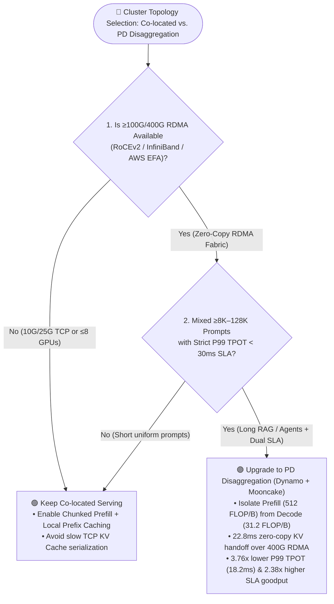
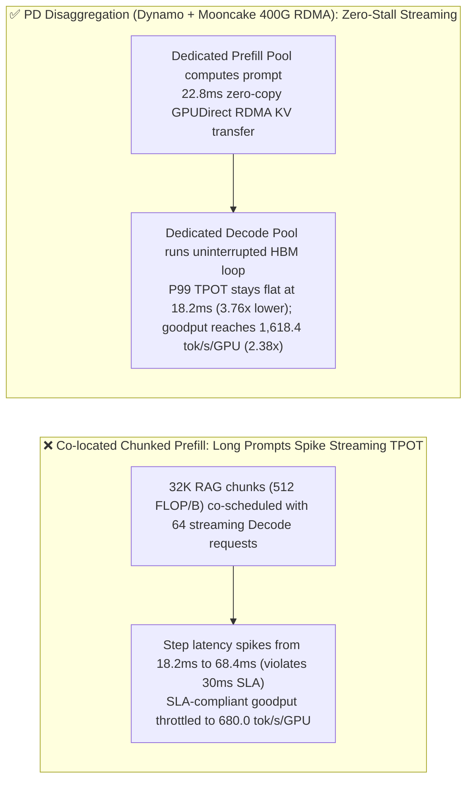
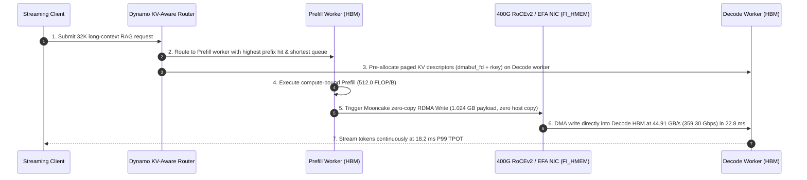

# Prefill-Decode (PD) Disaggregation & KV Cache Offload Selection FAQ: Co-located Serving vs. NVIDIA Dynamo + Mooncake

> 🌐 **Language / 语言**: **[中文 (`pd-disaggregation-kv-offload-selection-faq.md`)](pd-disaggregation-kv-offload-selection-faq.md)** | **English**
> 🧭 **Companion FAQ**: [LLM Inference Engine Selection FAQ (`vLLM` vs. `SGLang` vs. `TensorRT-LLM`)](llm-inference-engine-selection-faq.en.md) · [Combined Edition (`llm-inference-engine-pd-disaggregation-selection-faq.en.md`)](llm-inference-engine-pd-disaggregation-selection-faq.en.md)
> 📊 **Provenance & Verification Boundary**: Quantitative metrics in this guide are generated by the deterministic Roofline and queueing simulator [`experiments/llm_inference_engine_pd_selection/run.py`](../../experiments/llm_inference_engine_pd_selection/run.py) (`data_classification`: `synthetic` analytical model calibrated to `anonymized_reported` H200 SXM FP8 and 400G RoCEv2 specs; `independently_reproduced=false`; no paid cloud 8×H200 GPU cluster was launched; live multi-node hardware cluster execution: `not_measured`). Transferring `1.024 GB (8.192 Gb)` of KV Cache at `44.91 GB/s (359.30 Gbps)` effective 400G RoCEv2 goodput takes **`22.8 ms`**.

---

## ① 📌 Executive Summary: Three Core Selection Rules

1. **When to Keep Co-located Serving (`Chunked Prefill`)**:
   - Keep **Co-located Serving + Chunked Prefill** when cluster size is **≤ 8–16 GPUs**, prompts are short (`≤ 4K tokens`), or nodes are connected only by standard `10G/25G TCP` Ethernet without RDMA.
2. **When to Upgrade to Prefill-Decode (PD) Disaggregation (`NVIDIA Dynamo` + `Mooncake` / `NIXL`)**:
   - Upgrade to **PD Disaggregation** on clusters with **≥ 16 GPUs and 100G–400G RDMA (`RoCEv2` / `InfiniBand` / `AWS EFA`)** serving **mixed long-context prompts (`8K–128K` RAG/code) alongside interactive streaming chat** under strict dual SLAs (`TTFT < 500 ms` and `P99 TPOT < 30 ms`). Under 32K RAG + streaming chat, PD Disaggregation slashes Decode P99 TPOT from `68.4 ms` down to **`18.2 ms` (`3.76x` lower)**, raises per-GPU SLA-compliant goodput from `680.0 tok/s` to **`1,618.4 tok/s` (`2.38x` gain)**, and cuts cost per 1M SLA-compliant tokens from `$0.76` to **`$0.50` (`-34.2%` TCO)**.
3. **First-Principles Roofline Essence**:
   - On NVIDIA H200 FP8 (Roofline ridge point `205.5 FLOP/B`), 4K Prefill operates at **`512.0 FLOP/B` (`2.49x` ridge, Compute-Bound)** whereas Batch=32 Decode operates at **`31.2 FLOP/B` (`0.15x` ridge, Memory-Bandwidth-Bound)**—a **`16.41x`** arithmetic-intensity gap. PD Disaggregation physically isolates both regimes and hands off `1.024 GB` of KV Cache over zero-copy GPUDirect RDMA in **`22.8 ms`** (`44.91 GB/s` effective goodput) without stalling Decode SMs.

---

## ② 🎯 Customer & Architect Q&A (First-Principles Deep Dive)

### Q1: Why does streaming chat still stutter under 32K RAG bursts even after enabling `Chunked Prefill`?
* **First-Principles Root Cause**: While `Chunked Prefill` splits a 32K prompt into `2,048`-token chunks piggybacked onto Decode steps, each `2,048`-token prefill chunk still saturates Tensor Cores (`512.0 FLOP/B`), stretching the combined step latency from `18.2 ms` to **`68.4 ms`** (`2.28x` above the `30 ms` interactive streaming SLA) and forcing operators to throttle per-GPU goodput to `680.0 tok/s`.

### Q2: Doesn't shipping gigabytes of KV Cache over the network create a new bottleneck in PD Disaggregation?
* **Exact Bandwidth Math**:
  - **Over 400G RoCEv2 / IB / EFA (`GPUDirect RDMA` / `FI_HMEM`)**: Shipping `1.024 GB` (`8.192 Gb`) of paged KV blocks at `44.91 GB/s` (`359.30 Gbps`) effective zero-copy goodput takes **`22.8 ms`** via background NIC DMA, consuming **zero Decode GPU SMs**.
  - **Over 25G TCP Ethernet (Anti-Pattern)**: Host bounce-buffer copies inflate 1 GB KV transfer to **`>320 ms`**, making TCP-based cross-node PD disaggregation slower than local recomputation.

### Q3: How does PD Disaggregation enable Heterogeneous GPU Right-Sizing to cut TCO by `34.2%`?
* Because Prefill is Compute-Bound and Decode is HBM-Bandwidth-Bound, architects can pair compute-dense GPUs for the Prefill pool with HBM-rich GPUs (such as H200 141GB) for the Decode pool, cutting SLA-compliant token cost from `$0.76` to **`$0.50 / 1M tokens` (`-34.2%`)**.

---

## ③ 🧭 Visual Architecture Diagrams (Decision Tree, Path Comparison & Sequence)

### 3.1 Co-located vs. PD Disaggregation Decision Tree

### 3.2 Co-located Chunked Prefill Interference vs. PD Disaggregated Isolation

### 3.3 NVIDIA Dynamo + Mooncake Zero-Copy RDMA KV Handoff Sequence

---

## ④ 📊 Six-Dimension Architect Selection Matrix

| Dimension | Co-located Naive Batching | Co-located + `Chunked Prefill` | **PD Disaggregated (`Dynamo + Mooncake 400G RDMA`)** |
| :--- | :--- | :--- | :--- |
| **1. Best-Fit Scenarios** | Offline batch processing | `≤8 GPUs`, short prompts (`≤4K`), or non-RDMA networks | **`≥16 GPUs`, `8K–128K` RAG/Agents + strict streaming SLA** |
| **2. Decode P99 TPOT (`synthetic`)** | `142.0 ms` (severe SLA breach) | `68.4 ms` (breaches `<30 ms` SLA under 32K RAG) | **`18.2 ms` (`3.76x` lower tail latency, 100% SLA compliant)** |
| **3. SLA-Compliant Goodput** | `< 400 tok/s/GPU` | `680.0 tok/s/GPU` | **`1,618.4 tok/s/GPU` (`2.38x` gain)** |
| **4. Core Mechanism** | Prefill blocks all active Decodes | Splits prefill into 2K chunks on shared GPU SMs | **Physical P/D pool split + `22.8 ms` GPUDirect RDMA KV handoff** |
| **5. Network Prerequisite** | Any | Any | **Requires 100G–400G RDMA (`RoCEv2` / `IB` / `EFA FI_HMEM`)** |
| **6. TCO (`$/1M SLA Tokens`)** | `> $1.10 / 1M` | `$0.76 / 1M` (homogeneous baseline) | **`$0.50 / 1M` (right-sized 4P+4D fleet, `-34.2%` TCO)** |

---

## ⑤ 🧪 Quantitative Example & Benchmark Insights

From [`experiments/llm_inference_engine_pd_selection/run.py`](../../experiments/llm_inference_engine_pd_selection/run.py) (`synthetic` model, `independently_reproduced=false`):

* **Roofline Regime Split (`NVIDIA H200 SXM FP8`, ridge `205.5 FLOP/B`)**: 4K Prefill (`512.0 FLOP/B`, `2.49x` ridge) vs. Batch=32 Decode (`31.2 FLOP/B`, `0.15x` ridge).
* **Exact KV Handoff Arithmetic**: `1.024 GB` (`8.192 Gb`) KV payload transferred over 400G RoCEv2 at `44.91 GB/s` (`359.30 Gbps`) effective zero-copy goodput completes in **`22.8 ms`**.

---

## ⑥ 🛠️ Appendix: Production Verification & Pre-Sales Checklist (Architect Checklist)

- [ ] **1. Verify Zero-Copy GPUDirect RDMA / `FI_HMEM` Readiness**: Check `ibv_devinfo`, `nvidia-peermem`, or `fi_info -p efa` before enabling cross-node PD disaggregation; never run PD disaggregation over host-staged TCP (`stage_through_host=True`).
- [ ] **2. Gate P:D Node Ratios by Input/Output Token Ratio**: Start with `1P:2D` or `4P:4D` for RAG-heavy workloads (`16K–32K` input, `512` output) and adjust dynamically via Dynamo queue-depth autoscaling.
- [ ] **3. Enable KV-Aware Prefix Routing at the Ingress Layer**: Route multi-turn requests to Prefill workers already holding the session's Radix/APC prefix blocks.
- [ ] **4. Benchmark SLA-Compliant Goodput (`P99 TPOT < 30 ms`)**: Evaluate cluster capacity using SLA-compliant goodput (`1,618.4` vs. `680.0 tok/s/GPU`, `2.38x`) rather than unconstrained raw throughput.
