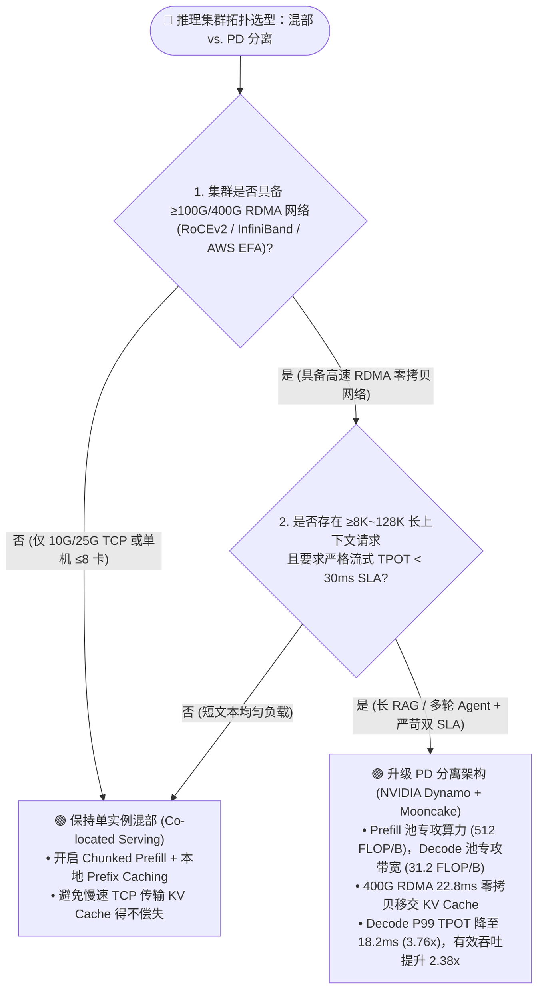
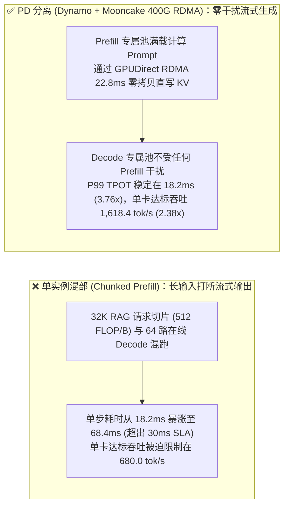
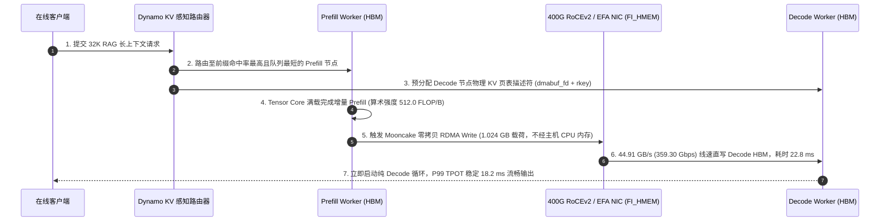

# 大模型 Prefill-Decode (PD) 分离与 KV Cache 卸载选型 FAQ 指南：单实例混部 vs. NVIDIA Dynamo + Mooncake

> 🌐 **Language / 语言**: **中文 (Chinese)** | **[English (`pd-disaggregation-kv-offload-selection-faq.en.md`)](pd-disaggregation-kv-offload-selection-faq.en.md)**
> 🧭 **姊妹专题 (Companion FAQ)**: [大模型推理引擎选型 FAQ (`vLLM` vs `SGLang` vs `TensorRT-LLM`)](llm-inference-engine-selection-faq.md) · [综合合订版 (`llm-inference-engine-pd-disaggregation-selection-faq.md`)](llm-inference-engine-pd-disaggregation-selection-faq.md)
> 📊 **数据溯源与复现边界 (Provenance)**: 文中定量结果来自本仓库确定性 Roofline 与排队论仿真器 [`experiments/llm_inference_engine_pd_selection/run.py`](../../experiments/llm_inference_engine_pd_selection/run.py)（分类：`synthetic` 理论/系统算例 + `anonymized_reported` H200 SXM FP8 与 400G RoCEv2 公开参数；`independently_reproduced=false`；未启动付费云上 8×H200 物理实机集群，物理集群实测状态：`not_measured`）。其中 `1.024 GB (8.192 Gb)` KV Cache 在 `400G RoCEv2` 实效带宽 `44.91 GB/s (359.30 Gbps)` 下跨节点零拷贝传输耗时严格为 **`22.8 ms`**。

---

## ① 📌 核心结论速览（Executive Summary）

1. **何时保持“单实例混部（Co-located Serving + Chunked Prefill）”**：
   - 当集群规模 **≤ 8～16 卡**、平均输入较短（`≤ 4K tokens`）、或者机间只有普通 `10G/25G TCP` 以太网而**没有 RDMA 高速网络**时，保持单实例混部并开启分块预填充（`Chunked Prefill`）运维最简单、性价比最高。
2. **何时必须升级为“Prefill-Decode (PD) 分离架构（`NVIDIA Dynamo` + `Mooncake` / `NIXL`）”**：
   - 当集群规模 **≥ 16 卡（配备 100G～400G RoCEv2 / InfiniBand / EFA RDMA）**、业务面临 **长上下文输入（`8K～128K` RAG/代码库）与实时流式对话混合**、且必须同时守住 **`TTFT < 500 ms` 与流式打字 `P99 TPOT < 30 ms`** 双重 SLA 时，必须采用 PD 分离。在 32K RAG + 流式对话混合负载下，PD 分离将 Decode P99 TPOT 从混部的 `68.4 ms` 压降至 **`18.2 ms`（降低 `3.76x`）**，单卡 SLA 达标有效吞吐从 `680.0 tok/s` 跃升至 **`1,618.4 tok/s`（提升 `2.38x`）**，并通过异构 P/D 配比将单百万达标 Token 成本从 `$0.76` 降至 **`$0.50`（节省 `34.2%`）**。
3. **第一性原理核心机制（为什么 Prefill 与 Decode 水火不容）**：
   - 在 H200 FP8（屋脊线拐点 `205.5 FLOP/B`）上，4K Prefill 的算术强度高达 **`512.0 FLOP/B`（屋脊线的 `2.49x`，严重算力受限 Compute-Bound）**，而 Batch=32 Decode 仅为 **`31.2 FLOP/B`（屋脊线的 `0.15x`，严重显存带宽受限 Memory-Bandwidth-Bound）**。同机混部时，长 Prefill 会强行抢占 SM 算力导致正在流式打字的 Decode 请求严重卡顿；PD 分离通过 **GPUDirect RDMA 零拷贝**（`1.024 GB` KV 载荷在 `44.91 GB/s` 实效带宽下仅耗时 **`22.8 ms`**）彻底隔离两类负载。

---

## ② 🎯 客户与架构师灵魂拷问 Q&A（FAQ-Driven）

### Q1：我们已经开了 vLLM / SGLang 的分块预填充（Chunked Prefill），为什么 32K RAG 混部时用户还是抱怨打字一卡一卡的？
* **第一性原理剖析**：Chunked Prefill 虽然把 32K Prompt 切成多个 `2,048` Token 的切片塞进每一轮 Decode 步中，但每个 `2,048` 切片的矩阵计算量依然高达 `512.0 FLOP/B`，直接把原本只需 `18.2 ms` 的纯 Decode 步拉长到 **`68.4 ms`**（超出 `30 ms` 流式 SLA 达 `2.28x`）。为了不违约，架构师只能被迫把单卡并发压低到 `680 tok/s`。

### Q2：PD 分离要把上百兆甚至上 GB 的 KV Cache 通过网络传给 Decode 节点，网络传输不会成为新的瓶颈吗？
* **定量算账（何时划算、何时亏本）**：
  - **在 400G RoCEv2 / IB (`GPUDirect RDMA` / `libfabric FI_HMEM`) 上**：传输 `1.024 GB`（`8.192 Gb`）分页 KV Cache，按 `44.91 GB/s`（`359.30 Gbps`）实效零拷贝带宽计算，耗时仅 **`22.8 ms`**，且由网卡 DMA 引擎在后台异步完成，**完全不占用 Decode GPU 的计算核心（SM）**。
  - **在普通 25G TCP 以太网上（反模式）**：数据需经 GPU → 主机内存 Bounce Buffer → 内核 TCP 协议栈，传输 1 GB 耗时超过 **`320 ms`**，远超本地重算开销。因此 **没有 RDMA 绝不上跨机 PD 分离**。

### Q3：如何利用 PD 分离实现“异构 GPU 混部降本（Heterogeneous Right-Sizing）”？
* 既然 Prefill 吃算力（FLOPs）、Decode 吃显存容量与带宽（HBM GB/s），架构师无需购买清一色的昂贵同构卡：可以用高算力性价比卡组成 **Prefill 池**，用大显存高带宽卡（如 H200 141GB）组成 **Decode 池**，按 `4P:4D` 弹性配比，将每百万 SLA 达标 Token 成本从同构混部的 `$0.76` 压降至 **`$0.50`（降低 `34.2%`）**。

---

## ③ 🧭 直观可视化图解（Mermaid 选型决策树 + 路径对比 + 时序图）

### 3.1 单实例混部 vs. PD 分离选型决策树

### 3.2 同机混部 Prefill 干扰阻塞 vs. PD 分离物理隔离对比图

### 3.3 NVIDIA Dynamo + Mooncake GPUDirect RDMA 零拷贝 KV 移交时序图

---

## ④ 📊 架构师选型决策矩阵（Architect Decision Matrix）

| 对比维度 | 单实例朴素混部（无分块） | 单实例混部 + `Chunked Prefill` | **PD 分离（`Dynamo + Mooncake 400G RDMA`）** |
| :--- | :--- | :--- | :--- |
| **1. 核心适用场景** | 离线批处理（无实时流式要求） | `≤8 卡`、短文本（`≤4K`）或无 RDMA 网络环境 | **`≥16 卡`、`8K～128K` 长上下文 RAG/Agent + 严苛流式 SLA** |
| **2. Decode P99 TPOT (`synthetic`)** | `142.0 ms`（严重卡顿违约） | `68.4 ms`（32K 混部下仍违背 `<30 ms` SLA） | **`18.2 ms`（较分块混部降低 `3.76x`，100% 达标）** |
| **3. 单卡 SLA 有效吞吐** | `< 400 tok/s/GPU` | `680.0 tok/s/GPU` | **`1,618.4 tok/s/GPU`（提升 `2.38x`）** |
| **4. 底层核心机制** | Prefill 独占阻塞全部 Decode | 切分为 2K 小块穿插执行，但仍争抢同一张卡 SM | **物理拆分 P/D 池 + GPUDirect RDMA `22.8 ms` 零拷贝 KV 移交** |
| **5. 硬件与网络前提** | 任意单卡或多卡 | 任意单卡或多卡 | **必须具备 100G～400G RDMA（RoCEv2 / IB / EFA `FI_HMEM`）** |
| **6. 综合 TCO (`$/1M SLA Tokens`)** | `> $1.10 / 1M` | `$0.76 / 1M`（同构混部基线） | **`$0.50 / 1M`（右配比异构 P/D 池，节省 `34.2%`）** |

---

## ⑤ 🧪 简明定量算例与 Benchmark 洞察

基于 [`experiments/llm_inference_engine_pd_selection/run.py`](../../experiments/llm_inference_engine_pd_selection/run.py) 封存算例（`synthetic` 仿真，`independently_reproduced=false`）：

* **屋脊线物理鸿沟（H200 SXM FP8 拐点 `205.5 FLOP/B`）**：4K Prefill 算术强度为 **`512.0 FLOP/B`（屋脊线的 `2.49x`）**，而 Batch=32 Decode 仅为 **`31.2 FLOP/B`（屋脊线的 `0.15x`）**，两者存在 **`16.41x`** 的计算访存比代差。
* **KV 传输带宽精确核算**：`1.024 GB`（`8.192 Gb`）增量 KV Cache 在 400G RoCEv2 实效带宽 `44.91 GB/s`（`359.30 Gbps`）下零拷贝传输耗时 **`22.8 ms`**（若退化回主机内存 TCP 拷贝则暴涨至 `>320 ms`）。

---

## ⑥ 🛠️ 附录：生产环境快速核验与售前打单清单（Architect Checklist）

- [ ] **1. 核验 RDMA 零拷贝就绪状态**：执行 `ibv_devinfo` 与 `lsmod | grep peermem`（或 AWS EFA `fi_info -p efa`），确认 GPUDirect RDMA / `FI_HMEM_CUDA` 处于激活状态，严禁在 `stage_through_host=True` 慢路径下开启跨机 PD 分离。
- [ ] **2. 区分客户双 SLA 阈值**：明确收集客户对首字延迟（如 `P95 TTFT < 500 ms`）与流式打字延迟（如 `P99 TPOT < 30 ms`）的独立要求，以此决定 P:D 节点配比（长输入重负载选 `2P:2D` 或 `3P:5D`，长输出重负载选 `1P:3D`）。
- [ ] **3. 开启 KV 感知智能路由（KV-Aware Routing）**：在 NVIDIA Dynamo / Mooncake 前端开启前缀感知路由，避免同一会话多轮请求在不同 Prefill 节点间重复传输 KV Cache。
- [ ] **4. 压测对比 `SLA Goodput` 而非单纯总吞吐**：验收时只统计满足 `P99 TPOT < 30 ms` 约束下的有效吞吐（Goodput），向客户直观展示 `2.38x` 的达标容量提升与 `34.2%` 的 TCO 节省。
