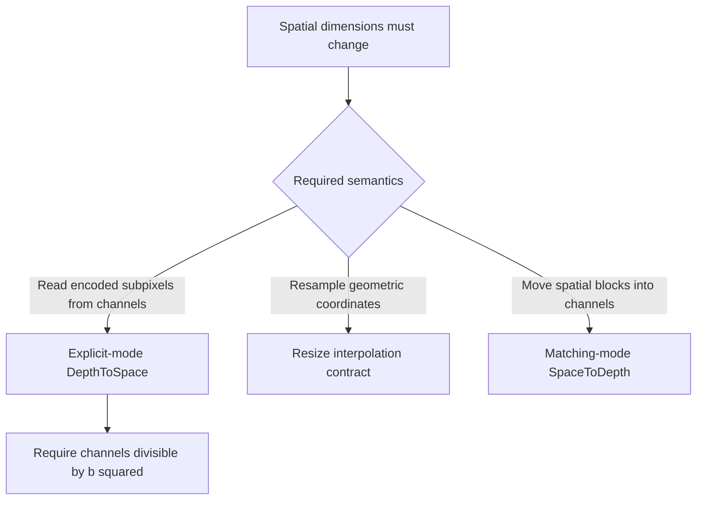
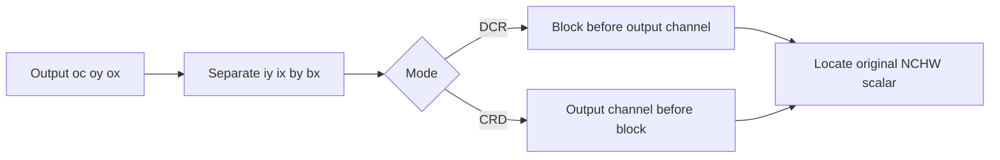
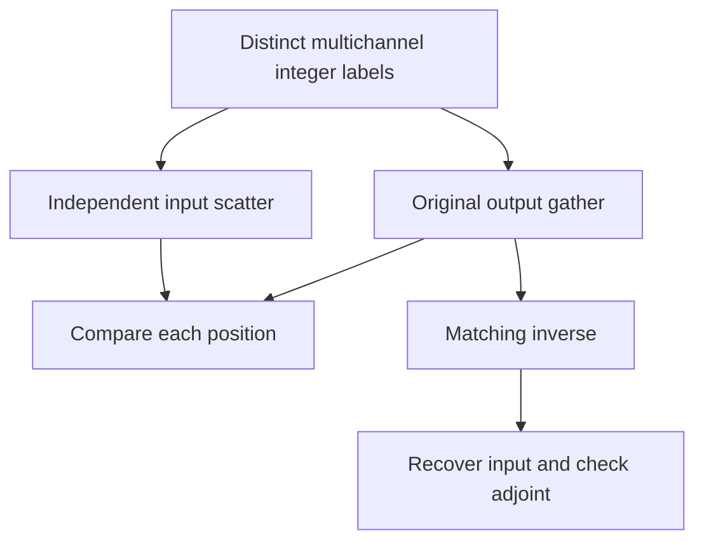

# AI Infra tensor-rearrangement FAQ: PixelShuffle, DepthToSpace/SpaceToDepth and DCR/CRD

> **Language**: English | [中文](pixel-shuffle-depth-space-dcr-crd-layout-selection-faq.md)  
> **Round 138 · 2026-11-14 daytime**: subpixel paths in visual generation/superresolution, reversible spatial rearrangement and export contracts.  
> **Related**: [Resize coordinate contracts](resize-integer-size-half-pixel-align-corners-selection-faq.en.md) · [Roaring container identity](roaring-array-bitset-run-container-payload-selection-faq.en.md)

**Executive finding:** PixelShuffle is a **coordinate permutation**, not Resize interpolation. DCR and CRD have equal output shapes but different channel/block order. With original input `[1,8,1,2]`, blocksize2 and labels `0..15`, both outputs have shape `[1,2,2,4]`, yet only **4/16** labels match by position. The pinned PyTorch TorchScript opset11 exporter explicitly selects CRD; omitting it silently selects ONNX's different default DCR.

**Artifacts**: [coordinate workbench](../reports/pixel-shuffle-depth-space-dcr-crd-layout-sizer.html) · [seven cards](../reports/pixel-shuffle-depth-space-dcr-crd-layout-selection-cards.html) · [1600px SVG](../../assets/svg/pixel-shuffle-depth-space-dcr-crd-layout-selection-faq-summary.svg) · [sealed report](../../experiments/pixel_shuffle_layout_selection/report.json)

## Q1: When should PixelShuffle replace—or not replace—Resize/interpolation?

Use DepthToSpace/PixelShuffle when an upstream layer has already encoded subpixel positions in channels and those values need exact spatial relocation. Spatial dimensions grow by `b`, channels shrink by `b²`, and element count stays unchanged. The operator itself does not create information or compute bilinear weights. Image quality depends on the trained model, not correct permutation alone.



Equal shape does not establish equivalent exports. Both models can pass dimensional validation and allocate the same number of elements while sending different feature channels to a pixel. Use labeled, multi-output-channel fixtures to expose this.

## Q2: What exact source-index difference distinguishes DCR and CRD?

Output coordinate `(batch,oc,oy,ox)` maps to original spatial location `(iy,ix)`, with `(iy,by)=divmod(oy,b)` and `(ix,bx)=divmod(ox,b)`. Let output channels be `Co=Cin/b²`:

| Mode | Original input channel |
| :--- | :--- |
| DCR | `(by*b+bx)*Co+oc` |
| CRD | `oc*b*b+by*b+bx` |

These formulas change how block position and output channel combine. The original gather computes input flat indices from output flat indices. An independent oracle instead enumerates each input channel, separates `oc/by/bx` and scatters to the output without calling the gather.



The original model accepts positive bounded NCHW dimensions and exact scalar integers. It does not simulate arbitrary leading batch axes, empty dimensions, native strides/channels-last or actual floating dtypes. Mathematical coordinates do not establish native support for every tensor case.

## Q3: How can a tiny test hide or expose a layout bug?

Default input channels contain `[0,1]`, `[2,3]` … `[14,15]`. Flattened CRD output is `[0,2,1,3,4,6,5,7,8,10,9,11,12,14,13,15]`; DCR is `[0,4,1,5,8,12,9,13,2,6,3,7,10,14,11,15]`. Only four positions match despite identical shape.

Testing only `Cin=4,b=2` leaves one output channel, where both modes coincide. Such a passing case cannot replace multi-channel coverage. Constant input values can also hide a wrong permutation; this fixture intentionally labels every coordinate differently.

The matching-mode original inverse recovers all 16 labels. For permutation matrix `P`, adjoint `Pᵀ=P⁻¹`; our integer fixture satisfies `<Px,g>=<x,P⁻¹g>=1356`. This checks scalar mathematics, not PyTorch autograd/native execution.



The model does not interpolate or round away a wrong mode. A mismatched inverse preserves element count but fails to recover ordering. Fix the export/layout contract instead of treating this as numeric tolerance.

## Q4: What do ONNX opsets and the PyTorch exporter actually require?

The actual pinned PyTorch TorchScript `pixel_shuffle` exporter emits `DepthToSpace(blocksize=...,mode="CRD")` in its opset11 path and restricts that path to four dimensions. This is a statement about **that fixed exporter path**, not every Dynamo/exporter/backend.

The actual ONNX schema and reference default DepthToSpace to DCR. **SpaceToDepth opset28** added CRD mode, and both operators received context-dependent function bodies in a **2026-08-31** capability change—not a November invention. Pinned shape inference also checks DepthToSpace channel divisibility and SpaceToDepth spatial divisibility.

| Direct single-op SpaceToDepth target | DCR | CRD |
| :--- | :--- | :--- |
| opset27 | Existing default supported | Cannot directly preserve CRD |
| opset28 | Explicit mode supported | Explicit mode supported |

The source's 28→27 converter removes a mode attribute only when it is DCR; upstream tests explicitly reject CRD downgrade. Our original gate models that direct-op contract without executing the converter. **Explicit Reshape→Transpose→Reshape lowering may represent CRD in older opsets**, so rejecting direct downgrade is not mathematical impossibility.

## Q5: Does rearrangement mean zero FLOPs or zero copy, and how should budgets be read?

No interpolation multiply-adds are needed, but coordinate work, reads, writes and layout conversion still cost something. “No interpolation” does not mean zero latency, guaranteed views or zero copy. Selecting `[1,256,128,128]`, blocksize2 and 4B scalars gives output `[1,64,256,256]`, 4194304 elements, input/output payloads 16777216B each and selected one-read-plus-one-write traffic 33554432B.

A separately retained int64 gather map would add 33554432B of logical map payload. Native kernels need not allocate it, and that is not Python-list memory. Fusion, strides, allocators, temporary buffers and native zero-copy remain unmeasured.

| Original scalar elements | Gather using retained map (ms) | Recompute map then gather (ms) |
| ---: | ---: | ---: |
| 64 | 0.002800 | 0.030133 |
| 256 | 0.011667 | 0.112200 |
| 1024 | 0.047933 | 0.460300 |
| 4096 | 0.181900 | 1.877433 |

Two warmups, seven alternating repeats, three operations per sample; medians come from sealed raw samples. The preplanned path excludes initial map construction and retains that map; the comparison computes/materializes it each call before gathering. This is a Python planning boundary, not ONNX/PyTorch kernel, GPU or fusion performance.

## Q6: How can the study be reproduced and production boundaries checked?

```powershell
python -m unittest discover -s tests -p test_pixel_shuffle_layout_selection.py -q
python -m experiments.pixel_shuffle_layout_selection.run --check
# --measure deliberately replaces original local CPU samples.
```

Eight tests cover both exact fixtures, 18 shape/mode scatter-oracle cases, bijection, inverse/adjoint, the one-output-channel trap, direct-op downgrade, divisibility/budgets, Node/Python parity and sealed timing. The interactive display is limited to 4096 elements and exposes errors. Prior browser refusal remains respected; visual browser inspection was not performed.

Sources: [pinned ONNX tensor schema](https://github.com/onnx/onnx/blob/3c41120b9c69657a1dd13407b080bd451ed06c9c/onnx/defs/tensor/defs.cc), [DepthToSpace reference](https://github.com/onnx/onnx/blob/3c41120b9c69657a1dd13407b080bd451ed06c9c/onnx/reference/ops/op_depth_to_space.py), [SpaceToDepth reference](https://github.com/onnx/onnx/blob/3c41120b9c69657a1dd13407b080bd451ed06c9c/onnx/reference/ops/op_space_to_depth.py), [Aug31 mode/function-body change](https://github.com/onnx/onnx/commit/24b862d924bf5112afb4fbfc5e886809dad004d8) and [pinned PyTorch exporter](https://github.com/pytorch/pytorch/blob/7bbc31dd45f4e43a5e3899e7e328aedfd967f2ff/torch/onnx/_internal/torchscript_exporter/symbolic_opset11.py). Read ONNX files are Apache-2.0, PyTorch BSD-style; numeric code/oracle/visuals are original rather than copied implementation.

Production needs the actual exporter path, opset, backend support, layout/strides, quantization axes and image-quality regressions. Native parity, GPU/memory and superresolution quality remain unknown/null. Provenance is `synthetic`, `independently_reproduced=false`, with original CPU samples separately `measured`; passing integer permutations does not prove model accuracy.
