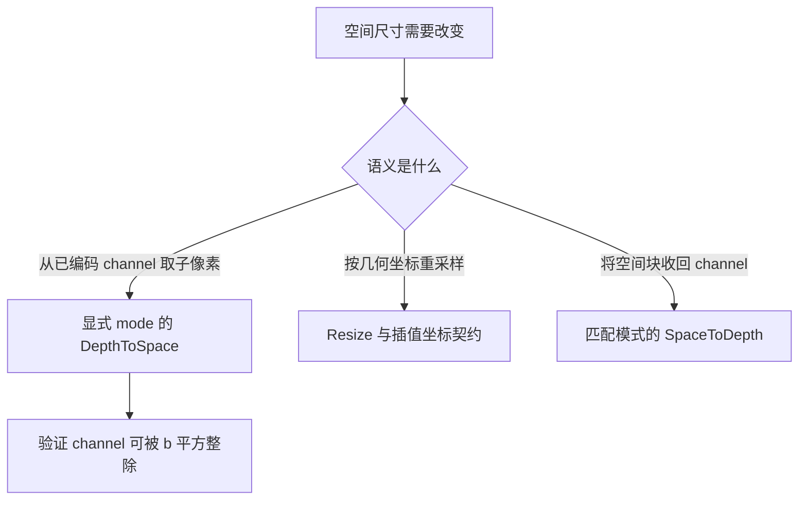
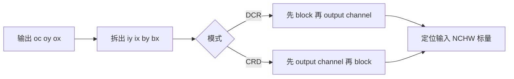
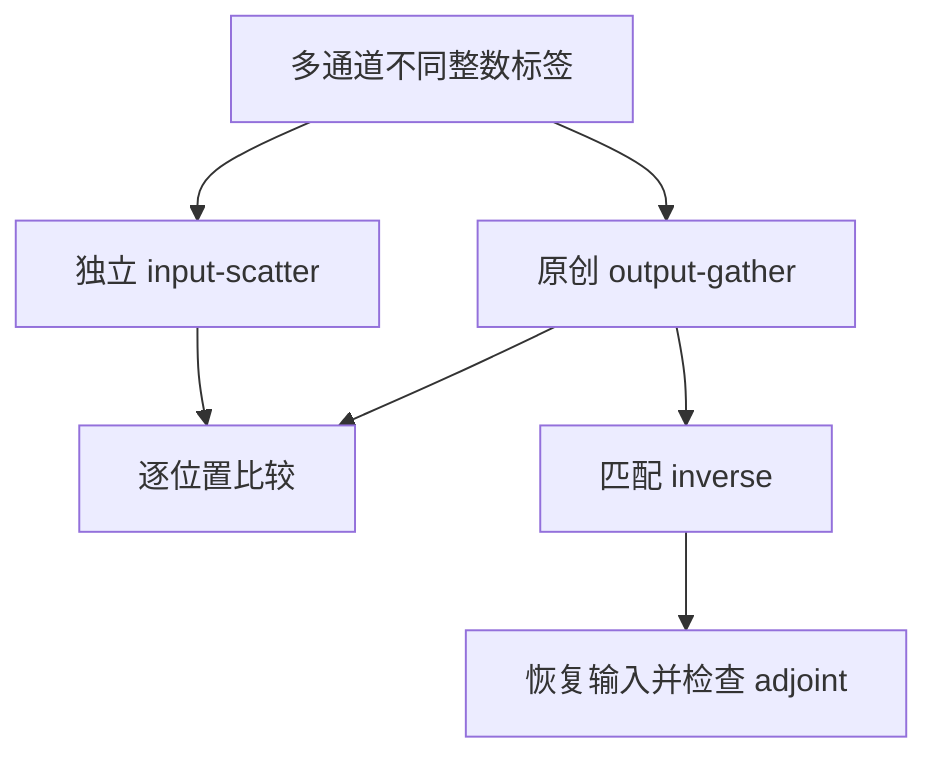

# AI Infra 张量重排选型 FAQ：PixelShuffle、DepthToSpace / SpaceToDepth 与 DCR / CRD

> **语言**：中文 | [English](pixel-shuffle-depth-space-dcr-crd-layout-selection-faq.en.md)  
> **Round 138 · 2026-11-14 白班**：视觉生成/超分辨率子像素路径、可逆空间重排与模型导出契约。  
> **关联**：[Resize 坐标原理](resize-integer-size-half-pixel-align-corners-selection-faq.md) · [Roaring 容器身份](roaring-array-bitset-run-container-payload-selection-faq.md)

**结论速览**：PixelShuffle 是**坐标置换**，不是 Resize 插值。DCR 与 CRD 输出 shape 一样，但通道/块顺序不同。原创输入 `[1,8,1,2]`、blocksize=2、标签 `0..15`，两种输出都是 `[1,2,2,4]`，却只有 **4/16** 位置标签相同。固定 PyTorch TorchScript opset11 exporter 显式选择 CRD；不能漏掉 mode 并接受 ONNX 默认 DCR。

**交付**：[H5 坐标工作台](../reports/pixel-shuffle-depth-space-dcr-crd-layout-sizer.html) · [7-Card](../reports/pixel-shuffle-depth-space-dcr-crd-layout-selection-cards.html) · [1600px SVG](../../assets/svg/pixel-shuffle-depth-space-dcr-crd-layout-selection-faq-summary.svg) · [封存数据](../../experiments/pixel_shuffle_layout_selection/report.json)

## Q1：什么时候选择 PixelShuffle，而不是 Resize / interpolation？

当上一层输出已把各个子像素位置的信息编码在 channel 维度，需要将它们精确搬到空间位置时，可使用 DepthToSpace/PixelShuffle。输出空间扩大 `b` 倍、通道缩小 `b²` 倍，元素数保持不变；这个算子本身不“生成更多信息”，也不计算双线性权重。最终图像质量依赖模型和训练，不由置换正确性保证。



不要用 shape 相同来证明两个模型导出等价。它们可能都能通过尺寸检查、分配相同数量元素，却将不同 feature channel 送入同一像素位置；这类错误要用带标签、多输出通道 fixture 检查。

## Q2：DCR / CRD 的核心索引差异是什么？

输出位置 `(batch,oc,oy,ox)` 对应原始空间 `(iy,ix)`，其中 `(iy,by)=divmod(oy,b)`、`(ix,bx)=divmod(ox,b)`。令输出通道数为 `Co=Cin/b²`：

| 模式 | 原始输入 channel |
| :--- | :--- |
| DCR | `(by*b+bx)*Co+oc` |
| CRD | `oc*b*b+by*b+bx` |

这两条公式改变 block 内位置与 channel 的组合顺序。原创 gather 从输出 flat index 计算输入 flat index；独立 oracle 反过来枚举每个 input channel，拆出 `oc/by/bx` 后 scatter 到输出，不调用 gather。



本模型只接收正整数、有界 NCHW 和确切标量整数；没有模拟任意 leading batch axes、空维度、strided/native channels-last 或实际 float dtype。数学坐标结论不能冒充全部 native 输入支持。

## Q3：为什么一个很小的测试就能隐藏或暴露布局错误？

默认输入通道依次存 `[0,1]`、`[2,3]`……`[14,15]`。CRD 输出 flatten 为 `[0,2,1,3,4,6,5,7,8,10,9,11,12,14,13,15]`；DCR 为 `[0,4,1,5,8,12,9,13,2,6,3,7,10,14,11,15]`。16 个位置仅 4 个匹配，但 shape 完全一致。

如果只测试 `Cin=4,b=2`，输出只有一个 channel，DCR 与 CRD 恰好重合。因此“一个通道样例通过”不能替代多通道测试。重复常量输入同样可能掩盖置换错位；本例特意使用各异的坐标标签。

匹配模式的原创 inverse 恢复全部 16 个输入标签。置换矩阵 `P` 的 adjoint 是 `Pᵀ=P⁻¹`；原始整数 inner-product fixture 满足 `<Px,g>=<x,P⁻¹g>=1356`。这是标量数学检查，不是 PyTorch autograd/native execution。



模型没有用插值或舍入来“修好”错误 mode。错误 inverse 的输出仍有正确元素数，但通道顺序无法恢复；应显式纠正 exporter/layout 契约，而不是把差异当数值容差。

## Q4：ONNX opset 版本与 PyTorch exporter 有什么实际约束？

实际读取固定 PyTorch TorchScript exporter 的 `pixel_shuffle`：opset11 路径生成 `DepthToSpace(blocksize=...,mode="CRD")`，且该路径明确限制 4-D 输入。这里说的是**该固定 exporter 路径**，不是所有 Dynamo/exporter/backend 自动同等行为。

实际读取 ONNX schema 和 reference：DepthToSpace 默认 DCR。SpaceToDepth 在 **opset28** 增加 CRD mode，且两算子提供 context-dependent function bodies；这次能力提交日期为 **2026-08-31**，不能称为 11 月新发明。固定 schema 还检查 DepthToSpace 的 channel 可整除性与 SpaceToDepth 的空间整除性。

| direct single-op SpaceToDepth 目标 | DCR | CRD |
| :--- | :--- | :--- |
| opset27 | 可用既有默认模式 | 不能直接保留 CRD |
| opset28 | 支持显式模式 | 支持显式模式 |

源代码 version converter 的 28→27 adapter 只移除值为 DCR 的 mode；上游测试明确检查 CRD downgrade 失败。原创 gate 复述这个 direct-op 合同，不声称本地运行 converter。**显式 Reshape→Transpose→Reshape lowering 可能在旧 opset 表达 CRD**，所以拒绝 direct downgrade 不等于数学上绝对不能转换。

## Q5：这是零 FLOP / 零拷贝吗？怎样阅读预算与 timing？

它不需要插值的乘加，但坐标计算、读取、写入与布局转换仍有成本。“不做插值”不是零延迟、零拷贝或必然 view。预算选择输入 `[1,256,128,128]`、b=2、每标量4B，输出 `[1,64,256,256]`；元素 4194304 个，input/output payload 各 16777216B，选定一次读加一次写为 33554432B。

若另保留 int64 gather map，逻辑 map payload 还需 33554432B。它不是 native kernel 必须分配的 buffer，也不代表 Python list 实际内存；融合、strides、allocator、临时空间与 native zero-copy 全未测。

| 原创标量元素数 | 保留预计算 map 后 gather（ms） | 每次重算 map 再 gather（ms） |
| ---: | ---: | ---: |
| 64 | 0.002800 | 0.030133 |
| 256 | 0.011667 | 0.112200 |
| 1024 | 0.047933 | 0.460300 |
| 4096 | 0.181900 | 1.877433 |

两次 warmup、七轮交替 repeat，每样本三操作；中位数来自原始 samples。预规划路径排除首次 map 构建而保留 map；对照每次计算并物化 map 后再生成结果。这是 Python planning 边界，不是 ONNX/PyTorch kernel、GPU 或融合收益。

## Q6：如何复现、跟踪来源并设定上线边界？

```powershell
python -m unittest discover -s tests -p test_pixel_shuffle_layout_selection.py -q
python -m experiments.pixel_shuffle_layout_selection.run --check
# --measure 仅用于主动更新本机原创 CPU samples
```

八项测试覆盖两种精确 fixture、18 组 shape/mode 输入的独立 scatter、双射、inverse/adjoint、单输出通道反例、direct-op downgrade、整除和预算、Node/Python parity 与 sealed timing。交互工作台最多展示4096元素，错误可见；此前浏览器拒绝仍受尊重，未执行视觉浏览器检查。

来源：[固定 ONNX tensor schema](https://github.com/onnx/onnx/blob/3c41120b9c69657a1dd13407b080bd451ed06c9c/onnx/defs/tensor/defs.cc)、[DepthToSpace reference](https://github.com/onnx/onnx/blob/3c41120b9c69657a1dd13407b080bd451ed06c9c/onnx/reference/ops/op_depth_to_space.py)、[SpaceToDepth reference](https://github.com/onnx/onnx/blob/3c41120b9c69657a1dd13407b080bd451ed06c9c/onnx/reference/ops/op_space_to_depth.py)、[Aug31 mode/function-body 变更](https://github.com/onnx/onnx/commit/24b862d924bf5112afb4fbfc5e886809dad004d8) 及 [固定 PyTorch exporter](https://github.com/pytorch/pytorch/blob/7bbc31dd45f4e43a5e3899e7e328aedfd967f2ff/torch/onnx/_internal/torchscript_exporter/symbolic_opset11.py)。ONNX 所读文件 Apache-2.0，PyTorch BSD-style；原创数值/代码/图未复制 upstream 实现。

生产应检查真实 exporter 路径、opset、后端支持、layout/strides、quantization axes 与图像质量回归。native parity、GPU/memory 与 superresolution quality 均未知/null。报告 `synthetic`、`independently_reproduced=false`，本地原创 CPU 记录另为 `measured`；不能把整数置换通过当模型准确率证明。
