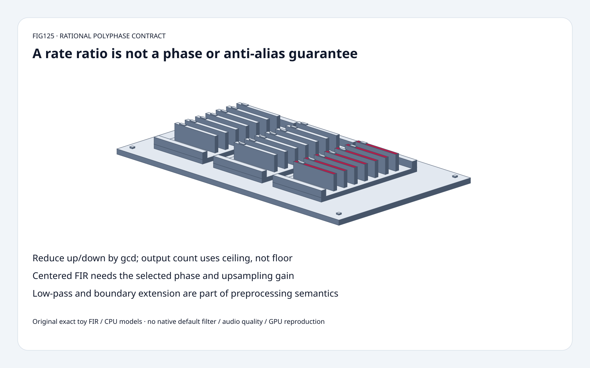
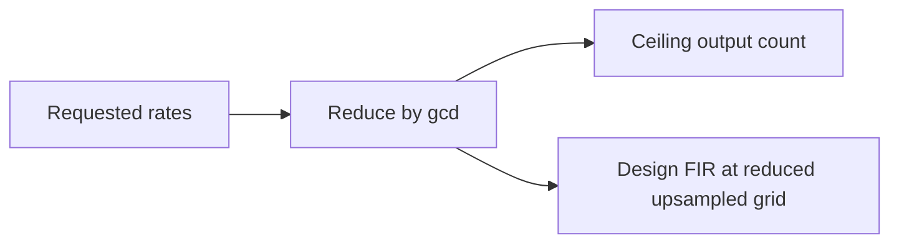
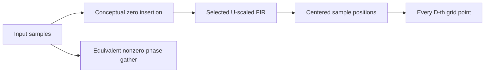
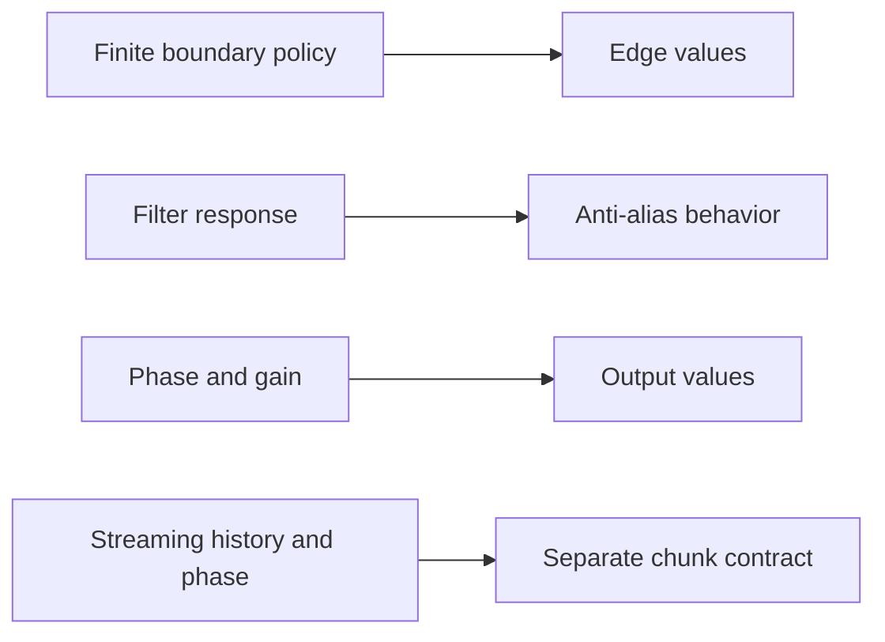

# Rational audio resampling FAQ: reduced rates, FIR phase and anti-aliasing

> **Language**: [中文](polyphase-rational-resampling-phase-antialias-selection-faq.md) | English
>
> **Round125 · 2026-11-14 · Day round2** · [SVG](../../assets/svg/polyphase-rational-resampling-phase-antialias-selection-faq-summary.svg) · [H5](../reports/polyphase-rational-resampling-phase-antialias-sizer.html) · [7 cards](../reports/polyphase-rational-resampling-phase-antialias-selection-cards.html) · [Data](../../experiments/polyphase_resampling_contract_selection/report.json)
>
> **Synthetic, `independently_reproduced=false`.** Original exact rational FIR/nonzero-phase model and independent dense zero-insertion convolution; separately measured original CPU float paths. No native SciPy, default Kaiser filter, GPU or audio-quality reproduction.



## 1. Executive summary: output rate does not certify the preprocessing contract

Selected 44,100→48,000 sample budgeting reduces `up=48000,down=44100`
to **U160/D147**, producing **48,000** output samples from 44,100 inputs.
Integer ceiling, not floor, determines finite output length.

Our five-input custom-FIR U3/D2 fixture produces **8** outputs.
A one-upsampled-grid phase shift changes **all 8/8** coordinates;
omitting the selected upsampling gain also changes all 8/8.

For alternating ±1 input, naive U1/D2 decimation aliases into constant
+1. A selected three-tap low-pass removes this fixture's **interior
squared-amplitude energy from 7 to 0** across seven samples.
This is not broadband attenuation, perceptual quality or model accuracy.

Pinned SciPy tree was updated November13; its signaltools file's
October23 change concerns empty-input lfilter/sosfilt handling.
The inspected resample_poly rules are established, not a new release claim.

## 2. Architect Q&A: what changes when the sample grid changes?

### Q1: Why reduce the ratio before choosing the upsampled grid?

Rates with a shared gcd express the same rational output sampling times.
The inspected source reduces both factors before filter design,
then computes `ceil(N*U/D)`.

Its default low-pass design uses cutoff `1/max(U,D)` relative to
the upsampled-grid Nyquist and half-length `10*max(U,D)`.
Do not size that default from unreduced 48,000 and44,100.
This source policy is not a statement that all filters must have that length.

Explicit custom FIRs are interpreted on the **reduced upsampled grid**.
A fixed filter appropriate for one ratio need not be suitable for another.
The H5 therefore separates its rate/byte budget from a small custom-FIR toy.

### Q2: Why filter before taking every D-th sample?

Downsampling folds out-of-band content into the output band.
Selecting every other value from `[1,-1,1,-1,...]` yields `[1,1,...]`,
not an anti-aliased low-frequency representation.

The original `[1/4,1/2,1/4]` centered FIR has a zero at the input
Nyquist alternating sequence. With U1/D2 and zero extension,
its first output is **1/4**, and seven remaining outputs are zero.
Energy bars exclude that first boundary sample.

A single Nyquist null is not a full stopband specification.
Do not infer arbitrary-frequency attenuation, speech quality,
WER or model-embedding preservation from this control.

### Q3: Where do centering and upsampling gain enter?

For our selected odd symmetric custom FIR:

```text
U,D = reduced positive integer rates
M = ceil(N*U/D)
center = m*D + half_filter_length
y[m] = sum_k x[k] * U*h[center-k*U]
```

Only valid input/filter indices contribute; outside input is zero.
The direct implementation visits nonzero upsampled coordinates.
An independent oracle explicitly inserts zeros, performs a full
convolution and reads the centered positions.

The inspected source scales custom FIR coefficients by reduced U
and pads/removes samples to implement centering.
Our equivalent bounded zero-extension equation does not reproduce
native dtype/array namespace/axis or other pad modes.

Five inputs `[1,2,3,4,5]`, U3/D2, h=`[1,2,3,2,1]/9`:
`[1,5/3,7/3,3,11/3,13/3,5,5/3]`.
One phase shift gives
`[4/3,2,8/3,10/3,4,14/3,10/3,0]`.
Missing U gain divides the correct outputs by3.

### Q4: Does the first output always equal the first input?

Do not assume exact equality for arbitrary custom FIRs or pad policies.
Our three-tap zero-extension decimator applied to constant-one input
starts at **3/4**, followed by seven ones.
Finite boundaries use information not available beyond the input;
changing extension changes that meaning.

SciPy supports zero/constant, line and other extension/background
modes, with different edge assumptions.
Our original model selects only zero extension.
It is not a streaming resampler: independent chunks can create fresh
edges and phase resets, so filter history and rational phase must
be carried by a separately specified streaming implementation.

### Q5: What is the identity-rate and memory contract?

At reduced U=D=1, inspected SciPy returns a copy without applying
the selected FIR; the original model follows that control.
Do not accidentally filter an identity conversion.

Selected float32 44,100 inputs and48,000 outputs imply
**176,400 input bytes** and **192,000 output bytes**.
These are logical payloads, not measured allocations or peak HBM.
Explicit inserted-zero storage is unnecessary for the direct
nonzero-phase calculation, but actual native workspace remains unmeasured.
Python exact Fraction/boxed float allocations are not float32 payloads.

## 3. Visual architecture: rational grid, FIR and boundary policy







## 4. Selection matrix: choose all preprocessing semantics together

| Choice | Good fit | Gate |
| :--- | :--- | :--- |
| Reduced rational rate | Exact output sample grid | Integer gcd and ceiling |
| FIR polyphase | Bounded local nonperiodic filtering | Filter response, gain and phase |
| Naive decimation | Already-bandlimited data under explicit contract | No automatic anti-aliasing |
| Zero extension | Explicit zero outside recorded signal | Edge transients |
| Alternative extension | Domain-appropriate edges | Deliberate native pad selection |
| Per-chunk application | Only with specified streaming state | History and rational phase continuity |

## 5. Hands-on evidence: exact convolution, phase errors and CPU work

```powershell
python -m experiments.polyphase_resampling_contract_selection.run --check
python -m unittest discover -s tests -p test_polyphase_resampling_contract_selection.py -q
```

Eight tests cover multiple rates/lengths against dense exact convolution,
gcd/ceiling/identity copies, wrong phase/gain, alias/boundary fixtures,
impulse/superposition, invalid rates/filters, Node parity and sealed medians.

| Input samples | Original nonzero-phase gather (ms) | Original dense zero insertion (ms) |
| :--- | ---: | ---: |
| 32 | 0.031167 | 0.057267 |
| 128 | 0.136567 | 0.258333 |
| 512 | 0.573867 | 1.079233 |
| 2,048 | 2.406533 | 4.300000 |

Fixed U3/D2 five taps; original Python float paths checked for equal
outputs. Two warmups, seven alternating repeats, three operations/
sample, median repeat means. Native SciPy, filter design, streaming,
GPU and quality assessment excluded.
H5 bounded integer input and exact budget checks; float display is
not the Python Fraction oracle. Browser visual inspection not performed.

## 6. Sources, provenance and readiness

- [Pinned resample_poly implementation](https://github.com/scipy/scipy/blob/30149047c624e328459a4d66d1e5f8b047b7bde7/scipy/signal/_signaltools.py): reduced ratio, length, filter/gain, centering and pad policies.
- [October23 file change](https://github.com/scipy/scipy/commit/5ccd743e5e6b752b68171c42eb42b6f83c0a3516): lfilter/sosfilt empty inputs, not a resampling invention.
- [BSD-3-Clause license](https://github.com/scipy/scipy/blob/30149047c624e328459a4d66d1e5f8b047b7bde7/LICENSE.txt): upstream rights retained.
- [Original experiment](../../experiments/polyphase_resampling_contract_selection/README.md): exact toy model, independent oracle and sealed CPU records.

No upstream implementation copied. Original odd symmetric custom FIRs
are teaching controls, not native default design or quality certification.
