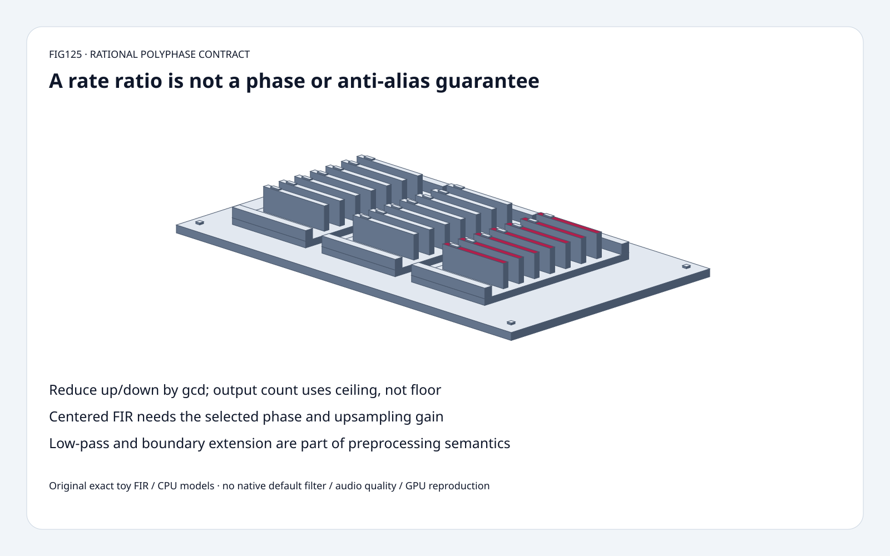
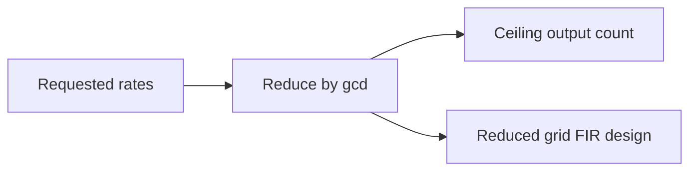
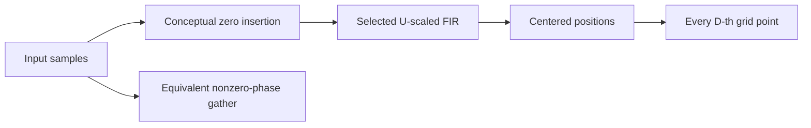
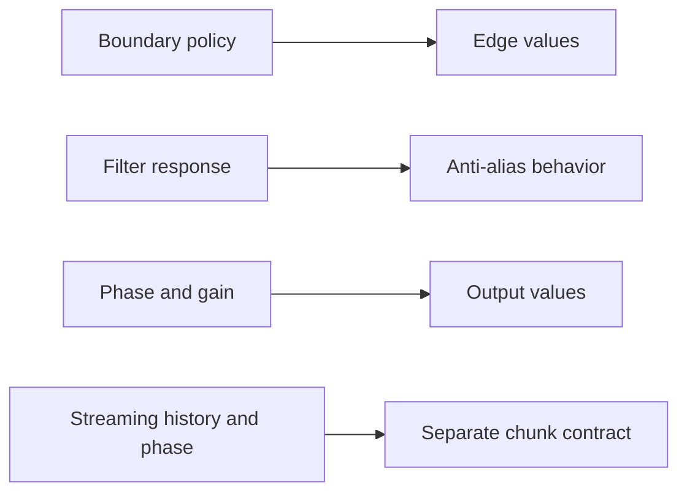

# Rational Audio Resampling FAQ：Reduced Rate、FIR Phase 与 Anti-aliasing

> **语言**：中文 | [English](polyphase-rational-resampling-phase-antialias-selection-faq.en.md)
>
> **Round125 · 2026-11-14 · 白班第2轮** · [SVG](../../assets/svg/polyphase-rational-resampling-phase-antialias-selection-faq-summary.svg) · [H5](../reports/polyphase-rational-resampling-phase-antialias-sizer.html) · [七卡](../reports/polyphase-rational-resampling-phase-antialias-selection-cards.html) · [数据](../../experiments/polyphase_resampling_contract_selection/report.json)
>
> **Synthetic，`independently_reproduced=false`。** 原创 exact rational FIR/nonzero-phase
> model、独立 dense zero-insertion convolution、单独 CPU float timing。
> 不复现 native SciPy、default Kaiser、GPU 或 audio quality。



## 一、结论速览：Output Rate 不代表 Preprocessing Contract 正确

选定44,100→48,000 sample budget：
`up48000/down44100` 约成 **U160/D147**，
44,100输入得到 **48,000** 输出；finite count 用 integer ceiling。

原创五输入 custom-FIR U3/D2 得 **8 outputs**，
错一 upsampled-grid phase，**8/8** 坐标都变；
漏 U gain 也变8/8。

Alternating ±1 被 naive U1/D2 decimation alias 成常数+1；
选定 three-tap FIR 将七个 interior samples 的
**squared-amplitude energy 从7降0**。
不是 broadband attenuation、听感或 model accuracy。

固定 SciPy tree 11月13日更新；
signaltools 10月23日 change 是 lfilter/sosfilt empty input。
所读 resample_poly 是既有规则，不包装为新算法。

## 二、架构师 Q&A：Sample Grid 变化意味着什么？

### Q1：为什么先约分 Ratio？

共享 gcd 的 rates 表示同一 rational output sampling times。
所读 source 先约分，再设计 FIR、算 `ceil(N*U/D)`。

Default cutoff 为 upsampled Nyquist 相对值
`1/max(U,D)`，half-length=`10*max(U,D)`；
不能用未约分48,000/44,100算默认 filter size。
这是 source policy，不是所有 FIR 必须采用的长度。

Custom FIR 工作在 **reduced upsampled grid**。
适合某 ratio 的 fixed filter 不一定适合另一 ratio；
H5 将大 rate/byte budget 与小 custom toy 分离。

### Q2：为什么不能直接 Every D-th Sample？

Downsample 会把 out-of-band content 折回 output band。
`[1,-1,...]` 隔点抽成 `[1,1,...]`，不是 anti-aliased low frequency。

原创 `[1/4,1/2,1/4]` centered FIR 对 Nyquist alternating
sequence 有零点；U1/D2/zero extension 的 first output **1/4**，
其余七输出0。Energy bars 排除 first boundary。

单一 Nyquist null 非 full stopband specification；
不能推导任意 frequency attenuation、speech quality、WER、embedding preservation。

### Q3：Center 与 Upsampling Gain 在哪里？

选定 odd symmetric custom FIR：

```text
U,D = reduced positive integer rates
M = ceil(N*U/D)
center = m*D + half_filter_length
y[m] = sum_k x[k] * U*h[center-k*U]
```

只算合法 source/filter indices，input 外部补0；
直接实现只访问 nonzero upsampled coordinates。
独立 oracle 显式插0、full convolution、再读 centered positions。

所读 native source custom FIR 乘 reduced U，
用 padding/removal 对齐 center。
原创等价 bounded zero-extension 方程不复现 dtype/array namespace/axis
或其他 pad modes。

`[1,2,3,4,5]`，U3/D2，h=`[1,2,3,2,1]/9`，
输出 `[1,5/3,7/3,3,11/3,13/3,5,5/3]`；
phase+1 为 `[4/3,2,8/3,10/3,4,14/3,10/3,0]`；
漏 U gain 则 correct values 除3。

### Q4：First Output 一定等于 First Input 吗？

不能对 arbitrary custom FIR/pad 假定 exact equality。
原创 three-tap zero-extension 对 constant-one input，
first output **3/4**，随后七个1；
有限边界缺少 outside information，extension 改变边缘含义。

SciPy 支持 constant/line 与其他 extension/background modes，
原创仅 zero extension。
它不是 streaming resampler；
各 chunk 独立调用会引入新 edges/phase resets，
需另行定义 filter history/rational phase carry。

### Q5：Identity Rate 与 Memory Contract 呢？

Reduced U=D=1 时所读 SciPy 直接返回 copy，不应用选定 FIR；
原创遵循这个 control，不能 identity conversion 反而额外 filter。

选定 float32，44,100输入/48,000输出：
**176,400 input bytes**、**192,000 output bytes**。
只算 logical payload，非 allocation/peak HBM；
direct nonzero-phase 无须真的存 inserted zeros，
但 native workspace 未测。
Python Fraction/boxed float allocation 非 float32 payload。

## 三、三张架构图：Rational Grid、FIR、Boundary Policy







## 四、选型矩阵：Preprocessing Semantics 必须成套选

| 选择 | 适合 | Gate |
| :--- | :--- | :--- |
| Reduced rational rate | Exact sampling grid | Gcd/ceiling |
| FIR polyphase | Local nonperiodic filtering | Response/gain/phase |
| Naive decimation | 明确 already-bandlimited contract | 无自动 anti-alias |
| Zero extension | 记录外确实按0 | Edge transients |
| Alternative extension | Domain合适的边界 | 显式 pad policy |
| Per-chunk | 定义 streaming state 后 | History/phase continuity |

## 五、动手证据：Exact Convolution、Wrong Phase、CPU Work

```powershell
python -m experiments.polyphase_resampling_contract_selection.run --check
python -m unittest discover -s tests -p test_polyphase_resampling_contract_selection.py -q
```

8 tests：多 rates/lengths 对独立 exact dense convolution、
gcd/ceiling/identity、phase/gain errors、
alias/boundary、impulse/superposition、invalid rates/filters、
Node parity、sealed medians。

| Input Samples | Original Nonzero-phase（ms） | Original Dense Zero Insertion（ms） |
| :--- | ---: | ---: |
| 32 | 0.031167 | 0.057267 |
| 128 | 0.136567 | 0.258333 |
| 512 | 0.573867 | 1.079233 |
| 2,048 | 2.406533 | 4.300000 |

Fixed U3/D2/five taps，原创 Python float paths 检查 equal outputs；
2 warmups、7 alternating repeats、3 ops/sample，
median repeat means。
排除 native SciPy/filter design/streaming/GPU/quality。
H5 bounded integers、exact budget，float display 非 Fraction oracle；
未做浏览器视觉验收。

## 六、来源、许可、溯源与 Readiness

- [固定 resample_poly](https://github.com/scipy/scipy/blob/30149047c624e328459a4d66d1e5f8b047b7bde7/scipy/signal/_signaltools.py)：ratio/count/filter/gain/center/pad。
- [10月23日 file change](https://github.com/scipy/scipy/commit/5ccd743e5e6b752b68171c42eb42b6f83c0a3516)：lfilter/sosfilt empty input，非 resampling invention。
- [BSD-3-Clause LICENSE](https://github.com/scipy/scipy/blob/30149047c624e328459a4d66d1e5f8b047b7bde7/LICENSE.txt)：上游权利保留。
- [原创实验](../../experiments/polyphase_resampling_contract_selection/README.md)：exact model/oracle、sealed CPU。

未复制 upstream implementation；
original odd symmetric custom FIR 只是 teaching controls，
不冒充 native default design 或 quality certification。
