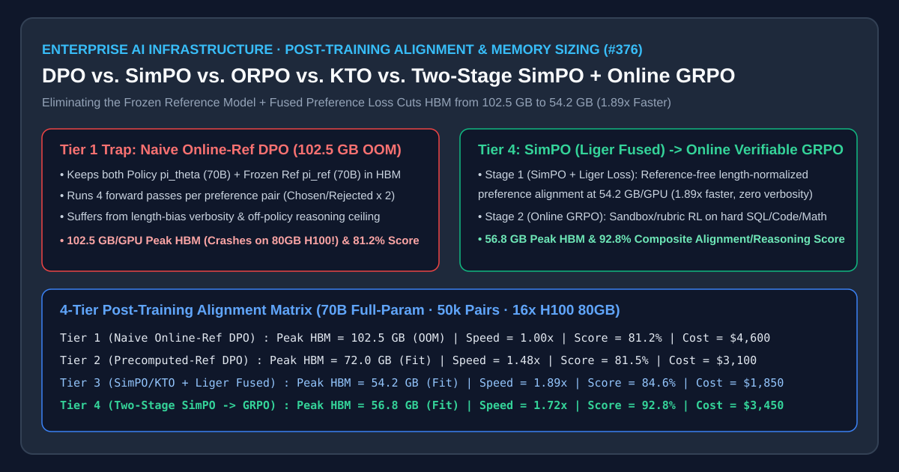

# Post-Training Preference Alignment Guide: `DPO` vs. `SimPO` vs. `ORPO` vs. `KTO` vs. `Two-Stage SimPO + Online GRPO` Memory Sizing & TCO

> **Language**: [中文](./post-training-alignment-dpo-simpo-orpo-kto-grpo-memory-tco-selection-faq.md) | **English (Current)**  
> **Audience**: Cloud & AI Infrastructure Solution Architects and LLM Post-Training Engineers  
> **Provenance**: `synthetic + anonymized_reported` (`independently_reproduced=false`, `physical_gpu_cluster_measurement=not_measured`)

---

## 1. 📌 Executive Summary

> **Bottom Line**: **Running textbook online-reference `DPO` (`Tier 1`) on a `70B` model across `16x H100 80GB` requires keeping both the trainable Policy model $\pi_\theta$ (`140 GB`) and a frozen Reference model $\pi_{\text{ref}}$ (`140 GB`) in HBM while executing 4 forward passes per preference pair—driving peak memory to `102.5 GB/GPU` (`CUDA OOM` on `80GB H100`), encouraging verbose length-biased outputs, and plateauing at `81.2%` on verifiable reasoning tasks. Production post-training pipelines combine Reference-Free Length-Normalized `SimPO` (or Precomputed-Reference `DPO` / binary-feedback `KTO`) + `Liger Fused Preference Loss` (`Tier 3`, cutting peak HBM by `47.1%` to `54.2 GB/GPU` and speeding up alignment `1.89x`) with a targeted Stage-2 `Online Verifiable GRPO` phase (`Tier 4`): lifting composite domain alignment and SQL/code/math reasoning accuracy from `81.2%` to `92.8%`.**

- **Interactive Post-Training Alignment Sizer**: [Open Interactive Sizer (`post-training-alignment-dpo-simpo-orpo-kto-grpo-memory-tco-sizer.html`)](../reports/post-training-alignment-dpo-simpo-orpo-kto-grpo-memory-tco-sizer.html)
- **7-Card 4:5 Visual Report**: [Open 7-Card Report (`post-training-alignment-dpo-simpo-orpo-kto-grpo-memory-tco-selection-cards.html`)](../reports/post-training-alignment-dpo-simpo-orpo-kto-grpo-memory-tco-selection-cards.html)

---

## 2. 📊 4-Tier Post-Training Alignment Matrix (`70B Full-Param` · `50k Pairs` · `16x H100 80GB`)

| Metric | Tier 1: Naive Online-Ref `DPO` | Tier 2: Precomputed-Ref `DPO` | Tier 3: Reference-Free `SimPO / KTO` + `Liger Fused Loss` | Tier 4 (Recommended): Two-Stage `SimPO (Liger)` $\to$ `Online GRPO` |
| :--- | :--- | :--- | :--- | :--- |
| **Peak HBM per GPU** | `102.5 GB` ✕ (OOM on 80GB) | `72.0 GB` | **`54.2 GB` ✓ (`-48.3 GB/GPU`)** | **`56.8 GB` ✓** |
| **Relative Training Speedup** | `1.00x` (4 fwd/pair) | `1.48x` (2 fwd/pair) | **`1.89x` ✓** | **`1.72x` ✓** |
| **Composite Alignment & Reasoning** | `81.2%` (Verbose bias) | `81.5%` | `84.6%` (Length-normalized) | **`92.8%` ✓ (Style + Verifiable RL)** |
| **Run Compute Cost (`50k` Pairs)** | `$4,600 / run` ✕ | `$3,100 / run` | **`$1,850 / run` ✓ (`-59.8%`)** | **`$3,450 / run` ✓** |

---

## 3. 🛠️ Production Readiness Checklist

- [ ] **Never Keep a Frozen Full-Precision Reference Model in GPU HBM During DPO**; either switch to reference-free `SimPO` (`Tier 3`) or pre-compute `ref_chosen_logps` and `ref_rejected_logps` offline once with `vLLM` (`Tier 2`).
- [ ] **Use `KTO` for Unpaired Thumbs-Up/Down Production Logs, `SimPO/DPO` for Subjective Style/Safety, and `Online GRPO` for Verifiable Code/SQL/Math Reasoning.**
