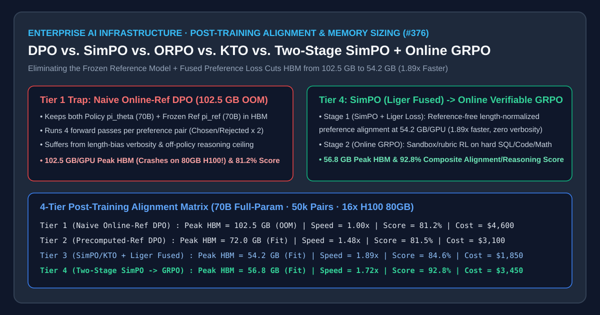
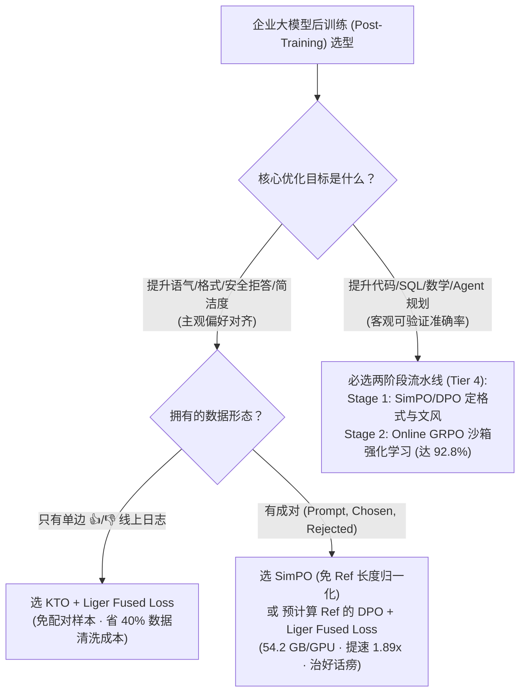

# 大模型偏好对齐与后训练（Post-Training Alignment）选型：`DPO` vs. `SimPO` vs. `ORPO` vs. `KTO` vs. `两阶段 SimPO + 在线 GRPO` 显存手算与适用场景指南

> **语言 / Language**: **中文 (当前)** | [English](./post-training-alignment-dpo-simpo-orpo-kto-grpo-memory-tco-selection-faq.en.md)  
> **定位**：面向 Cloud & AI Infrastructure Solution Architect 与后训练平台架构师的偏好对齐技术选型（`DPO`、`SimPO`、`ORPO`、`KTO` 与在线可验证强化学习 `GRPO`）、消除冻结 Reference Model `140 GB` 显存浪费与 `Liger Fused Preference Loss` 算子融合、以及破解 `DPO` 话痨偏置（Length Bias）的白皮书  
> **合规与来源声明**：`synthetic + anonymized_reported`（`independently_reproduced=false`，`physical_gpu_cluster_measurement=not_measured`；完全面向通用企业级大模型对话风格对齐、安全拒答与复杂推理后训练流水线设计）

---

## 1. 📌 核心选型结论速览（Executive Summary）

> **一句话结论**：**在 `16x H100 80GB` 上对 `70B` 大模型做全量偏好对齐（`50,000` 条 Chosen/Rejected 偏好对）时，若沿用教科书式的原生在线 `DPO`（Tier 1），必须在显存中同时常驻一份可训练的 **Policy 模型 $\pi_\theta$（`140 GB`）** 和一份冻结的 **Reference 模型 $\pi_{\text{ref}}$（又占 `140 GB`！）**，且每条样本要跑 4 次前向传播并物化两次巨大的 Logits 矩阵——导致单卡峰值显存飙至 **`102.5 GB/GPU`（在 80GB H100 上直接 OOM 崩溃）**！不仅如此，传统离线 `DPO` 对数概率直接按长度求和，会导致模型染上严重的**“话痨病（Length Bias，回答越啰嗦得分越高）”**，且在 SQL/代码/数学等复杂逻辑任务上综合得分卡在 **`81.2%`**！生产环境黄金准则是采用“两阶段精细化后训练流水线（Tier 4）：第一阶段用 **免参考模型长度归一化 `SimPO`（或预计算 Reference Logprobs 的 `DPO` / 单边点赞点踩 `KTO`）+ `Liger Fused Preference Loss` 融合算子** 塑形文风、指令格式与安全边界（峰值显存从 `102.5 GB` 暴降至 **`54.2 GB/GPU`**，训练提速 **`1.89 倍`**）；第二阶段针对可验证任务（代码/SQL/数学/JSON 工具）接入 **在线 `GRPO` 沙箱强化学习**”——将领域对齐与推理综合准确率直接推升至 **`92.8%`**！**

- **交互式后训练偏好对齐（DPO / SimPO / KTO / GRPO）计算器**：[打开交互式计算器 (`post-training-alignment-dpo-simpo-orpo-kto-grpo-memory-tco-sizer.html`)](../reports/post-training-alignment-dpo-simpo-orpo-kto-grpo-memory-tco-sizer.html)
- **7-Card 4:5 视觉评测报告**：[打开 7-Card 报告 (`post-training-alignment-dpo-simpo-orpo-kto-grpo-memory-tco-selection-cards.html`)](../reports/post-training-alignment-dpo-simpo-orpo-kto-grpo-memory-tco-selection-cards.html)

---

## 2. 🎯 客户与架构师灵魂拷问 Q&A（Deep-Dive Architecture FAQ）

### Q1：`DPO`、`SimPO`、`ORPO`、`KTO`、`GRPO` 五种缩写看得眼花缭乱，企业架构师到底该按什么数据形态和业务目标做选型？
请熟记这张**企业后训练算法拍板速查表**：
1. **只有线上用户单边点击的“👍 点赞 / 👎 点踩”日志，凑不出成对的 `(Prompt, 好回答 Chosen, 坏回答 Rejected)`？**
   - **必选 `KTO (Kahneman-Tversky Optimization)`**：无需构造配对样本，直接吃进单条 `(x, y, label=True/False)` 线上反馈日志即可完成对齐！
2. **算力预算极其紧张，想把 `SFT`（监督微调）和偏好对齐合并成 1 次训练跑完？**
   - **选 `ORPO (Odds Ratio Preference Optimization)`**：在标准 SFT 交叉熵损失上直接加一项 Chosen 与 Rejected 的发生比（Odds Ratio）惩罚项，免除 Reference 模型，一轮搞定 SFT+对齐。
3. **拥有高质量成对偏好数据 `(x, y_w, y_l)`，目标是优化语气、格式、客服话术、消除啰嗦话痨与安全拒答？**
   - **首选 `SimPO (Simple Preference Optimization)` + `Liger Fused Loss`（或开启 `precompute_ref_log_probs=True` 的 `DPO`）**：`SimPO` 直接用**长度平均对数概率 $\frac{\beta}{|y|} \sum \log \pi_\theta(y_t|x, y_{<t})$** 作为隐式奖励（直接与推理生成时的束搜索/采样目标对齐！），彻底砍掉冻结的 $\pi_{\text{ref}}$ 模型，省下 `30~48 GB/GPU` 显存，且生成的回答精炼干脆、绝不凑字数！
4. **目标是提升多步复杂逻辑（Text-to-SQL、代码生成、数学计算、多跳工具调用）？**
   - **离线 `DPO / SimPO` 天花板有限（仅 `81.2%~84.6%`），必须在第二阶段上在线 `GRPO`（Group Relative Policy Optimization）**：让模型自己实时采样 $G=8$ 条思维链轨迹并交由沙箱/编译器打分，才能学会自我纠错与深层推理（跃升至 **`92.8%`**）！

---

## 3. 🧭 直观可视化图解（Mermaid 企业大模型后训练五种范式选型决策树）

---

## 4. 📊 架构师四级后训练对齐架构选型矩阵（`70B` 全参对齐 · `50,000` 偏好对 · `16x H100 80GB`）

| 评估维度 | Tier 1：原生在线 `DPO`（双 70B 驻留 HBM + 物化 Logits） | Tier 2：预计算 Reference `DPO` (`precompute_ref_log_probs`) | Tier 3：免参考模型 `SimPO / KTO` + `Liger Fused Loss` | Tier 4（推荐）：两阶段流水线（`SimPO + Liger` $\to$ 在线 `GRPO`） |
| :--- | :--- | :--- | :--- | :--- |
| **单卡峰值显存占用 (`Peak HBM`)** | `102.5 GB / 卡` ✕（80GB H100 直接 OOM） | `72.0 GB / 卡` | **`54.2 GB / 卡` ✓（省 `48.3 GB/卡`）** | **`56.8 GB / 卡` ✓** |
| **相对训练吞吐加速比 (`Speedup`)** | `1.00x`（每对跑 4 次前向） | `1.48x`（每对跑 2 次前向） | **`1.89x` ✓（免 Ref + 融合算子）** | **`1.72x` ✓** |
| **领域对齐与复杂推理综合得分** | `81.2%`（存在话痨偏置） | `81.5%` | `84.6%`（消除长度啰嗦偏置） | **`92.8%` ✓（兼得优秀文风与硬核推理）** |
| **单次完整后训练算力总成本** | `$4,600 / 次` ✕ | `$3,100 / 次` | **`$1,850 / 次` ✓（省 `59.8%`）** | **`$3,450 / 次` ✓（性价比天花板）** |

---

## 5. 🛠️ 架构评审与生产落地 Checklist

- [ ] **严禁在 `DPO` 训练期间在显存里同时塞进一份冻结的 BF16 `Reference Model`**：若必须用标准 `DPO`，要么在训练前用 `vLLM` 一次性把所有样本的 `ref_chosen_logps` 和 `ref_rejected_logps` 离线算好存入 Parquet（Tier 2），要么在 LoRA 对齐中使用 `peft` 的 `disable_adapter()` 零显存切换底座。
- [ ] **将 `Chosen` 与 `Rejected` 在 Batch 维度拼接为单次前向并启用 `LigerFusedDPO / SimPOLoss`**：避免分别启动两次小 Batch 前向内核，并彻底消灭最后一层双倍 `[B*S, V]` Logits 显存峰值。
