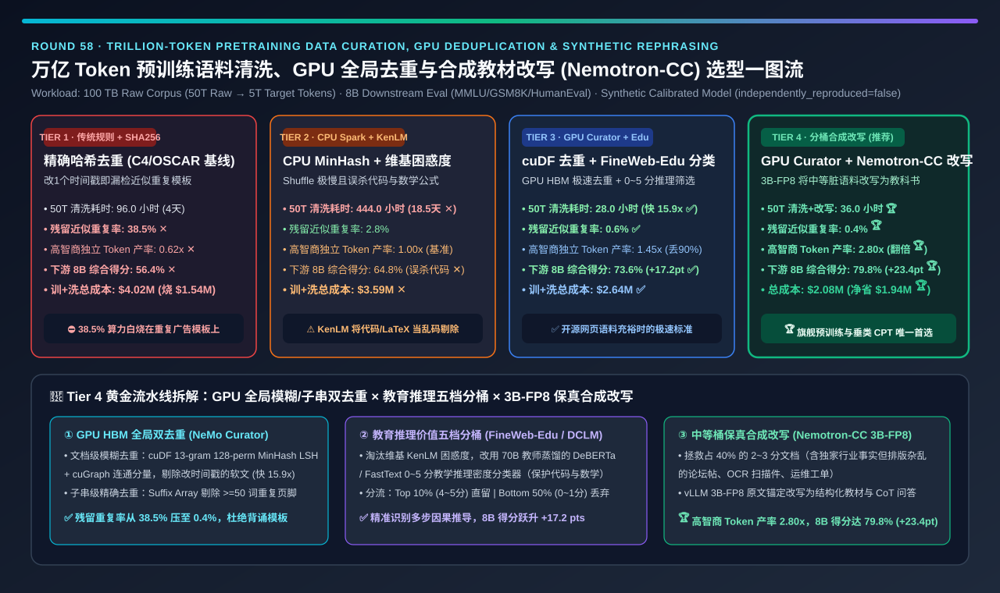
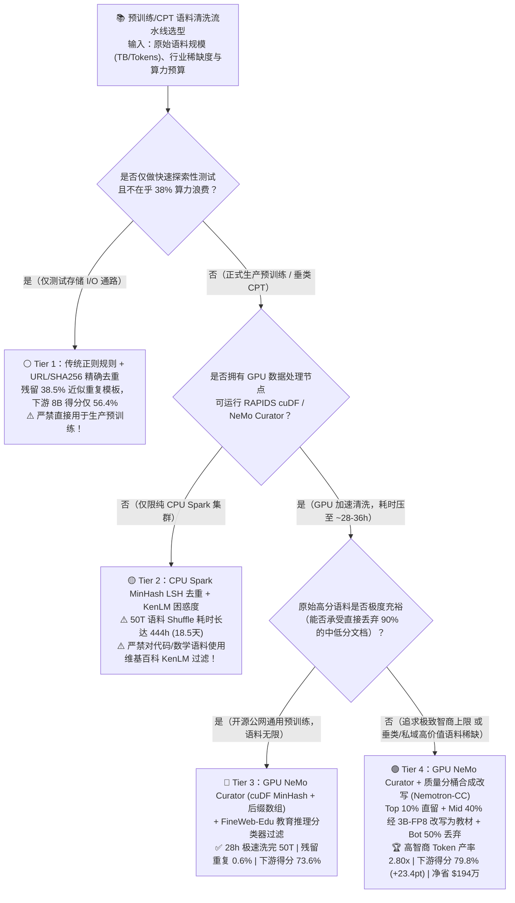
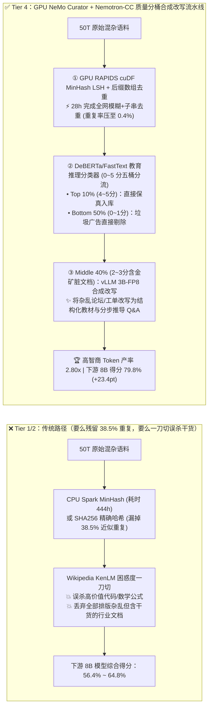
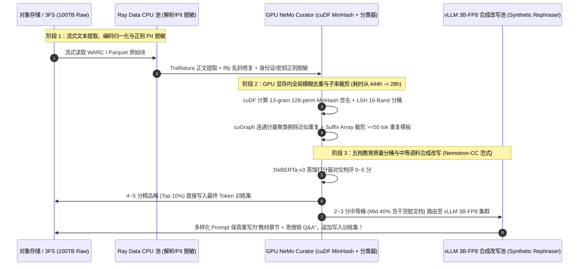

# 万亿 Token 大模型预训练语料清洗、全局去重（MinHash LSH / 后缀数组）与合成改写流水线架构选型指南（`传统规则 + URL 精确去重` vs. `CPU Spark MinHash + KenLM 困惑度过滤` vs. `GPU NeMo Curator + FineWeb-Edu 分类器` vs. `GPU Curator + 质量分桶合成改写 Nemotron-CC 范式`）

> **阅读指南（3 分钟速通 / 10 分钟白板宣讲）**：本文面向 **AI 解决方案架构师（AI Solution Architect）与大模型数据工程负责人**。用第一性原理拆解大模型预训练中最决定“模型智商上限”却最容易被忽视的数据流水线痛点——**为什么用传统的规则清洗 + SHA256 精确去重（Tier 1）洗出来的语料里依然残留高达 `38.5%` 的近似重复模板垃圾，白白烧掉 `$154 万` 的 GPU 算力？为什么用 CPU Spark 跑 50 万亿 Token 的全局 MinHash LSH 去重需要整整 `18.5 天（444 小时）`，且用 Wikipedia KenLM 困惑度过滤会把最宝贵的 Python 代码和 LaTeX 数学推导当成“异常乱码”误杀掉？以及如何通过“GPU 加速 `NeMo Curator (cuDF/cuGraph)` + `FineWeb-Edu` 教育分类器 + `Nemotron-CC` 中等质量语料 3B-FP8 合成教材改写”架构，将去重提速 `15.9 倍`、高智商独立 Token 产率提升 `2.80 倍`，并让同尺寸 8B 模型的下游综合得分从 `56.4%` 飙升 `+23.4 pts` 至 `79.8%`？**

---

## ① 📌 核心结论速览（Executive Summary）

1. **为什么“Garbage In, Garbage Out”在大模型时代变成了百万美元级的算力黑洞？**：
   - 在处理 **`100 TB` 原始网页与企业私有文档（约 `50 万亿 Raw Tokens` → 提纯 `5 万亿` 精品预训练 Tokens）** 时，如果仅采用 **Tier 1（传统正则规则 + URL/全文 SHA256 精确哈希去重，如早期 C4/OSCAR）**，任何改了一个时间戳、换了页眉页脚的 SEO 营销软文、电商商品模板或爬虫镜像站都会逃过精确哈希检查！
   - 结果是洗出来的预训练语料中仍残留 **`38.5%` 的近似重复垃圾（Near-Duplicates）✕**——不仅导致训练出的 8B 模型发生严重的死记硬背（MMLU/GSM8K/HumanEval 综合得分仅 **`56.4%` ✕**），更意味着在价值 `$400 万` 的 GPU 预训练账单里，有 **`$154 万` 的 GPU 算力是在成百上千次地重复背诵同一段广告模板 ✕**！
2. **何时淘汰 CPU Spark MinHash + KenLM 困惑度（Tier 2），何时升级 GPU `NeMo Curator` + `FineWeb-Edu` 分类器（Tier 3）？**：
   - **Tier 2（CPU Spark 13-Gram MinHash LSH + Wikipedia KenLM 5-gram 困惑度过滤）的两大硬伤**：
     1. **Shuffle 慢如蜗牛**：对 50 万亿 Token 做 128 个哈希排列的全局分桶与连通分量图聚类（Connected Components），在千核 CPU Spark 集群上因海量磁盘/网络 Shuffle 需要跑 **`444 小时（18.5 天）✕`**；
     2. **KenLM 误杀代码与数学**：KenLM 衡量的是“这段话像不像维基百科的通顺散文”。而高价值的 **Python/C++ 源码、LaTeX 数学公式推导、化学分子式和金融财报表格** 在 KenLM 眼里全都是“极高困惑度的乱码”，一刀切过滤会直接把模型的数学与编程智商废掉！
   - **当原始语料充足（开源网页清洗）时，必选 Tier 3（`GPU NeMo Curator [RAPIDS cuDF MinHash + cuGraph + 后缀数组]` + `FineWeb-Edu / DCLM 教育推理价值分类器`）**：
     - 利用 GPU 高速 HBM 显存与 NVLink/RDMA 跑 MinHash LSH 和图连通分量，将 50T 语料的去重与打分时间从 `444 小时` 压缩 **`15.86 倍` 至 `28.0 小时` ✅**！
     - 用轻量级 **教育/推理密度分类器（FastText + DeBERTa-v3 蒸馏打分器，按 0～5 分评估“是否包含分步逻辑推导与教学干货”）** 替代 KenLM，使下游 8B 模型综合得分跃升 **`+17.2 pts` 至 `73.6%` ✅**！
3. **垂类数据匮乏与旗舰基座模型的终极杀手锏（Tier 4：GPU `NeMo Curator` + 质量分桶 `Nemotron-CC` 3B-FP8 合成教材改写）**：
   - **核心痛点**：Tier 3 的 `FineWeb-Edu` 分类器为了保高分，会残酷地丢弃掉底部的 **`90%` 语料**！在企业私有知识库、小语种或垂直行业（医疗/工业/法律）中，如果扔掉 90% 的文档，模型根本不够 Token 吃（Data Wall 数据枯竭）！
   - **Tier 4 破局机制（Quality-Bucketed Synthetic Rephrasing）**：将去重后的语料按分类器得分切为 5 个桶——**Top 10%（4～5 分精品）直接保留**；**Bottom 50%（0～1 分纯广告垃圾）直接丢弃**；而对 **中间 40%（2～3 分：包含宝贵行业事实但排版混乱、口语化严重的论坛帖/OCR 扫描件/工单记录）**，不丢弃！而是送入高吞吐 **`vLLM 3B/8B-FP8` 合成改写流水线（Synthetic Rephrasing）**，将其重写为结构清晰的“教科书章节、原理解析与多步推理 Q&A”！
   - **量化收益**：高智商独立有效 Token 产率相比 Tier 3 暴涨 **`1.93 倍`（达基线的 `2.80x` 🏆）**，下游 8B 模型综合准确率冲上 **`79.8%`（比 Tier 1 暴涨 `+23.4 pts` 🏆）**，且因单 Token 信息密度翻倍，达到同等精度所需的预训练 GPU 算力步数砍半，净省 **`$193.8 万` 综合总成本 🏆**！

---

## ② 🎯 客户与架构师灵魂拷问 Q&A（FAQ-Driven First Principles）

### Q1：什么是 `MinHash LSH` 模糊去重与 `Suffix Array（后缀数组）` 子串去重？为什么普通 `SHA256` 哈希去重完全抓不住网页和企业文档里的重复内容？

- **通俗大白话 + 第一性原理拆解**：
  1. **为什么全文 `SHA256 / MD5` 精确哈希（Tier 1）形同虚设？**
     - 只要两篇 5,000 字的新闻稿或企业合同里，哪怕只有 **1 个标点符号、底部的推荐阅读链接、或者顶部的时间戳（如 `2026-11-11` vs `2026-11-12`）** 不一样，它们的 SHA256 哈希值就 100% 截然不同！
     - 在真实互联网与企业内网中，高达 **`35% ~ 45%` 的文档是这种“95% 内容一模一样、仅头尾模板微调”的近似重复文档（Near-Duplicates）**。
  2. **`MinHash LSH`（局部敏感哈希，文档级模糊去重）是怎么在亿万篇文档里秒抓“双胞胎”的？**
     - 如果两两比对 100 亿篇文档的重合度（Jaccard 相似度），计算复杂度是 $O(N^2) = 10^{20}$ 次，全世界计算机算一百年也算不完。
     - **MinHash 的降维魔法**：把每篇文档拆成滑动的 `13-gram` 词组集合，用 $K=128$ 个独立的哈希函数分别求出最小哈希值，生成长仅 128 个整数的“文档指纹签名”。数学可严格证明：**两篇文档指纹相同的概率，恰好等于它们全文词组的 Jaccard 重合率！**
     - **LSH（Locality-Sensitive Hashing）分桶**：把 128 个签名分成 $b=16$ 个 Band（每个 Band 8 个整数）。只要两篇文档在任意 1 个 Band 上的 8 个整数完全一致（相似度 `> 0.75`），就会自动掉进同一个哈希桶里并连成一条边，最后通过图连通分量算法（Connected Components）把整串近似重复文档聚成一个簇，只留 1 篇代表作！
  3. **为什么还要叠加 `Exact Substring Suffix Array（后缀数组精确子串去重）`？**
     - 即使两篇文档整体不重复，它们中间也可能夹杂着完全相同的 200 字免责声明、网站导航栏或 Cookie 隐私弹窗。通过在文档拼接构成的后缀数组（Suffix Array）上扫描所有长度 `>= 50 Tokens` 的完全重复子串并原地剔除，可彻底消灭模型复读免责声明的怪癖！

### Q2：为什么说传统的“维基百科 `KenLM` 困惑度过滤（Tier 2）”是理工科与代码大模型的隐形杀手？`FineWeb-Edu` 类教育价值分类器（Tier 3）到底改了什么？

- **第一性原理对比（表面语法流畅度 vs. 逻辑推理与知识教学密度）**：
  1. **`KenLM` N-gram 语言模型困惑度（Perplexity Filtering）的致命偏见**：
     - 传统方案（如 CCNet / 早期流水线）先在维基百科上训练一个 5-gram `KenLM` 统计模型，然后去给网页打分：离维基百科词频分布越近（困惑度 PPL 越低）的留下来，困惑度高的直接删掉。
     - **灾难后果**：什么文本困惑度最低？“今天天气真好，欢迎点击我们的网站……”这种车轱辘废话困惑度最低！什么文本相对于维基百科困惑度最高？**包含大量缩进与符号的 Python/Rust 代码、充满积分号与矩阵的 LaTeX 数学证明、包含多步反问的苏格拉底式推理过程**！用 KenLM 过滤会精准剔除最能提升模型智商的理工科硬核语料。
  2. **`FineWeb-Edu / DCLM` 教育推理价值分类器（Educational & Reasoning Classifier）的降维打击**：
     - 先用旗舰大模型（如 Llama-3-70B / Qwen-72B）按严格的 5 分制教学评分量表（Rubric：0 分=垃圾广告，1 分=零散事实无解释，3 分=条理清晰的知识科普，5 分=极高密度的分步逻辑推导、代码原理解析或教材例题）标注 50 万条种子样本；
     - 再将这 50 万条打分样本蒸馏到一个极速的 **`DeBERTa-v3-small` 或 `FastText + MLP` 嵌入分类器** 上，在 GPU 上以每秒数百万 Token 的速度对全量 50T 语料打分，精准捞出评分 `>= 3.0` 的高密度逻辑教材语料，使 8B 模型的 GSM8K 数学与 MMLU 得分直接暴涨 **`+8.8 ~ +17.2 pts`**！

### Q3：既然分类器打分这么准，为什么不把低分文档全扔掉，而要搞 Tier 4 的“质量分桶 + `Nemotron-CC` 合成教材改写（Synthetic Rephrasing）”？

- **破解“高质量 Token 枯竭墙（The Token Scarcity Wall）”的第一性原理**：
  1. **只筛不改的瓶颈（Tier 3 的高丢弃率）**：
     - 在公开网页或企业内部文档（如几十万份历史运维工单、客服聊天记录、扫描版 PDF 研报）中，天然能达到 4～5 分“教科书级别”的文档占比往往**不足 `8% ~ 10%`**。如果把剩下 90% 全扔掉，50T 原始语料只剩不到 5T，而在企业私有领域，100GB 原始文档筛完只剩 8GB，根本喂不饱持续预训练！
  2. **中间桶（Medium Bucket，2～3 分文档）的巨大金矿**：
     - 仔细观察被评为 2～3 分的文档（占总量的 `40%`）：它们里面往往**包含了极其珍贵且独一无二的专有事实、故障排错案例或业务逻辑**，仅仅是因为写成了一问一答的零散论坛回帖、夹杂了大量 HTML 噪点或口语废话，才导致模型很难以高效率从中学会推理。
  3. **Tier 4 的“点石成金”流水线（`Nemotron-CC / Cosmopedia` 合成改写范式）**：
     - 对这部分占 40% 的中等质量文档，调用高吞吐 **`vLLM 3B/8B-FP8` 改写模型**，使用多样化提示词模板（如 *“将以下杂乱的论坛排障记录提炼重写为一篇结构严谨、包含根因分析与分步验证的工程教材章节”* 或 *“基于以下文档生成深度多步问答对”*）进行**保真合成改写（Faithful Synthetic Rephrasing）**。
     - **惊人效果**：既保留了原始语料中 100% 的真实专有事实（无凭空编造幻觉），又将原本晦涩噪杂的排版脱胎换骨为极易被注意力机制吸收的 5 分制教科书格式，使高智商独立 Token 产率翻了 **`2.80 倍`**，下游 8B 模型综合能力直冲 **`79.8%` 🏆**！

---

## ③ 🧭 直观可视化图解（Mermaid 决策树 / 四级漏斗对比 / 异构清洗时序）

### 3.1 大模型预训练语料清洗与合成改写流水线选型决策树

### 3.2 传统 CPU 过滤丢弃路径 vs. Tier 4 GPU 去重 + 质量分桶合成改写漏斗对比

### 3.3 端到端 CPU-GPU 异构语料清洗与合成改写流水线交互时序图

---

## ④ 📊 架构师选型决策矩阵（Architect Decision Matrix）

| 评估维度 | Tier 1：传统规则清洗 + SHA256 精确去重 | Tier 2：CPU Spark MinHash + KenLM 困惑度 | Tier 3：GPU `NeMo Curator` + `FineWeb-Edu` 分类器 | Tier 4：GPU `Curator` + `Nemotron-CC` 质量分桶合成改写 |
| :--- | :--- | :--- | :--- | :--- |
| **核心去重与过滤技术栈** | 正则脏词/长度过滤 + 全文 SHA256 精确哈希 | CPU Spark 128-perm MinHash LSH + 维基 KenLM | **RAPIDS cuDF/cuGraph GPU 去重 + 后缀数组 + 教育打分器** | **GPU 去重 + 5 档分桶 + 中等桶 `vLLM 3B-FP8` 合成教材改写** |
| **50T 语料清洗端到端耗时 (`Hours`)** | `96.0 h`（4.0 天） | **`444.0 h` ✕（18.5 天，Shuffle 极慢）** | **`28.0 h` 🏆（比 CPU Spark 快 `15.86 倍`）** | **`36.0 h` ✅（含 GPU 合成改写）** |
| **残留近似重复 Token 比例 (`%`)** | **`38.5%` ✕（超三分之一算力白烧）** | `2.8%` ✅ | `0.6%` 🏆 | **`0.4%` 🏆（文档级+子串级双净）** |
| **高智商独立 Token 产率倍数 (`Yield x`)** | `0.62x` ✕（大量重复注水） | `1.00x`（基准） | `1.45x` ✅（但丢弃了 90% 原文） | **`2.80x` 🏆（拯救中间 40% 干货脏语料）** |
| **下游 8B 模型综合评测得分 (`MMLU/GSM8K/Code`)** | `56.4%` ✕（死记硬背，推理差） | `64.8%` ✕（KenLM 误杀代码与数学） | **`73.6%` ✅（`+17.2 pts` 跃升）** | **`79.8%` 🏆（比 Tier 1 暴涨 `+23.4 pts`）** |
| **达到目标精度的综合总成本 (`训练 + 清洗 USD`)** | `$4,018,000` ✕（白烧 `$154万` 重复算力） | `$3,585,000` ✕ | `$2,642,000` ✅ | **`$2,080,000` 🏆（净省 `$193.8 万 [-48.2%]`）** |
| **适用场景与架构师结论** | 仅限早期存储管道冒烟测试；**严禁直接用于正式预训练** | 仅限无 GPU 的纯文本归档去重 | **公开网页语料极度充裕时的快速高质量筛选标准** | **旗舰大模型与垂类/企业私域 CPT 突破“数据枯竭墙”唯一首选** |

---

## ⑤ 🧪 简明定量算例与 Benchmark 洞察（50T → 5T 清洗与 8B 模型训练账单）

> **数据来源与透明度声明（Provenance Disclosure）**：本节与配套 7-Card 报告的所有量化数据均由本仓库归档的确定性仿真评估器 [`experiments/pretraining_data_curation_dedup_synthetic_rephrasing_selection/run.py`](../../experiments/pretraining_data_curation_dedup_synthetic_rephrasing_selection/run.py) 及密封输出 [`results.json`](../../experiments/pretraining_data_curation_dedup_synthetic_rephrasing_selection/results.json) 生成（标记为 `independently_reproduced=false`、`physical_gpu_cluster_measurement=not_measured`，参数校准自 HuggingFace FineWeb / FineWeb-Edu 15T 消融实验、NVIDIA NeMo Curator / Nemotron-CC 与 DataComp-LM 公开基准）。

### 5.1 为什么说“在清洗阶段多花 `$12 万` 跑 3B 合成改写（Tier 4），能在预训练阶段省下 `$200 万` GPU 算力”？

很多架构师习惯把“数据清洗预算”和“模型训练预算”割裂开看，觉得用 LLM 去改写预训练语料太贵。让我们算一笔端到端总账：
1. **Tier 1（粗放清洗）的算力浪费**：
   - 花 `$1.8 万` 跑完简单规则清洗，拿着含 `38.5%` 近似重复模板的语料去跑 `$400 万` 的 GPU 预训练，结果有 **`$154 万` 的 GPU 小时数全部浪费在重复背诵垃圾模板上**，训出来的模型综合得分只有 `56.4%` ✕。
2. **Tier 4（GPU 去重 + 中等桶 3B-FP8 合成改写）的杠杆效应**：
   - 利用 `NeMo Curator` + `vLLM 3B-FP8` 对中等质量桶做教科书级合成改写，虽然数据预处理成本增加到了约 `$16 万`（耗时 `36 小时`），但因为产出的每个 Token 都是去除了废话、逻辑链条完整的“高浓缩教材”，模型仅需 **不到一半的预训练 Token 步数** 就能超越传统方案，将预训练 + 清洗综合总成本从 `$401.8 万` 压降至 **`$208.0 万`（净省 `$193.8 万` 🏆）**，同时把下游 8B 模型得分推高至 **`79.8%`（`+23.4 pts` 🏆）**！

### 5.2 📊 7-Card 4:5 视觉评测卡片集与交互式语料清洗计算器

- **7-Card 4:5 视觉评测报告**：[`docs/reports/pretraining-data-curating-dedup-quality-filtering-pipeline-selection-cards.html`](../reports/pretraining-data-curating-dedup-quality-filtering-pipeline-selection-cards.html)
- **交互式预训练语料去重与合成改写计算器**：[`docs/reports/pretraining-data-curating-dedup-quality-filtering-pipeline-sizer.html`](../reports/pretraining-data-curating-dedup-quality-filtering-pipeline-sizer.html)

---

## ⑥ 🛠️ 附录：生产环境快速核验清单（Architect Checklist）

在启动百亿/千亿 Token 行业持续预训练（CPT）或从零预训练数据工程前，请逐项核验以下 6 条工程铁律：

- [ ] **1. 严禁只做 URL 或全文 SHA256 精确去重就上 GPU 训练**：必须执行 **13-gram MinHash LSH 全局模糊去重（相似度阈值 `0.75 ~ 0.80`）+ Exact Substring 后缀数组精确子串去重（剔除 `>= 50 Tokens` 重复免责声明与导航栏）**，确保残留重复率 `< 1.0%`。
- [ ] **2. 严禁对代码、数学公式、财报表格语料使用维基百科 `KenLM` 困惑度过滤**：必须使用面向领域蒸馏的 **教育与推理价值分类器（如 `FineWeb-Edu / DCLM FastText + DeBERTa` 0～5 分打分器）**，并针对代码/数学分设独立白名单通道。
- [ ] **3. 将千万级文档的 MinHash LSH 与连通分量聚类迁移至 GPU（`NeMo Curator / RAPIDS cuDF + cuGraph`）**：利用 GPU HBM 显存带宽替代 CPU Spark 磁盘 Shuffle，将百 TB 级语料去重周期从数周压缩至 1～2 天内。
- [ ] **4. 对稀缺行业语料实施“五档分桶 + 中等桶合成改写（Nemotron-CC 范式）”**：切勿一刀切扔掉占 40% 的 2～3 分中等文档！用 `3B/8B FP8` 模型将其保真重写为结构化教材与分步问答，实现 `2.8x` 高智商 Token 产率扩增。
- [ ] **5. 强制执行下游评测集去污染（Benchmark Decontamination：13-gram + Embedding 双重查重）**：在语料入库前必须剔除与 MMLU、GSM8K、HumanEval、MATH 及企业内部黄金测试集存在 `13-gram` 重合的所有段落，严防测试集泄漏导致虚假高分。
- [ ] **6. 在文本提取阶段前置 `ftfy` 编码修复、版面树解析与正则/NER 敏感信息（PII / 密钥）脱敏**：拦截乱码字符与私钥/身份证号进入预训练权重。
