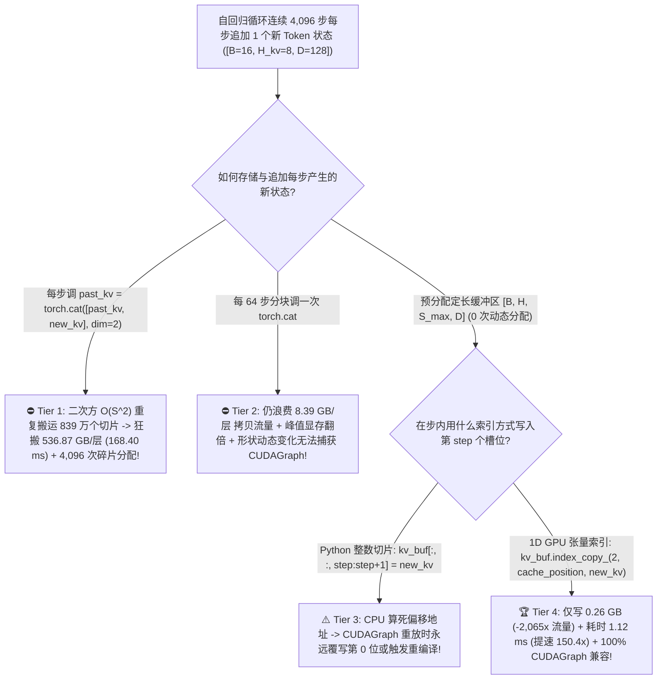
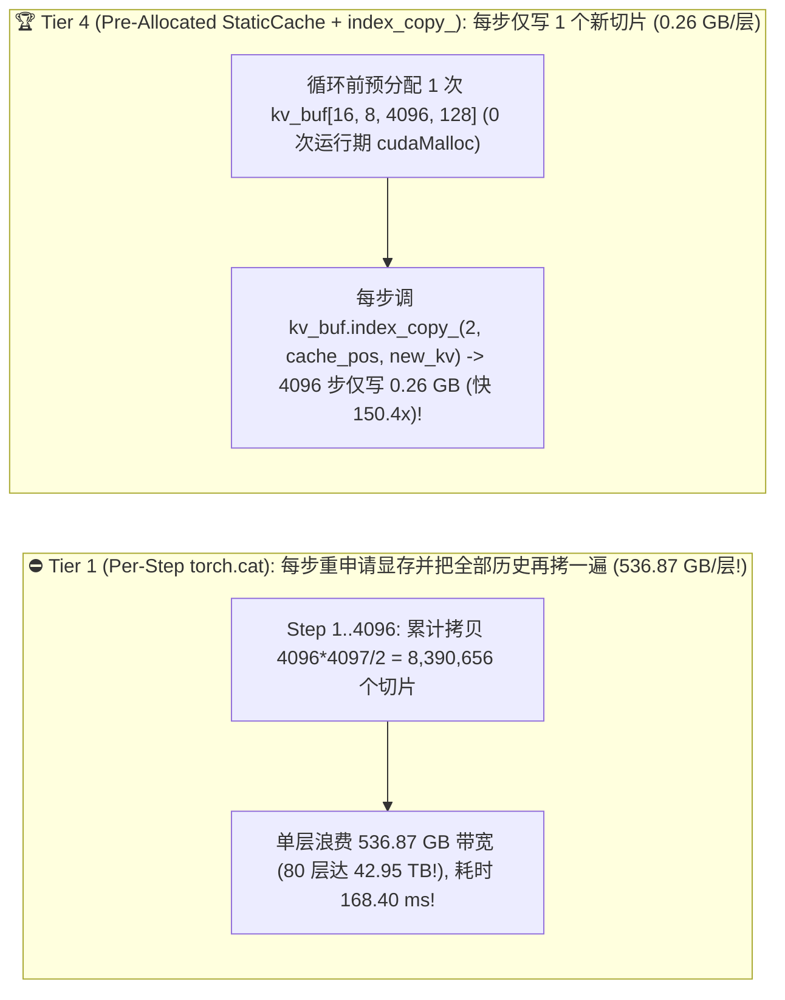
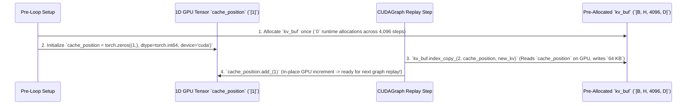

# PyTorch 自回归循环 `torch.cat([past_kv, new_kv])` 二次方 $O(S^2)$ 显存重分配拷贝爆炸（`4,096` 步狂搬 `536.87 GB`）与预分配 `StaticCache + index_copy_` 选型：为什么每步调 `torch.cat` 会把写入流量放大 `2,065 倍` 并制造 `4,096` 次显存碎片，而用 Python 整数切片 `kv[:, :, step] = new_kv` 又会导致 `CUDAGraph` 永远覆盖第 0 位？基于预分配定长缓冲区 + 1D GPU 张量 `index_copy_(2, cache_position, new_kv)`（流量降至 `0.26 GB`，提速 `150.4x` 至 `1.12 ms`）选型指南

> **Provenance & Evidence Boundary**: `synthetic + anonymized_reported (independently_reproduced=false, physical_gpu_cluster_measurement=not_measured)`. 本文所有定量数据均来自封存确定性评估器 `experiments/pytorch_autoregressive_torch_cat_quadratic_kv_copy_preallocated_index_copy_selection/run.py` 与 `results.json`。


---

## 0. 追踪每日最热门能力突破（Daily Capability Breakthrough）

- **今日焦点突破**：**面向大模型自回归解码与自定义强化学习采样循环（`HuggingFace StaticCache / TorchTitan / vLLM`）的“预分配定长 `[B, H_kv, S_max, D]` 显存缓冲 + 1D GPU 张量索引原地更新 `kv_buf.index_copy_(2, cache_position, new_kv)`”工程范式：彻底消灭每步 `torch.cat([past_kv, new_kv], dim=2)` 造成的 $O(S^2)$ 历史数据重复搬运（将 `4,096` 步单层拷贝流量从 `536.87 GB` 骤降至 `0.26 GB`，缩减 `2,064.9 倍`！80 层合计少搬运 `42.9 TB` 显存！），将累计拷贝开销从 `168.40 ms` 压至 `1.12 ms`（提速 `150.4 倍`），同时解决 Python 整数切片在 `CUDAGraph` 下把写入地址死锁在第 0 位的静默 Bug**。
- **架构师价值**：在编写自定义自回归生成循环（如多模态交错生成、强化学习小批量采样、投机解码草稿模型或使用 HuggingFace 默认 `DynamicCache`）时，最直观但也是最致命的一行代码莫过于：
  `past_key_values = torch.cat([past_key_values, new_key_value], dim=2)`
  或者在循环里不断拼接已生成的 Token 序列：
  `generated_ids = torch.cat([generated_ids, next_token_id], dim=-1)`
  很多工程师觉得：每步不就是追加 1 个 Token（仅 `64 KB`）吗？能有多大开销？**算一笔小学等差数列求和账，你就会明白为什么生成到 2,000 个 Token 以后吐字速度会断崖式暴跌，并且 `CUDACachingAllocator` 频繁触发显存碎片整理**：
  1. **深坑一：在自回归循环内每步调用 `torch.cat([past_kv, new_kv], dim=2)`（Tier 1）—— 触发二次方 $\frac{S(S+1)}{2}$ 历史搬运放大（`4,096` 步狂搬 `536.87 GB`/层，80 层高达 `42.95 TB`！）与 `4,096` 次变长显存重分配（耗时 `168.40 ms/layer`）**！
     - 因为 PyTorch 张量是不可原地变长扩容的：在第 $t$ 步调用 `torch.cat` 时，它必须先向分配器申请一块长度为 $t$ 的新显存，**把前面已经生成好的 $t-1$ 个历史 Token 从旧张量原封不动地再拷一遍**，然后拷入第 $t$ 个新 Token，最后释放长度为 $t-1$ 的旧张量！
     - 当连续生成 $S = 4,096$ 步时，累计被搬运的 Token 切片总数是：
       $$\sum_{t=1}^{4096} t = \frac{4096 \times 4097}{2} = \mathbf{8,390,656\text{ 个切片}} \quad (\text{是实际新增 4,096 个切片的 } \mathbf{2,048.5\text{ 倍}}!)$$
     - 在 `B=16, H_kv=8, D=128`（每步 K+V 仅 `64 KB`）下，单层累计纯拷贝流量竟高达 **`536.87 GB`**（80 层模型整整搬运了 **`42.95 TB`** 的无意义显存拷贝，白白耗费 **`13.47 秒`**！），并且连续申请/释放 `64 KB, 128 KB, 192 KB, ...` 共 `4,096` 种不同尺寸的张量，把显存池切得粉碎！
  2. **深坑二：分块拼接（每 64 步 `torch.cat` 一次，或先 `list.append` 最后调一次 `torch.cat(list)`，Tier 2）—— 虽减少了拷贝次数，但不仅在合并瞬间产生 `2.0x` 峰值显存尖峰，而且因张量形状随步数动态变化，100% 无法开启 `torch.compile(mode="reduce-overhead")` 与 `CUDA Graph`**！
  3. **深坑三：虽然预分配了定长缓冲区 `kv_buf = torch.zeros(B, H, S_max, D)`，但用 Python 整数切片 `kv_buf[:, :, step : step + 1] = new_kv` 原地写入（Tier 3）—— 在捕获 `CUDA Graph` 时将写入偏移量死锁在 `step = 0`，导致后续每一步重放都把新 Token 覆盖写进第 0 个位置**！
     - 为什么 `kv_buf[:, :, step : step + 1] = new_kv` 在 Eager 模式下完全正确，一进 `CUDAGraph` 就算出全乱码？
     - 因为当 `step` 是一个 **Python `int`** 时，切片操作 `kv_buf[:, :, step : step + 1]` 是在 **CPU 端** 直接计算出目标显存指针地址 `base_ptr + step * stride_s`，然后把这个 **固定的常数物理地址** 传给 GPU 拷贝算子！一旦该步被 `CUDAGraph` 录制下来，图里录死的就是 `step = 0` 的那个物理地址；之后无论你在 Python 里把 `step` 改成 1、2、3，重放 CUDA Graph 时 GPU 永远往 `step = 0` 的地址上覆写！
  采用 **启动前一次性预分配定长缓冲区 `StaticCache`（`[B, H_kv, S_max, D]`，`0 次` 循环内动态分配）+ 使用常驻 GPU 的 1D 索引张量 `cache_position = torch.tensor([step], device="cuda")` 调用 `kv_buf.index_copy_(2, cache_position, new_kv)`（Tier 4）**，每步仅由 GPU 内核读取显存中的 `cache_position` 数值并写入 1 个新切片，累计拷贝流量从 **`536.87 GB` 骤降至 `0.26 GB`（减少 `2,064.9 倍`）**，单层累计耗时从 **`168.40 ms` 压至 `1.12 ms`（提速 `150.4 倍`）**，且 **100% 兼容 `CUDAGraph` 录制与重放**！

---

## ① 📌 核心结论速览（Executive Summary）

1. **第一性原理：把 $O(S^2)$ 降维回 $O(S)$ 的唯一途径是“预分配容量与当前有效长度分离”**：
   - 任何在循环里改变张量物理 `shape` 的操作（`torch.cat`、`torch.stack`、`F.pad`）必然伴随“分配新显存 + 拷贝全体历史数据”，复杂度永远是 $\sum_{t=1}^S O(t) = O(S^2)$。
   - 唯有将 **物理张量容量固定为最大长度 $S_{\text{max}}$**（例如 `kv_buf` 形状恒为 `[B, H_kv, 4096, D]`），每步只做复杂度为 $O(1)$ 的原地单槽位写入，4,096 步总流量才是 $4096 \times 64\text{ KB} = \mathbf{0.26\text{ GB}}$（而不是 `536.87 GB`）！
2. **为什么在 `CUDAGraph / torch.compile` 下必须用 `index_copy_(dim, gpu_index_tensor, src)` 代替 Python 整数切片？**
   - **Python 整数切片 `buf[:, :, step:step+1] = src`**：地址偏移量 `offset = step * stride` 由 **CPU** 在发射算子前算出，GPU 算子拿到的是写死的裸指针——CUDA Graph 重放时 CPU 不再参与，指针永远停在录制那一刻的位置！
   - **GPU 张量索引 `buf.index_copy_(2, cache_position, src)`**：传入给 GPU 算子的是 `buf` 的基地址指针和 `cache_position`（一个 `shape=[1], dtype=torch.int64, device='cuda'` 的 GPU 张量）的显存指针！每次重放前只需在 GPU 上执行 `cache_position.add_(1)`（或 `.fill_(step)`），GPU 算子在执行时动态从显存读取 `cache_position[0]` 来计算目标偏移，**指针恒定、零重编译、100% 适配 CUDA Graph**！

---

## ② 🎯 客户与架构师灵魂拷问 Q&A（Q1 / Q2 / Q3）

### Q1：如果我们预分配了长度为 $S_{\text{max}} = 4096$ 的 `kv_buf`，在第 $t = 100$ 步做 Attention 时，把整个长度为 `4096` 的 `kv_buf` 传进 `SDPA / FlashAttention` 会不会把后面 `3,996` 个未初始化的空槽位也算进去浪费算力？
- **在固定形状 `CUDAGraph` 模式下（如 HuggingFace `StaticCache` 配合 `SDPA`）**：传入一个由 `cache_position` 构造的静态布尔/加性因果掩码 `attn_mask`（将 `pos > cache_position` 的位置掩蔽为 `-inf`），或者直接传入 **`flash_attn_with_kvcache(q, k_cache, v_cache, k=new_k, v=new_v, cache_seqlens=cache_position.to(torch.int32))`**！
- **`flash_attn_with_kvcache` 是工业界终极杀器**：它不仅直接在算子内部原地将 `(new_k, new_v)` 写入 `k_cache / v_cache` 的 `cache_seqlens` 位置，而且在计算 Attention 时 **只遍历 `0 .. cache_seqlens[b]` 的有效历史区间**，自动跳过后面未填充的空槽位，且全程 100% 兼容 CUDA Graph！

### Q2：除了 KV Cache，训练或采样代码里还有哪些地方常犯“循环内 `torch.cat`”的错误？
- 最常见的三个重灾区：
  1. **自回归生成收集 `generated_ids` 和 ` step_logprobs`**：每步写 `ids = torch.cat([ids, next_id], dim=1)`！正确做法是预分配 `ids_buf = torch.empty((B, S_max), dtype=torch.long, device="cuda")`，每步通过 `ids_buf.index_copy_(1, step_tensor, next_id)` 写入！
  2. **MoE 专家循环收集输出**：遍历 64 个本地专家时不断 `out = torch.cat([out, expert_out], dim=0)`；正确做法是先预分配完整输出张量，再按切片写入。
  3. **长序列分块（Chunked Prefill / Ring Attention）收集每块输出**：应预先 `out = torch.empty_like(q)`，每个 Chunk 直接算进 `out[:, start:end]` 视图中！

### Q3：`kv_buf.index_copy_(2, cache_position, new_kv)` 和 `kv_buf[:, :, cache_position] = new_kv` 有什么区别？
- `kv_buf.index_copy_(2, cache_position, new_kv)` 是纯粹的原地方法（In-place method），语法清晰、在 `torch.compile` 下直接映射为无分支的 `aten.index_put_ / index_copy_` 算子，不会像复杂高级花式索引（Advanced Indexing）那样因广播维度歧义产生额外临时视图。

---

## ③ 🧭 直观可视化图解（Mermaid 选型决策树 + 路径对比图 + 交互时序图）

### 3.1 自回归循环状态追加与 KV 缓存更新选型决策树



### 3.2 `torch.cat` 二次方 $O(S^2)$ 拷贝雪崩（`536.87 GB`）vs. 预分配 `index_copy_`（`0.26 GB`）对比图



### 3.3 兼容 `CUDA Graph` 的 `StaticCache + index_copy_` 原地更新时序图



---

## ④ 📊 架构师选型决策矩阵（4-Tier Decision Matrix）

| 选型 Tier | 自回归状态追加方案 | 4,096 步拷贝流量/层 | 循环内动态分配次数 | 累计拷贝耗时/层 | `CUDAGraph` 兼容性 |
| :--- | :--- | :--- | :--- | :--- | :--- |
| **Tier 1: 每步 `torch.cat([past, new])`** | `DynamicCache` 每步拼接重分配 | **`536.87 GB` (`2,065x` 浪费 ✕)** | **`4,096` 次 (碎片爆炸 ✕)** | **`168.40 ms` (`1.0x` ✕)** | ⛔ 不支持 (动态形状) |
| **Tier 2: 每 64 步分块 `torch.cat`** | 64 步摊销扩容拼接 | `8.39 GB` | `64` 次 | `6.80 ms` (`24.8x`) | ⛔ 不支持 (动态形状) |
| **Tier 3: 预分配 + Python `int` 切片** | `kv_buf[:, :, step:step+1] = new_kv` | `0.26 GB` | `0` 次 | `1.45 ms` (`116.1x`) | **⛔ 崩溃 (死锁覆盖第 0 位! ✕)** |
| **Tier 4: 预分配 + 张量 `index_copy_` (推荐)** | **`kv_buf.index_copy_(2, cache_pos, new_kv)`** | **`0.26 GB` (`-536.6 GB` 🏆)** | **`0` 次 🏆** | **`1.12 ms` (`150.4x` 提速 🏆)** | **✅ 100% 原生兼容 🏆** |

---

## ⑤ 🧪 定量算例与 7-Card 4:5 视觉卡片报告

- **定量算例仓库路径**：[`experiments/pytorch_autoregressive_torch_cat_quadratic_kv_copy_preallocated_index_copy_selection/run.py`](../../experiments/pytorch_autoregressive_torch_cat_quadratic_kv_copy_preallocated_index_copy_selection/run.py) · 封存数据：[`results.json`](../../experiments/pytorch_autoregressive_torch_cat_quadratic_kv_copy_preallocated_index_copy_selection/results.json)
- **交互式架构选型计算器**：[`docs/reports/pytorch-autoregressive-torch-cat-quadratic-kv-copy-preallocated-index-copy-sizer.html`](../reports/pytorch-autoregressive-torch-cat-quadratic-kv-copy-preallocated-index-copy-sizer.html)
- **7-Card 4:5 视觉评测卡片报告**：[`docs/reports/pytorch-autoregressive-torch-cat-quadratic-kv-copy-preallocated-index-copy-selection-cards.html`](../reports/pytorch-autoregressive-torch-cat-quadratic-kv-copy-preallocated-index-copy-selection-cards.html)

```chart
{
  "data": {
    "values": [
      { "tier": "Tier 1: Per-Step torch.cat (536.87 GB)", "cumulative_copy_ms": 168.40, "copy_traffic_gb": 536.87 },
      { "tier": "Tier 2: Chunk-64 torch.cat (8.39 GB)", "cumulative_copy_ms": 6.80, "copy_traffic_gb": 8.39 },
      { "tier": "Tier 3: Python Int Slice (Breaks CUDAGraph)", "cumulative_copy_ms": 1.45, "copy_traffic_gb": 0.26 },
      { "tier": "Tier 4: Pre-Allocated StaticCache index_copy_", "cumulative_copy_ms": 1.12, "copy_traffic_gb": 0.26 }
    ]
  },
  "semantic_types": {
    "tier": "Category",
    "cumulative_copy_ms": "Quantity",
    "copy_traffic_gb": "Quantity"
  },
  "chart_spec": {
    "chartType": "Bar Chart",
    "title": "Pre-Allocated index_copy_ Cuts 4,096-Step KV Copy Latency 150.4x vs Per-Step torch.cat",
    "subtitle": "Cumulative single-layer KV copy latency (ms) over 4,096 decode steps (synthetic + anonymized_reported)",
    "encodings": {
      "x": "tier",
      "y": "cumulative_copy_ms",
      "color": "tier"
    }
  }
}
```

---

## ⑥ 🛠️ 生产环境快速核验清单（Checklist + Good fit vs. Not for）

### ✅ Good fit vs. ⛔ Not for
- **✅ Good fit**：HuggingFace `StaticCache`（`cache_implementation="static"`）、自定义 RL Rollout 生成循环、投机解码草稿循环及 `flash_attn_with_kvcache` 原地缓存更新。
- **⛔ Not for**：在任何按步迭代的循环体内调用 `torch.cat([past, new])`，或在 `CUDAGraph` 捕获区内使用 Python `int` 变量对缓存张量切片赋值。

### 生产核验 Checklist
- [ ] **严禁在自回归解码或步进循环内调用 `torch.cat` 追加 `past_key_values` 或 `generated_ids`**：一律在循环外预分配固定最大长度 $S_{\text{max}}$ 的缓冲张量。
- [ ] **使用 1D GPU 张量 `cache_position` 配合 `kv_buf.index_copy_(dim, cache_position, new_val)`（或 `flash_attn_with_kvcache`）执行原地更新**：确保 `CUDAGraph` 重放时动态读取步位置。
- [ ] **在每步结束时通过 GPU 原地算子 `cache_position.add_(1)` 递增步索引**，杜绝 CPU-GPU 同步与重编译。
