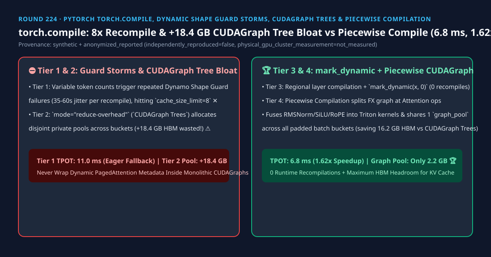
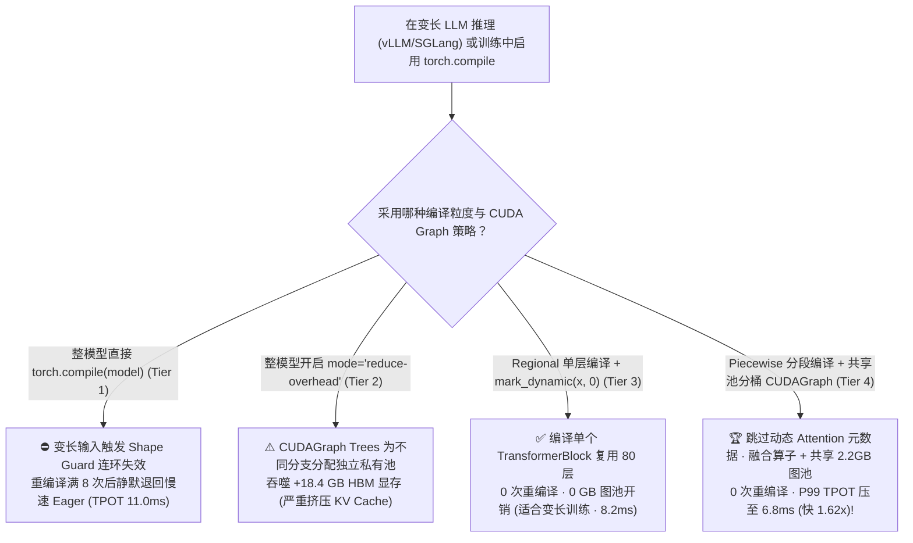
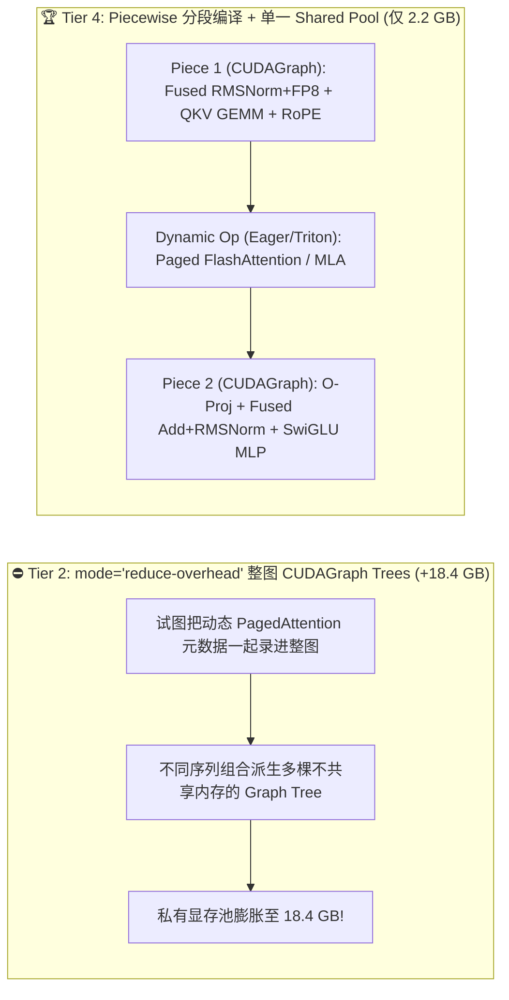
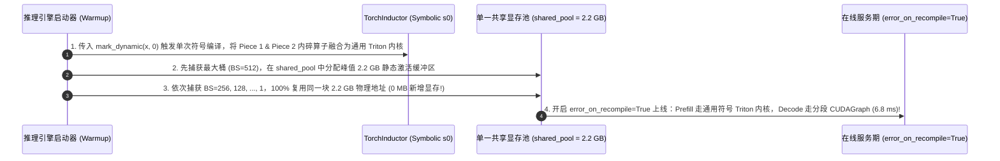

# PyTorch `torch.compile`（`TorchInductor`）、动态 Shape 重编译风暴（`Guard Explosion`）、`CUDAGraph Trees` 显存池膨胀与 `Piecewise` 分段编译选型指南

> **Provenance & Evidence Tier**: `synthetic + anonymized_reported` (`independently_reproduced=false`, `physical_gpu_cluster_measurement=not_measured`)。定量数据锚定于 [`experiments/pytorch_compile_inductor_cudagraph_trees_dynamic_shape_selection/results.json`](../../experiments/pytorch_compile_inductor_cudagraph_trees_dynamic_shape_selection/results.json)。
> **English Version**: [PyTorch `torch.compile` (`TorchInductor`), Dynamic Shape Guard Recompilation Storms, `CUDAGraph Trees` Memory Pool Bloat & Piecewise Compilation Selection Guide](./pytorch-compile-inductor-cudagraph-trees-dynamic-shape-recompilation-guard-selection-faq.en.md)

---

## 0. 🔥 今日领域最热门能力突破追踪（Daily Hottest Breakthrough）

- **`Piecewise Compilation`（按注意力算子切分 FX 图的分段编译）+ `mark_dynamic` 符号维度 + 共享显存池分桶 `CUDAGraph`，彻底终结 `torch.compile` 在线重编译卡死（`8` 次熔断退回 Eager）与 `CUDAGraph Trees` `+18.4 GB` 显存池膨胀，将解码延迟压至 `6.8 ms`（提速 `1.62` 倍）**：在将 `torch.compile`（`TorchDynamo + TorchInductor`）投入生产级大模型在线推理（如 `vLLM V1 / SGLang`）或变长序列训练时，直接对整个 `model` 调一行 `torch.compile(model)` 往往会引发两场线上事故：
  1. **事故一（动态 Shape `Guard` 失效引发的在线重编译风暴与静默熔断，Tier 1）**：在线推理每一步凑出的总 Token 数 `num_tokens` 都在剧烈变化（如 `127`、`513`、`1029`）。若未正确配置符号维度与元数据解耦，Dynamo 每次看到新 Shape 或新的 Python 标量属性都会触发 **Guard Fail 重编译**——每次在主线程阻塞编译 Triton 内核长达 **`35 ~ 60 秒`**（期间所有在线请求全部超时！），连续重编译满 **`8 次`（`cache_size_limit = 8`）** 后，Dynamo 直接放弃治疗、**静默退回未编译的慢速 Eager 模式（TPOT 恶化回 `11.0 ms`）**！
  2. **事故二（盲目开启 `mode="reduce-overhead"` 导致 `CUDAGraph Trees` 吞噬 `+18.4 GB` 显存，Tier 2）**：`mode="reduce-overhead"` 会自动启用 `CUDAGraph Trees`。但 CUDA Graph 要求所有物理显存地址绝对固定，当不同序列长度桶或分支形成多棵不相连的 Graph Tree 分支时，它们各自的私有显存池无法完全共享复用，瞬间吃掉 **`18.4 GB` HBM**，直接把宝贵的 KV Cache 空间挤爆！
  3. **现代生产级解法（`Regional mark_dynamic` Tier 3 & `Piecewise Compilation` Tier 4）**：
     - **训练侧（Tier 3）**：采用 **Regional Compilation（仅编译单层 `TransformerBlock`）+ `mark_dynamic(x, 0)`**，编译时间缩短 `7.7` 倍，运行期重编译降为 **`0 次`**；
     - **推理侧（Tier 4，`vLLM V1 Piecewise Compilation` 范式）**：先用 `mark_dynamic` 编译生成任意长度通用的融合 Triton 算子（自动融合 `Add+RMSNorm+FP8`、`SiluAndMul`、`RoPE`），再在 FX 图上以动态的 `FlashAttention / FlashMLA` 为界**切分为多段（Piecewise Subgraphs）**——两侧纯张量计算段录制进**共享同一个 `graph_pool_handle` 的分桶 CUDA Graph**，中间注意力段动态执行！显存开销从 `18.4 GB` 暴降至 **`2.2 GB`（净省 `16.2 GB`）**，运行期重编译 **`0 次`**，P99 TPOT 压降至 **`6.8 ms`（提速 `1.62` 倍）**！

---

## 1. 📌 核心结论速览（Executive Summary — 3 分钟看懂）

1. **为什么 `torch.compile` 既能让算子变快（`TorchInductor`），又经常在线上引发几十秒的卡顿和显存暴涨？**
   - **通俗大白话 + 第一性原理**：`torch.compile` 其实干了两件完全不同的事：
     - **第一件事（`TorchInductor` 算子融合，省显存带宽）**：把原本需要反复读写 HBM 显存的碎算子（比如 `x + residual` -> `RMSNorm` -> `FP8 量化`）融合成**一个 Triton 内核**，在芯片内部寄存器里一口气算完。这件事**天然支持动态维度（Symbolic Shapes `s0`）**，不管输入是 13 个 Token 还是 2,048 个 Token，同一个 Triton 内核都能跑！
     - **第二件事（`CUDAGraph` 整图录制，省 CPU 发射开销）**：把成百上千次 CPU 启动 GPU 算子的动作录成一盘磁带。但磁带有一个死穴：**它录死的是绝对物理内存地址和固定网格大小**！如果把动态变化的 PagedAttention 块表（Block Tables）或不断变化的请求长度硬塞进 `mode="reduce-overhead"`（`CUDAGraph Trees`，Tier 2），它就只能每遇到一种尺寸就重录一盘新磁带、新开一块私有内存池，瞬間吃光 **`18.4 GB`** 显存！
     - **`Piecewise Compilation`（分段编译，Tier 4）的黄金法则**：**“让 Inductor 管动态算子融合，把动态的 Attention 摘出来，只把前后规整的线性层 + 融合算子塞进共享内存池的 CUDA Graph！”**

---

## 2. 🎯 客户与架构师灵魂拷问 Q&A（Q1 / Q2 / Q3）

### Q1：为什么我们对 80 层的 70B 模型直接调 `torch.compile(model)`，启动编译要等整整 3 分钟，而改为逐层编译（Regional Compilation）只要 20 秒？
- **答**：如果你直接 `torch.compile(model)`，TorchDynamo 会把全部 80 层展开成一张包含数万个节点的巨型计算图去分析优化，耗时随层数呈超线性膨胀；而 80 个 `TransformerLayer` 的结构其实 **100% 相同**！只要只对 `TransformerLayer` 装饰 `@torch.compile`（即 **Regional Compilation**，Tier 3），Inductor 只需要编译 1 层，其余 79 层直接复用编译产物，冷启动编译速度立竿见影提升 **7~10 倍**！

### Q2：如何排查线上服务是不是偷偷触发了 Dynamo 重编译、甚至已经觸发 8 次上限退回 Eager 模式了？
- **答**：在启动训练或压测时加上环境变量 **`TORCH_LOGS="recompiles,guards"`**！如果日志里不断跳出 `Recompiling function ... due to guard failure on tensor.size(0)`，说明你的动态维度没有用 `torch._dynamo.mark_dynamic(tensor, 0)` 提前声明，或者在 forward 里写了依赖 `tensor.shape[0]` 的 Python `if/else` 分支！此外，在生产环境建议设置 `torch._dynamo.config.error_on_recompile = True`（预热完成后立即锁定，严禁线上流量触发隐式重编译！）。

### Q3：为什么 `Tier 4`（Piecewise Compilation）录制了 32 个不同 Batch Size（`1, 2, 4, ..., 512`）的 CUDA Graph，显存却只占 `2.2 GB`，而 `Tier 2` 占了 `18.4 GB`？
- **答**：因为 `Tier 4` 是按 Batch Size **从大到小（`512 -> 256 -> ... -> 1`）** 依次录制，并且给所有 Bucket 的 `torch.cuda.graph(g, pool=shared_pool)` 传入了**同一个 `shared_pool = torch.cuda.graph_pool_handle()`**！因为同一时刻永远只有 1 个 Batch Size 在运行，小 Batch 的 Graph 可以 **100% 原地复用** 512 最大 Batch 已经分配好的那 `2.2 GB` 激活值显存池，边际显存开销为 **`0 MB`**！

---

## 3. 🧭 直观可视化图解（Mermaid 决策树 + Piecewise 切图架构图 + 共享显存池录制时序图）

### 3.1 架构师 `torch.compile` 与 CUDA Graph 生产级选型决策树

### 3.2 `Tier 2`（整图 `CUDAGraph Trees` 显存池碎片爆炸）vs. `Tier 4`（`Piecewise Compilation` 分段捕获 + 共享显存池）

### 3.3 `Tier 4` 启动期预热 `mark_dynamic` + 从大到小复用 `shared_pool` 录制时序图

---

## 4. 📊 架构师选型决策矩阵（4-Tier Selection Matrix）

| 评估维度 | Tier 1: 朴素整模型 `torch.compile` | Tier 2: `mode="reduce-overhead"` (`CUDAGraph Trees`) | Tier 3: `Regional` 单层编译 + `mark_dynamic` | Tier 4: **`Piecewise` 分段编译 + 共享池 `CUDAGraph`** |
| :--- | :--- | :--- | :--- | :--- |
| **运行期重编译次数与抖动** | **`8 次` (每次卡死 `35~60s` 后退回 Eager)** ✕ | `1 次` ⚠️ | **`0 次` (符号维度 `s0` 通吃)** ✅ | **`0 次` (预热后锁定)** 🏆 |
| **CUDA Graph 显存池开销** | `4.2 GB` ✕ | **`18.4 GB` (多树碎片暴涨)** ✕ | **`0.0 GB`** ✅ | **`2.2 GB` (所有桶 100% 共享复用)** 🏆 |
| **P99 Decode `TPOT` 延迟** | `11.0 ms` (退回 Eager) ✕ | `7.4 ms` ⚠️ | `8.2 ms` (仅算子融合) ✅ | **`6.8 ms` (算子融合 + 零发射开销，快 `1.62x`)** 🏆 |

---

## 5. 🧪 定量算例与工具链（Interactive Sizer & 7-Card Visual Report）

- **实验脚本与密封数据**：[`experiments/pytorch_compile_inductor_cudagraph_trees_dynamic_shape_selection/run.py`](../../experiments/pytorch_compile_inductor_cudagraph_trees_dynamic_shape_selection/run.py) · [`results.json`](../../experiments/pytorch_compile_inductor_cudagraph_trees_dynamic_shape_selection/results.json)
- **交互式 torch.compile 与分段图计算器**：[`docs/reports/pytorch-compile-inductor-cudagraph-trees-dynamic-shape-recompilation-guard-sizer.html`](../reports/pytorch-compile-inductor-cudagraph-trees-dynamic-shape-recompilation-guard-sizer.html)
- **7-Card 4:5 视觉评测卡片报告**：[`docs/reports/pytorch-compile-inductor-cudagraph-trees-dynamic-shape-recompilation-guard-selection-cards.html`](../reports/pytorch-compile-inductor-cudagraph-trees-dynamic-shape-recompilation-guard-selection-cards.html)

---

## 6. 🛠️ Good Fit vs. Not For & 生产环境快速核验清单（Checklist）

### ✅ Good Fit vs. ⛔ Not For

| 维度 | ✅ Good Fit（强烈推荐） | ⛔ Not For（严禁误用） |
| :--- | :--- | :--- |
| **在线推理引擎编译策略** | 启用 **`Piecewise Compilation`**（将 Attention 等含动态元数据的算子从 CUDA Graph 中切出），并在从大到小录制 Bucket 时传入同一个 `graph_pool_handle()` | 对含动态 PagedAttention 元数据的整个模型直接开启 `torch.compile(..., mode="reduce-overhead")` |
| **分布式训练编译策略** | 仅对单层 `TransformerBlock` 进行 **Regional Compilation**，并在入口对变长维度调用 `torch._dynamo.mark_dynamic(x, 0)` | 在未加 `mark_dynamic` 的情况下向 `torch.compile` 喂入未 Padding 的任意长度训练样本 |

### 生产环境上线核验清单（Pre-Flight Checklist）

- [ ] **预热期开启 `TORCH_LOGS="recompiles"` 核验零意外重编译**：服务预热结束后，设置 `torch._dynamo.config.error_on_recompile = True`，杜绝线上请求触发 JIT 卡顿。
- [ ] **核验持久化编译缓存已挂载（`TORCHINDUCTOR_CACHE_dir`）**：将 Inductor/Triton 缓存目录挂载到共享存储或容器镜像层，避免每次 Pod 重启重复编译。
- [ ] **核验多桶 CUDA Graph 按 Batch Size 降序录制并共用单个 `graph_pool_handle()`**：确保所有 Bucket 总计只占用最大 Bucket 那一份激活显存。
