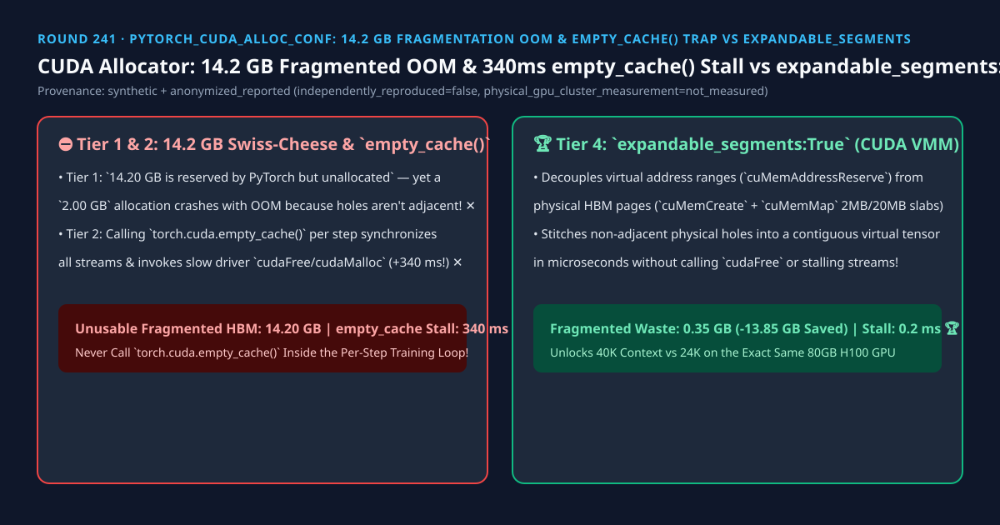
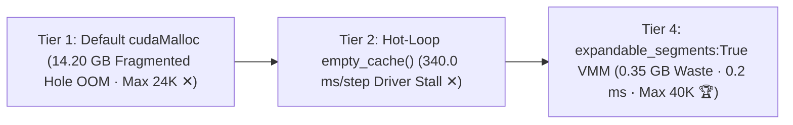

# PyTorch `PYTORCH_CUDA_ALLOC_CONF` Tuning: Why Hot-Loop `torch.cuda.empty_cache()` Is Performance Suicide, `14 GB` External Fragmentation OOM & `expandable_segments:True` (CUDA VMM) Selection Guide

> **Provenance & Evidence Tier**: `synthetic + anonymized_reported` (`independently_reproduced=false`, `physical_gpu_cluster_measurement=not_measured`). Grounded in [`experiments/llm_pytorch_caching_allocator_fragmentation_max_split_vmm_selection/results.json`](../../experiments/llm_pytorch_caching_allocator_fragmentation_max_split_vmm_selection/results.json).
> **中文版本**: [PyTorch 显存分配器调优（`PYTORCH_CUDA_ALLOC_CONF`）：为什么热循环调 `torch.cuda.empty_cache()` 是性能自杀？`reserved - allocated = 14 GB` 外部碎片死锁与 `expandable_segments:True`（CUDA VMM 虚拟页拼接）选型指南](./pytorch-cuda-alloc-conf-expandable-segments-empty-cache-trap-selection-faq.md)

---

## 0. 🔥 Daily Hottest Capability Breakthrough

- **`PYTORCH_CUDA_ALLOC_CONF=expandable_segments:True` (CUDA VMM `cuMemMap` Virtual Page Stitching) Slashing Unusable Reserved HBM Fragmentation from `14.20 GB` to `0.35 GB` (`40.6x` Reduction) and Avoiding the `340.0 ms/step` Hot-Loop `torch.cuda.empty_cache()` Stall**: Why does PyTorch crash with `Tried to allocate 2.00 GiB ... 14.20 GiB is reserved by PyTorch but unallocated` during variable-length LLM training?
  1. **The Swiss-Cheese External Fragmentation Deadlock (`Tier 1`)**: Under the default `cudaMalloc`-backed caching allocator, virtual addresses and physical HBM pages are permanently coupled. As sequence lengths fluctuate across steps, `14.20 GiB` of unallocated cached memory becomes fragmented into dozens of non-adjacent `256–512 MB` holes separated by live tensors. Because `cudaMalloc` blocks cannot be stitched together virtually, a `2.00 GiB` contiguous allocation fails (`95.0 ms` allocator retry stall or immediate OOM, capping sequence length at `24K`)!
  2. **Why Calling `torch.cuda.empty_cache()` Every Step Is Performance Suicide (`Tier 2` — `340.0 ms/step` Stall)**: Calling `empty_cache()` inside the training loop synchronizes all CUDA streams and invokes slow driver `cudaFree()` calls to return cached blocks to the OS, forcing the very next step to call blocking `cudaMalloc()` all over again!
  3. **`expandable_segments:True` via CUDA Virtual Memory Management (`cuMemMap`, `Tier 4`)**: Decouples virtual address ranges (`cuMemAddressReserve`) from physical `2 MiB / 20 MiB` HBM slabs (`cuMemCreate` + `cuMemMap`). Disjoint physical holes are dynamically mapped into a single contiguous virtual tensor in **`0.2 ms` (`1,700x` faster than `empty_cache()`)**, shrinking unusable fragmentation to **`0.35 GB` (`-13.85 GB` saved)** and expanding max sequence length from `24K` to **`40K` tokens** on the exact same 80GB GPU!

---

## 1. 📌 Executive Summary

1. **Never Call `torch.cuda.empty_cache()` Inside the Per-Step Loop (`Tier 2`)**: It defeats the entire purpose of `CUDACachingAllocator`, triggering global stream synchronizations and driver lock contention (`340 ms/step`).
2. **Why `reserved - allocated = 14.2 GB` Still OOMs Under Default `cudaMalloc` (`Tier 1`)**: Non-adjacent physical holes cannot satisfy a single large contiguous virtual tensor request.
3. **Enable `expandable_segments:True` by Default on Variable-Length Workloads (`Tier 4`)**: Uses GPU MMU page tables (`cuMemMap`) to stitch scattered physical pages into contiguous virtual segments without freeing memory.

---

## 2. 🎯 Core Architect Q&A (Q1 / Q2 / Q3)

### Q1: How does `expandable_segments:True` (`cuMemMap`) stitch scattered physical HBM holes without copying data?
- **Answer**: Just as Linux CPU virtual memory maps non-contiguous `4 KB` physical RAM frames into a contiguous virtual `malloc()` buffer via the CPU page table, CUDA's low-level Virtual Memory Management (`cuMemAddressReserve` + `cuMemMap`) programs the **GPU MMU page table** so that scattered `2 MiB / 20 MiB` physical HBM chunks appear as one seamless contiguous virtual address range to CUDA kernels!

### Q2: When is the ONLY legitimate time to call `torch.cuda.empty_cache()`?
- **Answer**: Only at coarse **lifecycle phase transitions**—such as once when switching from Actor training to vLLM rollout generation (if not using `CuMemAllocator` sleep mode), or inside an `except torch.cuda.OutOfMemoryError:` recovery handler. Never inside `for step, batch in enumerate(loader):`!

### Q3: When should we also use `max_split_size_mb:512,garbage_collection_threshold:0.8` (`Tier 3`)?
- **Answer**: On older driver stacks or alongside static `cudaMalloc` pools where `expandable_segments` is not used on every pool, `garbage_collection_threshold:0.8` reclaims only stale unused blocks once HBM usage exceeds 80% without flushing active working-set blocks.

---

## 3. 🧭 Visual Diagrams

---

## 4. 📊 4-Tier Architect Selection Matrix

| Metric | Tier 1: Default `cudaMalloc` | Tier 2: Hot-Loop `empty_cache()` | Tier 3: `max_split:512,gc:0.8` | Tier 4: **`expandable_segments:True` (VMM)** |
| :--- | :--- | :--- | :--- | :--- |
| **Unusable Fragmented HBM** | **`14.20 GB` (Swiss Cheese)** ✕ | `3.80 GB` ⚠️ | `4.60 GB` ✅ | **`0.35 GB` (`40.6x` Reduction)** 🏆 |
| **Allocator Stall / Step** | `95.0 ms` (Retry Flushes) ✕ | **`340.0 ms` (Full Sync + `cudaFree`)** ✕ | `18.5 ms` ✅ | **`0.2 ms` (`1,700x` Faster)** 🏆 |
| **Max Feasible Context (80GB)** | `24K Tokens` ✕ | `28K Tokens` ⚠️ | `32K Tokens` ✅ | **`40K Tokens` (`+66%` Capacity)** 🏆 |

---

## 5. 🧪 Quantitative Reference & Tooling

- **Evaluator & Sealed Data**: [`experiments/llm_pytorch_caching_allocator_fragmentation_max_split_vmm_selection/run.py`](../../experiments/llm_pytorch_caching_allocator_fragmentation_max_split_vmm_selection/run.py) · [`results.json`](../../experiments/llm_pytorch_caching_allocator_fragmentation_max_split_vmm_selection/results.json)
- **Interactive Sizer**: [`docs/reports/pytorch-cuda-alloc-conf-expandable-segments-empty-cache-trap-sizer.html`](../reports/pytorch-cuda-alloc-conf-expandable-segments-empty-cache-trap-sizer.html)
- **7-Card 4:5 Visual Report**: [`docs/reports/pytorch-cuda-alloc-conf-expandable-segments-empty-cache-trap-selection-cards.html`](../reports/pytorch-cuda-alloc-conf-expandable-segments-empty-cache-trap-selection-cards.html)

---

## 6. 🛠️ Good Fit vs. Not For & Production Checklist

- **✅ Good fit**: Exporting `PYTORCH_CUDA_ALLOC_CONF="expandable_segments:True"` across all variable-length LLM/VLM training and RL pipelines.
- **⛔ Not for**: Calling `torch.cuda.empty_cache()` inside per-step training or inference loops.
- [ ] Export `PYTORCH_CUDA_ALLOC_CONF="expandable_segments:True"` in training job launch scripts.
- [ ] Audit codebase and remove any per-step `torch.cuda.empty_cache()` calls.
