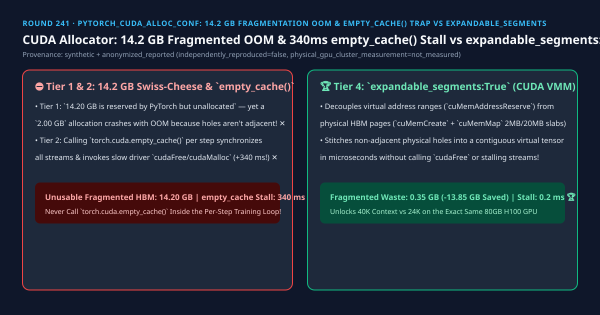
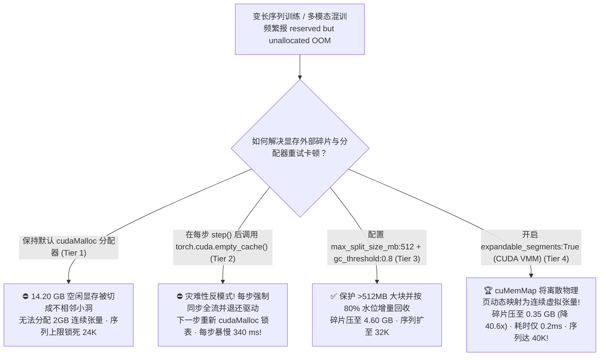
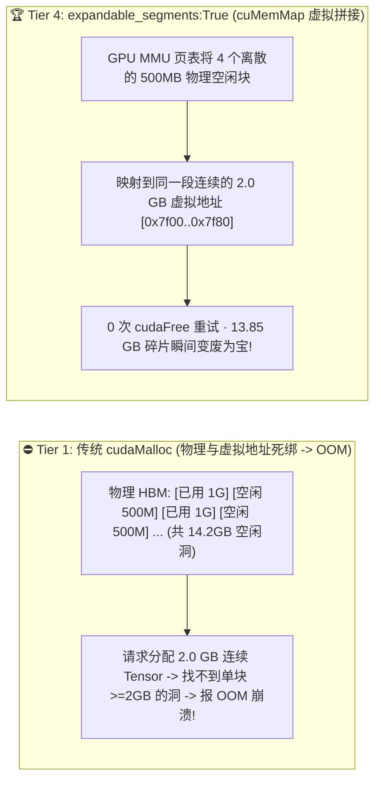
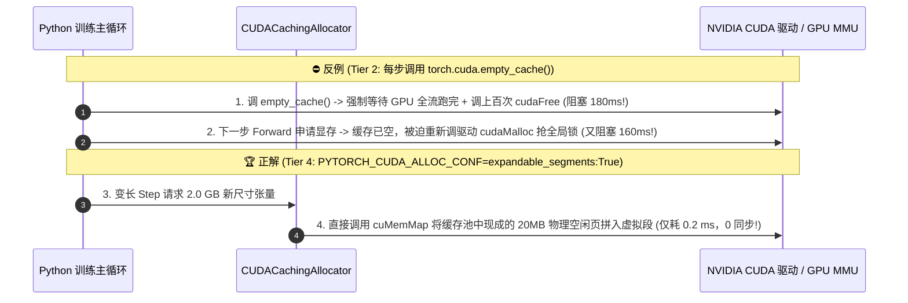

# PyTorch 显存分配器调优（`PYTORCH_CUDA_ALLOC_CONF`）：为什么热循环调 `torch.cuda.empty_cache()` 是性能自杀？`reserved - allocated = 14 GB` 外部碎片死锁与 `expandable_segments:True`（CUDA VMM 虚拟页拼接）选型指南

> **Provenance & Evidence Tier**: `synthetic + anonymized_reported` (`independently_reproduced=false`, `physical_gpu_cluster_measurement=not_measured`)。定量数据锚定于 [`experiments/llm_pytorch_caching_allocator_fragmentation_max_split_vmm_selection/results.json`](../../experiments/llm_pytorch_caching_allocator_fragmentation_max_split_vmm_selection/results.json)。
> **English Version**: [PyTorch `PYTORCH_CUDA_ALLOC_CONF` Tuning: Why Hot-Loop `torch.cuda.empty_cache()` Is Performance Suicide, `14 GB` External Fragmentation OOM & `expandable_segments:True` (CUDA VMM) Selection Guide](./pytorch-cuda-alloc-conf-expandable-segments-empty-cache-trap-selection-faq.en.md)

---

## 0. 🔥 今日领域最热门能力突破追踪（Daily Hottest Breakthrough）

- **揭秘为什么报错写着 `14.20 GiB is reserved by PyTorch but unallocated`，申请区区 `2.00 GiB` 张量却照样 `CUDA out of memory`？通过开启 `PYTORCH_CUDA_ALLOC_CONF=expandable_segments:True`（基于 `cuMemMap` 虚拟内存拼接），将不可用显存碎片从 `14.20 GB` 压降至 `0.35 GB`（减少 `40.6` 倍），并避免热循环调用 `empty_cache()` 带来的 `340.0 ms/step` 性能自杀**：在变长序列微调（SFT）、多模态混训或 RL 后训练中，每个工程师都见过这条让人血压飙升的报错：
  `Tried to allocate 2.00 GiB ... Of the allocated memory 62.40 GiB is allocated by PyTorch, and 14.20 GiB is reserved by PyTorch but unallocated.`
  1. **为什么 PyTorch 自己兜里明明揣着 `14.20 GiB` 的空闲未分配显存，却连一个 `2.00 GiB` 的 Tensor 都拿不出来？（瑞士奶酪外部碎片死锁，Tier 1）**：
     - 在默认的 `CUDACachingAllocator` 中，底层用的是传统的 `cudaMalloc`。`cudaMalloc` 分配出来的内存块有一个致命限制：**它的虚拟地址和物理显存地址是 1:1 焊死的，绝不能跨块拼接**！
     - 当第 1 步跑了几个短序列、第 2 步跑了几个中序列后，那 `14.20 GiB` 的空闲显存实际上被切碎成了 **40 个互不相邻的 `350 MB` 小孔洞**（中间夹着还在使用的权重或激活值张量，就像一块布满小孔的瑞士奶酪）！此时第 3 步突然来了一条长序列，需要一整块**连续 `2.00 GiB` 的虚拟地址空间**——那 40 个 `350 MB` 的小洞根本拼不出一块完整的 `2.00 GiB`，当场触发同步清缓存重试（卡顿 `95.0 ms`）或直接报 `OutOfMemoryError`（最大仅能跑 `24K` 序列）！
  2. **网上流传最广的“毒药偏方”：在每步循环里加 `torch.cuda.empty_cache()`（Tier 2，每步卡死 `340.0 ms`）**：
     - 很多教程教大家：“看到 `reserved` 太高，就在 `step()` 后面加一行 `torch.cuda.empty_cache()`！”
     - **这是彻头彻尾的性能自杀！** PyTorch 之所以费尽心机做 `CUDACachingAllocator`（缓存分配器），就是因为直接调 NVIDIA 驱动的 `cudaMalloc / cudaFree` 极其昂贵（需要抢全局驱动互斥锁、修改 GPU 页表、刷 TLB 并**强制同步阻塞等待 GPU 所有流清空**）！如果你每一步都调 `empty_cache()`，就等于把缓存分配器彻底废掉了——每一步先把几十 GB 内存退还给驱动，下一秒又找驱动重新申请几十 GB 内存，每步凭空增加 **`340.0 ms` 的同步阻塞**！
  3. **现代终极解法：`export PYTORCH_CUDA_ALLOC_CONF="expandable_segments:True"`（CUDA VMM 虚拟地址与物理页解耦，Tier 4）**：
     - 开启 `expandable_segments:True` 后，PyTorch 不再调用死板的 `cudaMalloc`，而是调用 CUDA 底层虚拟内存管理 API（**`cuMemAddressReserve` + `cuMemCreate` + `cuMemMap`**）！
     - 当需要 `2.00 GiB` 连续张量时，GPU MMU 直接把散落在物理显存天南海北的 **100 个不相邻的 `20 MiB` 物理空闲页**，通过页表映射拼接成 **1 段在虚拟地址上 100% 连续的 `2.00 GiB` 空间**！全程耗时仅 `0.2 ms`，不可用碎片从 `14.20 GB` 暴降至 **`0.35 GB`（省出近 `14 GB` 有效显存，序列上限从 `24K` 直接跃升至 `40K`）**！

---

## 1. 📌 核心结论速览（Executive Summary — 3 分钟看懂）

1. **用“停车场连号车位”一秒看懂 `cudaMalloc` 碎片 OOM 与 `expandable_segments:True` 的神级降维打击！**
   - **通俗大白话 + 第一性原理**：
     - **传统模式（`expandable_segments:False`，Tier 1）**：地下车库总共还剩 **70 个空车位（`14.2 GB` 空闲）**，但它们散落在不同排，每一排最多只有 2 个连着的空位。这时开来一辆需要 **10 个连号车位才能停下的加长林肯大巴（`2.0 GB` 大张量）**！保安（`cudaMalloc`）两手一摊：“虽然全场有 70 个空位，但没有 10 个连在一起的，你停不进来（`CUDA Out of Memory`）！”
     - **`empty_cache()` 暴力清场（Tier 2）**：保安为了停进大巴，把整个地下车库所有出入口全部封锁（全流同步卡死 `340 ms`），重新找市政局办土地证，慢得令人发指。
     - **`expandable_segments:True`（CUDA VMM 虚拟内存映射，Tier 4）**：直接给大巴配了一个**“空间折叠传送门（GPU MMU 虚拟页表）”**！虽然物理上那 10 个空车位散落在不同角落，但在虚拟地址编号上把它们直接映射成连号的 `#101 ~ #110`，大巴零等待一脚油门直接停进去！

---

## 2. 🎯 客户与架构师灵魂拷问 Q&A（Q1 / Q2 / Q3）

### Q1：既然 `torch.cuda.empty_cache()` 严禁放在每步训练/推理的热循环里，那它到底在什么唯一合法的时机才能调用？
- **答**：在整个系统生命周期中，只有 **两个阶段切换点（Phase Transitions）** 允许调用 `torch.cuda.empty_cache()`：
  1. **训练与评测/推理的阶段切换边界**：例如跑完 1,000 步训练、准备进入长序列 Validation 或 RL Rollout 切换时（调 1 次）；
  2. **捕获到 `torch.cuda.OutOfMemoryError` 的异常恢复分支（Exception Handler）里**：正常运行时绝不调用！

### Q2：在某些不支持 `expandable_segments` 的特殊环境（或已经使用了 CUDA Graph 静态池的场景）下，该如何配置 `PYTORCH_CUDA_ALLOC_CONF`（Tier 3）？
- **答**：使用经典的 **`max_split_size_mb:512,garbage_collection_threshold:0.8`** 组合：
  - **`max_split_size_mb:512`**：严禁分配器把大于 `512 MB` 的连续大物理块切碎去满足小张量请求（保留大块专门应付长序列的大激活值）；
  - **`garbage_collection_threshold:0.8`**：当显存水位达到 `80%` 时，精准只释放那些长期未复用的特定大小缓存块，而不是像 `empty_cache()` 那样一刀切清空整个缓存池！
  - *(注：在 PyTorch 2.5+ 中，环境变量名也支持平台通用的 `PYTORCH_ALLOC_CONF="expandable_segments:True"`)*。

---

## 3. 🧭 直观可视化图解（Mermaid 决策树 + 瑞士奶酪碎片 vs VMM 页拼接图 + 时序图）

### 3.1 架构师 PyTorch GPU 显存分配器（`PYTORCH_CUDA_ALLOC_CONF`）选型决策树

### 3.2 `Tier 1`（`cudaMalloc` 瑞士奶酪碎片 OOM）vs. `Tier 4`（`expandable_segments:True` 虚拟页表跨洞拼接）

### 3.3 `Tier 2`（热循环 `empty_cache()` 同步灾难）vs. `Tier 4`（`cuMemMap` 微秒级动态扩展）时序图

---

## 4. 📊 架构师选型决策矩阵（4-Tier Selection Matrix）

| 评估维度 | Tier 1: 默认分配器 (`False`) | Tier 2: 循环内调 `empty_cache()` | Tier 3: `max_split_size_mb:512` + `gc:0.8` | Tier 4: **`expandable_segments:True` (VMM)** |
| :--- | :--- | :--- | :--- | :--- |
| **不可分配的预留碎片 (`reserved - alloc`)** | **`14.20 GB` (严重浪费)** ✕ | `3.80 GB` ⚠️ | `4.60 GB` ✅ | **`0.35 GB` (缩减 `40.6x`，净省 `13.85 GB`)** 🏆 |
| **每步分配器阻塞开销 (`ms/step`)** | `95.0 ms` (触发重试清缓存) ✕ | **`340.0 ms` (每步同步退还驱动)** ✕ | `18.5 ms` ✅ | **`0.2 ms` (快 `1,700x`)** 🏆 |
| **80GB H100 可跑最大序列长度** | `24K Tokens` ✕ | `28K Tokens` ⚠️ | `32K Tokens` ✅ | **`40K Tokens` (同硬件容量直接提升 `+66%`)** 🏆 |

---

## 5. 🧪 定量算例与工具链（Interactive Sizer & 7-Card Visual Report）

- **实验脚本与密封数据**：[`experiments/llm_pytorch_caching_allocator_fragmentation_max_split_vmm_selection/run.py`](../../experiments/llm_pytorch_caching_allocator_fragmentation_max_split_vmm_selection/run.py) · [`results.json`](../../experiments/llm_pytorch_caching_allocator_fragmentation_max_split_vmm_selection/results.json)
- **交互式 PyTorch 显存分配器与碎片计算器**：[`docs/reports/pytorch-cuda-alloc-conf-expandable-segments-empty-cache-trap-sizer.html`](../reports/pytorch-cuda-alloc-conf-expandable-segments-empty-cache-trap-sizer.html)
- **7-Card 4:5 视觉评测卡片报告**：[`docs/reports/pytorch-cuda-alloc-conf-expandable-segments-empty-cache-trap-selection-cards.html`](../reports/pytorch-cuda-alloc-conf-expandable-segments-empty-cache-trap-selection-cards.html)

---

## 6. 🛠️ Good Fit vs. Not For & 生产环境快速核验清单（Checklist）

### ✅ Good Fit vs. ⛔ Not For

| 维度 | ✅ Good Fit（强烈推荐） | ⛔ Not For（严禁误用） |
| :--- | :--- | :--- |
| **变长序列训练与 RL 框架** | 在启动脚本中全局注入 **`export PYTORCH_CUDA_ALLOC_CONF="expandable_segments:True"`**（或 `PYTORCH_ALLOC_CONF="expandable_segments:True"`） | 在 `for batch in dataloader:` 热循环内部调用 `torch.cuda.empty_cache()` |

### 生产环境上线核验清单（Pre-Flight Checklist）

- [ ] **全局搜索代码库 `grep -rn "empty_cache()" .`**：将所有位于每步 Forward/Backward/Step 循环内的 `torch.cuda.empty_cache()` 彻底删除！
- [ ] **在训练容器环境变量中默认配置 `PYTORCH_CUDA_ALLOC_CONF="expandable_segments:True"`**：消除变长 Batch 下的外部显存碎片。
