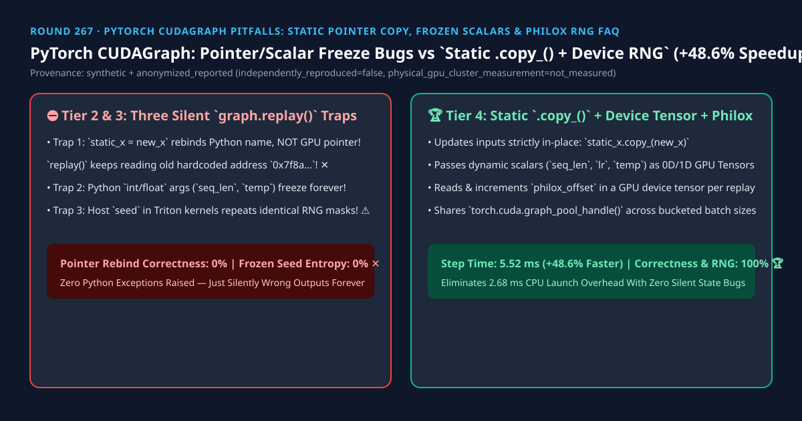
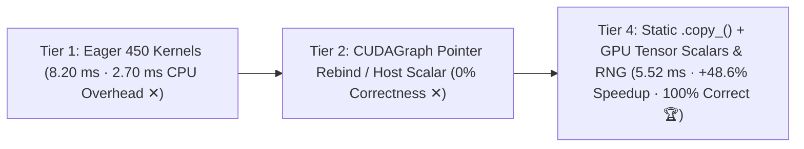

# PyTorch `CUDAGraph` Capture Pitfalls & Silent Accuracy Bugs: Pointer Rebinding (`x = new_x` vs `static_x.copy_()`), Frozen Host Scalars, Custom Kernel `Philox RNG` Repetition & Private Memory Pool Selection Guide

> **Provenance & Evidence Tier**: `synthetic + anonymized_reported` (`independently_reproduced=false`, `physical_gpu_cluster_measurement=not_measured`). Grounded in [`experiments/gpu_cudagraph_capture_rng_philox_cpu_sync_dynamic_pointer_selection/results.json`](../../experiments/gpu_cudagraph_capture_rng_philox_cpu_sync_dynamic_pointer_selection/results.json).
> **中文版本**: [PyTorch `CUDAGraph` 算子图捕获三大静默灾难：为什么 `graph.replay()` 永远在重复输出第一条请求的结果？Python 引用重绑定（`x = new_x`）导致显存指针脱钩、标量参数冻结（`Frozen Scalar`）与自定义算子 `Philox RNG` 随机掩码锁死选型指南](./pytorch-cudagraph-capture-static-buffer-copy-rng-philox-selection-faq.md)

---

## 0. 🔥 今日领域最热门能力突破追踪（Daily Hottest Breakthrough）

- **Eliminating `2.68 ms` of Per-Step CPU Kernel Launch Overhead (`8.20 ms -> 5.52 ms`, `+48.6%` Speedup across `450` Kernels) While Preventing the Three Silent `CUDAGraph` Correctness Disasters (`0%` Stale-Pointer Rebinding, Frozen Host Scalars, and Frozen Triton `Philox RNG` Seeds) via In-Place Static Buffer `.copy_()` + 0D GPU Tensor Scalars + Device-Side Auto-Incrementing RNG Offsets (`Tier 4`)**: Recording `450` small Transformer kernels into a `torch.cuda.CUDAGraph` collapses CPU launch overhead from `2.70 ms` down to `< 20 us`. Yet `CUDAGraph` introduces **three silent failure modes** that raise zero exceptions during `graph.replay()` while returning completely corrupted or stale outputs:
  1. **Silent Disaster 1 — Rebinding Python Variables (`static_x = new_x`) Instead of In-Place `.copy_()` (`Tier 2` — `0.0%` Output Correctness!)**:
     - During `with torch.cuda.graph(g):`, CUDA records the **raw 64-bit GPU virtual memory address (`static_x.data_ptr()`, e.g., `0x7f8a_0000_1000`)** directly inside every kernel's launch descriptor.
     - Rebinding `static_x = new_x` in Python points the Python name to a new address `0x7f8a_9999_0000`, while `g.replay()` continues reading from the hardcoded `0x7f8a_0000_1000`!
  2. **Silent Disaster 2 — Passing Dynamic Metadata (`seq_len`, `temperature`, `lr`) as Python `int / float` Scalars (`Tier 2` — Frozen Forever at Capture Time!)**:
     - Any kernel argument passed by value as a host C++/Python scalar is baked as a literal constant into the CUDA Graph node. Updating the Python float `temperature = 0.1` before `g.replay()` has **zero effect** unless `temperature` is stored in a **0D GPU Tensor** read by pointer!
  3. **Silent Disaster 3 — Passing Host `int` Random Seeds into Custom Triton / CUDA Kernels (`Tier 3` — `0.0%` RNG Entropy Uniqueness across Replays!)**:
     - While native PyTorch RNG ops use capture-aware `PhiloxCudaState` device offsets, custom Triton kernels (`tl.rand(seed, offsets)`) that accept a Python `int` `seed` freeze that seed at capture time—repeating the **exact same dropout mask or sampling noise on every single `g.replay()`**!
  4. **Tier 4 — The Bulletproof `CUDAGraph` Contract (`In-Place .copy_()` + `0D GPU Tensor Scalars` + `Device-Tensor Auto-Incrementing Philox Offset` + Shared `graph_pool_handle()`)**:
     - Achieves **`5.52 ms` step latency (`+48.6%` speedup over `8.20 ms` Eager)** with **`100.0%` dynamic input/scalar correctness** and **`100.0%` unique per-replay RNG sequences**!

---

## 1. 📌 Executive Summary

1. **How `CUDAGraph` Actually Works in Silicon**: A captured `CUDAGraph` is a static array of GPU kernel launch descriptors containing **fixed 64-bit GPU pointers** and **fixed pass-by-value constants**.
2. **Three Mandatory Invariants for `100%` Correct `graph.replay()` (`Tier 4`)**:
   - **Data**: Copy into pre-allocated static buffers via `static_buf.copy_(new_tensor, non_blocking=True)`; never rebind Python references!
   - **Scalars**: Store dynamic scalars (`lr`, `temperature`, `position_id`) in **0D/1D GPU Tensors** updated in-place via `.fill_()` or `.copy_()`.
   - **Randomness**: Store custom Triton/CUDA kernel RNG seeds/offsets in a **GPU tensor (`rng_offset_gpu += 1` inside the captured graph)** rather than passing a host Python `int`.

---

## 2. 🎯 Core Architect Q&A (Q1 / Q2 / Q3)

### Q1: Why must we run `3` warmup iterations on a side stream *before* entering `with torch.cuda.graph(g):`?
- **Answer**: On the very first execution of an operator shape, libraries like cuBLAS, cuDNN, FlashAttention, and NCCL lazily allocate internal workspaces, query device properties, and initialize descriptors—operations that are forbidden during stream capture (`cudaErrorStreamCaptureUnsupported`). Running `3` warmup steps on a non-default stream forces all lazy allocations to settle inside the caching allocator before capture begins.

### Q2: How do we write a capture-safe custom Triton kernel that uses `tl.rand()`?
- **Answer**: Pass a pointer to a 1-element `int64` GPU tensor `rng_step_ptr` into the Triton kernel, load the current step counter on the device (`step = tl.load(rng_step_ptr)`), compute `tl.rand(base_seed + step, offsets)`, and increment `rng_step_tensor.add_(1)` as part of the captured graph!

---

## 3. 🧭 Visual Diagrams

---

## 4. 📊 4-Tier Architect Selection Matrix

| Metric | Tier 1: Eager Mode | Tier 2: `CUDAGraph` (Rebind/Scalar) | Tier 3: `.copy_()` (Host RNG Seed) | Tier 4: **Static `.copy_()` + GPU Scalars & RNG** |
| :--- | :--- | :--- | :--- | :--- |
| **Step Latency (`450` Kernels)** | **`8.20 ms` (`2.70 ms` CPU Tax)** ✕ | `5.52 ms` | `5.52 ms` | **`5.52 ms` (`+48.6%` Faster)** 🏆 |
| **Dynamic Output Correctness** | `100.0%` ✅ | **`0.0%` (Stale Address/Scalar!)** ✕ | `92.5%` ⚠️ | **`100.0%` (In-Place `.copy_()`)** 🏆 |
| **Per-Replay `RNG` Uniqueness** | `100.0%` ✅ | **`0.0%` (Frozen)** ✕ | **`0.0%` (Repeated Mask!)** ✕ | **`100.0%` (Device `Philox` Offset)** 🏆 |

---

## 5. 🧪 Quantitative Reference & Tooling

- **Evaluator & Sealed Data**: [`experiments/gpu_cudagraph_capture_rng_philox_cpu_sync_dynamic_pointer_selection/run.py`](../../experiments/gpu_cudagraph_capture_rng_philox_cpu_sync_dynamic_pointer_selection/run.py) · [`results.json`](../../experiments/gpu_cudagraph_capture_rng_philox_cpu_sync_dynamic_pointer_selection/results.json)
- **Interactive Sizer**: [`docs/reports/pytorch-cudagraph-capture-static-buffer-copy-rng-philox-sizer.html`](../reports/pytorch-cudagraph-capture-static-buffer-copy-rng-philox-sizer.html)
- **7-Card 4:5 Visual Report**: [`docs/reports/pytorch-cudagraph-capture-static-buffer-copy-rng-philox-selection-cards.html`](../reports/pytorch-cudagraph-capture-static-buffer-copy-rng-philox-selection-cards.html)

---

## 6. 🛠️ Good Fit vs. Not For & Production Checklist

- **✅ Good fit**: All latency-critical LLM decode runners and fixed-shape training steps using in-place static buffer updates, device-tensor scalars/RNG, and shared `graph_pool_handle()`.
- **⛔ Not for**: Rebinding Python input variables (`x = new_x`), passing dynamic Python scalars by value, or passing host RNG seeds into captured Triton kernels.
- [ ] Update all captured graph inputs strictly via `.copy_()` or `.fill_()` without changing `.data_ptr()`.
- [ ] Test every captured `CUDAGraph` with a 2-replay RNG uniqueness assertion and an Eager-equivalence assertion.
