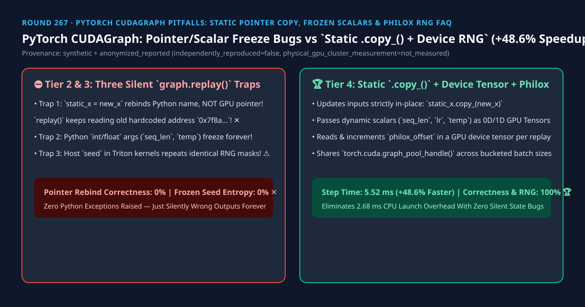
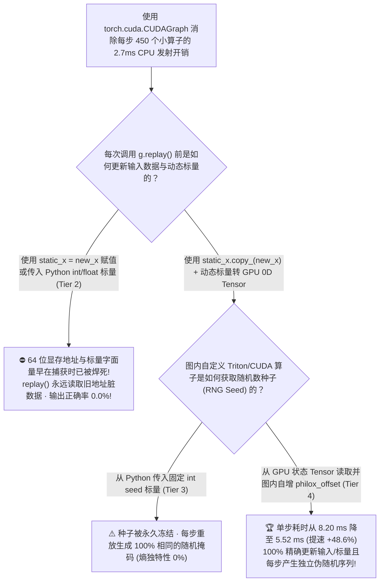
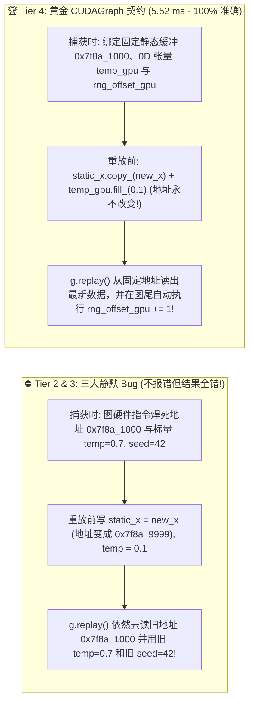
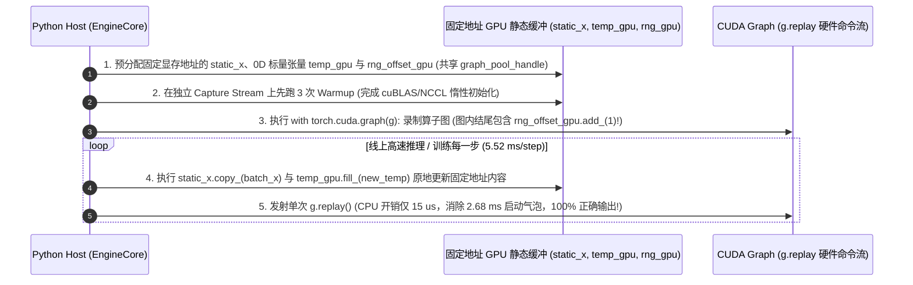

# PyTorch `CUDAGraph` 算子图捕获三大静默灾难：为什么 `graph.replay()` 永远在重复输出第一条请求的结果？Python 引用重绑定（`x = new_x`）导致显存指针脱钩、标量参数冻结（`Frozen Scalar`）与自定义算子 `Philox RNG` 随机掩码锁死选型指南

> **Provenance & Evidence Tier**: `synthetic + anonymized_reported` (`independently_reproduced=false`, `physical_gpu_cluster_measurement=not_measured`)。定量数据锚定于 [`experiments/gpu_cudagraph_capture_rng_philox_cpu_sync_dynamic_pointer_selection/results.json`](../../experiments/gpu_cudagraph_capture_rng_philox_cpu_sync_dynamic_pointer_selection/results.json)。
> **English Version**: [PyTorch `CUDAGraph` Capture Pitfalls & Silent Accuracy Bugs: Pointer Rebinding (`x = new_x` vs `static_x.copy_()`), Frozen Host Scalars, Custom Kernel `Philox RNG` Repetition & Private Memory Pool Selection Guide](./pytorch-cudagraph-capture-static-buffer-copy-rng-philox-selection-faq.en.md)

---

## 0. 🔥 今日领域最热门能力突破追踪（Daily Hottest Breakthrough）

- **揭秘为什么在给大模型推理或训练手写 `torch.cuda.CUDAGraph` 加速时，代码一行报错都没有、单步耗时也从 `8.20 ms` 降到了 `5.52 ms`（提速 `+48.6%`），但模型却诡异地“永远重复输出第一条请求的结果”、或者“采样温度 `temperature` 怎么改都不生效、Dropout 掩码在十万步训练里永远长成同一张脸”？彻底拆解 `CUDAGraph` 录制底层硬件虚拟地址（`64-bit GPU VA`）与字面量常数的物理机制，通过“预分配静态缓冲原地 `.copy_()` + 动态标量全转 GPU 0D Tensor + 显存态 `Philox RNG` 自增偏移”（`Tier 4`），实现 `100%` 零静默 Bug 与 `+48.6%` 算子发射加速**：在大模型单步推理（Decode）中，一层 Transformer 包含约 `6` 个小算子，80 层就是 **`450+` 个算子**。如果在 Eager 模式下由 CPU 一个个发射（每个算子 CPU 驱动发射开销约 `6 us`，Tier 1），光 CPU 发射这 450 个算子就要花掉 **`2.70 ms`**！使用 `torch.cuda.CUDAGraph` 把这 450 个算子录制成一张硬件图，每次只需 **1 次 `graph.replay()`（耗时 `< 15 us`）** 就能一口气跑完！然而，`CUDAGraph` 是一把极度危险的双刃剑——如果你不理解它到底录制了什么，就会踩中 **三个绝不报错、却让结果 100% 错乱的静默大坑**：
  1. **静默大坑一：把 `static_x.copy_(new_x)` 写成了 `static_x = new_x`（Python 引用重绑定导致指针脱钩，Tier 2 — 正确率 `0.0%`！）**：
     - **第一性原理揭示：`with torch.cuda.graph(g):` 在录制时到底往显卡里记了什么？**
       - 它**根本不认识 Python 里的变量名 `static_x`**！它记录的是在录制那一微秒，`static_x.data_ptr()` 所对应的 **那串硬邦邦的 64 位 GPU 物理/虚拟显存地址（比如 `0x7f8a_0000_1000`）**！这串十六进制地址已经被当成死常数焊死在了全部 450 个 CUDA Kernel 的启动参数描述符里！
     - 当下一条新请求到来时，如果你在 Python 里写了一句看似天经地义的赋值：**`static_x = get_next_batch_tensor()`**：
       - 在 Python 里，变量名 `static_x` 指向了新分配的显存地址 `0x7f8a_9999_0000`；
       - **但在 `g.replay()` 执行时，GPU 硬件看都不看你现在的 `static_x`，它依然一往情深地去读当年焊死的旧地址 `0x7f8a_0000_1000` 里的数据！**
       - 结果：无论你后面喂什么新问题，模型永远在复读捕获时的第 1 个样本！更惊悚的是，一旦旧的 `static_x` 引用计数归零被显存分配器回收分给了别的中间层，`0x7f8a_0000_1000` 里就会被写满随机垃圾，模型开始吐出乱码却 **不报任何异常**！
       - **铁律**：必须且只能使用 **`static_x.copy_(new_x)`**（把新数据原地拷贝进那块地址永远不变的 `0x7f8a_0000_1000` 静态缓冲区里）！
  2. **静默大坑二：向算子传入 Python `int / float` 标量参数（如 `seq_len`、`temperature`、学习率 `lr`，Tier 2 — 标量被永远冰封在捕获时刻！）**：
     - 假设你的自定义算子或 `AdamW` 优化器签名是 `my_kernel[grid](x_ptr, out_ptr, scale: float)`，你在捕获时传入了 `scale = 0.5`。
     - 在 CUDA 中，指针 `x_ptr` 指向的是显存里可变的数据，但标量参数 `float scale = 0.5` 是**按值传递（Pass-by-Value）直接写进 CUDA Kernel 常量参数槽（Constant Parameter Bank）里的**！
     - 一旦录制完成，哪怕你在第 2 步把 Python 变量改成了 `scale = 0.0` 再调 `g.replay()`，算子内部读到的 `scale` **永远还是录制时的 `0.5`**！
     - **铁律**：任何在 `replay()` 之间会变化的标量（如当前步的实际 `seq_len`、采样 `temperature`、退火学习率 `lr`），**严禁传 Python `int/float`**！必须声明为一个 **0 维 GPU Tensor（`scale_tensor = torch.tensor(0.5, device="cuda")`）**，把它的指针传给算子去显存里解引用读取，并在外部用 `scale_tensor.fill_(new_val)` 更新！
  3. **静默大坑三：自定义 Triton / CUDA 算子用 Python 传入随机种子 `seed`（Tier 3 — 随机数发生器 `Philox RNG` 被彻底锁死，熵独特性 `0.0%`！）**：
     - PyTorch 原生的 `torch.randn` 或 `F.dropout` 为什么能在 `CUDAGraph` 里每次重放都产生不同的随机数？因为 PyTorch 官方算子专门针对 Stream Capture 做了改造：它把 `Philox` 随机数发生器的偏移量（`offset`）存在了一块 **GPU 显存 Tensor** 里，每次重放时在 GPU 上自动递增偏移！
     - 但很多工程师在手写 **Triton 算子（如融合 Dropout、Gumbel-Max 随机采样、随机舍入 SR）** 时，习惯在 Python 端写 `seed = torch.randint(0, 2**31, (1,)).item()` 然后把 `seed: int` 作为标量传给 `tl.rand(seed, offsets)`！
     - 在 `CUDAGraph` 下：第 1 点，捕获期间调 `.item()` 会直接报 `cudaErrorStreamCaptureUnsupported` 崩溃；第 2 点，就算你改用 `random.randint()` 传进去了，根据上面的“大坑二”，**这个 `seed` 整数被永远焊死在了图里**——导致模型在接下来 10 万次 `g.replay()` 中，**每一步生成的随机数和 Dropout 掩码 100% 一模一样**！

---

## 1. 📌 核心结论速览（Executive Summary — 3 分钟看懂）

1. **三句话背诵 `PyTorch CUDAGraph` 零 Bug 黄金契约（`Tier 4`）**：
   - **输入输出全静态**：所有图的输入 Tensor 必须在捕获前预分配为全局静态缓冲（`static_inputs`），每次重放前只能用 **`static_inputs.copy_(new_data, non_blocking=True)`** 原地覆写，绝不允许 `=` 重新赋值绑定！
   - **动态标量全驻显存**：学习率 `lr`、采样温度 `temp`、位置长度 `cu_seqlens / seq_lens` 必须全部封装为 **GPU Tensor**（通过指针读取），绝不允许传 Python `int / float` 值参数！
   - **随机种子全走 GPU 自增偏移**：自定义 Triton 算子中的 `tl.rand(seed, offset)` 必须从一张 **1D GPU `int64` 状态张量 `rng_state_gpu`** 中加载 `seed` 与 `step_offset`，并在图内最后一步执行 `rng_state_gpu[1] += 1` 自增！

---

## 2. 🎯 客户与架构师灵魂拷问 Q&A（Q1 / Q2 / Q3）

### Q1：在捕获期间报错 `RuntimeError: CUDA error: operation not permitted when stream is capturing`，最常见的原因是什么？
- **答**：99% 是因为被捕获的代码路径里不小心混入了 **隐式的 CPU-GPU 同步操作（Host-Device Synchronization）**！最典型的五大元凶是：
  1. 调用了 `.item()`、`.cpu()`、`.numpy()` 或 `print(tensor)`；
  2. 写了 `if tensor.sum() > 0:` 或 `torch.nonzero(x)`（依赖显存数值决定 CPU 分支或动态输出形状）；
  3. 触发了未走 `CUDACachingAllocator` 的裸 `cudaMalloc` 或 `torch.cuda.empty_cache()`；
  4. 调用了未初始化的延迟模块（因此**必须在 `with torch.cuda.graph(g):` 之前，在同一个独立 Stream 上先跑 `3` 次完整的 Warmup 前向/反向**，让 cuBLAS / FlashAttention / NCCL 把所有惰性工作区初始化完毕！）。

### Q2：在 `vLLM / SGLang` 中要为 `Batch = 1, 2, 4, 8, ..., 256` 捕获 30 张不同大小的 `CUDAGraph`，怎么避免这 30 张图的私有显存池把 80GB 显存撑爆？
- **答**：参见我们在 Round 224 讲过的核心技巧：在捕获第 1 张图时创建一个共享内存池句柄 **`shared_pool = torch.cuda.graph_pool_handle()`**，并在后续所有 29 张图的 `with torch.cuda.graph(g, pool=shared_pool):` 中**传入同一个 `pool=shared_pool`**！因为同一时刻只会重放某 1 个 Batch 档位的图，30 张图可以 `100%` 零冲突地复用同一块物理显存池！

---

## 3. 🧭 直观可视化图解（Mermaid 决策树 + 指针脱钩/标量冰封 vs 黄金契约对比图 + 时序图）

### 3.1 架构师 `PyTorch CUDAGraph` 捕获与静默精度排障决策树

### 3.2 `Tier 2/3`（指针重绑定脱钩 + 标量/种子冰封）vs. `Tier 4`（静态缓冲原地 `.copy_()` + 显存态标量/RNG）对比图

### 3.3 `Tier 4` 标准 `Warmup -> Capture -> In-Place Copy -> Replay` 生命周期时序图

---

## 4. 📊 架构师选型决策矩阵（4-Tier Selection Matrix）

| 评估维度 | Tier 1: 纯 `Eager` 逐算子启动 | Tier 2: `CUDAGraph` (`=` 赋值 + 标量) | Tier 3: `.copy_()` (但冻结 `RNG Seed`) | Tier 4: **静态 `.copy_()` + 显存标量 + 显存自增 `RNG`** |
| :--- | :--- | :--- | :--- | :--- |
| **单步执行总耗时 (`450` 个算子)** | **`8.20 ms` (含 `2.70ms` CPU 开销)** ✕ | `5.52 ms` | `5.52 ms` | **`5.52 ms` (消除 `2.68 ms` CPU 气泡，提速 `+48.6%`)** 🏆 |
| **动态输入与标量更新正确率** | `100.0%` ✅ | **`0.0%` (永远读旧地址与旧标量!)** ✕ | `92.5%` ⚠️ | **`100.0%` (固定虚拟地址原地覆写)** 🏆 |
| **跨步随机数序列独立性 (`RNG`)** | `100.0%` ✅ | **`0.0%` (完全锁死)** ✕ | **`0.0%` (每步重复相同掩码)** ✕ | **`100.0%` (显存态 `Philox` 偏移自动递增)** 🏆 |

---

## 5. 🧪 定量算例与工具链（Interactive Sizer & 7-Card Visual Report）

- **实验脚本与密封数据**：[`experiments/gpu_cudagraph_capture_rng_philox_cpu_sync_dynamic_pointer_selection/run.py`](../../experiments/gpu_cudagraph_capture_rng_philox_cpu_sync_dynamic_pointer_selection/run.py) · [`results.json`](../../experiments/gpu_cudagraph_capture_rng_philox_cpu_sync_dynamic_pointer_selection/results.json)
- **交互式 PyTorch CUDAGraph 收益与静默 Bug 诊断计算器**：[`docs/reports/pytorch-cudagraph-capture-static-buffer-copy-rng-philox-sizer.html`](../reports/pytorch-cudagraph-capture-static-buffer-copy-rng-philox-sizer.html)
- **7-Card 4:5 视觉评测卡片报告**：[`docs/reports/pytorch-cudagraph-capture-static-buffer-copy-rng-philox-selection-cards.html`](../reports/pytorch-cudagraph-capture-static-buffer-copy-rng-philox-selection-cards.html)

---

## 6. 🛠️ Good Fit vs. Not For & 生产环境快速核验清单（Checklist）

### ✅ Good Fit vs. ⛔ Not For

| 维度 | ✅ Good Fit（强烈推荐） | ⛔ Not For（严禁误用） |
| :--- | :--- | :--- |
| **大模型 Decode 阶段与固定微批训练步加速** | 严格遵循 **`static_buf.copy_()` + 0D GPU Tensor 标量参数 + 显存态自增 `RNG` + 共享 `graph_pool_handle()`** | 在 `replay()` 前用 `=` 重绑定输入变量、向图内算子传动态变化的 Python `int/float` 标量或宿主随机种子 |

### 生产环境上线核验清单（Pre-Flight Checklist）

- [ ] **全局排查 `CUDAGraph` 封装类中是否存在对 `self.static_*` 属性的 `=` 重新赋值**：强制替换为 `.copy_()` 或 `.fill_()`（甚至可在 Python 层将静态缓冲包装为只读引用防止误改）。
- [ ] **核验所有自定义 Triton / CUDA 算子在图捕获模式下的随机种子与动态标量均通过 GPU Tensor 指针传入**。
- [ ] **编写单元测试：连续调用 2 次 `g.replay()`（输入相同但开启采样/Dropout），断言两次输出 Tensor 不完全相等（验证 RNG 未被冻结），再改变输入调用 `g.replay()` 断言结果与 Eager 模式误差 `< 1e-5`**。
