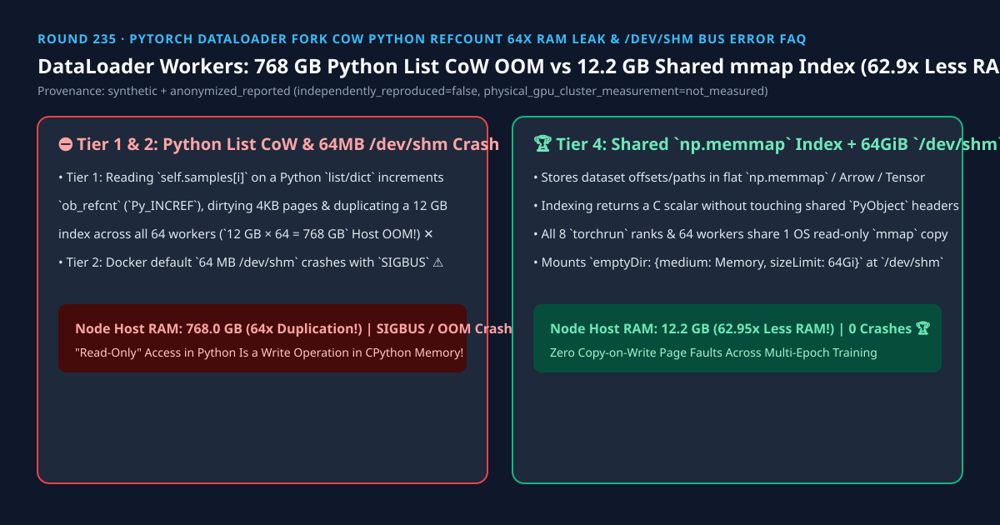
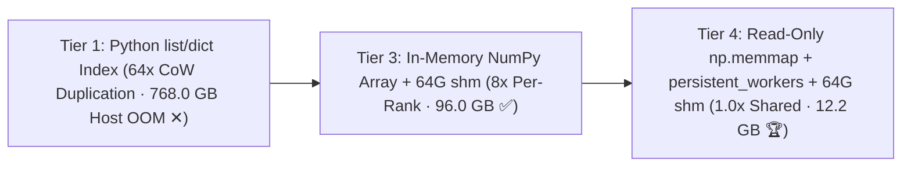

# PyTorch `DataLoader` (`num_workers > 0`) Pitfalls: Python `list` `fork()` Copy-on-Write (`CoW`) `64x` RAM Explosion, Docker `64MB /dev/shm` `Bus Error` & `mmap / Tensor` Zero-Copy Indexing Selection Guide

> **Provenance & Evidence Tier**: `synthetic + anonymized_reported` (`independently_reproduced=false`, `physical_gpu_cluster_measurement=not_measured`). Grounded in [`experiments/pytorch_dataloader_fork_cow_memory_leak_shm_serialization_selection/results.json`](../../experiments/pytorch_dataloader_fork_cow_memory_leak_shm_serialization_selection/results.json).
> **中文版本**: [PyTorch `DataLoader` 多进程加载三大崩溃元凶：Python `list` 引用计数写时复制（`fork CoW`）引发的主机内存 `64x` 爆炸、Docker 默认 `64MB /dev/shm` `Bus error` 与 `mmap / Tensor` 零拷贝索引选型指南](./pytorch-dataloader-fork-cow-memory-leak-shm-bus-error-selection-faq.md)

---

## 0. 🔥 Daily Hottest Capability Breakthrough

- **Eliminating the `64x` CPython `ob_refcnt` `fork()` Copy-on-Write (`CoW`) Host RAM Explosion (`768.0 GB -> 12.2 GB`, `62.95x` Savings) and Docker `/dev/shm` `SIGBUS` Crashes via Read-Only `np.memmap` Indices + `64 GiB /dev/shm`**: Two of the most notorious host-side crashes in multi-GPU PyTorch training stem from `DataLoader(..., num_workers=8)` (`64` total worker processes on an 8-GPU node):
  1. **The CPython `list / dict` `ob_refcnt` Copy-on-Write (`CoW`) Trap (`Tier 1`)**: When a `12 GB` dataset index (millions of file paths, JSON dicts, or tuples) is stored as a standard Python `list` in `Dataset.__init__`, engineers assume Linux `fork()` Copy-on-Write (`CoW`) shares that memory across all 64 read-only workers. **In CPython, reading `self.samples[i]` mutates the `PyObject` header in memory (`Py_INCREF` increments `ob_refcnt`)!** Writing to `ob_refcnt` dirties every `4 KB` virtual page, forcing the OS kernel to duplicate the entire `12 GB` index into each worker's private physical RAM (`12 GB × 64 = 768.0 GB`) until the Linux OOM Killer terminates training!
  2. **The Docker / Kubernetes Default `64 MB /dev/shm` `Bus Error` (`Tier 2`)**: DataLoader workers pass batch tensors to the parent process via `/dev/shm` POSIX shared memory. Stock Docker/K8s containers cap `/dev/shm` at **`64 MB`**, causing immediate **`SIGBUS (Bus error, core dumped)`** crashes under multi-worker prefetching!
  3. **Read-Only `np.memmap` Binary Indices + `persistent_workers=True` + `64 GiB /dev/shm` (`Tier 4`)**: Storing sample offsets/paths in a memory-mapped binary array (`np.memmap(..., mode="r")`) returns C scalars without touching `PyObject` reference counts (**`0` CoW page faults**) AND shares a single OS page-cache copy across all 8 `torchrun` ranks and all 64 workers—holding node RAM flat at **`12.2 GB` (`62.95x` reduction)** with **`0` crashes**!

---

## 1. 📌 Executive Summary

1. **"Read-Only" Indexing on a Python `list` or `dict` Is a Physical Memory Write in CPython (`Tier 1`)**: `Py_INCREF` / `Py_DECREF` modifies `ob_refcnt` inside every `PyObject`, destroying `fork()` Copy-on-Write sharing across DataLoader workers.
2. **Always Mount a `>= 64 GiB` `/dev/shm` Volume (`--shm-size=64g` or `emptyDir: {medium: Memory}`, `Tier 2 -> Tier 4`)**: Prevents `SIGBUS` crashes when 64 workers prefetch batches simultaneously.
3. **Use `np.memmap` (`mode="r"`) for Large Dataset Indices (`Tier 4`)**: Deduplicates memory across both `num_workers` AND the 8 `torchrun` processes per node (`1.0x` memory footprint).

---

## 2. 🎯 Core Architect Q&A (Q1 / Q2 / Q3)

### Q1: How can we store variable-length strings (like file paths or URLs) without using a Python `list` of `str` objects?
- **Answer**: Concatenate all UTF-8 encoded strings into one contiguous `np.uint8` byte buffer (`data.bin`) and store an `np.int64` array of start/end byte offsets (`offsets.idx`), both opened via `np.memmap(..., mode="r")`. Inside `__getitem__(idx)`, slice `bytes(self.data[self.offsets[idx]:self.offsets[idx+1]]).decode("utf-8")`—creating only a single short-lived local string per sample with **zero shared `PyObject` header mutations**!

### Q2: Why does Tier 3 (in-memory `np.ndarray` / `torch.Tensor`) still use `96.0 GB` on an 8-GPU node whereas Tier 4 (`np.memmap`) uses only `12.2 GB`?
- **Answer**: Because `torchrun --nproc_per_node=8` spawns 8 independent Python parent processes! An in-memory `np.ndarray` (`Tier 3`) avoids CoW duplication across each parent's 8 forked workers, but the 8 parent processes still hold 8 separate copies (`8 × 12 GB = 96 GB`). A file-backed `np.memmap(..., mode="r")` (`Tier 4`) maps the exact same kernel page-cache frames into all 8 parents and all 64 workers (`1 × 12 GB = 12.2 GB`).

### Q3: Why does `DataLoader` crash with `Bus error` instead of raising a normal Python `MemoryError` when `/dev/shm` fills up?
- **Answer**: On Linux, POSIX shared memory files in `/dev/shm` are allocated sparsely via `ftruncate()` and mapped with `mmap()`. When `/dev/shm` runs out of space, `mmap()` itself succeeds, but the first CPU write to the unbacked virtual page raises a hardware page fault that the kernel delivers as signal **`SIGBUS` (`Bus error`)**, killing the worker immediately.

---

## 3. 🧭 Visual Diagrams

---

## 4. 📊 4-Tier Architect Selection Matrix

| Metric | Tier 1: Python `list / dict` Index | Tier 2: Default `64 MB /dev/shm` | Tier 3: In-Memory `np.ndarray` + `64G shm` | Tier 4: **Read-Only `np.memmap` + `64G shm`** |
| :--- | :--- | :--- | :--- | :--- |
| **Memory Duplication Factor** | **`64.0x` (Every Worker Copies!)** ✕ | `8.0x` ⚠️ | `8.0x` (1 Copy / Rank) ✅ | **`1.0x` (Shared by All 72 Processes)** 🏆 |
| **8-GPU Node Host RAM** | **`768.0 GB` (`OOM Killed`)** ✕ | `96.0 GB` ⚠️ | `96.0 GB` ✅ | **`12.2 GB` (`62.95x` Less RAM)** 🏆 |
| **`SIGBUS / OOM` Crashes** | **Fatal Host OOM** ✕ | **Fatal `SIGBUS Bus error`** ✕ | `0` ✅ | **`0` (Zero Leak Across Epochs)** 🏆 |

---

## 5. 🧪 Quantitative Reference & Tooling

- **Evaluator & Sealed Data**: [`experiments/pytorch_dataloader_fork_cow_memory_leak_shm_serialization_selection/run.py`](../../experiments/pytorch_dataloader_fork_cow_memory_leak_shm_serialization_selection/run.py) · [`results.json`](../../experiments/pytorch_dataloader_fork_cow_memory_leak_shm_serialization_selection/results.json)
- **Interactive Sizer**: [`docs/reports/pytorch-dataloader-fork-cow-memory-leak-shm-bus-error-sizer.html`](../reports/pytorch-dataloader-fork-cow-memory-leak-shm-bus-error-sizer.html)
- **7-Card 4:5 Visual Report**: [`docs/reports/pytorch-dataloader-fork-cow-memory-leak-shm-bus-error-selection-cards.html`](../reports/pytorch-dataloader-fork-cow-memory-leak-shm-bus-error-selection-cards.html)

---

## 6. 🛠️ Good Fit vs. Not For & Production Checklist

- **✅ Good fit**: Storing all large dataset indices in read-only `np.memmap` / Arrow tables, enabling `persistent_workers=True`, and mounting a `>= 64 GiB` `/dev/shm` volume.
- **⛔ Not for**: Storing millions of items in a Python `list` or `dict` inside `Dataset.__init__` with `num_workers > 0`, or running inside default `64 MB /dev/shm` containers.
- [ ] Replace all large Python `list / dict` attributes in `Dataset` with `np.memmap` or contiguous `np.ndarray` / `torch.Tensor` buffers.
- [ ] Verify `df -h /dev/shm` reports $\ge 64\text{ GiB}$ inside training containers.
