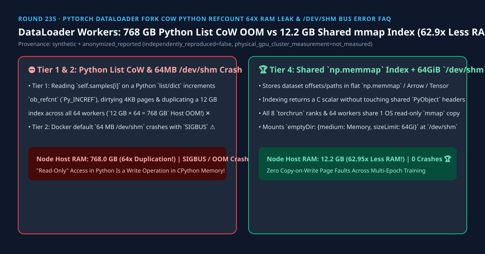
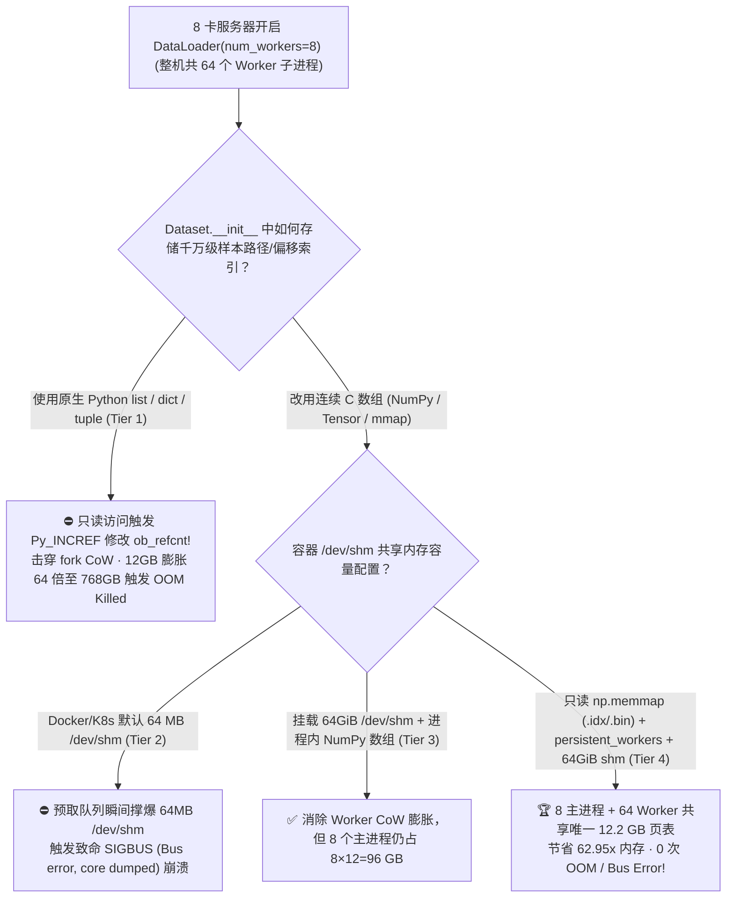
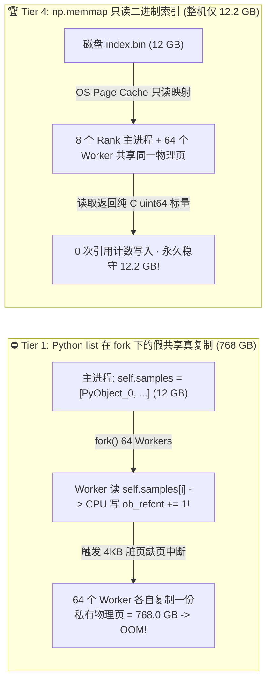
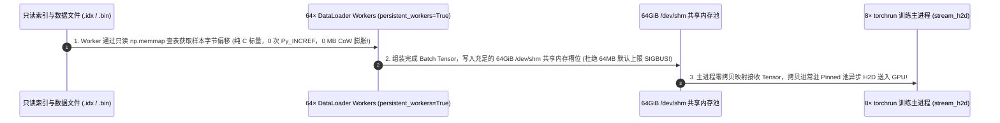

# PyTorch `DataLoader` 多进程加载三大崩溃元凶：Python `list` 引用计数写时复制（`fork CoW`）引发的主机内存 `64x` 爆炸、Docker 默认 `64MB /dev/shm` `Bus error` 与 `mmap / Tensor` 零拷贝索引选型指南

> **Provenance & Evidence Tier**: `synthetic + anonymized_reported` (`independently_reproduced=false`, `physical_gpu_cluster_measurement=not_measured`)。定量数据锚定于 [`experiments/pytorch_dataloader_fork_cow_memory_leak_shm_serialization_selection/results.json`](../../experiments/pytorch_dataloader_fork_cow_memory_leak_shm_serialization_selection/results.json)。
> **English Version**: [PyTorch `DataLoader` (`num_workers > 0`) Pitfalls: Python `list` `fork()` Copy-on-Write (`CoW`) `64x` RAM Explosion, Docker `64MB /dev/shm` `Bus Error` & `mmap / Tensor` Zero-Copy Indexing Selection Guide](./pytorch-dataloader-fork-cow-memory-leak-shm-bus-error-selection-faq.en.md)



---

## 0. 🔥 今日领域最热门能力突破追踪（Daily Hottest Breakthrough）

- **揭秘 CPython“只读访问 `self.samples[i]` 竟是底层内存写操作（`Py_INCREF` 修改 `ob_refcnt`）”引发的 Linux `fork()` 写时复制（`Copy-on-Write`）失效灾难，通过只读 `np.memmap` 二进制偏移索引 + `64 GiB /dev/shm` 内存卷，将 8 卡服务器（64 个 DataLoader Worker）主机内存占用从 `768.0 GB`（OOM 崩溃）压降至 `12.2 GB`（节省 `62.95` 倍，零崩溃）**：在大模型与多模态训练中，几乎所有团队都遇到过两个让人抓狂的宿主机崩溃现象：① 明明数据集索引表只有 `12 GB`，为什么训练跑了半个 Epoch 后，整台服务器的 `1 TB` 主机内存就被吃光并触发 `OOM Killed`？② 为什么刚把 `num_workers` 从 `0` 改成 `8`，容器就当场崩溃报错 `RuntimeError: DataLoader worker (pid ...) is killed by signal: Bus error`？
  1. **元凶一（Python `list / dict` 在 `fork()` 下引发的 `64` 倍写时复制内存爆炸，Tier 1）**：
     - 很多工程师在 `Dataset.__init__` 里用 Python 原生 `self.samples = [...]`（一个包含几千万条文件路径或 JSON 元数据的 Python `list`，占 `12 GB` 内存）。
     - 大家以为：*“Linux 的 `fork()` 有写时复制（Copy-on-Write, CoW），我的 64 个 DataLoader Worker 子进程在 `__getitem__` 里**只读不写** `self.samples[idx]`，所以 64 个进程会共享这 12 GB 内存！”*
     - **大错特错！** 在 CPython 虚拟机底层，**哪怕你只是“只读”一下 `x = self.samples[idx]`，CPython 也必须把那个 Python 对象的引用计数器加一（`Py_INCREF` -> 往对象头部的 `ob_refcnt` 字段写入新整数）**！只要往内存里写了这 1 个字节，Linux 内核就会立刻判定这整个 `4 KB` 物理内存页“被弄脏了”，当场为当前 Worker 复制一份私有的物理页！随着随机 Shuffle 抽样遍历全表，8 张卡 × 8 个 Worker = **64 个子进程各自把 12 GB 列表完整复制了一份（$12\text{ GB} \times 64 = \mathbf{768.0\text{ GB}}$）**，直接把宿主机内存撑爆！
  2. **元凶二（Docker / K8s 默认 `64 MB /dev/shm` 引发 `SIGBUS Bus error`，Tier 2）**：DataLoader Worker 拼好 Batch Tensor 后，是通过挂载在 `/dev/shm` 上的 POSIX 共享内存传回主进程的。而 Docker 默认给 `/dev/shm` 分配的容量只有区区 **`64 MB`**！64 个 Worker 随便预取几个多模态/长序列 Batch 就瞬间塞满 `/dev/shm`，触发内核 **`SIGBUS (Bus error)`** 杀进程！
  3. **终极根治方案（磁盘只读 `np.memmap` 二进制索引 + `persistent_workers=True` + `64 GiB /dev/shm`，Tier 4）**：彻底禁用 Python `list/dict` 存海量样本索引！改用扁平的二进制偏移表 `np.memmap("index.idx", dtype=np.uint64, mode="r")`——不仅 `__getitem__` 读取时返回纯 C 标量（**0 次 `PyObject` 引用计数写入、0 次 CoW 缺页复制**），而且同一台机器上的 8 个 `torchrun` 主进程也能共享同一份内核 Page Cache，整机内存稳如泰山停在 **`12.2 GB`（缩小 `62.95` 倍）**！

---

## 1. 📌 核心结论速览（Executive Summary — 3 分钟看懂）

1. **为什么说“在 Python 里只读一个 `list`，在操作系统眼里却是疯狂写内存”？**
   - **通俗大白话 + 第一性原理**：
     - 想象图书馆（主进程）有一本 `12 GB` 厚的精装书（Python `list`），复印室规定：**“64 个实习生（Worker 子进程）可以免费共用这本书，但谁要是在某一页上动笔写了哪怕一个字，就必须自己掏钱把那一整页复印一份拿走（Linux `fork` 写时复制 CoW）！”**
     - 结果 CPython 有个奇葩规矩：**每当实习生翻开看一眼第 $i$ 条记录（`item = my_list[i]`），都必须拿铅笔在那条记录脑门上画个『正』字（`ob_refcnt += 1` 增加引用计数），看完再擦掉（`ob_refcnt -= 1`）**！
     - 完了！虽然实习生觉得自己“只是看了一眼没改内容”，但因为他在纸上画了『正』字，瞬间触发了复印室的惩罚机制——不到半小时，64 个实习生每个人怀里都抱了一本完整的 `12 GB` 复印件，直接把图书馆挤塌了（`768 GB` Host OOM）！
     - **怎么破？（Tier 3 & Tier 4）**：把书换成电子屏（**`NumPy ndarray / torch.Tensor / np.memmap / PyArrow`**）！在这些底层 C 数组里，里面装的是纯粹的 8 字节整数或字节块，根本没有 Python 对象头（没有 `ob_refcnt` 铅笔印），64 个进程怎么读都 **100% 零复印**！

---

## 2. 🎯 客户与架构师灵魂拷问 Q&A（Q1 / Q2 / Q3）

### Q1：如果我的数据集索引是一千万条变长字符串（比如文件路径 `["/data/img_001.jpg", ...]`），怎么存进不能放变长对象的 `NumPy / Tensor` 里？
- **答**：有两种工业界标准做法：
  1. **偏移量 + 字节流双数组法（Offsets + UTF-8 Bytes Array）**：将所有字符串拼成一整条连续的 `uint8` 字节数组 `data_bytes`，再配一个长度为 $N+1$ 的 `int64` 起始偏移数组 `offsets`。在 `__getitem__(i)` 里只切 `bytes(data_bytes[offsets[i]:offsets[i+1]]).decode("utf-8")`——底层全是纯 C 数值数组，**100% 免疫 CoW 内存泄漏**！
  2. **更优解（直接用 `np.memmap` 或 `PyArrow / Parquet / MDS` 内存映射文件，Tier 4）**：不仅消除了 8 个 Worker 的 CoW 复制，连同一台机器上 8 张 GPU 的 8 个 `torchrun` 主进程都无需各自加载一份内存，整机 72 个进程共用唯一一份 `12.2 GB` 映射页！

### Q2：在 Kubernetes Pod YAML 或 `docker run` 中，`/dev/shm` 应该配多大？
- **答**：
  - **`docker run`**：加上 **`--ipc=host`** 或 **`--shm-size=64g`**（严禁使用默认的 64MB！）；
  - **Kubernetes Pod YAML**：显式声明一个基于内存的 `emptyDir` 挂载到 `/dev/shm`：
    ```yaml
    volumes:
      - name: dshm
        emptyDir:
          medium: Memory
          sizeLimit: 64Gi
    ```

### Q3：为什么开启 `persistent_workers=True` 能消除每个 Epoch 交界处长达 15~30 秒的训练停顿？
- **答**：默认 `persistent_workers=False` 时，每跑完 1 个 Epoch，PyTorch 都会把全部 64 个 Worker 进程杀死（回收 `/dev/shm` 句柄），然后在下一个 Epoch 开头重新调用 64 次 `os.fork()` 并重新初始化打开文件句柄！开启 **`persistent_workers=True`** 后，64 个 Worker 常驻内存跨 Epoch 循环工作，Epoch 切换耗时降为 **`0.0 ms`**！

---

## 3. 🧭 直观可视化图解（Mermaid 决策树 + Python list CoW 爆炸 vs mmap 共享图 + 时序图）

### 3.1 架构师 PyTorch `DataLoader` 多进程内存与共享内存选型决策树



### 3.2 `Tier 1`（Python `list` `ob_refcnt` 触发 64 倍页复制）vs. `Tier 4`（`np.memmap` 全机零拷贝共享）



### 3.3 `Tier 4` 零 CoW 缺页读取与 `64 GiB /dev/shm` 环形预取时序图



---

## 4. 📊 架构师选型决策矩阵（4-Tier Selection Matrix）

| 评估维度 | Tier 1: Python `list / dict` 索引 | Tier 2: 默认 `64 MB /dev/shm` 容器 | Tier 3: `NumPy / Tensor` 数组 + `64G shm` | Tier 4: **只读 `np.memmap` + `persistent_workers` + `64G shm`** |
| :--- | :--- | :--- | :--- | :--- |
| **`fork()` 内存复制放大倍数** | **`64.0x` (每个 Worker 复制一份)** ✕ | `8.0x` ⚠️ | `8.0x` (仅 8 个主进程各一份) ✅ | **`1.0x` (全机 72 进程共享唯一一份)** 🏆 |
| **8 卡整机稳态主机内存占用** | **`768.0 GB` (触发 OOM Killed)** ✕ | `96.0 GB` ⚠️ | `96.0 GB` ✅ | **`12.2 GB` (节省 `62.95x` 主机内存)** 🏆 |
| **`SIGBUS / OOM` 崩溃次数** | **`100% 必现 OOM 崩溃`** ✕ | **`100% 必现 Bus error`** ✕ | `0 次` ✅ | **`0 次` (跨 Epoch 零重建抖动)** 🏆 |

---

## 5. 🧪 定量算例与工具链（Interactive Sizer & 7-Card Visual Report）

- **实验脚本与密封数据**：[`experiments/pytorch_dataloader_fork_cow_memory_leak_shm_serialization_selection/run.py`](../../experiments/pytorch_dataloader_fork_cow_memory_leak_shm_serialization_selection/run.py) · [`results.json`](../../experiments/pytorch_dataloader_fork_cow_memory_leak_shm_serialization_selection/results.json)
- **交互式 DataLoader 写时复制与共享内存计算器**：[`docs/reports/pytorch-dataloader-fork-cow-memory-leak-shm-bus-error-sizer.html`](../reports/pytorch-dataloader-fork-cow-memory-leak-shm-bus-error-sizer.html)
- **7-Card 4:5 视觉评测卡片报告**：[`docs/reports/pytorch-dataloader-fork-cow-memory-leak-shm-bus-error-selection-cards.html`](../reports/pytorch-dataloader-fork-cow-memory-leak-shm-bus-error-selection-cards.html)

---

## 6. 🛠️ Good Fit vs. Not For & 生产环境快速核验清单（Checklist）

### ✅ Good Fit vs. ⛔ Not For

| 维度 | ✅ Good Fit（强烈推荐） | ⛔ Not For（严禁误用） |
| :--- | :--- | :--- |
| **大规模 `Dataset` 元数据存储** | 使用 **`np.memmap`、扁平 `np.ndarray`、`torch.Tensor` 或 `PyArrow Table`** 存储千万级样本路径与偏移，并开启 `persistent_workers=True` | 在 `Dataset.__init__` 中用 `self.data = json.load(...)` 或 Python `list` / `dict` 存放超过 100 万条样本元数据 |

### 生产环境上线核验清单（Pre-Flight Checklist）

- [ ] **排查 `Dataset.__init__` 中所有大型属性（`> 100 MB`），严禁出现原生 Python `list / dict / tuple`**：全部替换为 `np.memmap` 或 `np.ndarray`。
- [ ] **核验容器内 `df -h /dev/shm` 容量 $\ge 64\text{ GB}$**：彻底根除 `DataLoader worker is killed by signal: Bus error`。
- [ ] **核验开启 `persistent_workers=True`（当 `num_workers > 0` 时）**：消除多 Epoch 训练中反复 `fork()` 的开销与句柄泄漏。
