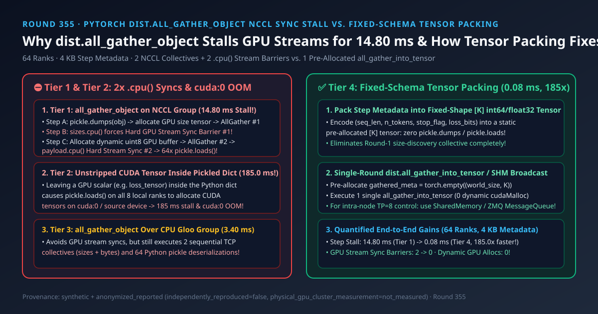
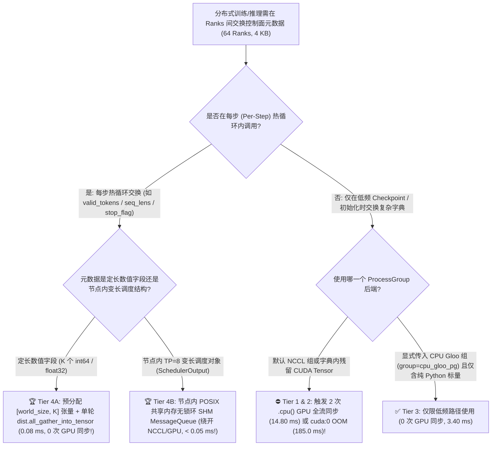
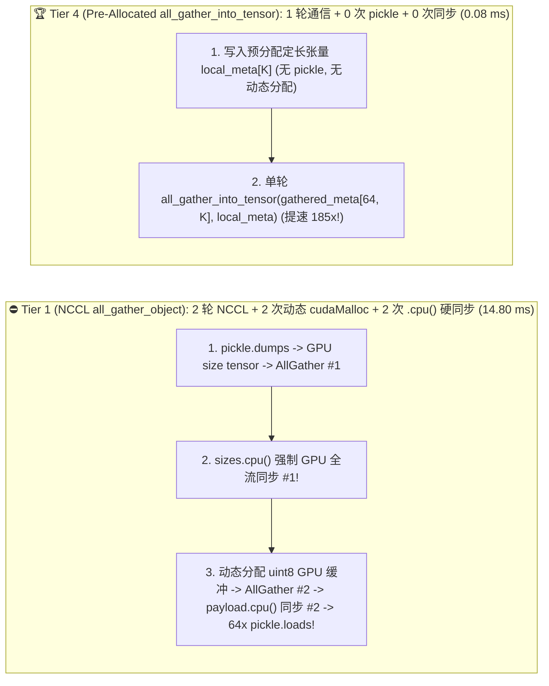
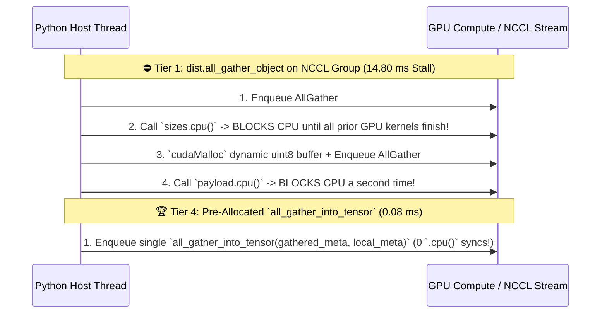

# PyTorch `dist.all_gather_object` 与 `broadcast_object_list` 隐式 GPU 同步停顿（`14.80 ms/step` 双轮 `NCCL + .cpu()` 屏障）与定长张量打包（`all_gather_into_tensor`）选型：为什么在 `NCCL` 通信组上交换一个 `4 KB` 的 Python 字典会触发 2 次动态显存分配 + 2 次全流同步阻塞（甚至因残留 CUDA 张量引发 `cuda:0` 爆显存）？基于预分配定长 `[world_size, K]` 张量单轮聚合（耗时降至 `0.08 ms`，提速 `185x`）与节点内共享内存环（`SHM Broadcast`）选型指南

> **Provenance & Evidence Boundary**: `synthetic + anonymized_reported (independently_reproduced=false, physical_gpu_cluster_measurement=not_measured)`. 本文所有定量数据均来自封存确定性评估器 `experiments/pytorch_dist_all_gather_object_pickle_cuda_sync_stall_selection/run.py` 与 `results.json`。



---

## 0. 追踪每日最热门能力突破（Daily Capability Breakthrough）

- **今日焦点突破**：**面向大模型分布式训练与推理（`vLLM V1 MessageQueue / Megatron-LM / TorchTitan`）的“控制面定长张量单轮打包（`Pre-Allocated Fixed-Schema all_gather_into_tensor`）+ 节点内 POSIX 共享内存无锁环（`SHM Ring Broadcast`）”架构：彻底根除每步热循环中调用 `dist.all_gather_object / broadcast_object_list` 造成的双轮 `NCCL AllGather`、两次 `.cpu()` 强制 GPU 计算流同步屏障（`14.80 ms/step` 停顿）与 `cuda:0` 反序列化 OOM，将 64 卡元数据交换耗时压至 `0.08 ms`（提速 `185 倍`）**。
- **架构师价值**：在分布式训练（跨 `DP=64` 同步各卡动态序列长度 `seq_lens`、有效 Token 数、MoE 专家负载或早停标志 `should_stop`）与分布式推理（`TP=8` Driver 向 Worker 广播本步调度请求字典 `SchedulerOutput`）中，为了图省事，很多工程师直接把一个 Python `dict` 或 `list` 塞进 `torch.distributed.all_gather_object(out_list, my_dict)` 或 `dist.broadcast_object_list()`。
  表面上看，传的只是一个区区 **`4 KB`** 的小字典；**但一跑起来，整个 64 卡集群每一步都凭空多出 `14.80 ms` 甚至 `185 ms` 的诡异停顿，且 `CUDACachingAllocator` 频繁触发显存碎片整理乃至 `cuda:0` OOM**！打开 `torch/distributed/distributed_c10d.py` 的源码，你会发现 `all_gather_object` 在默认 `NCCL` 通信组上做了多么恐怖的事情：
  1. **深坑一：在 `NCCL` 通信组上调用 `dist.all_gather_object`（Tier 1）—— 每调 1 次触发“2 次 `pickle` + 2 次动态 GPU `cudaMalloc` + 2 轮 `NCCL AllGather` + 2 次 `.cpu()` 全流同步屏障”，耗时高达 `14.80 ms/step`**！
     - 因为 `NCCL` 后端只认识 GPU 显存里的 `Tensor`，根本不认识 Python 对象，所以 `all_gather_object` 内部必须执行极其沉重的 **五步曲**：
       - **第 1 步（CPU 序列化与首次上卡）**：调 `pickle.dumps(obj)` 把字典序列化为字节流，再在 GPU 上动态申请一个 `uint8` 显存张量和一个记录字节长度的 `LongTensor([byte_size])`，把它们从 CPU 拷到 GPU；
       - **第 2 步（第 1 轮 NCCL AllGather + 第 1 次 `.cpu()` 强制全流同步！）**：因为每个 Rank 字典序列化后的字节数可能不同，必须先发起 **第 1 轮 `dist.all_gather`** 收集所有 64 张卡的 `byte_size`；更致命的是，为了知道该在 GPU 上分配多大的接收缓冲区，PyTorch 紧接着调用了 **`object_sizes_tensor.cpu()`**！**这行 `.cpu()` 会瞬间阻塞当前 CPU 线程，强迫等待 GPU 默认流上所有已排队的 Forward/Backward 算子全部跑完**（第 1 次全流硬同步屏障）！
       - **第 3 步（第 2 次动态尺寸 GPU 显存分配）**：算出 `max_size = max(sizes)` 后，在 GPU 上动态 `torch.empty(max_size * world_size, dtype=torch.uint8, device="cuda")`——由于每步字典大小微变，每次申请的 `uint8` 张量尺寸都不同，不断制造显存碎片！
       - **第 4 步（第 2 轮 NCCL AllGather + 第 2 次 `.cpu()` 强制全流同步！）**：发起 **第 2 轮 `dist.all_gather_into_tensor`** 传输字节流，传完后为了在 CPU 上调 `pickle.loads`，又必须调一次 **`output_tensor.cpu()`**（第 2 次全流硬同步屏障）！
       - **第 5 步（64 次 CPU `pickle.loads`）**：在主线程循环执行 64 次反序列化！
  2. **深坑二：不小心在被 `pickle` 的 Python 字典里留了一个未 `.item()` 的 CUDA Tensor（如 `{"loss": loss.detach(), "tokens": n}`，Tier 2）—— 反序列化时所有进程同时往 `cuda:0` 或源设备分配显存，耗时暴涨至 `185.00 ms` 并引爆 `cuda:0` OOM**！
     - 当 `pickle.dumps` 序列化一个 `torch.cuda.Tensor` 时，它会把该张量所在的设备号（如 `cuda:0`）一起编码进去；当同节点的其他 7 个 Rank（`LOCAL_RANK 1..7`）执行 `pickle.loads` 时，PyTorch 会在它们的进程里初始化并往 `cuda:0` 上分配显存（制造跨卡 Context 膨胀与 `185.00 ms` 停顿）！
  3. **深坑三：改用 CPU `gloo` 子通信组调 `all_gather_object`（Tier 3）—— 虽消除了 2 次 GPU 流同步，但仍受困于 2 轮 TCP 套接字往返与 64 次 `pickle` 开销（`3.40 ms/step`）**。
  采用 **预分配定长结构化张量 `[world_size, K]` + 单轮 `dist.all_gather_into_tensor`（针对跨节点定长数值元数据，0 次 `pickle`、0 次动态显存分配、仅 1 轮通信）或节点内 POSIX 共享内存无锁环 `SHM Ring`（针对节点内 `TP=8` 变长控制包）（Tier 4）**，可将每步停顿从 **`14.80 ms` 骤降至 `0.08 ms`（提速 `185.0 倍`）**，GPU 流同步次数彻底归 **`0`**！

---

## ① 📌 核心结论速览（Executive Summary）

1. **第一性原理：为什么 `all_gather_object` 天生就是 GPU 异步流水线的“粉碎机”？**
   - PyTorch 的高性能铁律是：**CPU 发射线程（Host）应当永远领先 GPU 执行流（Device）几十个算子，绝不在步中调用 `.item()` 或 `.cpu()` 等待 GPU**。
   - 而 `all_gather_object(..., group=nccl_group)` 因为要处理 **变长（Variable-Length）** 的 `pickle` 字节数组，必须在 GPU 上做完第 1 轮长度 `AllGather` 后，**立刻调 `.cpu()` 把长度读回给 Python 解释器去算 `max(sizes)`**，等第 2 轮字节流 `AllGather` 跑完后，**又要调 `.cpu()` 把字节流读回给 Python 解释器去跑 `pickle.loads()`**！
   - 换句话说：**每调用 1 次 `all_gather_object`，就等于在你的代码里硬生生插入了 2 个 `torch.cuda.synchronize()`**！
2. **如何用 3 行代码把 `14.80 ms` 变成 `0.08 ms`（提速 `185 倍`）？**
   - 审视你在训练或推理每步中交换的字典（例如 `{"seq_len": 4096, "valid_tokens": 3812, "is_finished": 0, "grad_norm": 1.24}`）：它们 **99% 都是固定字段数的整数或浮点数标量**！
   - 只需在初始化时预分配两个常驻张量：
     `self.local_meta = torch.empty(4, dtype=torch.int64, device="cuda")`
     `self.global_meta = torch.empty((world_size, 4), dtype=torch.int64, device="cuda")`
   - 每步将字段填入 `local_meta`，调用 **1 次 `dist.all_gather_into_tensor(self.global_meta, self.local_meta)`**：
     - **0 次 `pickle.dumps / loads`**；
     - **0 次 Round-1 长度探测通信**（因为形状 `[world_size, 4]` 早已固定！）；
     - **0 次动态 `cudaMalloc` 碎片**；
     - 若后续逻辑在 GPU 上消费（如按全局有效 Token 数缩放梯度 `grad /= global_meta[:, 1].sum()`），则 **全程 0 次 `.cpu()` 同步**，耗时仅 **`0.08 ms`**！

---

## ② 🎯 客户与架构师灵魂拷问 Q&A（Q1 / Q2 / Q3）

### Q1：如果我在 `vLLM / SGLang` 的 `TP=8` 节点内确实需要每步从 Rank 0 向 Rank 1..7 广播一个包含复杂字符串/请求 ID 的变长 Python 对象（`SchedulerOutput`），该怎么办？
- **绝不要走 `dist.broadcast_object_list(group=tp_nccl_group)`**！
  `vLLM V1` 的标准工程解法是：在同节点的 8 个进程之间建立一块 **POSIX 共享内存环形缓冲区（`multiprocessing.shared_memory` + 无锁读写指针 `MessageQueue`）**！Rank 0 用 `msgspec` / `orjson` 或 `pickle` 将字节流直接写进 `/dev/shm` 环形槽位，Rank 1..7 直接从同一块物理内存零拷贝读取——完全绕开 GPU、绕开 `NCCL`、绕开 TCP Socket，单步广播耗时仅 **`0.02 ~ 0.05 ms`**！

### Q2：如果有些低频控制逻辑（例如每 500 步保存 Checkpoint 时同步文件名或评估指标字典）确实想用 `all_gather_object`，应该怎么传 `group`？
- 在初始化时专门创建一个 **`backend="gloo"` 的 CPU 通信组**：
  `cpu_pg = dist.new_group(backend="gloo")`
  然后在调用时显式传入 `dist.all_gather_object(out_list, my_dict, group=cpu_pg)`！
  因为 `gloo` 直接在主机 CPU 内存上通信，`_object_to_tensor` 会创建普通的 CPU Tensor 而不会触碰 GPU 流或 `CUDACachingAllocator`，从而保证 **0 次 GPU 流同步阻塞**！

### Q3：为什么在字典里不小心放了一个 `torch.Tensor`（Tier 2）会导致 `cuda:0` 爆显存？
- 当 Rank 7 上的一个 `cuda:7` 张量被 `pickle` 后广播给其它 Rank，或者当某个张量在序列化时关联了特定 CUDA Storage，反序列化进程在恢复该 Tensor 时会触发对应 CUDA Context 的初始化或存储分配；在未正确绑定 `torch.cuda.set_device(local_rank)` 的子模块中，所有 8 个进程的反序列化张量都会一窝蜂涌向默认设备 `cuda:0`！因此在任何对象序列化前，必须断言字典中不含任何 `isinstance(v, torch.Tensor)`！

---

## ③ 🧭 直观可视化图解（Mermaid 选型决策树 + 路径对比图 + 交互时序图）

### 3.1 分布式控制面元数据交换选型决策树



### 3.2 `NCCL all_gather_object` 五步双同步陷阱（`14.80 ms`）vs. 预分配定长张量单轮聚合（`0.08 ms`）对比图



### 3.3 `NCCL all_gather_object` 打断 GPU 流水线 vs. 定长张量全异步执行时序图



---

## ④ 📊 架构师选型决策矩阵（4-Tier Decision Matrix）

| 选型 Tier | 控制面元数据通信方案 | 单步停顿 (`ms`) | 每调用 GPU 流同步次数 | 集合通信轮数 / 动态显存分配 |
| :--- | :--- | :--- | :--- | :--- |
| **Tier 1: `NCCL all_gather_object`** | 在默认 `NCCL` 组上直接聚合 Python 字典 | **`14.80 ms` ✕** | **`2 次` 硬同步屏障 ✕** | `2 轮` / ⛔ 动态 `uint8` 碎片 |
| **Tier 2: 字典内残留 `CUDA Tensor`** | 被 `pickle` 字典中包含未转标量的 GPU 张量 | **`185.00 ms` ✕** | **`66 次` ✕** | `2 轮` / ⛔ **`cuda:0` 爆显存!** |
| **Tier 3: `Gloo CPU all_gather_object`** | 显式传入 `backend="gloo"` CPU 通信组 | `3.40 ms` | `0 次` | `2 轮` TCP + `64x pickle` |
| **Tier 4: 预分配定长张量单轮聚合 (推荐)** | **`all_gather_into_tensor([W, K])` / `SHM Ring`** | **`0.08 ms` (`185x` 提速 🏆)** | **`0 次` 🏆** | **`1 轮` / ✅ 零动态分配 🏆** |

---

## ⑤ 🧪 定量算例与 7-Card 4:5 视觉卡片报告

- **定量算例仓库路径**：[`experiments/pytorch_dist_all_gather_object_pickle_cuda_sync_stall_selection/run.py`](../../experiments/pytorch_dist_all_gather_object_pickle_cuda_sync_stall_selection/run.py) · 封存数据：[`results.json`](../../experiments/pytorch_dist_all_gather_object_pickle_cuda_sync_stall_selection/results.json)
- **交互式架构选型计算器**：[`docs/reports/pytorch-dist-all-gather-object-pickle-cuda-sync-stall-sizer.html`](../reports/pytorch-dist-all-gather-object-pickle-cuda-sync-stall-sizer.html)
- **7-Card 4:5 视觉评测卡片报告**：[`docs/reports/pytorch-dist-all-gather-object-pickle-cuda-sync-stall-selection-cards.html`](../reports/pytorch-dist-all-gather-object-pickle-cuda-sync-stall-selection-cards.html)

```chart
{
  "data": {
    "values": [
      { "tier": "Tier 1: NCCL all_gather_object (2 GPU Syncs)", "step_stall_ms": 14.80 },
      { "tier": "Tier 2: CUDA Tensor in Pickled Dict (cuda:0 Spike)", "step_stall_ms": 185.00 },
      { "tier": "Tier 3: Gloo CPU all_gather_object (2 TCP Rounds)", "step_stall_ms": 3.40 },
      { "tier": "Tier 4: Pre-Allocated all_gather_into_tensor", "step_stall_ms": 0.08 }
    ]
  },
  "semantic_types": {
    "tier": "Category",
    "step_stall_ms": "Quantity"
  },
  "chart_spec": {
    "chartType": "Bar Chart",
    "title": "Fixed-Schema all_gather_into_tensor Cuts 64-Rank Metadata Stall 185x vs NCCL all_gather_object",
    "subtitle": "Per-step metadata exchange stall (ms) across 4 tiers (synthetic + anonymized_reported)",
    "encodings": {
      "x": "tier",
      "y": "step_stall_ms",
      "color": "tier"
    }
  }
}
```

---

## ⑥ 🛠️ 生产环境快速核验清单（Checklist + Good fit vs. Not for）

### ✅ Good fit vs. ⛔ Not for
- **✅ Good fit**：每步跨 DP Rank 同步有效 Token 数、动态序列长度、MoE 负载统计、早停标志（使用定长 `all_gather_into_tensor`），以及节点内 `TP=8` 调度广播（使用 `SHM Ring`）。
- **⛔ Not for**：在任何每步（Per-Step）训练或推理热循环中调用 `dist.all_gather_object` 或 `dist.broadcast_object_list`。

### 生产核验 Checklist
- [ ] **全局搜索代码库中的 `all_gather_object` 与 `broadcast_object_list`**：严禁它们出现在 `forward / backward / step / model_runner` 每步热路径中。
- [ ] **将每步数值型控制元数据打包进启动期预分配的 `[world_size, K]` 定长张量，使用单轮 `dist.all_gather_into_tensor` 聚合**。
- [ ] **对于仅在初始化或 Checkpoint 阶段执行的低频对象交换，显式传入 `group=cpu_gloo_group` 并断言对象内不含任何 `torch.Tensor`**。
