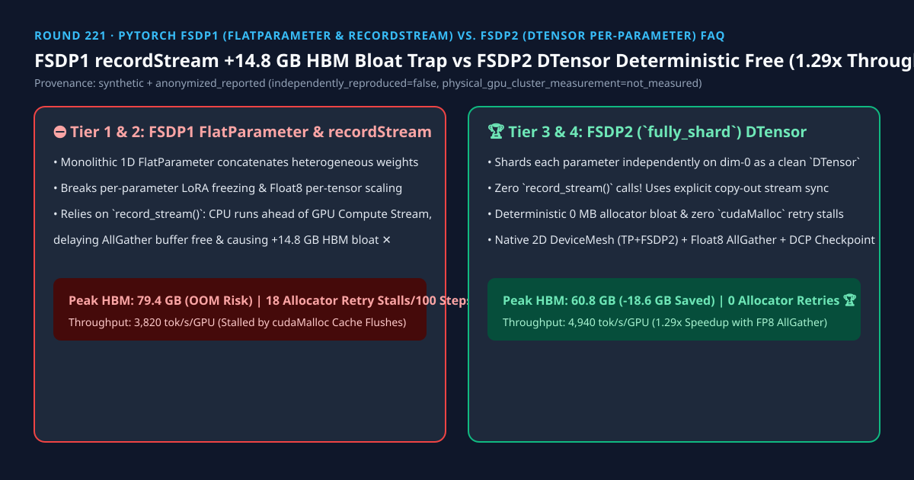
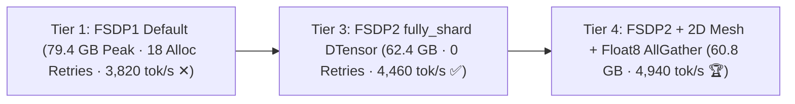

# PyTorch `FSDP1` (`FlatParameter` & `recordStream` Bloat) vs. `FSDP2` (`fully_shard` Per-Parameter `DTensor`) Selection Guide

> **Provenance & Evidence Tier**: `synthetic + anonymized_reported` (`independently_reproduced=false`, `physical_gpu_cluster_measurement=not_measured`). Grounded in [`experiments/pytorch_fsdp2_dtensor_per_param_recordstream_selection/results.json`](../../experiments/pytorch_fsdp2_dtensor_per_param_recordstream_selection/results.json).
> **中文版本**: [PyTorch `FSDP1`（`FlatParameter` 拼接与 `recordStream` 显存暴涨陷阱）vs. `FSDP2`（`fully_shard` 逐参数 `DTensor` 与确定性释放）选型指南](./pytorch-fsdp2-dtensor-per-parameter-sharding-recordstream-selection-faq.md)

---

## 0. 🔥 Daily Hottest Capability Breakthrough

- **PyTorch `FSDP2` (`fully_shard`) Eliminating `+14.8 GB` `record_stream` HBM Bloat and Unlocking `1.29x` Faster Training with Composable `DTensor` + `Float8 AllGather`**: Legacy `FSDP1` (`FullyShardedDataParallel`) concatenates heterogeneous parameters into a single 1D `FlatParameter` and relies on `tensor.record_stream()` to manage cross-stream lifetimes between the `AllGather` communication stream and the compute stream. Because the host CPU thread enqueues kernels much faster than the GPU executes them, `FSDP1` without strict throttling (**Tier 1**) accumulates **`+14.8 GB` of in-flight `AllGather` buffers (`79.4 GB` peak reserved HBM on 80GB H100)** and triggers **`18` blocking `cudaMalloc` allocator cache-flush retries per 100 steps (`3,820 tok/s/GPU`)**! Even with `limit_all_gathers=True` (**Tier 2**, `65.2 GB`), `FlatParameter` breaks per-parameter freezing (`LoRA` / VLM frozen vision encoders) and `Float8Tensor` subclass composability. **`FSDP2` (`fully_shard`, Tier 3 & Tier 4)** represents each parameter independently as a `dim-0` sharded `DTensor` with **zero `record_stream` calls (`0.0 GB` bloat, `0` allocator retries, `60.8 GB` peak HBM)** and natively composes with 2D `DeviceMesh (TP + HSDP)` and **Float8 `AllGather` (`4,940 tok/s/GPU`, `1.29x` speedup)**!

---

## 1. 📌 Executive Summary

1. **Why `FSDP1` `FlatParameter` Is an Architectural Dead End (`Tier 1 & Tier 2`)**: Flattening and concatenating multiple `nn.Parameter` tensors into a 1D `FlatParameter` destroys per-parameter metadata, making it painful to mix frozen and trainable weights, apply per-tensor `Float8` scaling, or combine `FSDP` with Tensor Parallelism (`TP`).
2. **Why `record_stream()` Causes Non-Deterministic OOMs (`Tier 1`)**: In `FSDP1`, `record_stream` ties buffer deallocation to GPU compute stream progress. When the CPU runs ahead of the GPU, unfreed `AllGather` buffers pile up in the caching allocator (`+14.8 GB`).
3. **Why `FSDP2` (`fully_shard`) Is Strictly Superior (`Tier 3 & Tier 4`)**: `FSDP2` shards each parameter cleanly along `dim-0` as a `DTensor` and manages communication buffers deterministically without `record_stream`.

---

## 2. 🎯 Core Architect Q&A (Q1 / Q2 / Q3)

### Q1: How does `FSDP2` avoid `record_stream()` while still overlapping `AllGather` communication with compute?
- **Answer**: `FSDP2` uses explicit stream-to-stream `cudaEvent` synchronization between the `AllGather` copy-out stream and the compute stream, deterministically recycling the unsharded parameter storage immediately at the end of each module's forward/backward hook without leaking lifetime tracking into `CUDACachingAllocator`.

### Q2: If `FSDP2` shards each parameter individually instead of using a single `FlatParameter`, doesn't it launch too many small `AllGather` collectives?
- **Answer**: No! While each `nn.Parameter` remains a distinct `DTensor` logically, `FSDP2` packs all parameters belonging to a `fully_shard` module group into a single contiguous staging buffer during the `AllGather` collective, preserving large-message network efficiency while keeping parameter boundaries intact.

### Q3: How do we check if an existing training job is suffering from `record_stream` allocator stalls?
- **Answer**: Inspect `torch.cuda.memory_stats()["num_alloc_retries"]`. Any non-zero or climbing count during steady-state steps indicates that `CUDACachingAllocator` is hitting the HBM ceiling and blocking the host CPU to flush cached blocks.

---

## 3. 🧭 Visual Diagrams

---

## 4. 📊 4-Tier Architect Selection Matrix

| Metric | Tier 1: `FSDP1` Default (`record_stream`) | Tier 2: `FSDP1` (`limit_all_gathers`) | Tier 3: `FSDP2` (`fully_shard` `DTensor`) | Tier 4: `FSDP2` + `2D Mesh` + `Float8 AllGather` |
| :--- | :--- | :--- | :--- | :--- |
| **Peak Reserved HBM (80GB)** | **`79.4 GB` (Near OOM)** ✕ | `65.2 GB` ⚠️ | **`62.4 GB`** ✅ | **`60.8 GB` (`-18.6 GB` Saved)** 🏆 |
| **`record_stream` HBM Bloat** | **`+14.8 GB`** ✕ | `+2.4 GB` ⚠️ | **`0.0 GB` (No `record_stream`)** ✅ | **`0.0 GB` (Deterministic Free)** 🏆 |
| **`cudaMalloc` Retries / 100 Steps** | **`18` (Severe Stalls)** ✕ | `2` ⚠️ | **`0`** ✅ | **`0`** 🏆 |
| **Throughput (`tok/s/GPU`)** | `3,820 tok/s` (`1.00x`) ✕ | `4,180 tok/s` (`1.09x`) ⚠️ | `4,460 tok/s` (`1.17x`) ✅ | **`4,940 tok/s` (`1.29x`)** 🏆 |

---

## 5. 🧪 Quantitative Reference & Tooling

- **Evaluator & Sealed Data**: [`experiments/pytorch_fsdp2_dtensor_per_param_recordstream_selection/run.py`](../../experiments/pytorch_fsdp2_dtensor_per_param_recordstream_selection/run.py) · [`results.json`](../../experiments/pytorch_fsdp2_dtensor_per_param_recordstream_selection/results.json)
- **Interactive Sizer**: [`docs/reports/pytorch-fsdp2-dtensor-per-parameter-sharding-recordstream-sizer.html`](../reports/pytorch-fsdp2-dtensor-per-parameter-sharding-recordstream-sizer.html)
- **7-Card 4:5 Visual Report**: [`docs/reports/pytorch-fsdp2-dtensor-per-parameter-sharding-recordstream-selection-cards.html`](../reports/pytorch-fsdp2-dtensor-per-parameter-sharding-recordstream-selection-cards.html)

---

## 6. 🛠️ Good Fit vs. Not For & Production Checklist

- **✅ Good fit**: All modern PyTorch 2.5+ / TorchTitan LLM, VLM, and MoE training workloads requiring deterministic memory, per-parameter freezing (`LoRA`), 2D/3D `DeviceMesh` parallelism, and `Float8` quantized `AllGather`.
- **⛔ Not for**: New training pipelines using legacy `FSDP1` (`FlatParameter`) or running without monitoring `num_alloc_retries`.
- [ ] Apply `fully_shard` bottom-up to each `TransformerBlock` and then to the root model.
- [ ] Verify `torch.cuda.memory_stats()["num_alloc_retries"] == 0` in steady-state training.
