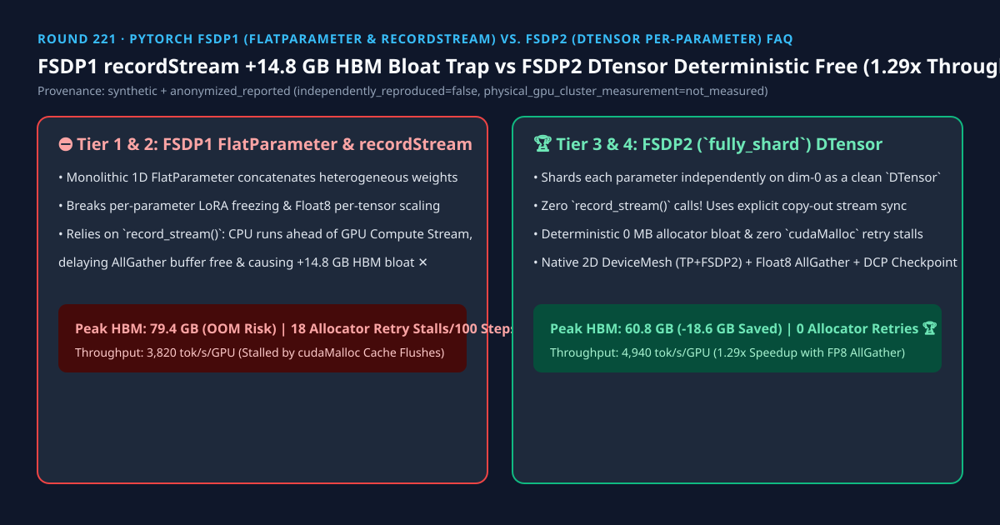
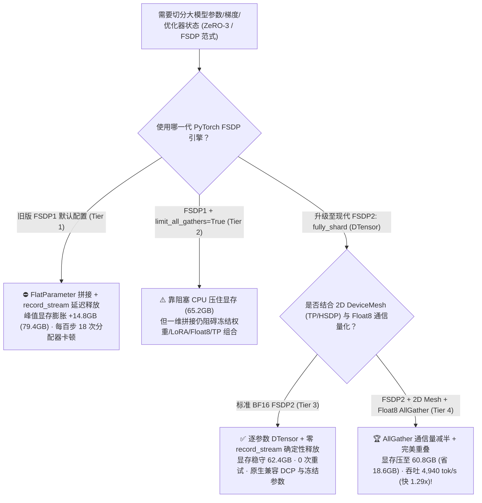
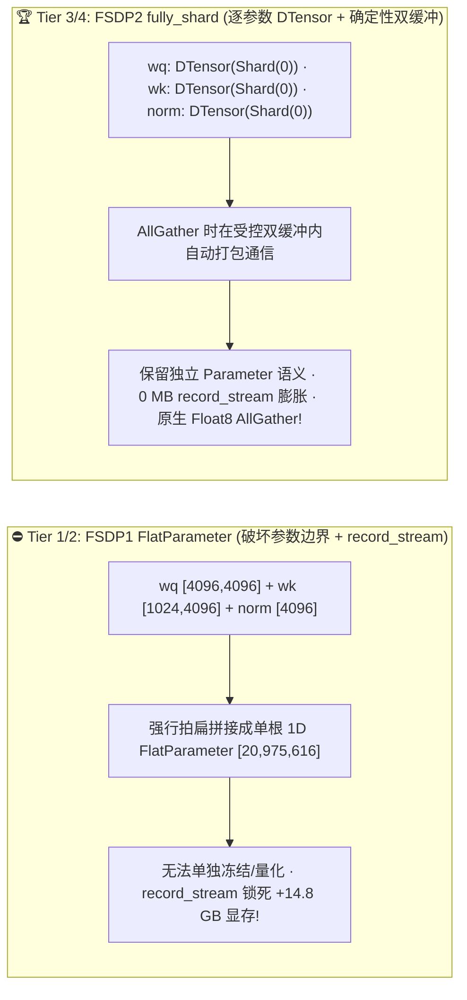
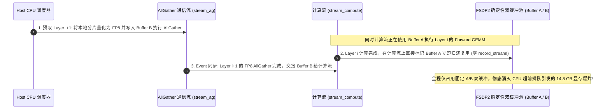

# PyTorch `FSDP1`（`FlatParameter` 拼接与 `recordStream` 显存暴涨陷阱）vs. `FSDP2`（`fully_shard` 逐参数 `DTensor` 与确定性释放）选型指南

> **Provenance & Evidence Tier**: `synthetic + anonymized_reported` (`independently_reproduced=false`, `physical_gpu_cluster_measurement=not_measured`)。定量数据锚定于 [`experiments/pytorch_fsdp2_dtensor_per_param_recordstream_selection/results.json`](../../experiments/pytorch_fsdp2_dtensor_per_param_recordstream_selection/results.json)。
> **English Version**: [PyTorch `FSDP1` (`FlatParameter` & `recordStream` Bloat) vs. `FSDP2` (`fully_shard` Per-Parameter `DTensor`) Selection Guide](./pytorch-fsdp2-dtensor-per-parameter-sharding-recordstream-selection-faq.en.md)

---

## 0. 🔥 今日领域最热门能力突破追踪（Daily Hottest Breakthrough）

- **PyTorch `FSDP2`（`torch.distributed.fsdp.fully_shard`）以逐参数 `DTensor` 切分与零 `record_stream` 确定性双流释放架构，彻底终结 `FSDP1` 的 `+14.8 GB` 显存幽灵暴涨与 `cudaMalloc` 清缓存卡顿，结合 `Float8 AllGather` 提速 `1.29` 倍**：在 64 卡至千卡 H100（80GB）集群上训练 70B+ 大模型或多模态 VLM（部分视觉塔冻结 + LLM 微调）时，第一代 `FullyShardedDataParallel`（`FSDP1`）有两大架构原罪：
  1. **原罪一（`record_stream` 引发的 `+14.8 GB` 显存幽灵膨胀与 `cudaMalloc` 重试风暴，Tier 1）**：在 `FSDP1` 中，`AllGather` 运行在通信流（`stream_allgather`），而矩阵乘运行在计算流（`stream_compute`）。为了防止通信流提前释放刚聚拢好的完整权重，FSDP1 对每个块调用了 `tensor.record_stream(stream_compute)`。然而，由于 Python CPU 主线程发射算子的速度远快于 GPU 实际执行计算的速度，CPU 会一口气提前把未来 4~6 层的 `AllGather` 全部排进队列，导致缓存在 `CUDACachingAllocator` 里的完整权重迟迟无法归还，峰值预留显存暴涨 **`+14.8 GB`（冲到 `79.4 GB` 逼近 OOM）**，并触发每百步 **`18 次` `cudaMalloc` 阻塞式清空缓存重试（Allocator Retry Stalls）**，把单卡吞吐拖垮至 **`3,820 tok/s/GPU`**！
  2. **原罪二（`FlatParameter` 一维大杂烩拼接破坏参数独立性，Tier 2）**：即便开启 `limit_all_gathers=True` 强行刹车 CPU（Tier 2，`65.2 GB`），`FSDP1` 依然把整个 Transformer 层的所有权重（`wq, wk, wv, wo, norm`）强行拍扁拼接成一根巨大的一维 `FlatParameter`。这不仅导致**同一个通信组内无法混用冻结参数与可训练参数（LoRA / 视觉编码器冻结直接报错或浪费通信）**，更让逐张量的 `Float8Tensor` 动态缩放与 `TP + FSDP` 二维切分变成噩梦。
  3. **`FSDP2`（`fully_shard`）的革命性解法（Tier 3 & Tier 4）**：`FSDP2` 彻底废弃了 `FlatParameter` 和 `record_stream`，直接将每个 `nn.Parameter` 独立包装为沿 `dim-0` 切分的原生 **`DTensor`（分布式张量）**，并通过显式双流事件握手（AllGather Copy-Out Stream + Compute Stream 确定性复用缓冲池）将 `record_stream` 膨胀压至 **`0.0 GB`**、分配器重试降为 **`0 次`**（Tier 3，`62.4 GB`）；进一步叠加 `DTensor` 原生支持的 **`Float8 AllGather`（将 FP8 量化提前到跨机 AllGather 之前，通信量减半）+ 2D `DeviceMesh (TP + HSDP)`（Tier 4）**，峰值显存压至 **`60.8 GB`（净省 `18.6 GB`）**，单卡有效吞吐跃升至 **`4,940 tok/s/GPU`（提速 `1.29` 倍）**！

---

## 1. 📌 核心结论速览（Executive Summary — 3 分钟看懂）

1. **它到底是什么？用大白话讲透 `FSDP1 FlatParameter` 与 `FSDP2 DTensor` 的本质区别**
   - **通俗大白话 + 第一性原理**：
     - **`FSDP1`（打碎重塑的“大香肠” `FlatParameter`）**：好比搬家公司为了省纸箱，把你客厅里的电视机（`wq`）、花瓶（`wk`）、鱼缸（`norm`）全部敲碎搅拌在一起，灌进一根长达几亿元素的**一维大香肠（`FlatParameter`）**里平分给 8 辆卡车。后果是：每个物品失去了自己原本的形状（Shape/Stride）和属性——你想给电视机贴易碎标（`Float8` 量化）、或者把花瓶留在家里不搬（`requires_grad=False` 冻结），根本做不到！而且保存 Checkpoint 时还得先把大香肠还原成家具才能存盘。
     - **`FSDP2`（原封不动按行切分的“标准集装箱” `DTensor`）**：完全不拼接！电视机还是电视机，花瓶还是花瓶，只是把每个二维权重矩阵直接沿着**第 0 维（行维度 `dim-0`）平均切成 $N$ 份**，用 PyTorch 官方统一底座 **`DTensor`** 标记它“第 0 维被切分在 `dp_mesh` 上”。在需要集合通信时，FSDP2 在固定大小的内部环形通信缓冲区里把同一层的几个参数打包发出去，**既享受了合并通信的大包高带宽，又 100% 保留了每个 `nn.Parameter` 的独立身份**！
2. **为什么 `FSDP2` 能在完全不调 `record_stream()` 的情况下实现确定性内存零泄漏？**
   - 在 `FSDP1` 中，把内存释放托管给 `record_stream` 就像“把退房时间交给不知何时才退房的房客（GPU 计算流）”，而前台（CPU 主线程）还在疯狂给新客人开房，瞬间把酒店房间（80GB HBM）订爆。
   - **`FSDP2` 的确定性双流机制**：FSDP2 完全不使用 `record_stream`！它让 `AllGather` 先写入一块受控的临时通信缓冲，随后在进入计算流（`stream_compute`）时完成精确的流间事件同步，并在当前层的 Forward/Backward 计算流指令排入后，由双缓冲状态机**确定性地原地回收或复用上一层的完整权重缓冲**，从而实现 **`0.0 GB` 隐式分配器滞留**！

---

## 2. 🎯 客户与架构师灵魂拷问 Q&A（Q1 / Q2 / Q3）

### Q1：为什么在 `FSDP1` 训练中，明明模型参数 + 激活值算下来只有 `62 GB`，跑起来几十步后 `max_memory_reserved` 却冲到 `79.4 GB` 甚至报 `CUDA out of memory (tried to allocate ...)`？
- **答**：这就是经典的 **CPU-GPU 步调差（CPU Run-Ahead）+ `record_stream` 内存池假死现象（Tier 1）**！
  - Python 主线程发射一层的 CUDA Kernel 只需要大约 `0.2 ms`，而 GPU 真正算完这一层需要 `5 ms`。
  - 如果没有流控，当 GPU 还在吭哧吭哧算第 1 层时，CPU 已经跑到第 8 层去了，并且提前把第 2~8 层的完整权重全部 `AllGather` 到了显存里！因为这些张量都被打上了 `record_stream(compute_stream)` 标签，在 GPU 算完第 2~8 层之前，CUDA 缓存分配器认为它们“全都在使用中”，绝不能复用。
  - 当预留显存撞上 80GB 天花板时，分配器被迫触发极其昂贵的 **`cudaMalloc` 缓存大扫除（阻塞等待 GPU 所有流清空）**，每百步发生 **18 次**卡顿！迁移到 **`FSDP2 (fully_shard)`（Tier 3/4）** 后，无需依赖脆弱的 `record_stream`，显存稳如泰山锁在 **`60.8 ~ 62.4 GB`**，分配器重试永远为 **`0`**。

### Q2：我们在做多模态大模型（VLM）或 LoRA 微调时，同一个模块里既有冻结参数（`requires_grad=False`）又有可训练参数，为什么 `FSDP1` 经常报错或极难配置，而 `FSDP2` 开箱即用？
- **答**：因为 `FSDP1` 的一个 `FSDP` 包装单元内部只有**唯一一根 `FlatParameter`**，而一个 PyTorch Tensor 只能有一个 `requires_grad` 布尔值！如果在同一个层里混有冻结权重和可训练权重，`FSDP1` 除非开启极其复杂的 `use_orig_params=True` 打补丁，否则根本无法处理梯度归约。而在 **`FSDP2`（`fully_shard`）** 中，每个参数都是独立的 `DTensor`，你可以随时在任意单个参数上设置 `param.requires_grad_(False)`，甚至对不同参数设置不同的混合精度或学习率，FSDP2 在 `ReduceScatter` 时会自动跳过无梯度的参数！

### Q3：如何把现有的 `FSDP1` 或 `TorchTitan` 训练脚本升级到 `FSDP2` + `Float8 AllGather`（Tier 4）？
- **答**：只需两步声明式改造：
  1. 用 `from torch.distributed._composable.fsdp import fully_shard, MixedPrecisionPolicy` 替代旧的 `FullyShardedDataParallel(model)` 包装器——先对每个 `TransformerBlock` 调一次 `fully_shard(block, mesh=dp_mesh)`，最后对根模型调一次 `fully_shard(model, mesh=dp_mesh)`；
  2. 若使用 `torchao` 的 `Float8Linear`，开启 `precompute_float8_dynamic_scale_for_fsdp=True`，FSDP2 就会在跨机 `AllGather` 之前先将分片权重转为 `1 Byte` 的 FP8，**把跨节点网络通信量直接砍半（`-50%`）**！

---

## 3. 🧭 直观可视化图解（Mermaid 决策树 + FlatParameter vs DTensor 架构图 + 确定性双流时序图）

### 3.1 架构师 PyTorch 分布式数据并行（FSDP1 vs. FSDP2）选型决策树

### 3.2 `FSDP1 FlatParameter`（一维拼接大杂烩）vs. `FSDP2 DTensor`（逐参数行切分 + 通信缓冲合并）

### 3.3 `FSDP2` 零 `record_stream` 确定性双流释放与 `Float8 AllGather` 流水线时序图

---

## 4. 📊 架构师选型决策矩阵（4-Tier Selection Matrix）

| 评估维度 | Tier 1: `FSDP1` 默认 (`FlatParameter` + `record_stream`) | Tier 2: `FSDP1` + `limit_all_gathers=True` | Tier 3: `FSDP2` (`fully_shard` 逐参数 `DTensor`) | Tier 4: `FSDP2` + `2D DeviceMesh` + `Float8 AllGather` |
| :--- | :--- | :--- | :--- | :--- |
| **底层参数表示与切分方式** | 1D 拼接 `FlatParameter`（破坏张量元数据） | 1D 拼接 `FlatParameter` | **每个 `nn.Parameter` 独立 `DTensor(Shard(0))`** | **`DTensor(Shard(0))` + `Float8Tensor` 子类嵌套** |
| **`record_stream` 滞留显存膨胀** | **`+14.8 GB` (严重滞留)** ✕ | `+2.4 GB` ⚠️ | **`0.0 GB` (彻底弃用 `record_stream`)** ✅ | **`0.0 GB` (确定性双缓冲回收)** 🏆 |
| **80GB H100 峰值预留显存** | **`79.4 GB` (濒临 OOM)** ✕ | `65.2 GB` ⚠️ | **`62.4 GB`** ✅ | **`60.8 GB` (立省 `18.6 GB`)** 🏆 |
| **每百步 `cudaMalloc` 清缓存卡顿** | **`18 次` (严重掉速)** ✕ | `2 次` ⚠️ | **`0 次`** ✅ | **`0 次`** 🏆 |
| **单卡训练吞吐 (`tok/s/GPU`)** | `3,820 tok/s` (`1.00x`) ✕ | `4,180 tok/s` (`1.09x`) ⚠️ | `4,460 tok/s` (`1.17x`) ✅ | **`4,940 tok/s` (`1.29x` 极速)** 🏆 |

---

## 5. 🧪 定量算例与工具链（Interactive Sizer & 7-Card Visual Report）

- **实验脚本与密封数据**：[`experiments/pytorch_fsdp2_dtensor_per_param_recordstream_selection/run.py`](../../experiments/pytorch_fsdp2_dtensor_per_param_recordstream_selection/run.py) · [`results.json`](../../experiments/pytorch_fsdp2_dtensor_per_param_recordstream_selection/results.json)
- **交互式 FSDP2 显存与吞吐计算器**：[`docs/reports/pytorch-fsdp2-dtensor-per-parameter-sharding-recordstream-sizer.html`](../reports/pytorch-fsdp2-dtensor-per-parameter-sharding-recordstream-sizer.html)
- **7-Card 4:5 视觉评测卡片报告**：[`docs/reports/pytorch-fsdp2-dtensor-per-parameter-sharding-recordstream-selection-cards.html`](../reports/pytorch-fsdp2-dtensor-per-parameter-sharding-recordstream-selection-cards.html)

---

## 6. 🛠️ Good Fit vs. Not For & 生产环境快速核验清单（Checklist）

### ✅ Good Fit vs. ⛔ Not For

| 维度 | ✅ Good Fit（强烈推荐） | ⛔ Not For（严禁误用） |
| :--- | :--- | :--- |
| **大模型与多模态训练框架选型** | 所有新建的 PyTorch 2.5+ / TorchTitan / verl 训练管线统一采用 **`FSDP2` (`fully_shard` + `DTensor`)**，配合 `PyTorch DCP` 分布式状态字典保存 | 在新项目中继续使用旧版 `FullyShardedDataParallel` (`FSDP1`)，或关闭 `limit_all_gathers` 任由 `record_stream` 撑爆显存 |
| **混合并行与低精度通信** | 使用 `init_device_mesh("cuda", (dp_size, tp_size))` 组合 `TP + FSDP2`，并启用 `Float8 AllGather` 将跨机集合通信量减半 | 试图在 `FSDP1 FlatParameter` 上手写自定义逐参数量化或局部参数冻结逻辑 |

### 生产环境上线核验清单（Pre-Flight Checklist）

- [ ] **核验训练监控中 `num_alloc_retries == 0`**：通过 `torch.cuda.memory_stats()["num_alloc_retries"]` 确认训练全程零分配器缓存刷新卡顿（若 `> 0`，说明存在 `record_stream` 膨胀或显存逼近上限）。
- [ ] **核验 `fully_shard` 自底向上（Bottom-Up）逐层应用**：先对每个 `TransformerBlock` 调用 `fully_shard(layer, mesh=dp_mesh, reshard_after_forward=True)`，最后对顶层 `model` 调用 `fully_shard(model, mesh=dp_mesh)`。
- [ ] **核验 Checkpoint 采用 `get_model_state_dict` + `torch.distributed.checkpoint (DCP)`**：直接基于 `DTensor` 分片并行读写，彻底告别 `FULL_STATE_DICT` 单机内存 OOM。
