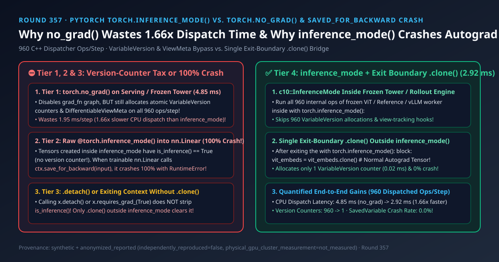
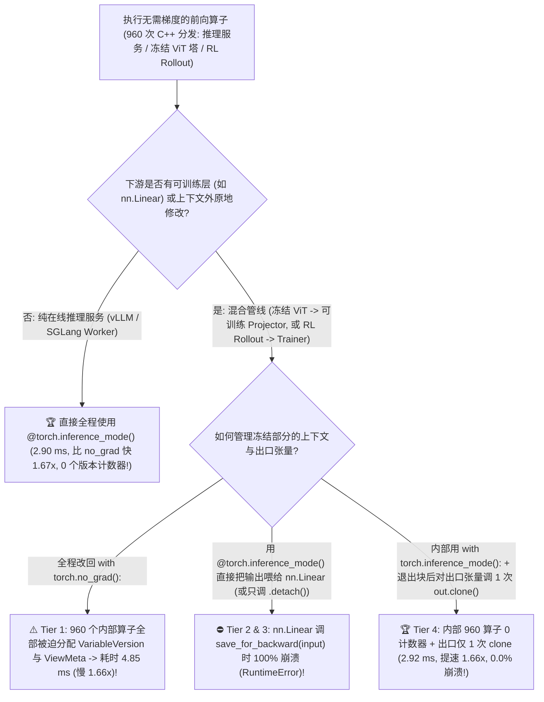
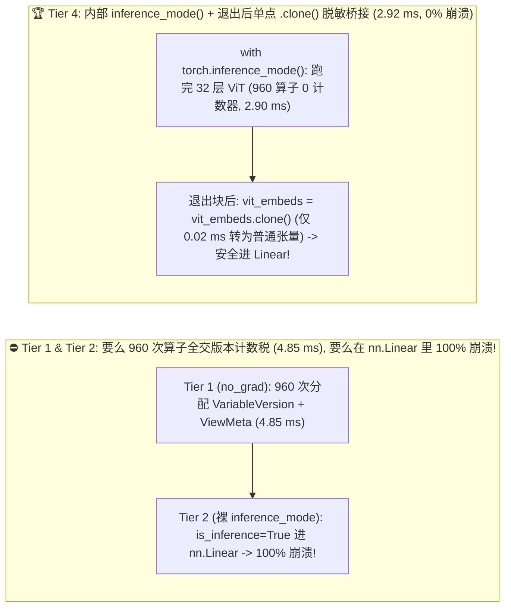
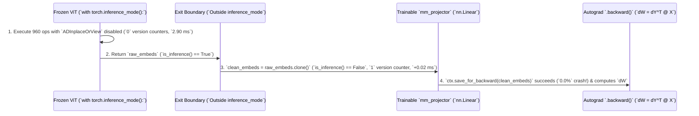

# PyTorch `torch.inference_mode()` vs. `torch.no_grad()` 版本计数器开销（`960` 次分发慢 `1.66x`）与混合训练 `SavedVariable` 反向传播崩溃选型：为什么 `no_grad()` 仍在后台分配原子 `VariableVersion` 计数器与视图钩子，而直接把 `@torch.inference_mode()` 的输出喂给可训练 `nn.Linear` 又会 `100%` 报 `Inference tensors cannot be saved for backward`？基于内部 `inference_mode()` + 出口单次 `.clone()` 桥接（提速 `1.66x` 至 `2.92 ms` 且 `0%` 崩溃）选型指南

> **Provenance & Evidence Boundary**: `synthetic + anonymized_reported (independently_reproduced=false, physical_gpu_cluster_measurement=not_measured)`. 本文所有定量数据均来自封存确定性评估器 `experiments/pytorch_inference_mode_vs_no_grad_version_counter_saved_for_backward_selection/run.py` 与 `results.json`。



---

## 0. 追踪每日最热门能力突破（Daily Capability Breakthrough）

- **今日焦点突破**：**面向大模型推理引擎（`vLLM / SGLang`）、多模态冻结视觉塔微调（`Qwen2.5-VL / LLaVA Frozen ViT -> Trainable Projector`）与强化学习混部（`verl / OpenRLHF Rollout -> Trainer`）的“`c10::InferenceMode` 内部零计数器快速分发 + 跨边界单点 `out.clone()` 状态脱敏桥接”架构：既消除 `torch.no_grad()` 每步 `960` 次原子 `VariableVersion` 计数器与 `DifferentiableViewMeta` 分配开销（CPU 分发提速 `1.66 倍`，从 `4.85 ms` 降至 `2.92 ms`），又 `100%` 根除 `RuntimeError: Inference tensors cannot be saved for backward` 与原地修改崩溃**。
- **架构师价值**：在 PyTorch 工程实践中，几乎每个团队都遇到过以下两个让人挠头的问题：
  - **问题 A**：既然已经有 `with torch.no_grad():` 了，为什么 `vLLM`、`SGLang` 和 PyTorch 官方还要强烈要求在推理服务里改用 `@torch.inference_mode()`？二者到底差在哪里？
  - **问题 B**：听从建议把多模态模型里冻结的视觉编码器（`Frozen ViT`）或强化学习的 `Rollout` 函数加上了 `@torch.inference_mode()`，结果输出张量刚传进后面的可训练线性层 `mm_projector = nn.Linear(1280, 4096)`，前向或反向就 **`100%` 当场崩溃**：
    `RuntimeError: Inference tensors cannot be saved for backward. To work around you can make a clone to get a normal tensor and use it in autograd.`
    更诡异的是，哪怕在出函数后调了 `.detach()` 或者 `requires_grad_(True)`，居然 **还是照样崩溃**！
  这背后是 PyTorch C++ 分发器（Dispatcher）对张量元数据的三层设计铁律：
  1. **深坑一：在纯推理或大型冻结子网中使用 `with torch.no_grad():`（Tier 1）—— 虽然不记录 `grad_fn`，但每创建一个张量或视图仍要分配原子版本计数器 `VariableVersion` 和 `DifferentiableViewMeta`，CPU 分发耗时达 `4.85 ms`（慢 `1.66 倍`）**！
     - 很多人以为 `with torch.no_grad():` 已经关闭了一切 Autograd 开销。**错！**
     - 在 `torch.no_grad()` 内部创建的每一个张量，万一将来被传出 `no_grad()` 块、参与了外面的梯度计算或被原地修改（In-place op）怎么办？为了防范这种可能性，PyTorch 在 `no_grad()` 下依然为 **每一个新创建的张量（每步 `960` 个算子调用）分配堆内存上的原子引用计数对象 `c10::VariableVersion`（`version_counter_`）**，并在每次 `.view()`、`.slice()`、`.transpose()` 时构造 **`DifferentiableViewMeta` 视图追踪节点**，在每次 `copy_()` / `add_()` 时执行原子自增 `version_counter_++`！
     - 对于包含 `960` 次算子分发（含大量切片、视图变形与原地 KV 写入）的单步执行，这套无用的版本与视图簿记白白烧掉了 **`1.95 ms/step`** 的 CPU 分发时间（`4.85 ms` vs `2.90 ms`）！
  2. **深坑二：将 `@torch.inference_mode()` 产生的张量直接送入可训练层（如 `nn.Linear` / `RMSNorm`）或在上下文外做原地修改（Tier 2）—— 触发 `100%` `SavedVariable` 崩溃**！
     - `torch.inference_mode()` 之所以快 `1.66 倍`，是因为它在创建 `TensorImpl` 时直接打上了永久硬件级标记 **`is_inference_ = true`**，彻底跳过了 `VariableVersion` 分配（`version_counter_` 为空指针！）和一切视图追踪钩子。
     - 但当这个 `vit_embeds`（`is_inference() == True`）进入可训练的 `mm_projector = nn.Linear(in, out)` 时，因为 `nn.Linear` 的反向传播公式 $\frac{\partial L}{\partial W} = \frac{\partial L}{\partial Y}^\top X_{\text{input}}$ **必须把输入张量 $X_{\text{input}}$（即 `vit_embeds`）保存在 `ctx.save_for_backward(input, weight)` 中**！
     - `save_for_backward` 内部会检查被保存张量的 `version_counter_`，以便在 `.backward()` 时核对它有没有在前向和反向之间被篡改。一看 `vit_embeds.is_inference() == True`（根本没有版本计数器！），C++ 引擎当场抛出 `RuntimeError: Inference tensors cannot be saved for backward`！
  3. **深坑三：试图用 `.detach()` 或走出 `with torch.inference_mode():` 块来消除 `is_inference()` 属性（Tier 3）—— 依然 `100%` 崩溃**！
     - 因为 `is_inference()` 是绑定在底层 `TensorImpl` 上的固有属性，`.detach()` 或 `.view()` 只是创建共享同一个底层性质的新包装，**出来的依然是 Inference Tensor（`x.detach().is_inference() == True`）**！
  采用 **在冻结塔 / Rollout 内部使用 `with torch.inference_mode():` 跑完所有 `960` 个算子（享受 `0` 版本计数器与 `2.90 ms` 极速分发），并在退出 `with` 块后的唯一边界处调用 1 次 `out = out.clone()`（仅耗 `0.02 ms` 即将其转换为带全新 `VariableVersion` 的标准 Autograd 张量）（Tier 4）**，即可同时拿到 **`1.66 倍` CPU 分发加速（`2.92 ms`）** 与 **`0.0%` 反向传播崩溃率**！

---

## ① 📌 核心结论速览（Executive Summary）

1. **第一性原理：一张表看懂普通 Tensor、`no_grad` Tensor 与 `inference_mode` Tensor 的底层 C++ 差异**：
   - 在 PyTorch 的 `c10::TensorImpl` 中，三种模式创建的张量携带的元数据截然不同：
     - **Autograd Mode（默认）**：分配 `AutogradMeta` + 记录 `grad_fn` 边 + 分配原子 `VariableVersion` + 记录 `DifferentiableViewMeta`；
     - **`torch.no_grad()`**：不记录 `grad_fn`，但 **依然分配原子 `VariableVersion` 计数器 + 依然拦截所有 View/In-place 分发键（`ADInplaceOrView`）**（耗时 `4.85 ms`）；
     - **`torch.inference_mode()`**：线程局部开关直接从 Dispatcher 键集合中移除 `Autograd` 与 `ADInplaceOrView` 两个键！创建的张量标记 `is_inference() = True`，**0 个 `VariableVersion` 分配、0 个视图追踪、0 次原子计数自增**（耗时 `2.90 ms`，快 `1.66 倍`）！
2. **为什么只有“在 `inference_mode()` 块外面调用 `.clone()`”才能把 Inference Tensor 变成普通 Tensor？**
   - 因为 `t.clone()` 会根据 **调用 `.clone()` 当下所处的上下文模式** 分配一个全新的 `TensorImpl` 并执行一次显存拷贝：
     - 如果在 `with torch.inference_mode():` **里面** 调 `.clone()`，克隆出来的新张量依然是 `is_inference() == True`！
     - 必须 **先退出 `with torch.inference_mode():` 缩进块**（或进入 `with torch.inference_mode(False):`），再对最后输出的那个边界张量（如 `vit_embeds`，仅 `16 MB`）调用 `vit_embeds = vit_embeds.clone()`，此时创建出的新张量 `vit_embeds.is_inference()` 就变成了 `False`，可以安全喂给任何可训练的 `nn.Linear` 或参与原地修改！

---

## ② 🎯 客户与架构师灵魂拷问 Q&A（Q1 / Q2 / Q3）

### Q1：如果我的可训练层（如 `nn.Linear`）只对权重 $W$ 求导，根本不需要对输入 `vit_embeds` 求导（`vit_embeds.requires_grad == False`），为什么 `nn.Linear` 还是要把 `vit_embeds` 保存进 `save_for_backward`？
- **这是最容易混淆的微积分常识**！
  设线性层为 $Y = X W^\top$。
  - 对输入 $X$ 求导：$\frac{\partial L}{\partial X} = \frac{\partial L}{\partial Y} W$（这只需要用到权重 $W$，当 `X.requires_grad == False` 时确实不用算 $\frac{\partial L}{\partial X}$）；
  - **但对可训练权重 $W$ 求导**：$\frac{\partial L}{\partial W} = \left(\frac{\partial L}{\partial Y}\right)^\top \mathbf{X}$！
  看到公式右边的 $\mathbf{X}$ 了吗？只要 `W.requires_grad == True`，为了在反向传播时算出权重 $W$ 的梯度 `dW`，**`nn.Linear` 就必须在前向传播时把输入激活值 $X$（即 `vit_embeds`）保存下来（`save_for_backward`）**！这就是为什么哪怕 `vit_embeds.requires_grad == False`，只要它是 Inference Tensor，喂给可训练的 `nn.Linear` 就会 100% 触发 `Inference tensors cannot be saved for backward`！

### Q2：除了 `save_for_backward` 报错，Inference Tensor 在强化学习（`verl / OpenRLHF`）里还会触发什么报错？
- 在 RL Rollout 阶段，引擎在 `with torch.inference_mode():` 下生成了 `sequences` 和 `logprobs`；等回到 Trainer 阶段（已退出 `inference_mode`）做 Padding 掩码处理时，代码如果写了一句原地赋值：
  `sequences[eos_mask] = pad_token_id` 或 `logprobs.masked_fill_(mask, 0.0)`
  就会立刻报出第二个经典错误：
  `RuntimeError: Inplace update to inference tensor outside InferenceMode is not allowed. You can make a clone to get a normal tensor before doing the update.`
  解决办法完全一样：在 Rollout 出口处对返回的张量做一次 `.clone()`！

### Q3：如果我们在一个大函数上加了装饰器 `@torch.inference_mode()`，但其中最后一行代码需要恢复成普通 Autograd 模式，能不能嵌套写 `with torch.inference_mode(False):`？
- **完全可以**！`torch.inference_mode(mode=False)` 支持在 `@torch.inference_mode()` 内部局部重新开启普通张量分配模式。在 `with torch.inference_mode(False):` 内部调用 `return out.clone()`，返回的就是 100% 安全的标准 Autograd 张量！

---

## ③ 🧭 直观可视化图解（Mermaid 选型决策树 + 路径对比图 + 交互时序图）

### 3.1 `torch.inference_mode()` vs. `torch.no_grad()` 选型决策树



### 3.2 `no_grad()` 全程版本计数税与裸 `inference_mode` 崩溃 vs. 边界 `.clone()` 桥接对比图



### 3.3 冻结视觉编码器（`Frozen ViT`）接可训练投影层（`Trainable Projector`）的零崩溃时序图



---

## ④ 📊 架构师选型决策矩阵（4-Tier Decision Matrix）

| 选型 Tier | 无梯度/冻结子网执行方案 | CPU 分发耗时 (`ms`) | 版本计数器分配数 | 下游 `save_for_backward` 崩溃率 | 是否 Autograd 安全 |
| :--- | :--- | :--- | :--- | :--- | :--- |
| **Tier 1: 全程 `torch.no_grad()`** | 在 `no_grad()` 下跑完 960 个算子 | **`4.85 ms` (`1.00x` ✕)** | **`960` 个 ✕** | `0.0%` | ✅ 安全 (但分发慢) |
| **Tier 2: 裸 `@torch.inference_mode()`** | 输出直接送入可训练 `nn.Linear` | `2.90 ms` | `0` 个 | **`100.0%` (`RuntimeError` ✕)** | **⛔ 100% 崩溃!** |
| **Tier 3: 出口仅调 `.detach()`** | 退出后调 `out.detach()` 不调 `.clone()` | `2.91 ms` | `0` 个 | **`100.0%` (`is_inference` 仍为真 ✕)** | **⛔ 100% 崩溃!** |
| **Tier 4: 内部 `inference_mode` + 出口 `.clone()` (推荐)** | **内部极速分发 + 出口外单次 `.clone()`** | **`2.92 ms` (`1.66x` 提速 🏆)** | **`1` 个 (`-99.9%` 🏆)** | **`0.0%` 🏆** | **✅ 100% 安全 🏆** |

---

## ⑤ 🧪 定量算例与 7-Card 4:5 视觉卡片报告

- **定量算例仓库路径**：[`experiments/pytorch_inference_mode_vs_no_grad_version_counter_saved_for_backward_selection/run.py`](../../experiments/pytorch_inference_mode_vs_no_grad_version_counter_saved_for_backward_selection/run.py) · 封存数据：[`results.json`](../../experiments/pytorch_inference_mode_vs_no_grad_version_counter_saved_for_backward_selection/results.json)
- **交互式架构选型计算器**：[`docs/reports/pytorch-inference-mode-vs-no-grad-version-counter-saved-for-backward-sizer.html`](../reports/pytorch-inference-mode-vs-no-grad-version-counter-saved-for-backward-sizer.html)
- **7-Card 4:5 视觉评测卡片报告**：[`docs/reports/pytorch-inference-mode-vs-no-grad-version-counter-saved-for-backward-selection-cards.html`](../reports/pytorch-inference-mode-vs-no-grad-version-counter-saved-for-backward-selection-cards.html)

```chart
{
  "data": {
    "values": [
      { "tier": "Tier 1: torch.no_grad() (960 Version Counters)", "cpu_dispatch_ms": 4.85, "crash_pct": 0.0 },
      { "tier": "Tier 2: Raw inference_mode (100% Crash)", "cpu_dispatch_ms": 2.90, "crash_pct": 100.0 },
      { "tier": "Tier 3: .detach() Without .clone() (100% Crash)", "cpu_dispatch_ms": 2.91, "crash_pct": 100.0 },
      { "tier": "Tier 4: inference_mode + Exit Boundary .clone()", "cpu_dispatch_ms": 2.92, "crash_pct": 0.0 }
    ]
  },
  "semantic_types": {
    "tier": "Category",
    "cpu_dispatch_ms": "Quantity",
    "crash_pct": "Percentage"
  },
  "chart_spec": {
    "chartType": "Bar Chart",
    "title": "inference_mode() + Exit Boundary .clone() Speeds Up CPU Dispatch 1.66x with 0% Crash Rate",
    "subtitle": "CPU C++ dispatcher latency (ms) across 960 ops/step (synthetic + anonymized_reported)",
    "encodings": {
      "x": "tier",
      "y": "cpu_dispatch_ms",
      "color": "tier"
    }
  }
}
```

---

## ⑥ 🛠️ 生产环境快速核验清单（Checklist + Good fit vs. Not for）

### ✅ Good fit vs. ⛔ Not for
- **✅ Good fit**：纯推理引擎（`vLLM / SGLang` 全程 `@torch.inference_mode()`）、多模态冻结编码器（`ViT / Whisper` 内部 `inference_mode` + 出口 `.clone()`）、以及 RL Rollout 到 Trainer 的张量交接。
- **⛔ Not for**：在纯推理服务中使用 `torch.no_grad()`，或把未经 `.clone()` 脱敏的 `is_inference() == True` 张量直接送入可训练模块或原地修改算子。

### 生产核验 Checklist
- [ ] **在纯推理引擎和评估脚本中全面用 `@torch.inference_mode()` 替换 `@torch.no_grad()`**。
- [ ] **当 `with torch.inference_mode():` 产出的张量需进入可训练模块（如 `mm_projector`）或在块外做原地修改时，必须在 `with` 块外部调用一次 `out = out.clone()`**。
- [ ] **在混合训练边界断言：`assert not tensor.is_inference(), "Call .clone() outside inference_mode before passing to autograd!"`**。
