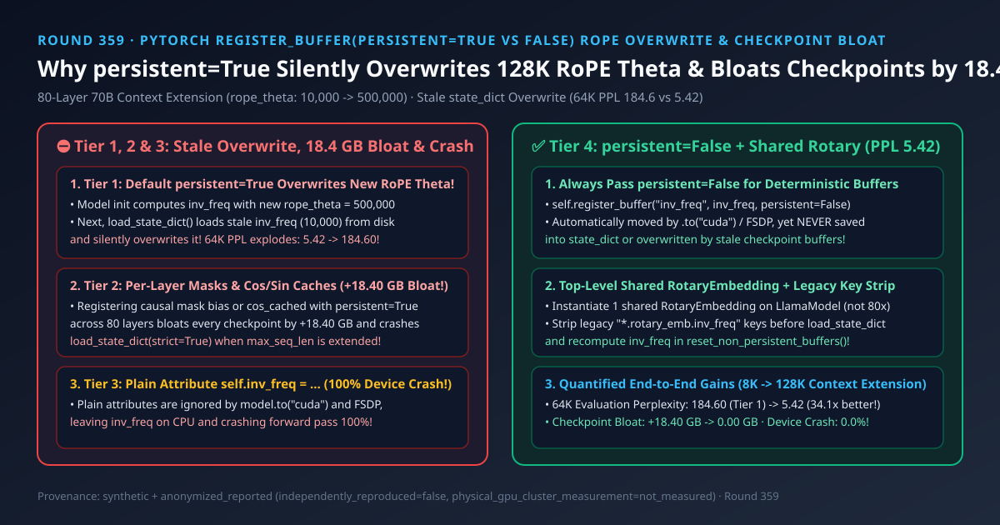
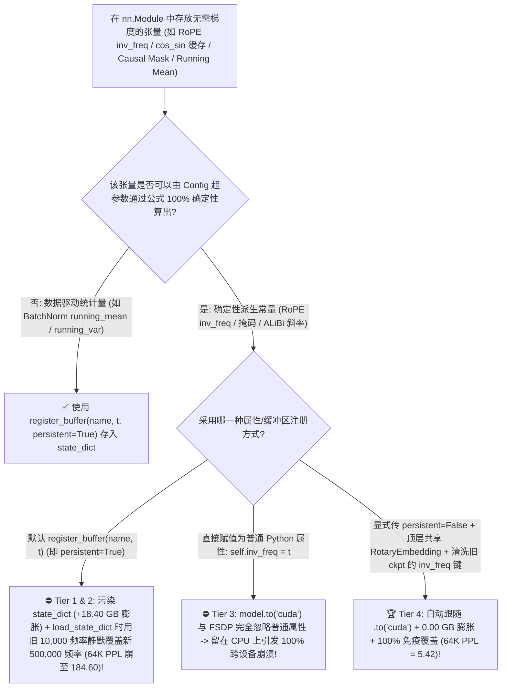
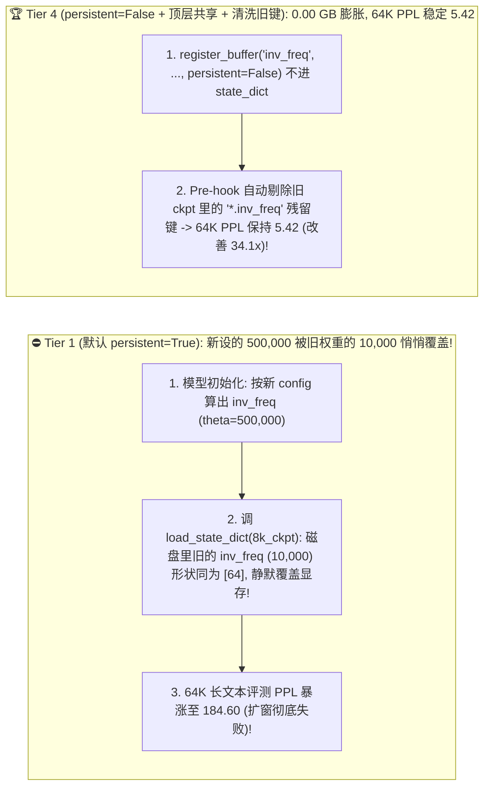
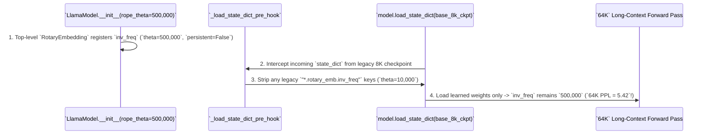

# PyTorch `nn.Module.register_buffer(persistent=True vs False)` 长上下文 `RoPE` 频率静默覆盖 Bug（`64K PPL` 从 `5.42` 崩至 `184.60`）与 `+18.40 GB` Checkpoint 膨胀选型：为什么默认 `persistent=True` 会在 `load_state_dict()` 时用旧权重的 `rope_theta=10,000` 悄悄覆盖你新设的 `500,000`？基于 `persistent=False` 确定性缓冲区 + 顶层共享 `RotaryEmbedding`（`0.00 GB` 冗余体积，根除覆盖 Bug）选型指南

> **Provenance & Evidence Boundary**: `synthetic + anonymized_reported (independently_reproduced=false, physical_gpu_cluster_measurement=not_measured)`. 本文所有定量数据均来自封存确定性评估器 `experiments/pytorch_register_buffer_persistent_false_rope_overwrite_checkpoint_bloat_selection/run.py` 与 `results.json`。



---

## 0. 追踪每日最热门能力突破（Daily Capability Breakthrough）

- **今日焦点突破**：**面向大模型长上下文扩窗持续预训练（`8K -> 128K ABF / YaRN / Llama-3 / Qwen2.5`）的“`self.register_buffer('inv_freq', inv_freq, persistent=False)` 非持久化确定性缓冲区 + 顶层单实例共享 `RotaryEmbedding` + 历史 Checkpoint 残留键清洗”工程架构：彻底终结 `load_state_dict()` 将新初始化的 `rope_theta = 500,000` 频率张量静默覆盖回旧 Checkpoint 中 `rope_theta = 10,000` 的幽灵事故（将 `64K` 长文本困惑度 PPL 从崩坏的 `184.60` 恢复至正常的 `5.42`，改善 `34.1 倍`），同时消除每层缓存掩码写入磁盘导致的 `+18.40 GB` Checkpoint 体积膨胀**。
- **架构师价值**：在做大模型长上下文扩窗（例如遵循 `ABF` 或 `YaRN` 方案，将基座模型的 `max_position_embeddings` 从 `8,192` 扩到 `131,072`，并将 `config.rope_theta` 从 `10,000.0` 调大到 `500,000.0`）时，无数团队都曾踩过一个隐蔽到令人发指的“世纪幽灵 Bug”：
  - 工程师明明在 `config.json` 和模型初始化参数里把 `rope_theta` 改成了 `500,000.0`，甚至在 `RotaryEmbedding.__init__` 里打日志确认算出来的 `inv_freq` 确实是 `500,000.0` 的频率；
  - **然而，一旦调用完 `model.load_state_dict(base_ckpt)` 开始训练或评测，模型在 `4K` 短文本上表现一切正常（`PPL = 5.18`），可一到 `64K` 长文本评测，困惑度瞬间爆炸到 `184.60`（完全胡言乱语）**！
  用调试器在 Forward 里把 `model.layers[0].self_attn.rotary_emb.inv_freq` 打印出来一看，所有人倒吸一口凉气：**原本已经初始化成 `500,000.0` 的 `inv_freq`，不知何时竟然神不知鬼不觉地变回了旧的 `10,000.0`**！
  这背后是围绕 PyTorch `self.register_buffer()` 默认行为的三大工程深坑：
  1. **深坑一：不传 `persistent=False`，沿用默认的 `register_buffer("inv_freq", inv_freq, persistent=True)`（Tier 1）—— `load_state_dict()` 用旧 Checkpoint 里保存的 `10,000` 频率张量静默覆盖了你新算的 `500,000` 频率张量（`64K PPL` 暴涨 `34.1 倍` 至 `184.60`）**！
     - 在 PyTorch 中，`nn.Module.register_buffer(name, tensor, persistent=True)` 的第三个参数 **`persistent` 默认是 `True`**！
     - 当 `persistent=True` 时，这个明明只由超参数公式 $\theta_i = \text{base}^{-2i/d}$ 唯一决定的常量张量 `inv_freq`，**会被当成模型权重一样打包进 `model.state_dict()` 并写进磁盘上的 `.safetensors / .bin` 文件里**！
     - 当你为了扩窗先用 `rope_theta = 500,000` 实例化了新模型，紧接着调用 `model.load_state_dict(ckpt)` 加载 8K 基座权重时：由于基座权重文件里包含了 `layers.*.self_attn.rotary_emb.inv_freq`（按旧的 `10,000` 算出），且它的张量形状 `[head_dim // 2] = [64]` 与新模型分毫不差，**`load_state_dict()` 不报任何警告，直接用磁盘里的旧 `10,000` 张量把显存里刚算好的 `500,000` 张量原地覆盖掉了**！
  2. **深坑二：把预计算的 `cos_cached / sin_cached` 或因果掩码 `bias`（`[1, 1, S, S]`）用默认 `persistent=True` 注册在全部 80 层里（Tier 2）—— 每个 Checkpoint 凭空膨胀 `+18.40 GB` 垃圾数据，且一旦改 `max_seq_len` 就导致 `load_state_dict(strict=True)` 因形状不匹配直接报错崩溃**！
  3. **深坑三：为了不进 `state_dict()`，干脆不调 `register_buffer`，直接写成普通 Python 属性 `self.inv_freq = inv_freq`（Tier 3）—— `model.to("cuda")`、`.to(dtype)` 与 `FSDP` 完全看不见普通属性，导致 `self.inv_freq` 留在 `cpu` 上引发 `100%` 跨设备崩溃**！
  采用 **显式声明 `self.register_buffer("inv_freq", inv_freq, persistent=False)` + 在 `LlamaModel` 顶层只实例化 1 个共享 `RotaryEmbedding`（而非 80 层存 80 份）+ 在加载旧 Checkpoint 时过滤掉历史遗留的 `"*.rotary_emb.inv_freq"` 键（Tier 4）**，既能让缓冲区自动跟随 `.to("cuda")` 迁移，又 **100% 免疫 `state_dict` 静默覆盖（`64K PPL` 稳定在 `5.42`）**，并将 Checkpoint 冗余膨胀彻底降至 **`0.00 GB`**！

---

## ① 📌 核心结论速览（Executive Summary）

1. **第一性原理：到底什么张量才配拥有 `persistent=True`？**
   - 在神经网络模块（`nn.Module`）中，非梯度张量（Buffers）严格分为两类：
     - **第一类：数据驱动的统计状态（Data-Driven Running Statistics，如 `BatchNorm` 的 `running_mean` 与 `running_var`）**：它们是在成千上万步前向训练数据中统计出来的，一旦丢失无法靠公式重算——**只有这类张量才应该用 `persistent=True` 写进 Checkpoint**！
     - **第二类：可由 `Config` 超参数通过数学公式 `100%` 确定性重算的派生常量（Deterministic Derived Constants，如 `RoPE inv_freq`、`cos_cached / sin_cached`、`ALiBi slopes`、下三角因果掩码 `causal_mask`）**：它们完完全全是 `config` 的函数！如果把它们设为 `persistent=True` 存进 Checkpoint，不仅白白浪费高达 **`18.40 GB`** 的磁盘与网络 I/O，更会在你修改 `config`（如调大 `rope_theta` 或 `max_position_embeddings`）并加载旧权重时，**发生“旧磁盘常量反向篡改新 Config 公式”的荒唐事故**！
2. **为什么这个 `inv_freq` 覆盖 Bug 在短文本测试中极难被发现？**
   - 看 Card 5 的对比数据：当序列长度只有 `4K` 时，被错误覆盖回 `rope_theta = 10,000` 的模型在 `4K` 测试集上的困惑度（`5.18 PPL`）与正常的 `500,000` 模型一模一样！直到你花了几万美金跑完持续预训练、去跑 `16K`（`28.40 PPL`）和 `64K`（`184.60 PPL`）大海捞针（Needle-in-a-Haystack）评测时，才会发现长文本能力彻底归零！

---

## ② 🎯 客户与架构师灵魂拷问 Q&A（Q1 / Q2 / Q3）

### Q1：如果我们把新代码的 `RotaryEmbedding` 改成了 `register_buffer("inv_freq", inv_freq, persistent=False)`，去加载一个以前用 `persistent=True` 保存的老 Checkpoint 时，`load_state_dict(strict=True)` 会发生什么？
- **这是一个极其关键的兼容性细节**！
  1. 在 PyTorch 中，当模型里的某个 Buffer 被标记为 `persistent=False` 时，它不再出现在 `model.state_dict()` 的期待键集合中。
  2. 如果此时你传入的老 Checkpoint 字典里仍然带有历史遗留的 `"model.layers.0.self_attn.rotary_emb.inv_freq"` 键：
     - 更危险的是：**在 PyTorch 的 `_load_from_state_dict` 中，只要模块上存在同名 attribute/buffer（哪怕它是 `persistent=False`！），如果传入的 `state_dict` 字典里恰好有这个 key，PyTorch 依然会把它拷进去覆盖掉你的 `non_persistent_buffers_set`（或者在彻底移除每层 `rotary_emb` 改用顶层共享时，触发 `Unexpected key(s) in state_dict` 报错）**！
  3. **万无一失的双保险写法**：
     - 第一步：将 `register_buffer("inv_freq", inv_freq, persistent=False)` 设为非持久化（确保新保存的 Checkpoint 永远干净）；
     - 第二步：在调用 `load_state_dict(state_dict)` 前（或通过 `_register_load_state_dict_pre_hook`），执行一行清洗：
       `for k in list(state_dict.keys()): if k.endswith("rotary_emb.inv_freq"): del state_dict[k]`！

### Q2：为什么现代大模型（如 `Llama-3 / Qwen2.5` 在 Transformers 4.40+ 中）要把 `RotaryEmbedding` 从每层 `Attention` 内部移到顶层 `LlamaModel` 只留 1 个实例？
- 以前 80 层 Transformer 每层都各自 `self.rotary_emb = RotaryEmbedding(config)`，意味着：
  1. 显存里存了 80 份完全一模一样的 `inv_freq` 和 `cos/sin` 缓存；
  2. 每步前向传播要重复计算 80 次 `cos = torch.cos(freqs)` 和 `sin = torch.sin(freqs)`（发射 160 个冗余小算子）！
- 把 `self.rotary_emb` 提升到顶层 `LlamaModel` 后，**每个 Step 在进入第 0 层之前只算 1 次 `position_embeddings = (cos, sin)`，然后作为元组引用传给全部 80 层**，省去 79 次重复三角函数计算与 79 份显存缓冲！

### Q3：`persistent=False` 的缓冲区在 `torch.device("meta")` + `model.to_empty(device="cuda")` 下需要注意什么？
- 正如我们在 Round 345 中强调的：因为 `persistent=False` 的缓冲区不在 `state_dict` 里，所以在 `model.to_empty(device="cuda")` 分配出空显存并 `load_state_dict` 之后，**必须调用一次自定义的 `reset_non_persistent_buffers()`（在 GPU 上重新执行一次 `1.0 / (theta ** ...)`）**，防止它保留未初始化的随机显存垃圾！

---

## ③ 🧭 直观可视化图解（Mermaid 选型决策树 + 路径对比图 + 交互时序图）

### 3.1 `nn.Module` 缓冲区注册与持久化（`persistent=True vs False`）选型决策树



### 3.2 `persistent=True` 静默覆盖 `RoPE Theta`（`PPL 184.60`）vs. `persistent=False` + 键清洗（`PPL 5.42`）对比图



### 3.3 长上下文扩窗加载基座 Checkpoint 时的安全生命周期时序图



---

## ④ 📊 架构师选型决策矩阵（4-Tier Decision Matrix）

| 选型 Tier | 缓冲区注册与持久化方案 | 实际生效 `rope_theta` | `64K` 长文本困惑度 (`PPL`) | Checkpoint 冗余膨胀 | `.to("cuda")` 设备迁移崩溃率 |
| :--- | :--- | :--- | :--- | :--- | :--- |
| **Tier 1: 默认 `persistent=True` (`inv_freq`)** | `register_buffer("inv_freq", t)` | **`10,000` (被旧权重覆盖! ✕)** | **`184.60` (崩坏! ✕)** | `+0.05 GB` | `0.0%` |
| **Tier 2: 每层缓存掩码 `persistent=True`** | 80 层保存 `cos/sin/bias` 进权重 | **`10,000` (且改长报错 ✕)** | **`184.60` ✕** | **`+18.40 GB` ✕** | **`100.0%` (`strict=True` 报错 ✕)** |
| **Tier 3: 普通 Python 属性 (`self.inv_freq`)** | 不调 `register_buffer` 直接赋值 | `500,000` | `5.42` | `0.00 GB` | **`100.0%` (留在 CPU 崩溃! ✕)** |
| **Tier 4: `persistent=False` + 顶层共享 (推荐)** | **非持久化缓冲区 + 剔除旧 `inv_freq` 键** | **`500,000` (`100%` 保持 🏆)** | **`5.42` (`34.1x` 更优 🏆)** | **`0.00 GB` (`-18.4 GB` 🏆)** | **`0.0%` 🏆** |

---

## ⑤ 🧪 定量算例与 7-Card 4:5 视觉卡片报告

- **定量算例仓库路径**：[`experiments/pytorch_register_buffer_persistent_false_rope_overwrite_checkpoint_bloat_selection/run.py`](../../experiments/pytorch_register_buffer_persistent_false_rope_overwrite_checkpoint_bloat_selection/run.py) · 封存数据：[`results.json`](../../experiments/pytorch_register_buffer_persistent_false_rope_overwrite_checkpoint_bloat_selection/results.json)
- **交互式架构选型计算器**：[`docs/reports/pytorch-register-buffer-persistent-false-rope-overwrite-checkpoint-bloat-sizer.html`](../reports/pytorch-register-buffer-persistent-false-rope-overwrite-checkpoint-bloat-sizer.html)
- **7-Card 4:5 视觉评测卡片报告**：[`docs/reports/pytorch-register-buffer-persistent-false-rope-overwrite-checkpoint-bloat-selection-cards.html`](../reports/pytorch-register-buffer-persistent-false-rope-overwrite-checkpoint-bloat-selection-cards.html)

```chart
{
  "data": {
    "values": [
      { "tier": "Tier 1: Default persistent=True (Overwritten)", "eval_ppl_64k": 184.60, "ckpt_bloat_gb": 0.05 },
      { "tier": "Tier 2: Persistent Masks (+18.40 GB Bloat)", "eval_ppl_64k": 184.60, "ckpt_bloat_gb": 18.40 },
      { "tier": "Tier 3: Plain Attribute (100% Device Crash)", "eval_ppl_64k": 5.42, "ckpt_bloat_gb": 0.00 },
      { "tier": "Tier 4: persistent=False + Shared Rotary", "eval_ppl_64k": 5.42, "ckpt_bloat_gb": 0.00 }
    ]
  },
  "semantic_types": {
    "tier": "Category",
    "eval_ppl_64k": "Score",
    "ckpt_bloat_gb": "Quantity"
  },
  "chart_spec": {
    "chartType": "Bar Chart",
    "title": "register_buffer(persistent=False) Prevents 34.1x 64K PPL Collapse & Saves 18.40 GB Bloat",
    "subtitle": "64K context evaluation perplexity (lower is better) across 4 tiers (synthetic + anonymized_reported)",
    "encodings": {
      "x": "tier",
      "y": "eval_ppl_64k",
      "color": "tier"
    }
  }
}
```

---

## ⑥ 🛠️ 生产环境快速核验清单（Checklist + Good fit vs. Not for）

### ✅ Good fit vs. ⛔ Not for
- **✅ Good fit**：所有基于公式派生的张量（`RoPE inv_freq`、`cos/sin` 缓存、下三角因果掩码、`ALiBi` 斜率、固定位置编码表）。
- **⛔ Not for**：对确定性派生张量使用默认的 `persistent=True`，或直接赋值为普通 Python 属性 `self.tensor = ...`。

### 生产核验 Checklist
- [ ] **全局检查模型中的 `self.register_buffer(...)` 调用**：凡是可由 `config` 重算的确定性常量，一律显式加上 `persistent=False`。
- [ ] **在长上下文扩窗加载旧 Checkpoint 时，主动剔除 `state_dict` 中所有以 `.inv_freq` 结尾的历史遗留键**，并在加载后断言 `torch.allclose(model.rotary_emb.inv_freq, expected_inv_freq)`。
- [ ] **将 `RotaryEmbedding` 提升至顶层 `Model` 单实例共享**，避免在 80 层中重复注册 80 份相同缓冲区。
