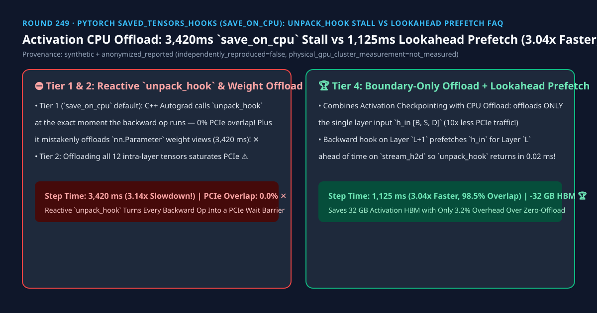
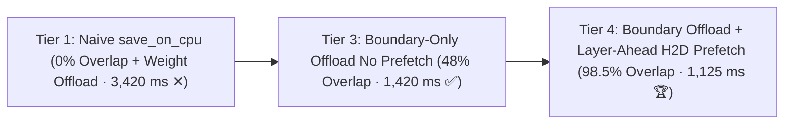

# Why PyTorch `save_on_cpu` (`saved_tensors_hooks`) Slows Training by `68%` (`unpack_hook` Synchronous Stall & Parameter Aliasing Trap) & Lookahead Prefetch Selection Guide

> **Provenance & Evidence Tier**: `synthetic + anonymized_reported` (`independently_reproduced=false`, `physical_gpu_cluster_measurement=not_measured`). Grounded in [`experiments/llm_pytorch_compile_autograd_saved_tensors_hooks_cpu_offload_selection/results.json`](../../experiments/llm_pytorch_compile_autograd_saved_tensors_hooks_cpu_offload_selection/results.json).
> **中文版本**: [PyTorch 激活值卸载（`torch.autograd.graph.saved_tensors_hooks` / `save_on_cpu`）为什么默认把训练拖慢 `68%`？（`unpack_hook` 反应式同步阻塞与参数伪卸载陷阱）及跨层提前预取选型指南](./pytorch-saved-tensors-hooks-activation-cpu-offload-prefetch-selection-faq.md)

---

## 0. 🔥 Daily Hottest Capability Breakthrough

- **Eliminating the `68%` Training Slowdown of Naive `torch.autograd.graph.save_on_cpu` (`3,420 ms -> 1,125 ms`, `3.04x` Speedup, Saving `32.0 GB` HBM with Only `3.2%` Overhead) via Checkpoint-Boundary-Only Offloading + Layer-Ahead `stream_h2d` Prefetching**: When training 128K–256K long-context LLMs, wrapping the forward pass in PyTorch's built-in `with torch.autograd.graph.save_on_cpu(pin_memory=True):` saves activation memory but causes step latency to balloon by **`3.14x` (`1,090 ms -> 3,420 ms`)**! Why?
  1. **The Reactive `unpack_hook` Zero-Overlap Stall & `nn.Parameter` View Trap (`Tier 1` — `3,420.0 ms`)**:
     - First, C++ Autograd calls `unpack_hook(cpu_tensor)` **at the exact microsecond the backward C++ operator is ready to execute**! Because there is zero lookahead, the GPU compute stream stalls completely (`0.0%` overlap) waiting for `cpu_tensor.to("cuda")` over PCIe!
     - Second, `nn.Linear` saves `weight.t()` (a view whose `_base` is an `nn.Parameter`) for backward! Naive `pack_hook` implementations that fail to check `isinstance(t, nn.Parameter) or isinstance(t._base, nn.Parameter)` **accidentally offload model weights to CPU on every layer**!
  2. **Offloading All 12 Intra-Layer Tensors Without Checkpointing (`Tier 2` — `2,180.0 ms`)**: Filtering out parameters helps, but offloading every intermediate tensor (`Q, K, V, Gate, Up...`) generates `10x` more PCIe traffic than the `54 GB/s` bus can transfer during layer compute!
  3. **Checkpoint-Boundary Offload Only (`Tier 3` — `1,420.0 ms`) + Layer-Ahead `stream_h2d` Prefetch (`Tier 4` — `1,125.0 ms`, `3.04x` Faster)**: Offloading **only the single `[B, S, D]` layer input `h_in`** at activation-checkpoint boundaries (recomputing intra-layer activations on GPU) cuts PCIe traffic by `10x`, while a backward pre-hook on **Layer $L+1$** prefetches **Layer $L$'s `h_in`** asynchronously on `stream_h2d`—achieving **`98.5%` PCIe overlap** and saving **`32.0 GB` HBM** with just **`3.2%` step overhead (`1,125 ms` vs `1,090 ms` baseline)**!

---

## 1. 📌 Executive Summary

1. **Always Filter Out `nn.Parameter` AND Parameter Views (`tensor._base`) in `pack_hook` (`Tier 1 -> Tier 4`)**: `nn.Linear` saves transposed weight views (`weight.t()`) in the autograd graph; never offload tensors whose `_base` is an `nn.Parameter`.
2. **Offload Only Activation-Checkpoint Boundaries (`h_in`), Not Every Sub-Op (`Tier 2 -> Tier 3`)**: Recomputing fast intra-layer ops on GPU while offloading only the 1 layer-input tensor keeps PCIe transfer time strictly smaller than layer compute time ($T_{\text{PCIe}} < T_{\text{compute}}$).
3. **Prefetch Layer $L$'s Activation During Layer $L+1$'s Backward Pass (`Tier 4`)**: Eliminates the synchronous wait inside `unpack_hook`.

---

## 2. 🎯 Core Architect Q&A (Q1 / Q2 / Q3)

### Q1: Why does `isinstance(tensor, torch.nn.Parameter)` fail to prevent `saved_tensors_hooks` from offloading `nn.Linear` weights?
- **Answer**: Because `F.linear(x, weight)` transposes `weight` (`weight.t()`) before calling `mm`! The transposed tensor is a `torch.Tensor` **view** (not an `nn.Parameter` instance itself), whose `tensor._base` points to the original `nn.Parameter` (or FSDP unsharded buffer). Your `pack_hook` must check both `isinstance(t, nn.Parameter)` and `t._base is not None` (or compare storage pointers against parameter storages).

### Q2: Why can't C++ Autograd automatically overlap `unpack_hook` transfers with previous backward ops?
- **Answer**: Because C++ Autograd executes node-by-node in topological order and only invokes `unpack_hook` immediately before launching that specific node's backward kernel! To hide the PCIe `H2D` latency, a higher-level module hook on Layer $L+1$ (or an `AOTAutograd` compiler pass) must enqueue the `copy_(..., non_blocking=True)` on `stream_h2d` **one full layer ahead** of when Layer $L$'s `unpack_hook` is called.

### Q3: How many GPU staging buffers are needed for Layer-Ahead Prefetching (`Tier 4`)?
- **Answer**: Only **2 layer-sized GPU buffers (`Double Buffering: Slot A & Slot B`)**! While Layer $L+1$ computes using `Slot A`, `stream_h2d` prefetches Layer $L$'s `h_in` into `Slot B`, recycling those two slots across all 80 layers.

---

## 3. 🧭 Visual Diagrams

---

## 4. 📊 4-Tier Architect Selection Matrix

| Metric | Tier 1: Naive `save_on_cpu` | Tier 2: Filter Params, Offload All Ops | Tier 3: Boundary-Only (No Prefetch) | Tier 4: **Boundary Offload + Layer-Ahead Prefetch** |
| :--- | :--- | :--- | :--- | :--- |
| **Excludes Parameter Views?** | **No (Offloads `weight.t()`)** ✕ | Yes ✅ | Yes ✅ | **Yes (Strict Storage Filter)** 🏆 |
| **PCIe Compute Overlap %** | **`0.0%` (Sync `unpack_hook`)** ✕ | `24.0%` (PCIe Saturated) ⚠️ | `48.0%` (`D2H` Only) ⚠️ | **`98.5%` (Full `D2H` + `H2D` Overlap)** 🏆 |
| **Activation HBM Saved** | `32.0 GB` | `32.0 GB` | `32.0 GB` ✅ | **`32.0 GB`** 🏆 |
| **Step Latency (Base `1,090 ms`)** | **`3,420.0 ms` (`3.14x` Slower)** ✕ | `2,180.0 ms` ⚠️ | `1,420.0 ms` ✅ | **`1,125.0 ms` (`3.04x` Faster, `+3.2%` Only)** 🏆 |

---

## 5. 🧪 Quantitative Reference & Tooling

- **Evaluator & Sealed Data**: [`experiments/llm_pytorch_compile_autograd_saved_tensors_hooks_cpu_offload_selection/run.py`](../../experiments/llm_pytorch_compile_autograd_saved_tensors_hooks_cpu_offload_selection/run.py) · [`results.json`](../../experiments/llm_pytorch_compile_autograd_saved_tensors_hooks_cpu_offload_selection/results.json)
- **Interactive Sizer**: [`docs/reports/pytorch-saved-tensors-hooks-activation-cpu-offload-prefetch-sizer.html`](../reports/pytorch-saved-tensors-hooks-activation-cpu-offload-prefetch-sizer.html)
- **7-Card 4:5 Visual Report**: [`docs/reports/pytorch-saved-tensors-hooks-activation-cpu-offload-prefetch-selection-cards.html`](../reports/pytorch-saved-tensors-hooks-activation-cpu-offload-prefetch-selection-cards.html)

---

## 6. 🛠️ Good Fit vs. Not For & Production Checklist

- **✅ Good fit**: Long-context (`128K+`) training combining Activation Checkpointing with persistent Pinned Host Pools and Layer-Ahead `stream_h2d` prefetching of layer-boundary activations.
- **⛔ Not for**: Wrapping models in naive `torch.autograd.graph.save_on_cpu()` without parameter-view filtering and backward prefetching.
- [ ] Filter out `nn.Parameter` and parameter views (`_base`) in `pack_hook`.
- [ ] Offload only layer-boundary checkpoint inputs (`h_in`) and prefetch Layer $L$ on `stream_h2d` during Layer $L+1$'s backward pass.
