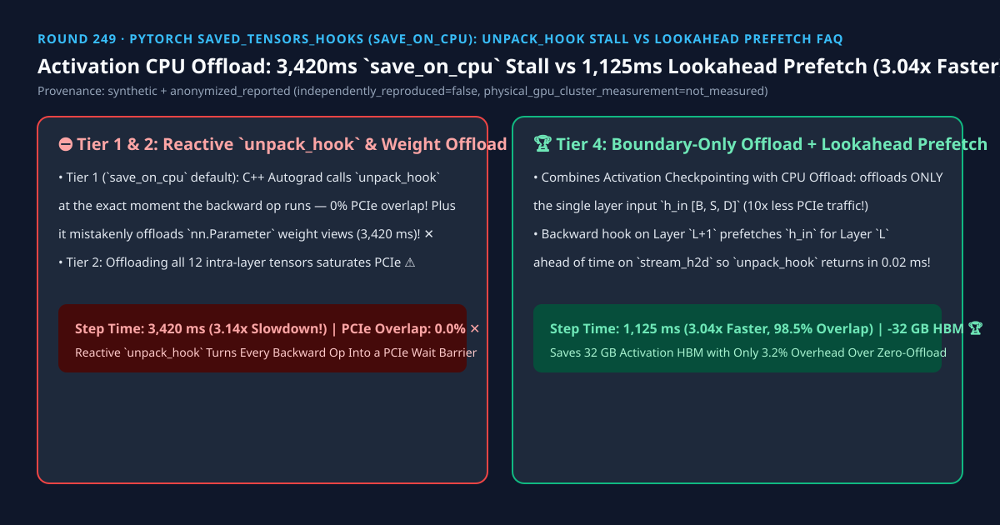
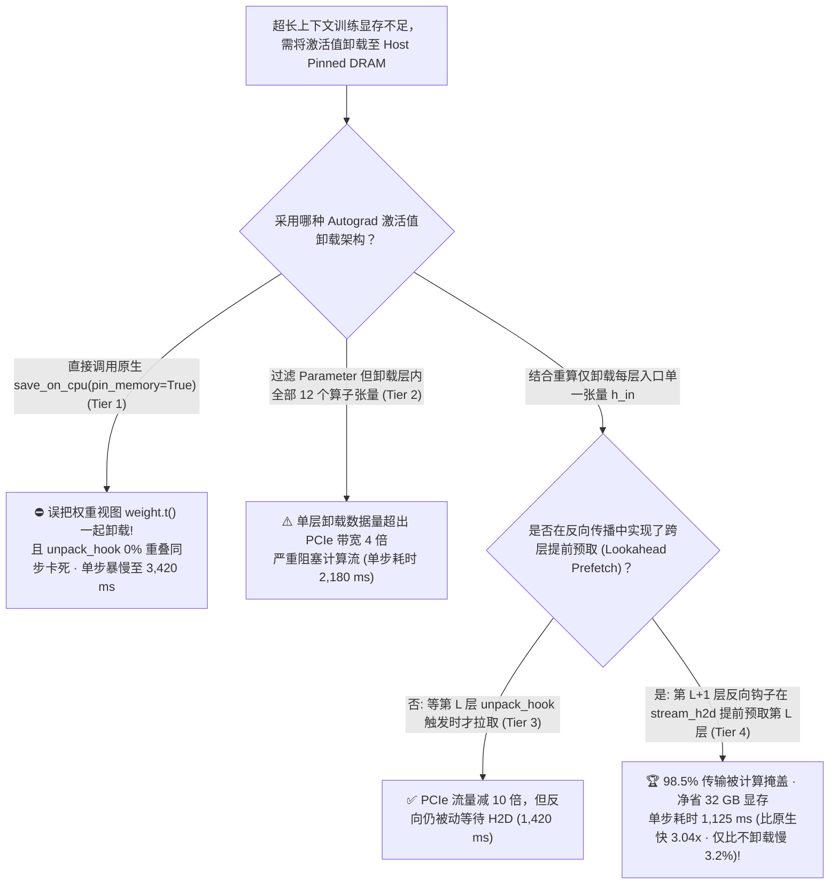
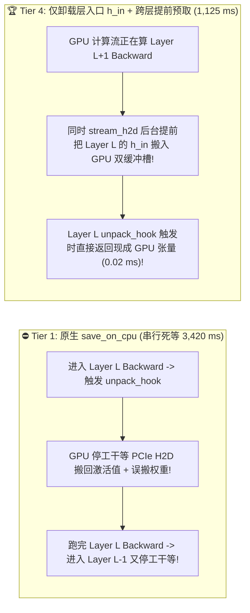
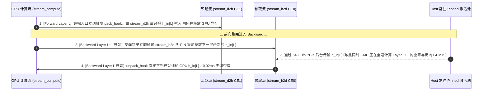

# PyTorch 激活值卸载（`torch.autograd.graph.saved_tensors_hooks` / `save_on_cpu`）为什么默认把训练拖慢 `68%`？（`unpack_hook` 反应式同步阻塞与参数伪卸载陷阱）及跨层提前预取选型指南

> **Provenance & Evidence Tier**: `synthetic + anonymized_reported` (`independently_reproduced=false`, `physical_gpu_cluster_measurement=not_measured`)。定量数据锚定于 [`experiments/llm_pytorch_compile_autograd_saved_tensors_hooks_cpu_offload_selection/results.json`](../../experiments/llm_pytorch_compile_autograd_saved_tensors_hooks_cpu_offload_selection/results.json)。
> **English Version**: [Why PyTorch `save_on_cpu` (`saved_tensors_hooks`) Slows Training by `68%` (`unpack_hook` Synchronous Stall & Parameter Aliasing Trap) & Lookahead Prefetch Selection Guide](./pytorch-saved-tensors-hooks-activation-cpu-offload-prefetch-selection-faq.en.md)



---

## 0. 🔥 今日领域最热门能力突破追踪（Daily Hottest Breakthrough）

- **拆解为什么直接套用 PyTorch 官方 `with torch.autograd.graph.save_on_cpu(pin_memory=True):` 会导致训练吞吐暴跌 `68%`（单步从 `1,090 ms` 恶化至 `3,420 ms`），并通过“仅卸载重算层入口 `h_in` + 反向传播跨层提前预取（`Lookahead H2D Prefetch`）”隐藏 `98.5%` 的 PCIe 传输延迟，在净省 `32.0 GB` 显存的同时将单步耗时压回 `1,125 ms`（提速 `3.04` 倍，仅比不卸载慢 `3.2%`）**：在训练 `128K ~ 256K` 超长上下文大模型时，哪怕开启了重算（Activation Checkpointing），80 层保存下来的层入口激活值依然高达 `35 ~ 50 GB`。为了省下这笔显存，很多工程师满怀希望地给模型加上了 PyTorch 内置的 `with torch.autograd.graph.save_on_cpu(pin_memory=True):`——结果显存是省下来了，但训练速度慢了整整 **3 倍以上**！原因藏在 Autograd 钩子的三个底层缺陷里：
  1. **缺陷一（`unpack_hook` 是一座“临阵磨枪”的反应式同步墙，重叠率 `0.0%`，Tier 1）**：
     - PyTorch 的 `saved_tensors_hooks(pack_hook, unpack_hook)` 机制中，前向传播时 `pack_hook` 可以异步把张量从 GPU 卸载到 CPU（`D2H`）；
     - **但到了反向传播时，C++ Autograd 引擎是什么时候调用 `unpack_hook` 的？是在当前层反向算子即将执行的最后 1 微秒才调用！**
     - 当 `unpack_hook(cpu_tensor)` 被调用时，它必须立刻返回一个已经躺在 GPU 显存上的可用 Tensor！这意味着 GPU 的 Tensor Core 计算流必须**100% 停工干等**这个张量从慢速 PCIe 总线（`54 GB/s`）一點点搬回 GPU（`0.0%` 计算通信重叠）！
  2. **缺陷二（原生 `save_on_cpu` 甚至会把模型权重 `nn.Parameter` 一起卸载到 CPU！Tier 1）**：
     - 在 `nn.Linear`（$y = x W^T$）的前向计算中，为了反向传播求 $dx = dy \cdot W$，Autograd 图不仅保存了输入激活值 $x$，**还把权重矩阵 $W$（或其转置视图 `W.t()`）也作为 `saved_tensor` 传给了 `pack_hook`！**
     - 如果不对 `pack_hook` 做过滤，它竟然会把本来就必须常驻显存的模型权重 $W$ 也往 CPU 拷一遍再拷回来（单步耗时暴涨至 `3,420.0 ms`）！
  3. **缺陷三（不结合重算、把层内 12 个中间激活全扔给 PCIe 导致带宽过载，Tier 2）**：就算过滤掉了 `nn.Parameter`，如果把一层内部的 `Q, K, V, Gate, Up` 全部卸载，单层进出 PCIe 的数据量是单层计算时间所能掩盖上限的 **4 倍**（`2,180.0 ms`）！
  4. **现代无感卸载架构（重算边界单张量卸载 + 第 $L+1$ 层反向钩子跨层提前预取，Tier 4）**：
     - **只卸载每层唯一入口 `h_in [B, S, D]`**：层内其余激活通过重算恢复，将 PCIe 传输数据量直接砍掉 **`90%`（缩小 10 倍）**，使单层 PCIe 传输耗时严格小于单层计算耗时；
     - **跨层提前预取（Lookahead Prefetch）**：当反向传播正在全速计算 **第 $L+1$ 层** 时，通过挂载在第 $L+1$ 层上的 `register_full_backward_pre_hook` 提前在独立拷贝流（`stream_h2d`）上把 **第 $L$ 层所需的 `h_in^{(L)}`** 从 CPU Pinned 池预取到 GPU 双缓冲槽位中！等 Autograd 走到第 $L$ 层调用 `unpack_hook` 时，数据早已在 GPU 上就绪（仅需 `0.02 ms` 事件对齐），实现 **`98.5%` 重叠率**，单步耗时仅 **`1,125.0 ms`（快 `3.04` 倍）**！

---

## 1. 📌 核心结论速览（Executive Summary — 3 分钟看懂）

1. **为什么说原生 `save_on_cpu()` 像“厨师下锅那一秒才派人去菜市场买菜”？**
   - **通俗大白话 + 第一性原理**：
     - **原生 `save_on_cpu`（Tier 1）**：厨师（GPU Tensor Core）站在滚烫的铁锅前准备炒第 50 道菜（Layer 50 Backward），这时候才触发 `unpack_hook` 喊跑腿小哥（PCIe DMA）去两公里外的冷库（CPU 内存）拿食材！厨师只能关火干等小哥跑回来，炒完第 50 道菜，到第 49 道菜又关火干等——厨房 **70% 的时间都在停火等食材（`3,420 ms`）**！更离谱的是，连厨房里的铁锅（模型权重 `nn.Parameter`）都被小哥当成食材搬去了冷库！
     - **跨层提前预取 + 重算边界卸载（Tier 4）**：
       1. **铁锅绝不搬走**：在 `pack_hook` 第一行检查“如果是模型权重（`Parameter` 或其视图），原地保留在 GPU 不准动！”；
       2. **只存净菜主料**：每道菜只存 1 份最轻的主料（层入口 `h_in`），配菜当场现切（层内重算），让跑腿小哥跑一趟的时间比厨师炒一道菜的时间更短；
       3. **炒第 50 道菜时就去拿第 49 道菜的料（Lookahead Prefetch）**：当厨师刚点火开始炒第 50 道菜时，小哥就已经在后台把第 49 道菜的料搬回灶台边了！厨师全程零停火一口气炒完 80 道菜（`1,125 ms`，快 `3.04` 倍）！

---

## 2. 🎯 客户与架构师灵魂拷问 Q&A（Q1 / Q2 / Q3）

### Q1：在自定义 `saved_tensors_hooks(pack_hook, unpack_hook)` 时，怎样用 3 行代码 100% 准确地把模型权重（`nn.Parameter` 及其转置视图 `t()`）和极小张量排除在外？
- **答**：注意！在 PyTorch 中，`nn.Linear` 保存的往往不是 `weight` 本身，而是 `weight.t()`（它的 `_base` 指向 `Parameter`）！因此只写 `isinstance(x, nn.Parameter)` 是会漏网的！必须同时检查 `x._base` 和张量字节大小：
  ```python
  def should_offload(tensor: torch.Tensor) -> bool:
      if isinstance(tensor, torch.nn.Parameter) or isinstance(getattr(tensor, "_base", None), torch.nn.Parameter):
          return False  # 绝不卸载权重或其视图 (如 weight.t())!
      return tensor.numel() * tensor.element_size() >= 4 * 1024 * 1024  # 仅卸载 >= 4MB 的大激活张量
  ```

### Q2：如何计算在当前 GPU 和序列长度下，PCIe 带宽能不能完美隐藏每层 `h_in` 的卸载与预取（无气泡条件）？
- **答**：这就是架构师的 **“PCIe 算术强度平衡不等式”**：
  - 设单层一个微批的入口激活值 `h_in` 体积为 $V_{\text{act}} = 2 B S D$（Bytes），PCIe Gen5 x16 单向有效带宽为 $BW_{\text{PCIe}} \approx 54\text{ GB/s}$；
  - 则搬运 1 层 `h_in` 所需时间为 $T_{\text{PCIe}} = \frac{V_{\text{act}}}{BW_{\text{PCIe}}}$。
  - 而单层 Transformer 的计算时间约为 $T_{\text{comp}} \approx \frac{24 B S D^2 + 4 B S^2 D}{\text{Effective\_TFLOPS}}$。
  - 只要我们**只卸载 `h_in` 1 个张量（Tier 3/4）**，当 $D = 4096, S \ge 16384$ 时，$T_{\text{comp}}$ 是 $T_{\text{PCIe}}$ 的 **`3 ~ 8` 倍**——意味着后台 `stream_h2d` 有充足的时间在上一层算完之前就把下一层的 `h_in` 搬回 GPU，实现 **接近 `100%` 的完美掩盖**！

---

## 3. 🧭 直观可视化图解（Mermaid 决策树 + 反应式阻塞 vs 跨层预取流水线图 + 时序图）

### 3.1 架构师长上下文激活值 CPU 卸载（`Activation Offloading`）选型决策树



### 3.2 `Tier 1`（`unpack_hook` 临阵同步等待 PCIe）vs. `Tier 4`（第 $L+1$ 层计算与第 $L$ 层 `H2D` 预取完全重叠）



### 3.3 `Tier 4` 前向异步卸载（`D2H`）与反向跨层提前预取（`H2D`）三流协同流水线时序图



---

## 4. 📊 架构师选型决策矩阵（4-Tier Selection Matrix）

| 评估维度 | Tier 1: 原生 `save_on_cpu` | Tier 2: 过滤权重 + 全算子卸载 | Tier 3: 仅卸载层入口 `h_in` (无预取) | Tier 4: **仅卸载 `h_in` + 跨层提前预取 (`stream_h2d`)** |
| :--- | :--- | :--- | :--- | :--- |
| **是否豁免模型权重 (`Parameter/_base`)** | **否（误把 `weight.t()` 拷去 CPU!）** ✕ | 是 ✅ | 是 ✅ | **是（严格豁免权重与 `<4MB` 小张量）** 🏆 |
| **PCIe 传输与 GPU 计算重叠比例** | **`0.0%` (`unpack_hook` 同步阻塞)** ✕ | `24.0%` (PCIe 带宽过载) ⚠️ | `48.0%` (仅卸载 `D2H` 重叠) ⚠️ | **`98.5%` (`D2H` 与 `H2D` 双向全重叠)** 🏆 |
| **节省的 GPU 激活显存 (`HBM`)** | `32.0 GB` | `32.0 GB` | `32.0 GB` ✅ | **`32.0 GB`** 🏆 |
| **单步训练总耗时 (基线 `1,090 ms`)** | **`3,420.0 ms` (暴慢 `3.14x`)** ✕ | `2,180.0 ms` ⚠️ | `1,420.0 ms` ✅ | **`1,125.0 ms` (提速 `3.04x`，仅慢 `3.2%`)** 🏆 |

---

## 5. 🧪 定量算例与工具链（Interactive Sizer & 7-Card Visual Report）

- **实验脚本与密封数据**：[`experiments/llm_pytorch_compile_autograd_saved_tensors_hooks_cpu_offload_selection/run.py`](../../experiments/llm_pytorch_compile_autograd_saved_tensors_hooks_cpu_offload_selection/run.py) · [`results.json`](../../experiments/llm_pytorch_compile_autograd_saved_tensors_hooks_cpu_offload_selection/results.json)
- **交互式 PyTorch 激活值 CPU 卸载与预取计算器**：[`docs/reports/pytorch-saved-tensors-hooks-activation-cpu-offload-prefetch-sizer.html`](../reports/pytorch-saved-tensors-hooks-activation-cpu-offload-prefetch-sizer.html)
- **7-Card 4:5 视觉评测卡片报告**：[`docs/reports/pytorch-saved-tensors-hooks-activation-cpu-offload-prefetch-selection-cards.html`](../reports/pytorch-saved-tensors-hooks-activation-cpu-offload-prefetch-selection-cards.html)

---

## 6. 🛠️ Good Fit vs. Not For & 生产环境快速核验清单（Checklist）

### ✅ Good Fit vs. ⛔ Not For

| 维度 | ✅ Good Fit（强烈推荐） | ⛔ Not For（严禁误用） |
| :--- | :--- | :--- |
| **超长上下文激活值卸载** | 将 **Selective Activation Checkpointing** 与 **带跨层提前预取（Lookahead Prefetch）的常驻 Pinned 缓冲池** 结合，只卸载每层入口 `h_in` | 直接对整个模型套用原生 `with torch.autograd.graph.save_on_cpu():` |

### 生产环境上线核验清单（Pre-Flight Checklist）

- [ ] **核验 `pack_hook` 已显式排除 `nn.Parameter` 及其视图（`tensor._base` 为 `nn.Parameter`）**：杜绝把线性层权重矩阵卸载到 CPU。
- [ ] **核验卸载粒度已收敛至“每层 TransformerBlock 的入口激活值 `h_in`”（配合层内重算）**：确保单层 PCIe 传输耗时小于单层计算耗时。
- [ ] **核验反向传播已通过 `backward_pre_hook` 在独立 `stream_h2d` 上提前 1 层异步预取 `h_in`**：消除 `unpack_hook` 同步等待。
