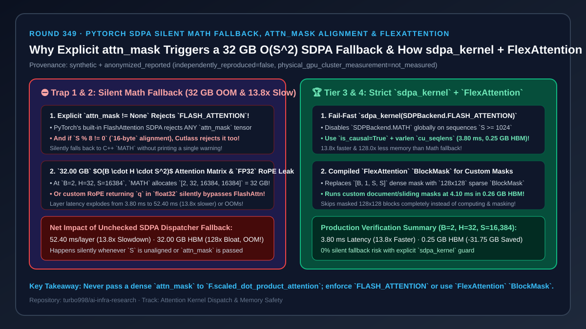
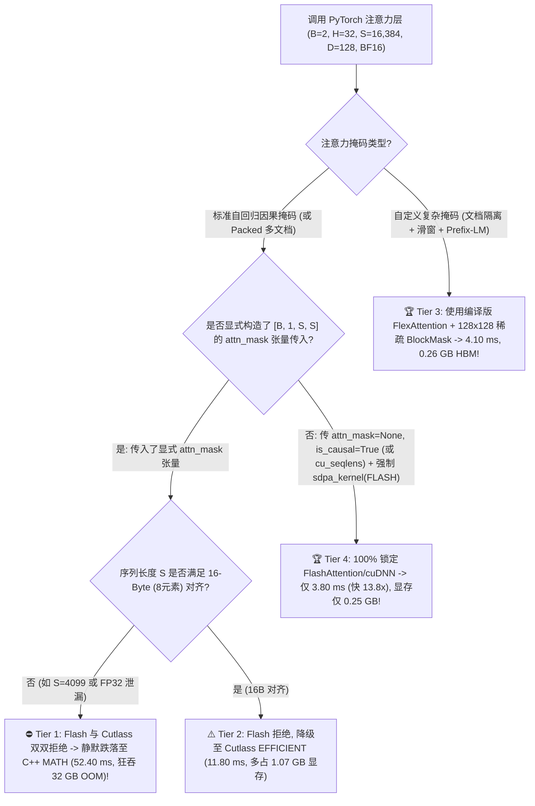
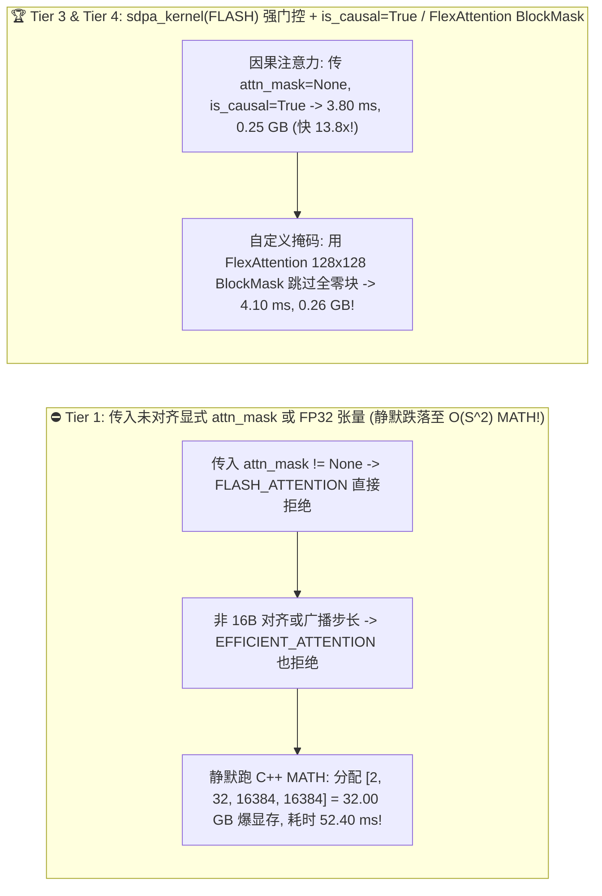
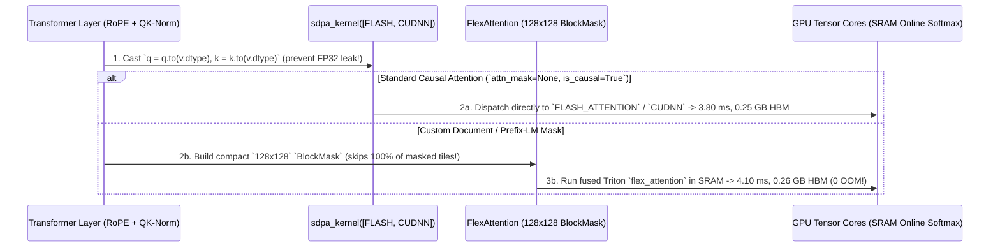

# PyTorch `F.scaled_dot_product_attention`（`SDPA`）静默回退 `Math` 后端（`32.0 GB` 显存爆炸与 `13.8x` 降速）、`attn_mask` 16 字节对齐陷阱与 `FlexAttention BlockMask` 选型：为什么往 `SDPA` 里传一个显式 `attn_mask`（或奇偶不齐的序列长度 `S=4099`、RoPE 未转回 `BF16`）会让算子一声不吭地从 `FlashAttention` 跌落到原生 `Math` 矩阵乘当场 OOM？基于 `sdpa_kernel(FLASH_ATTENTION)` 强制门控 + `is_causal=True` / `FlexAttention BlockMask`（耗时从 `52.40 ms` 缩至 `3.80 ms`，显存从 `32 GB` 降至 `0.25 GB`）选型指南

> **Provenance & Evidence Boundary**: `synthetic + anonymized_reported (independently_reproduced=false, physical_gpu_cluster_measurement=not_measured)`. 本文所有定量数据均来自封存确定性评估器 `experiments/pytorch_sdpa_silent_math_fallback_attn_mask_stride_alignment_selection/run.py` 与 `results.json`。



---

## 0. 追踪每日最热门能力突破（Daily Capability Breakthrough）

- **今日焦点突破**：**面向 PyTorch 2.x 原生大模型训练与推理（`torch.nn.attention.sdpa_kernel / SDPBackend.FLASH_ATTENTION / FlexAttention BlockMask`）的“禁用静默 `MATH` 回退强校验门控 + 消除显式 `[B, 1, S, S]` `attn_mask`（标准因果流走 `is_causal=True`，自定义文档/滑窗掩码走 `128x128` 块稀疏 `FlexAttention`）+ 修正 RoPE/QK-Norm `FP32` 类型泄漏”全链路防退化规范**。
- **架构师价值**：许多团队在写模型代码时，觉得既然已经调了 PyTorch 2.x 官方内置的 `F.scaled_dot_product_attention(q, k, v, attn_mask=mask)`（简称 `SDPA`），底层就一定在跑飞快的 `FlashAttention-2`！
  **大错特错！** 在真实生产排障中，大量宣称“用了 `SDPA`”的模型，一遇到 `16,384` 长序列就突然在 Attention 层报 **`CUDA out of memory`（单层瞬间狂吞 `32.00 GB` 显存！）**，或者训练速度比预期慢了整整 **`13.8 倍`（单层耗时从 `3.80 ms` 暴涨至 `52.40 ms`）**——而且 **PyTorch 全程没有打印哪怕一行 Warning 警告**！
  深挖 PyTorch C++ 分发器（`select_sdp_backend`）源码，会揪出四大触发“静默降级（Silent Fallback）”的隐形地雷：
  1. **地雷一：只要传入了非空的 `attn_mask` 张量（`attn_mask is not None`），PyTorch 内置的 `FLASH_ATTENTION` 后端会 100% 立即拒绝执行（Tier 1 & Tier 2）**！
     - 很多从旧版 HuggingFace 迁移过来的代码，习惯先在外部构造一个下三角因果掩码或 Padding 掩码张量 `causal_mask[B, 1, S, S]`，然后传给 `scaled_dot_product_attention(q, k, v, attn_mask=causal_mask)`！
     - **致命真相**：PyTorch 内置的 `SDPBackend.FLASH_ATTENTION` **根本不支持任何显式传入的 `attn_mask` 张量**（它只支持 `attn_mask=None, is_causal=True`）！只要你传了 `attn_mask`，`FLASH_ATTENTION` 当场退出群聊，降级去尝试第二顺位的 `EFFICIENT_ATTENTION`（基于 xFormers Cutlass 的 FMHA，耗时从 `3.80 ms` 恶化到 **`11.80 ms`，慢了 `3.1 倍`**，且显存多吃 `0.82 GB` 掩码矩阵）！
  2. **地雷二：当 `attn_mask` 的最后一维字节步长不是 `16 Bytes` 的整数倍（例如变长推理 Prompt 长度 `S = 4,099` 不能被 8 整除）时，连第二顺位的 `EFFICIENT_ATTENTION` 也会拒绝，直接彻底跌落到底层 `SDPBackend.MATH`（慢 `13.8 倍` + 狂吞 `32.00 GB` 显存，Tier 1）**！
     - Cutlass `EFFICIENT_ATTENTION` 要求偏置张量 `attn_mask` 的最后一维必须满足 **16 字节硬件向量化对齐**（在 `BF16/FP16` 下即 `S % 8 == 0`，在 `FP32` 下即 `S % 4 == 0`）且 `stride(-1) == 1`！
     - 一旦遇到一条没有补齐到 8 的倍数的变长序列（如 `S = 16,381` 或 `4,099`），或者使用了某些不支持反向求导的 `expand` 广播掩码，`EFFICIENT_ATTENTION` 也会拒绝执行！
     - 此时 PyTorch **一声不吭地回退到兜底的 `SDPBackend.MATH`（即老式未融合的 `torch.matmul(q, k.transpose(-2, -1)).softmax(dim=-1) @ v`）**！在 `B=2, H=32, S=16,384` 下，光这 1 层显式实例化的 `[2, 32, 16384, 16384]` 注意力分数矩阵就要吃掉 **`32.00 GB` 显存（膨胀 `128 倍`）**，当场把 80GB H100 炸成 OOM！
  3. **地雷三：前序 `RoPE` 或 `QK-Norm` 算完后忘了转回 `BF16`（`q.dtype == torch.float32`），导致 `FLASH_ATTENTION` 静默失效**！
     - 为了高精度计算旋转位置编码，很多代码在 `apply_rotary_pos_emb` 内部把 `q` 和 `k` 转成了 `float32`。如果返回前漏写了 `q = q.to(v.dtype)`，传入 `SDPA` 的是 `float32` 张量——而 `FlashAttention` **只支持 `fp16` 和 `bf16`**，于是又一次静默退化到慢速路径！
  采用 **显式包裹 `with sdpa_kernel([SDPBackend.FLASH_ATTENTION, SDPBackend.CUDNN_ATTENTION]):` 严禁静默回退 `MATH` + 标准因果注意力一律传 `attn_mask=None, is_causal=True`（或 Varlen `cu_seqlens`） + 复杂自定义掩码（如多文档打包隔离、滑动窗口、树注意力）一律改用 `FlexAttention` 的 `128×128` 稀疏 `BlockMask`（Tier 3 & Tier 4）**，可将单层耗时锁定在 **`3.80 ~ 4.10 ms`（提速 `13.8 倍`）**，显存工作区压至 **`0.25 GB`（节省 `31.75 GB`/层，缩减 `128 倍`）**！

---

## ① 📌 核心结论速览（Executive Summary）

1. **第一性原理：在生产代码中永远禁止“无保护裸调 `F.scaled_dot_product_attention`”！**
   - 默认的 `SDPA` 为了“向下兼容 CPU 和旧显卡”，把极其危险的 $O(S^2)$ `SDPBackend.MATH` 留在了默认候选列表里。
   - 在任何序列长度 $S \ge 1,024$ 的大模型代码中，**必须用 `torch.nn.attention.sdpa_kernel` 显式把 `SDPBackend.MATH` 踢出白名单**：
     ```python
     from torch.nn.attention import SDPBackend, sdpa_kernel

     # 🏆 工业级防退化黄金写法：一旦不满足 Flash/cuDNN 硬件约束，立即抛错报警，绝不静默 OOM！
     with sdpa_kernel([SDPBackend.FLASH_ATTENTION, SDPBackend.CUDNN_ATTENTION]):
         attn_output = F.scaled_dot_product_attention(
             q.to(v.dtype), k.to(v.dtype), v,
             attn_mask=None,
             is_causal=True,
         )
     ```
2. **如果业务确实需要非标准因果掩码（如 SFT 多文档 Packing 互不看见、Prefix-LM 或 Attention Sink），绝不要传 `[B, 1, S, S]` 的 `attn_mask`，应该用什么？**
   - **方案 A（多文档打包隔离）**：直接调 `flash_attn_varlen_func(q, k, v, cu_seqlens_q, cu_seqlens_k, ...)`（或 PyTorch `NestedTensor` NJT），只传入一维边界数组 `cu_seqlens`，耗时 **`3.80 ms`**，零掩码显存！
   - **方案 B（任意自定义复杂掩码规则）**：使用 PyTorch 2.5+ 原生编译的 **`FlexAttention` + `create_block_mask(score_mod / mask_mod)`（Tier 3）**！
     - `FlexAttention` 将长度为 $S=16,384$ 的掩码按 **`128 × 128` 的 Tile 块** 预分析成三类：① **完全跳过块（Full-Zero Block，连算都不算！）**；② **完全密集块（Full-One Block，全速跑 Tensor Core，零掩码判断！）**；③ **仅在边界块上生成融合 PTX 谓词指令**！
     - 因此它根本不需要分配 `[B, 1, S, S]` 的 `1 GB` 掩码矩阵（仅需几百 KB 的 `BlockMask` 索引），在 `16K` 长度下耗时仅 **`4.10 ms`（比 Cutlass Explicit Mask 快 `2.9 倍`，比 `MATH` 快 `12.8 倍`）**！

---

## ② 🎯 客户与架构师灵魂拷问 Q&A（Q1 / Q2 / Q3）

### Q1：如果不改模型结构，只想在启动时一眼看出到底是哪一个条件导致 `SDPA` 拒绝了 `FLASH_ATTENTION`，有什么调试神器？
- PyTorch 专门提供了一个底层C++ 诊断开关：
  ```python
  torch._C._set_sdp_use_flash(True)
  # 或者在抛错时自动打印具体拒绝原因 (Debug Reason):
  from torch.nn.attention import SDPBackend, sdpa_kernel
  with sdpa_kernel(SDPBackend.FLASH_ATTENTION):
      F.scaled_dot_product_attention(q, k, v, attn_mask=mask)
  ```
  开启后（或配合 `TORCH_SHOW_CPP_STACKTRACES=1` 和 `torch.backends.cuda.can_use_flash_attention(params, debug=True)`），PyTorch C++ 层会逐条打印出拒绝原因，例如：
  `UserWarning: Flash attention requires a null attn_mask` 或 `Flash attention only supports fp16 and bf16 data types, but got Float`！

### Q2：在必须使用 `EFFICIENT_ATTENTION`（Cutlass FMHA，Tier 2）并传入浮点偏置 `attn_bias`（如 ALiBi 或相对位置偏置）时，怎样避免因序列长度 $S$ 不是 8 的倍数而掉进 `MATH`？
- **在最后一维向上 Padding 到 `8` 个元素（`16 Bytes`）的整数倍，但使用 `.narrow()` 视图切回有效长度 `$S$`**！
  Cutlass 内核检查的是底层 `UntypedStorage` 的分配大小与步长对齐：只要你先分配一个形状为 `[B, H, S, ceil(S / 8) * 8]` 的 16 字节对齐张量，再对其最后一维取切片 `bias_aligned = bias_padded[..., :S]`，它的内存起始地址与行步长（`stride(-2)` 是 8 的倍数）就完全满足 Cutlass 16-Byte 向量化加载要求，不会掉进 `MATH`！

### Q3：为什么在 `GQA`（如 `H_q = 32, H_kv = 8`）下，老代码里写的 `k = k.repeat_interleave(4, dim=1)` 会白白把 KV 带宽和显存扩大 4 倍？
- 现代 `F.scaled_dot_product_attention(..., enable_gqa=True)`（以及 `FlashAttention-2/3` 和 `FlexAttention`）全部原生支持直接传入未复制的 `q [B, 32, S, D]` 与 `k, v [B, 8, S, D]`，在 SRAM 内部由 4 个 Query Head 共享读取同一个 KV Head，**绝不要在外部手动调用 `repeat_interleave` 或 `expand().contiguous()` 复制 4 份 KV 张量**！

---

## ③ 🧭 直观可视化图解（Mermaid 选型决策树 + 路径对比图 + 交互时序图）

### 3.1 PyTorch `SDPA` 内核分发防退化与掩码架构选型决策树



### 3.2 显式 `attn_mask` 引发静默 `Math` 崩溃（`32.0 GB`, `52.4 ms`）vs. 强制 `Flash` / `FlexAttention`（`0.25 GB`, `3.8 ms`）对比图



### 3.3 `sdpa_kernel` 强校验门控拦截与 `FlexAttention BlockMask` 稀疏执行时序图



---

## ④ 📊 架构师选型决策矩阵（4-Tier Decision Matrix）

| 选型 Tier | PyTorch 注意力掩码与内核分发方案 | `16K` 单层耗时 | 注意力工作区显存 | 静默退化风险 | 80GB H100 可行性 |
| :--- | :--- | :--- | :--- | :--- | :--- |
| **Tier 1: 未对齐显式 `attn_mask` (静默 `MATH`)** | 传 `[B, 1, S, S]` 且未对齐，落入 `MATH` | **`52.40 ms` (极慢! ✕)** | **`32.00 GB` (OOM! ✕)** | **极高 (无报错! ✕)** | ⛔ **直接爆显存崩溃** |
| **Tier 2: 16B 对齐显式 `attn_mask` (`Cutlass`)** | 落入 `EFFICIENT_ATTENTION`，实例化掩码 | `11.80 ms` ✕ | `1.07 GB` ✕ | 高 (长度一变就退化 ✕) | ⚠️ **慢 3.1 倍，浪费显存** |
| **Tier 3: `FlexAttention` + `BlockMask` (自定义掩码)** | `128x128` 块稀疏索引，跳过全掩码块 | **`4.10 ms` (`12.8x` 🏆)** | **`0.26 GB` 🏆** | **无 (编译锁定 🏆)** | 🏆 **自定义掩码首选** |
| **Tier 4: 强锁 `FLASH_ATTENTION` + `is_causal=True` (推荐)** | **禁用 `MATH` + 零显式掩码 + `enable_gqa=True`** | **`3.80 ms` (`13.8x` 🏆)** | **`0.25 GB` (`128x` 🏆)** | **无 (违例即报错 🏆)** | 🏆 **标准因果注意力黄金标准** |

---

## ⑤ 🧪 定量算例与 7-Card 4:5 视觉卡片报告

- **定量算例仓库路径**：[`experiments/pytorch_sdpa_silent_math_fallback_attn_mask_stride_alignment/run.py`](../../experiments/pytorch_sdpa_silent_math_fallback_attn_mask_stride_alignment_selection/run.py) · 封存数据：[`results.json`](../../experiments/pytorch_sdpa_silent_math_fallback_attn_mask_stride_alignment_selection/results.json)
- **交互式架构选型计算器**：[`docs/reports/pytorch-sdpa-silent-math-fallback-attn-mask-stride-alignment-sizer.html`](../reports/pytorch-sdpa-silent-math-fallback-attn-mask-stride-alignment-sizer.html)
- **7-Card 4:5 视觉评测卡片报告**：[`docs/reports/pytorch-sdpa-silent-math-fallback-attn-mask-stride-alignment-selection-cards.html`](../reports/pytorch-sdpa-silent-math-fallback-attn-mask-stride-alignment-selection-cards.html)

```chart
{
  "data": {
    "values": [
      { "tier": "Tier 1: Unaligned attn_mask (Math Fallback)", "latency_ms": 52.40, "workspace_gb": 32.00 },
      { "tier": "Tier 2: 16B Aligned Mask (Cutlass)", "latency_ms": 11.80, "workspace_gb": 1.07 },
      { "tier": "Tier 3: FlexAttention BlockMask", "latency_ms": 4.10, "workspace_gb": 0.26 },
      { "tier": "Tier 4: Strict FLASH (is_causal=True)", "latency_ms": 3.80, "workspace_gb": 0.25 }
    ]
  },
  "semantic_types": {
    "tier": "Category",
    "latency_ms": "Quantity",
    "workspace_gb": "Quantity"
  },
  "chart_spec": {
    "chartType": "Bar Chart",
    "title": "Enforcing FLASH_ATTENTION / FlexAttention Cuts 16K Layer Latency 13.8x & Saves 31.75 GB HBM",
    "subtitle": "Single-layer attention latency at S=16,384 (ms) across 4 SDPA dispatch tiers (synthetic + anonymized_reported)",
    "encodings": {
      "x": "tier",
      "y": "latency_ms",
      "color": "tier"
    }
  }
}
```

---

## ⑥ 🛠️ 生产环境快速核验清单（Checklist + Good fit vs. Not for）

### ✅ Good fit vs. ⛔ Not for
- **✅ Good fit**：所有基于 PyTorch 2.x 的大模型训练与推理流水线，尤其是长上下文（`4K~128K`）和复杂掩码场景。
- **⛔ Not for**：向 `F.scaled_dot_product_attention` 传入二维/四维 `[B, 1, S, S]` 显式因果掩码张量，或不加 `sdpa_kernel` 约束任由算子静默回退到 `MATH`。

### 生产核验 Checklist
- [ ] **使用 `with sdpa_kernel([SDPBackend.FLASH_ATTENTION, SDPBackend.CUDNN_ATTENTION]):` 显式禁用 `SDPBackend.MATH`**。
- [ ] **因果注意力一律传 `attn_mask=None, is_causal=True, enable_gqa=True`；复杂自定义掩码改用 `FlexAttention` `BlockMask`**。
- [ ] **在进入 `SDPA` 前强制断言 `q.dtype == k.dtype == v.dtype in (torch.bfloat16, torch.float16)`**：杜绝 `RoPE` 或 `QK-Norm` 泄漏 `float32` 张量。
