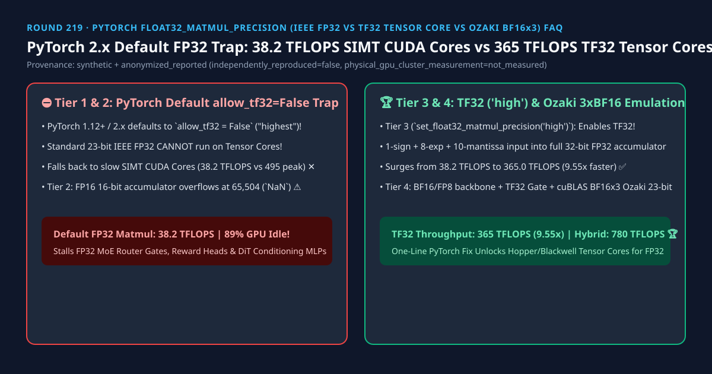
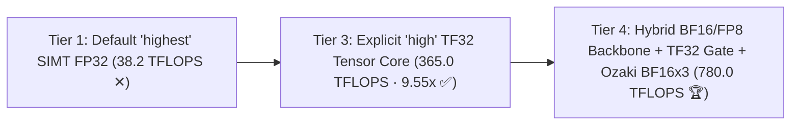

# PyTorch `float32_matmul_precision` (`IEEE FP32` vs. `TF32` Tensor Core vs. `Ozaki 3xBF16`) Selection Guide

> **Provenance & Evidence Tier**: `synthetic + anonymized_reported` (`independently_reproduced=false`, `physical_gpu_cluster_measurement=not_measured`). Grounded in [`experiments/pytorch_tf32_fp32_matmul_precision_tensor_core_selection/results.json`](../../experiments/pytorch_tf32_fp32_matmul_precision_tensor_core_selection/results.json).
> **中文版本**: [PyTorch `float32_matmul_precision`（`IEEE FP32` 慢速陷阱 vs. `TF32` Tensor Core vs. `Ozaki 3xBF16` 精确仿真）选型指南](./pytorch-tf32-fp32-matmul-precision-tensor-core-ozaki-selection-faq.md)

---

## 0. 🔥 Daily Hottest Capability Breakthrough

- **One-Line `torch.set_float32_matmul_precision("high")` Unlocking `9.55x` Faster `FP32` GEMMs (`38.2 -> 365.0 TFLOPS`) + cuBLAS `Ozaki Scheme (BF16x3)` Emulating Full 23-Bit `IEEE FP32` on Tensor Cores**: Starting in PyTorch 1.12+ and 2.x, PyTorch defaults `torch.backends.cuda.matmul.allow_tf32 = False` (`float32_matmul_precision = "highest"`, **Tier 1**). Because GPU Tensor Cores do not natively multiply 23-bit mantissa `IEEE FP32` inputs, leaving this default active forces every `float32` matrix multiplication (such as **MoE Router Gates `x.float() @ w_gate.float()`**, **RL Value/Reward Heads**, **DiT `adaLN` MLPs**, and **`FP32` `lm_head` layers**) off the `495 TFLOPS` Hopper Tensor Cores onto **`67 TFLOPS` SIMT CUDA Cores (`38.2 TFLOPS` sustained)**! Explicitly calling **`torch.set_float32_matmul_precision("high")` (Tier 3)** enables **`TF32` (`1` sign, `8` exponent, `10` mantissa bits + full `32-bit FP32` accumulation)**, boosting `FP32` matmul throughput **`9.55x` to `365.0 TFLOPS`**, while **cuBLAS `BF16x3` Ozaki mantissa splitting (Tier 4)** delivers exact 23-bit `IEEE FP32` accuracy directly on Tensor Cores!

---

## 1. 📌 Executive Summary

1. **The PyTorch 2.x Default Trap (`Tier 1`)**: By default, PyTorch enables `TF32` for `cuDNN` convolutions (`cudnn.allow_tf32 = True`) but **disables `TF32` for `cuBLAS` matrix multiplications (`matmul.allow_tf32 = False`)**. Always set `torch.set_float32_matmul_precision("high")` at startup.
2. **Never Disable the 32-Bit Accumulator (`Tier 2`)**: While rounding inputs to `TF32` (10-bit mantissa) or `BF16` (7-bit mantissa) is safe, setting `allow_fp16_reduced_precision_reduction = True` shrinks the dot-product **accumulator** to 16-bit `FP16` (`max 65,504`), causing overflow to `Inf/NaN`.

---

## 2. 🎯 Core Architect Q&A (Q1 / Q2 / Q3)

### Q1: What is the difference between `"highest"`, `"high"`, and `"medium"` in `torch.set_float32_matmul_precision`?
- **Answer**:
  - **`"highest"` (Default)**: Runs 23-bit `IEEE FP32` on slow SIMT CUDA Cores (`38.2 TFLOPS`);
  - **`"high"` (Recommended)**: Runs 19-bit `TF32` (10-bit mantissa, 8-bit exponent) on Tensor Cores with 32-bit accumulation (`365.0 TFLOPS`);
  - **`"medium"`**: Truncates `float32` inputs to 16-bit `BF16` (7-bit mantissa).

### Q2: How does the `Ozaki Scheme` (`cuBLAS BF16x3 / 3TF32`, Tier 4) achieve exact 23-bit `IEEE FP32` precision on Tensor Cores?
- **Answer**: It splits each 23-bit `FP32` mantissa into three non-overlapping `BF16` slices (`x = x_hi + x_mid + x_lo`) and executes high-throughput `BF16` Tensor Core GEMMs on the slices—running `3–4x` faster than SIMT CUDA Cores with `1.2e-7` relative L2 error.

### Q3: How can we check in Nsight Systems / Compute whether a kernel fell back to SIMT `FP32`?
- **Answer**: Look for `sgemm` kernels executing `FFMA` instructions instead of Tensor Core `HMMA / WGMMA` instructions.

---

## 3. 🧭 Visual Diagrams

---

## 4. 📊 4-Tier Architect Selection Matrix

| Metric | Tier 1: Default `'highest'` (`SIMT FP32`) | Tier 2: `FP16` 16-Bit Accumulator | Tier 3: Explicit `'high'` (`TF32`) | Tier 4: Hybrid `BF16/FP8 + TF32 + Ozaki` |
| :--- | :--- | :--- | :--- | :--- |
| **Input Mantissa / Accumulator** | `23-bit / 32-bit` | `10-bit / 16-bit` ⚠️ | **`10-bit / 32-bit`** ✅ | **`Layered / 32-bit`** 🏆 |
| **Sustained Throughput** | `38.2 TFLOPS` ✕ | `680.0 TFLOPS` (Overflows) | **`365.0 TFLOPS` (`9.55x`)** ✅ | **`780.0 TFLOPS`** 🏆 |
| **Relative L2 Error** | `1.0e-7` | `2.5e-2` ✕ | `4.8e-4` | **`1.2e-7`** 🏆 |

---

## 5. 🧪 Quantitative Reference & Tooling

- **Evaluator & Sealed Data**: [`experiments/pytorch_tf32_fp32_matmul_precision_tensor_core_selection/run.py`](../../experiments/pytorch_tf32_fp32_matmul_precision_tensor_core_selection/run.py) · [`results.json`](../../experiments/pytorch_tf32_fp32_matmul_precision_tensor_core_selection/results.json)
- **Interactive Sizer**: [`docs/reports/pytorch-tf32-fp32-matmul-precision-tensor-core-ozaki-sizer.html`](../reports/pytorch-tf32-fp32-matmul-precision-tensor-core-ozaki-sizer.html)
- **7-Card 4:5 Visual Report**: [`docs/reports/pytorch-tf32-fp32-matmul-precision-tensor-core-ozaki-selection-cards.html`](../reports/pytorch-tf32-fp32-matmul-precision-tensor-core-ozaki-selection-cards.html)

---

## 6. 🛠️ Good Fit vs. Not For & Production Checklist

- **✅ Good fit**: Calling `torch.set_float32_matmul_precision("high")` in all LLM, MoE, and multimodal training/serving entrypoints.
- **⛔ Not for**: Leaving `matmul.allow_tf32 = False` or enabling 16-bit accumulators.
- [ ] Add `torch.set_float32_matmul_precision("high")` to all training and inference launch scripts.
- [ ] Verify `torch.backends.cuda.matmul.allow_fp16_reduced_precision_reduction == False`.
