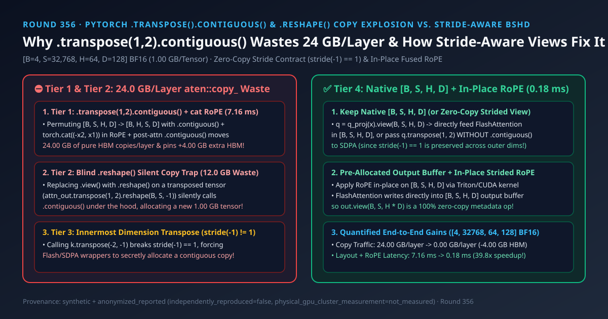
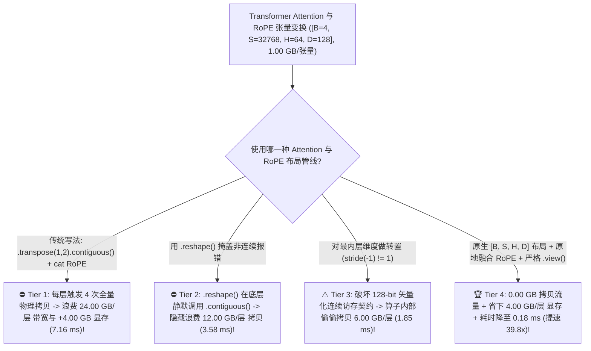
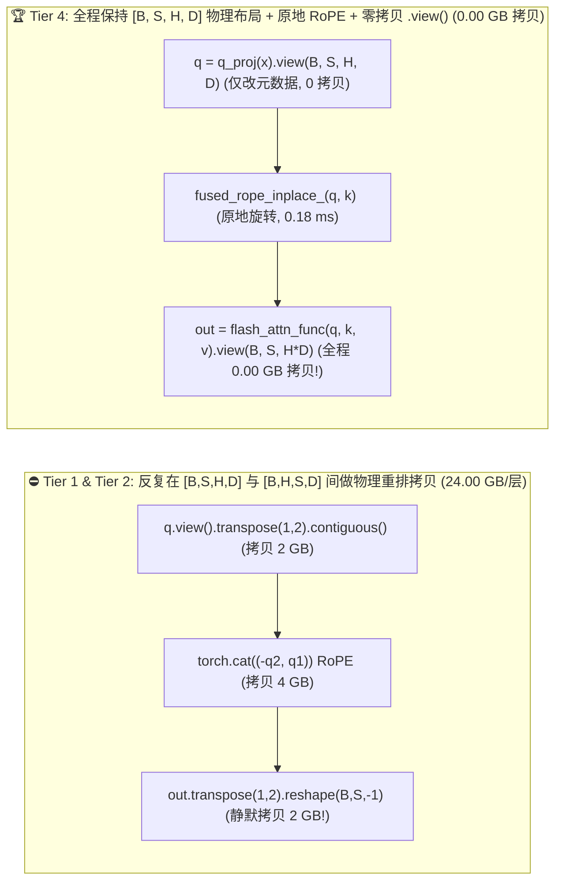
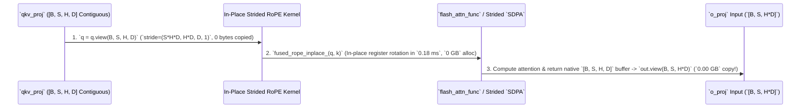

# PyTorch `.transpose().contiguous()` 与 `.reshape()` 隐式全量显存拷贝爆炸（每层浪费 `24.00 GB` 带宽与 `+4.00 GB` 显存）及步幅感知原生 `[B, S, H, D]` 布局选型：为什么把 `.view()` 改成 `.reshape()` 会掩盖非连续张量的静默 `.contiguous()` 分配，且 `rotate_half` 拼接会白白复制 `1.00 GB`？基于原生 `[B, S, H, D]` 零拷贝视图（`stride(-1) == 1`）+ 原地融合 `RoPE`（耗时从 `7.16 ms` 降至 `0.18 ms`，提速 `39.8x`）选型指南

> **Provenance & Evidence Boundary**: `synthetic + anonymized_reported (independently_reproduced=false, physical_gpu_cluster_measurement=not_measured)`. 本文所有定量数据均来自封存确定性评估器 `experiments/pytorch_transpose_contiguous_copy_explosion_stride_aware_layout_selection/run.py` 与 `results.json`。



---

## 0. 追踪每日最热门能力突破（Daily Capability Breakthrough）

- **今日焦点突破**：**面向长上下文大模型训练与推理（`FlashAttention-3 / TorchTitan / vLLM`）的“全链路原生 `[B, S, H, D]`（或变长 `[T, H, D]`）零拷贝张量步幅契约（`Zero-Copy Stride Contract: stride(-1) == 1`）+ 原地融合 `RoPE` + 严禁 `.reshape()` 静默拷贝”架构：彻底消灭每层注意力前后的 `.transpose(1, 2).contiguous()` 与 `torch.cat` 引起的 `24.00 GB/layer` 纯显存搬运浪费和 `+4.00 GB/layer` 冗余激活显存，将每层布局与位置编码开销从 `7.16 ms` 压至 `0.18 ms`（提速 `39.8 倍`）**。
- **架构师价值**：在用 Nsight Systems (`nsys`) 剖析长序列（如 `B=4, S=32768, H=64, D=128`，单个 `BF16` $Q$ 张量即达 **`1.00 GB`**！）Transformer 训练或推理性能时，架构师常常震惊地发现：**GPU 上占比排名第二或第三的算子竟然不是矩阵乘（GEMM），而是密密麻麻的 `aten::copy_`（显存到显存的纯搬运 Kernel）**！为什么明明只做了线性投影、RoPE 和 Attention，每层却凭空跑出了 **`24.00 GB`** 的 `aten::copy_` 流量？追根溯源，罪魁祸首是三个普遍存在于模型代码中的 PyTorch 张量布局反模式：
  1. **深坑一：在 Attention 前后习惯性调用 `.transpose(1, 2).contiguous()` 以及用 `torch.cat((-x2, x1))` 实现 `RoPE`（Tier 1）—— 单层凭空产生 `24.00 GB` 纯显存拷贝流量、白白霸占 `+4.00 GB` 峰值显存、耗时高达 `7.16 ms/layer`**！
     - 传统 HuggingFace 风格代码中，`q_proj(x)` 输出的物理连续形状是 `[B, S, H*D]`。为了凑成早期 `matmul(Q, K^T)` 需要的 `[B, H, S, D]`，代码依次干了三件极其败家的事：
       1. `q = q.view(B, S, H, D).transpose(1, 2).contiguous()`：`.transpose(1, 2)` 原本只是零成本修改 `stride` 元数据，但后面一旦跟上 `.contiguous()`，就会立刻在显存里新申请 **`1.00 GB`** 并触发一次 `1.00 GB Read + 1.00 GB Write = 2.00 GB` 的全量物理重排拷贝！
       2. `RoPE` 中的 `rotate_half(q)` 写成 `torch.cat((-q[..., 64:], q[..., :64]), dim=-1)`：对切片做 `cat` 并做逐元素乘加，又在显存里新分配出 **`1.00 GB`** 张量并读写 `4.00 GB`！
       3. Attention 算完拿到 `[B, H, S, D]` 后，为了喂给 `o_proj`，又写 `attn_out = attn_out.transpose(1, 2).contiguous().view(B, S, H*D)`：再次分配 **`1.00 GB`** 并拷贝 `2.00 GB`！
     - 把 $(Q, K, V, \text{Out})$ 加起来，**每一层 Transformer 都在做高达 `24.00 GB` 的无意义显存搬家**（80 层前向+反向累计搬运近 **`2 TB`**！），单层白白耗费 **`7.16 ms`**，且 Autograd 图里多挂了 **`4.00 GB`** 的冗余连续副本！
  2. **深坑二：听信报错提示把 `.view()` 改成 `.reshape()`（`.reshape()` 静默拷贝陷阱，Tier 2）—— 表面不报错了，实则在底层偷偷调 `.contiguous()` 复制了 `1.00 GB` 显存**！
     - 当开发者写出 `attn_out.transpose(1, 2).view(B, S, H * D)` 时，如果 `attn_out` 物理上是按 `[B, H, S, D]` 连续存储的，PyTorch 会报错：`RuntimeError: view size is not compatible with input tensor's size and stride... Use .reshape(...) instead.`
     - 90% 的开发者看到报错建议后，顺手就把 `.view()` 改成了 **`.reshape()`**！
     - **为什么 `.reshape()` 是性能毒药？** 因为当输入张量的 `stride` 不满足零拷贝合并条件时，**`tensor.reshape()` 会在 C++ 底层静默调用 `tensor.contiguous().view()`**！它一声不吭地为你分配了 **`1.00 GB`** 新显存并跑了一个 `2.00 GB` 带宽的 `aten::copy_` 算子（单层仍浪费 `12.00 GB` 拷贝流量与 `3.58 ms`）！
  3. **深坑三：对最内层维度做转置（如 `k.transpose(-2, -1)`）破坏了 `stride(-1) == 1` 硬件契约（Tier 3）—— 逼迫 FlashAttention / cuBLAS 算子内部偷偷调用 `.contiguous()`（浪费 `6.00 GB` 与 `1.85 ms`）**！
  采用 **全链路原生 `[B, S, H, D]`（或变长打包 `[T, H, D]`）物理布局 + 原地步幅感知 `Triton/CUDA RoPE` 内核 + 全程强制使用 `.view()` 严禁 `.reshape()`（Tier 4）**，可将每层布局转换拷贝流量从 **`24.00 GB` 彻底归零（`0.00 GB`）**，每层节省 **`4.00 GB`** 峰值显存，并将布局 + RoPE 耗时从 **`7.16 ms` 压至 `0.18 ms`（提速 `39.8 倍`）**！

---

## ① 📌 核心结论速览（Executive Summary）

1. **第一性原理：看懂 PyTorch 的 `size` 与 `stride`——什么时候转置（Transpose）是真正“零成本”的？**
   - 在 PyTorch 中，一个 4D 张量 `[B, S, H, D]`（设 `B=4, S=32768, H=64, D=128`）在物理显存中只是一维连续数组，靠四元组步幅 `stride = (S*H*D, H*D, D, 1) = (268435456, 8192, 128, 1)` 寻址：
     $$\text{Physical Offset}(b, s, h, d) = b \cdot \text{stride}_0 + s \cdot \text{stride}_1 + h \cdot \text{stride}_2 + d \cdot \text{stride}_3$$
   - 当你调用 `q_t = q.transpose(1, 2)`（形状变为 `[B, H, S, D]`）时，PyTorch **1 个字节的显存都没动**，仅仅把步幅元组交换成了 `stride = (268435456, 128, 8192, 1)`！
   - **关键硬件定律**：现代 GPU 算子（`FlashAttention-2/3`、`cuDNN SDPA`、`Triton`、`CUTLASS`）在读取每个 Attention Head 的特征向量（长度为 $D=128$）时，使用的是 `128-bit`（16 字节，即 8 个 `BF16`）矢量化合并访存指令（`LDG.E.128` / `cp.async`）。**它只要求最内层维度 $D$ 在物理内存中是紧挨着的（即 `stride(-1) == 1` 且满足 8 元素对齐），而对外层维度 `B, H, S` 的步幅大小完全无感**！
   - 这意味着：
     - **如果你用 `flash_attn_func(q, k, v)`**：它原生接收的就是 `[B, S, H, D]`！从 `q_proj(x).view(B, S, H, D)` 进去，到 `out.view(B, S, H * D)` 出来，**连 `.transpose(1, 2)` 都不需要调，全程 100% 物理连续、0 次拷贝**！
     - **如果你用 PyTorch 原生 `F.scaled_dot_product_attention(q, k, v)`**：只需传入零拷贝视图 `q.transpose(1, 2)`（**千万不要加 `.contiguous()`！**）——因为 `q.transpose(1, 2)` 的最内层步幅依然是 `stride(-1) == 1`，SDPA 的 Flash 内核不仅直接零拷贝读取它，甚至会聪明地把输出张量的物理内存按 `[B, S, H, D]` 步幅分配好，使得算完后的 `out.transpose(1, 2).view(B, S, H * D)` 依然是 **100% 零拷贝的 `.view()`**！
2. **为什么加了 `.contiguous()` 反而把 SDPA 的“输出步幅保持优化”给废掉了？**
   - 如果你在进 SDPA 前画蛇添足写了 `q = q.transpose(1, 2).contiguous()`（先白拷 1 次），SDPA 看到输入在 `[B, H, S, D]` 上连续，就会把输出 `out` 也按 `[B, H, S, D]` 物理连续分配；结果出 SDPA 后你调 `out.transpose(1, 2)` 时，物理内存反而在 `[B, S, H, D]` 上不连续了，逼着你再拷第 2 次！**去掉入口的 `.contiguous()`，入口和出口的 2 次拷贝同时消失**！

---

## ② 🎯 客户与架构师灵魂拷问 Q&A（Q1 / Q2 / Q3）

### Q1：为什么我们应该在热路径代码规范里“禁用 `.reshape()`，强制只准写 `.view()`”？
- 因为 **`.view()` 是零拷贝断言（Zero-Copy Assertion）**：
  - 如果张量步幅支持零拷贝变形，`.view()` 和 `.reshape()` 完全等价（耗时 `< 1 us`）；
  - 一旦上游有人改坏了张量布局导致步幅不连续，`.view()` 会立即抛出异常让你当场发现 Bug，而 `.reshape()` 会悄悄在后台每层吃掉几 GB 显存和带宽！如果某处确实需要物理重排，也应显式写出 `.contiguous().view(...)`，让每一次显存拷贝在 Code Review 中无所遁形！

### Q2：为什么标准 HuggingFace 里的 `apply_rotary_pos_emb` 也是显存杀手？怎么改成原地零拷贝？
- 标准写法 `q_embed = (q * cos) + (rotate_half(q) * sin)` 会创建 5 个与 `q` 同尺寸（各 `1.00 GB`）的临时张量！
- 使用 **融合原地步幅感知 `Triton / CUDA RoPE` 算子**（如 `flash_attn.layers.rotary.apply_rotary_emb(q, cos, sin, inplace=True)` 或 `vllm._custom_ops.rotary_embedding`）：算子根据 `q.stride()` 直接在原张量 `[B, S, H, D]` 的寄存器内成对读取 $(q_{2i}, q_{2i+1})$，乘旋转矩阵后原地写回原地址——**额外显存分配为 `0.00 GB`，耗时从 `2.40 ms` 降至 `0.18 ms`**！

### Q3：什么时候转置操作会真正破坏硬件要求（Tier 3）？
- 当你转置涉及 **最后一个维度（最内层维度 `-1`）** 时！例如 `k_t = k.transpose(-2, -1)`（把 `[B, H, S, D]` 变成 `[B, H, D, S]`），此时 `k_t.stride(-1)` 变成了 `D = 128 != 1`。除了支持通用步幅的 GEMM 转置标志（cuBLAS `CUBLAS_OP_T` 在硬件内處理转置读取）外，绝大多数自定义 CUDA/Triton Kernel 都要求 `tensor.stride(-1) == 1`。

---

## ③ 🧭 直观可视化图解（Mermaid 选型决策树 + 路径对比图 + 交互时序图）

### 3.1 Transformer 张量布局与零拷贝步幅选型决策树



### 3.2 显式/隐式 `.contiguous()` 拷贝链（`24.00 GB`）vs. 原生 `[B, S, H, D]` 零拷贝流水线（`0.00 GB`）对比图



### 3.3 `SDPA` 传入非连续 `transpose(1, 2)` 视图（零拷贝）vs. 画蛇添足加 `.contiguous()`（双倍拷贝）时序图



---

## ④ 📊 架构师选型决策矩阵（4-Tier Decision Matrix）

| 选型 Tier | 张量布局与位置编码实现方案 | 每层纯拷贝流量 (`GB`) | 每层冗余激活显存 | 布局+RoPE 耗时 (`ms`) | 是否零拷贝步幅 |
| :--- | :--- | :--- | :--- | :--- | :--- |
| **Tier 1: `.transpose().contiguous()` + `cat` RoPE** | 显式转置重排 + 切片拼接 RoPE | **`24.00 GB` ✕** | **`+4.00 GB` ✕** | **`7.16 ms` (`1.0x` ✕)** | ⛔ 否 (4 次全量重排) |
| **Tier 2: 盲目使用 `.reshape()` 消除报错** | 在转置视图上调 `.reshape(B, S, -1)` | **`12.00 GB` (静默拷贝! ✕)** | `+2.00 GB` | `3.58 ms` (`2.0x`) | ⛔ 否 (底层偷调 `contiguous`) |
| **Tier 3: 破坏最内层步幅 (`stride(-1) != 1`)** | 调 `transpose(-2, -1)` 后送入算子 | `6.00 GB` | `+1.00 GB` | `1.85 ms` (`3.9x`) | ⛔ 否 (算子包装层内拷贝) |
| **Tier 4: 原生 `[B, S, H, D]` + 原地融合 RoPE (推荐)** | **全程 `[B, S, H, D]` + 原地 RoPE + `.view()`** | **`0.00 GB` (`-24 GB` 🏆)** | **`0.00 GB` (`-4 GB` 🏆)** | **`0.18 ms` (`39.8x` 提速 🏆)** | **✅ 100% 零拷贝 🏆** |

---

## ⑤ 🧪 定量算例与 7-Card 4:5 视觉卡片报告

- **定量算例仓库路径**：[`experiments/pytorch_transpose_contiguous_copy_explosion_stride_aware_layout_selection/run.py`](../../experiments/pytorch_transpose_contiguous_copy_explosion_stride_aware_layout_selection/run.py) · 封存数据：[`results.json`](../../experiments/pytorch_transpose_contiguous_copy_explosion_stride_aware_layout_selection/results.json)
- **交互式架构选型计算器**：[`docs/reports/pytorch-transpose-contiguous-copy-explosion-stride-aware-layout-sizer.html`](../reports/pytorch-transpose-contiguous-copy-explosion-stride-aware-layout-sizer.html)
- **7-Card 4:5 视觉评测卡片报告**：[`docs/reports/pytorch-transpose-contiguous-copy-explosion-stride-aware-layout-selection-cards.html`](../reports/pytorch-transpose-contiguous-copy-explosion-stride-aware-layout-selection-cards.html)

```chart
{
  "data": {
    "values": [
      { "tier": "Tier 1: .transpose().contiguous() + cat RoPE", "layout_rope_latency_ms": 7.16, "copy_traffic_gb": 24.00 },
      { "tier": "Tier 2: Silent .reshape() Copy on Transposed", "layout_rope_latency_ms": 3.58, "copy_traffic_gb": 12.00 },
      { "tier": "Tier 3: Inner Stride Broken (stride(-1)!=1)", "layout_rope_latency_ms": 1.85, "copy_traffic_gb": 6.00 },
      { "tier": "Tier 4: Native [B,S,H,D] + In-Place Fused RoPE", "layout_rope_latency_ms": 0.18, "copy_traffic_gb": 0.00 }
    ]
  },
  "semantic_types": {
    "tier": "Category",
    "layout_rope_latency_ms": "Quantity",
    "copy_traffic_gb": "Quantity"
  },
  "chart_spec": {
    "chartType": "Bar Chart",
    "title": "Native [B, S, H, D] + In-Place RoPE Eliminates 24 GB/Layer Copy Traffic & Speeds Up 39.8x",
    "subtitle": "Per-layer layout + RoPE latency (ms) at [B=4, S=32768, H=64, D=128] (synthetic + anonymized_reported)",
    "encodings": {
      "x": "tier",
      "y": "layout_rope_latency_ms",
      "color": "tier"
    }
  }
}
```

---

## ⑥ 🛠️ 生产环境快速核验清单（Checklist + Good fit vs. Not for）

### ✅ Good fit vs. ⛔ Not for
- **✅ Good fit**：所有 Transformer 预训练、长序列微调（`32K–128K`）与推理引擎的 Attention/RoPE/KV-Cache 模块。
- **⛔ Not for**：在 Attention 前后写 `.transpose(1, 2).contiguous()`、用 `.reshape()` 压制 `.view()` 步幅报错、或用 `torch.cat((-x2, x1))` 实现 RoPE。

### 生产核验 Checklist
- [ ] **保持 `[B, S, H, D]`（或变长 `[T, H, D]`）作为全模型统一物理布局**：若调用 PyTorch `SDPA`，直接传入 `q.transpose(1, 2)` 视图而**不要**加 `.contiguous()`。
- [ ] **在模型前向热路径中用严格的 `.view()` 替换所有 `.reshape()`**：防止非连续张量在底层静默触发 `aten::copy_`。
- [ ] **使用原地步幅感知 `Triton / CUDA RoPE` 算子替代 `torch.cat((-x2, x1))` 表达式**，并断言所有传给底层算子的张量满足 `tensor.stride(-1) == 1`。
