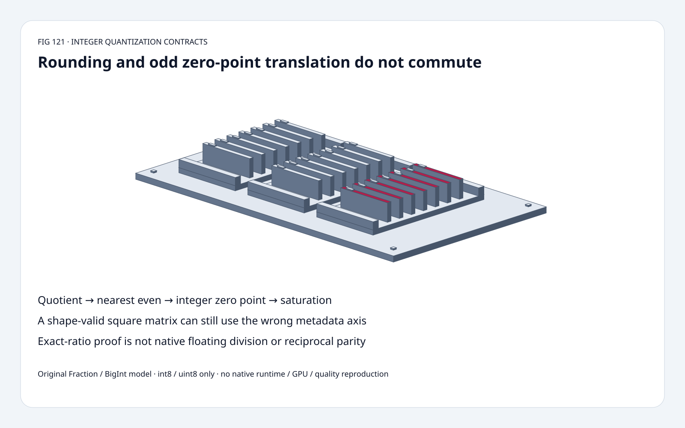
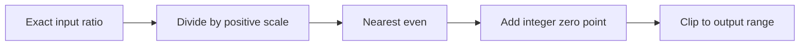
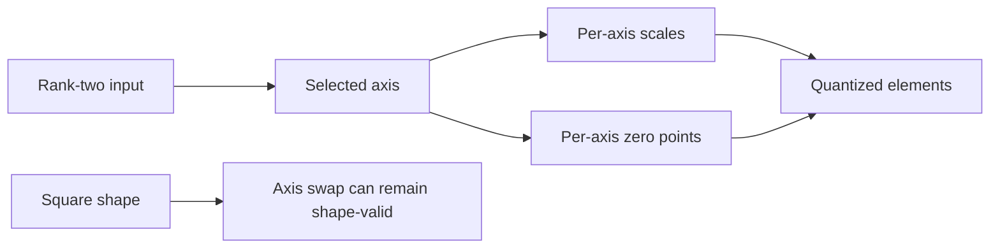
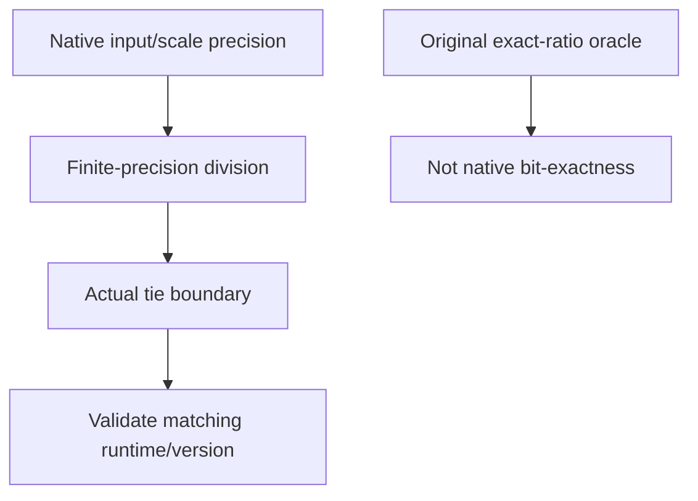

# QuantizeLinear FAQ: nearest-even, zero-point placement and metadata axis

> **Language**: [中文](quantize-linear-rne-zero-point-axis-selection-faq.md) | English
>
> **Round 121 · 2026-11-14 (night round 30)** · [SVG](../../assets/svg/quantize-linear-rne-zero-point-axis-selection-faq-summary.svg) · [7 cards](../reports/quantize-linear-rne-zero-point-axis-selection-cards.html) · [H5](../reports/quantize-linear-rne-zero-point-axis-sizer.html) · [Data](../../experiments/quantize_linear_contract_selection/report.json)
>
> **Synthetic, `independently_reproduced=false`.** Original exact Fraction/BigInt int8/uint8 models and separate CPU timing. No native ONNX runtime, floating division, model quality or GPU reproduction.



## 1. Executive summary: an integer zero point does not always commute with rounding

The inspected integer reference performs quotient → nearest-even →
integer zero point → clipping.
At ratio **1/2**, zero point **1**:
`RNE(1/2)+1=1`, while `RNE(1/2+1)=2`.
Odd integer translation changes which neighboring integer is even.

Original square 2×2 fixture matches the declared contract **4/4**;
putting the zero point inside rounding matches **2/4**.
Changing metadata axis also remains shape-valid but matches **2/4**.

These are existing integer contracts at a pinned November 12 tree.
The August 29 reference change adds float6 types; **FP6 is not
evaluated here**, nor is integer quantization a new November algorithm.

## 2. Architect Q&A: which operations and metadata define the integer?

### Q1: Why not move the zero point inside nearest-even?

At a non-tie, integer translation ordinarily shifts the rounded
integer as expected. At an exact half tie, an odd translation flips
parity. For example, 0.5 rounds to even 0, but 1.5 rounds to even 2.

The original exact model follows the inspected integer reference's
order: divide by positive scale, nearest-even, add integer zero point,
clip to the selected dtype. It does not silently substitute
ties-away-from-zero or truncate toward zero.

Signed half ties `[-5/2,-3/2,-1/2,1/2,3/2,5/2]` map to
`[-2,-2,0,0,2,2]`. Tests also probe values immediately around ±1/2.

### Q2: How can a wrong axis remain shape-valid?

Original input `[[1/2,3/2],[-1/2,-3/2]]`,
scales `[1,1/2]`, zero points `[1,-1]`, int8:

| Metadata axis | Output |
| :--- | :--- |
| Correct axis 1 | `[[1,2],[1,-4]]` |
| Wrong axis 0 | `[[1,3],[-2,-4]]` |
| Axis 1, zero inside RNE | `[[2,2],[0,-4]]` |

Both dimensions have length two, so length checking alone cannot
catch the axis swap. In our rank-two scope, axis -1 denotes 1,
and -2 denotes 0.

Scalar per-tensor, one-dimensional per-axis and blocked metadata
are distinct source contracts. The original model implements
**rank-two per-axis only**, not every source broadcast mode.

### Q3: Why clip instead of relying on an integer cast?

For int8, the selected output interval is [-128,127];
for uint8, [0,255].
Original quotient 130 plus zero point 1 saturates to **127**;
quotient -140 plus 1 saturates to **-128**.
A wrapping cast is not that law.

The original scope restricts the rounded quotient to signed-int32
magnitude. It is an ideal exact-ratio model, not emulation of the
reference's intermediate casts/overflow behavior for extreme inputs.
Invalid scales, dtype/zero-point domains, shape and axis raise explicitly.

### Q4: Does an exact ratio prove native bit-exact Q/DQ?

No. The source `precision` path can cast inputs/scales before division.
Native finite-precision division may move a value onto or across a tie.
Wider/exact arithmetic cannot prove every native rounding boundary.

The source derives dtype from zero-point metadata, checks conflicts
with explicit output dtype and can default to uint8 when both are
absent. Our calculator **requires an explicit int8/uint8 choice**.

Correct unsaturated reconstruction in the fixture has maximum exact
error **1/2**, within half the selected scale.
Q/DQ is not lossless identity, and this is not model-accuracy evidence.
Saturation can invalidate the ordinary half-scale error bound.

### Q5: What storage does the H5 estimate?

Default selected 1,024×4,096 input, axis 1:
float32 input **16,777,216 bytes**, one-byte output **4,194,304 bytes**,
4,096 float32 scales **16,384 bytes**, one-byte zero points
**4,096 bytes**.

The toy accepts up to 64 exact rational values; the larger budget
is a separate logical shape assumption. These are not transient
workspace, actual allocation or peak HBM.
No FP6/FP8/INT4 packing, blocked metadata or scalar-scale storage
is modeled.

## 3. Visual architecture: preserve operation order and axis identity







## 4. Selection matrix: integer law first, kernel choice second

| Choice | Good fit | Gate |
| :--- | :--- | :--- |
| Exact per-axis oracle | Contract and boundary testing | Not native arithmetic precision |
| Round then zero point | Inspected integer path | Half ties and parity matter |
| Per-tensor scalar | One shared scale | Not this model's per-axis vector |
| Blocked/low-bit formats | Their supported source versions | Separate shape/packing contracts |
| Native Q/DQ runtime | Actual kernel evaluation | Match dtype, opset, precision and axis |
| Reciprocal rewrite | Exact rational model equivalence | Does not prove floating equivalence |

## 5. Hands-on evidence: independent rounding and exact reciprocal controls

```powershell
python -m experiments.quantize_linear_contract_selection.run --check
python -m unittest discover -s tests -p test_quantize_linear_contract_selection.py -q
```

Eight tests cover independent nearest-neighbor/parity rounding, signed
ties and neighbors, odd-zero translation, shape-valid axis swap,
saturation, reconstruction bounds, invalid inputs, Node BigInt/Python
parity and sealed samples.

| Exact-ratio elements | Cached reciprocal (ms) | Per-element division (ms) |
| :--- | ---: | ---: |
| 32 | 0.092100 | 0.088900 |
| 128 | 0.359467 | 0.362500 |
| 512 | 1.464500 | 1.446433 |
| 2,048 | 5.885867 | 5.931267 |

Original Fraction arithmetic; identical integer results.
Reciprocal construction included. No consistent speedup is inferred.
Two warmups, seven alternating repeats, three operations/sample;
median repeat means. Native float precision, ONNX runtime, tensor
layouts and GPU excluded. No browser visual inspection.

## 6. Sources, provenance and readiness

- [Pinned integer reference](https://github.com/onnx/onnx/blob/3c41120b9c69657a1dd13407b080bd451ed06c9c/onnx/reference/ops/op_quantize_linear.py): rounding order, clipping, dtype and optional precision.
- [Pinned metadata reshaping](https://github.com/onnx/onnx/blob/3c41120b9c69657a1dd13407b080bd451ed06c9c/onnx/reference/ops/_quant_utils.py): scalar/per-axis/blocked contracts, not all implemented here.
- [August 29 float6 update](https://github.com/onnx/onnx/commit/3ab9181bbe2bb73cfd9ab88d4bdb8fad539d59b3): chronology only, not evaluated float6 evidence.
- [Apache-2.0 license](https://github.com/onnx/onnx/blob/3c41120b9c69657a1dd13407b080bd451ed06c9c/LICENSE): upstream rights retained.

Original Fraction/BigInt code, independent reference, CPU work and art;
no upstream implementation copied. Native latency, model quality and
peak HBM remain null.
