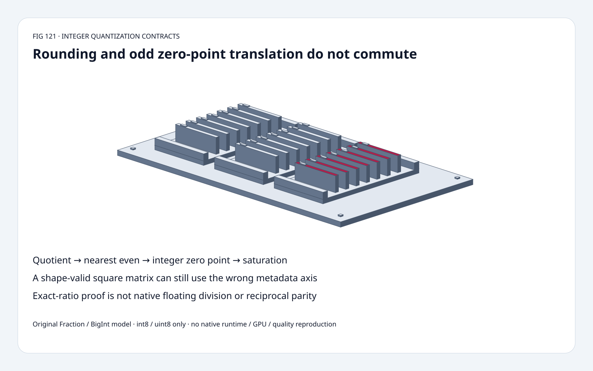
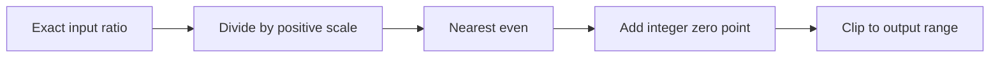
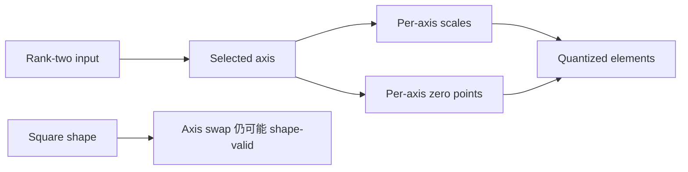
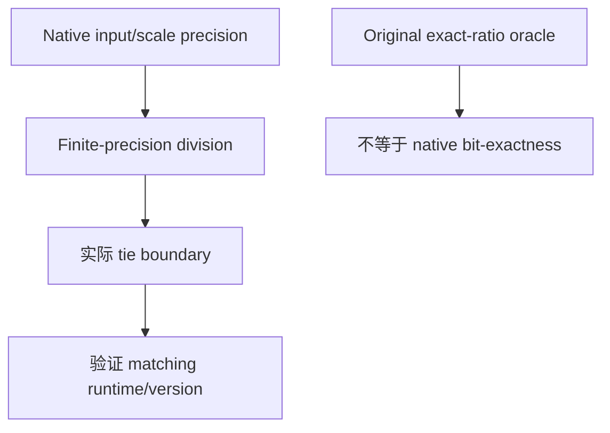

# QuantizeLinear FAQ：Nearest-Even、Zero-Point 放置与 Metadata Axis

> **语言**：中文 | [English](quantize-linear-rne-zero-point-axis-selection-faq.en.md)
>
> **Round 121 · 2026-11-14（夜班第 30 轮）** · [高清 SVG](../../assets/svg/quantize-linear-rne-zero-point-axis-selection-faq-summary.svg) · [七卡](../reports/quantize-linear-rne-zero-point-axis-selection-cards.html) · [H5](../reports/quantize-linear-rne-zero-point-axis-sizer.html) · [数据](../../experiments/quantize_linear_contract_selection/report.json)
>
> **Synthetic，`independently_reproduced=false`。** 原创 exact Fraction/BigInt int8/uint8、
> CPU timing；不复现 native runtime、floating division、model quality 或 GPU。



## 一、先看结论：Integer Zero Point 不一定与 Rounding 交换

所读 integer reference 先 quotient、nearest-even，再 integer zero point、clip。
Ratio=**1/2**、zero point=**1**：
`RNE(1/2)+1=1`，但 `RNE(1/2+1)=2`；
odd integer translation 改变相邻整数的 parity。

原创 2×2 fixture 正确路径 **4/4**；
zero 放到 rounding 内只 **2/4**。
换 metadata axis 仍 shape-valid，却也仅 **2/4**。

这是固定 11 月 12 日 tree 的既有 integer contract；
8 月 29 日 reference 更新增加 float6，**本研究不评测 FP6**，
也不把 integer quantization 称作 11 月新算法。

## 二、架构师 Q&A：哪些操作与 Metadata 定义 Integer？

### Q1：为什么不能把 Zero Point 移到 Nearest-Even 内？

非 tie 时 integer translation 通常对应平移；
exact half tie 的 odd translation 却改变 even 邻居。
0.5→0，但 1.5→2。

原创遵循所读 integer reference：
正 scale 除法、nearest-even、加 integer zero、clip；
不替换成 ties-away 或 truncate-to-zero。
Signed half ties `[-5/2,-3/2,-1/2,1/2,3/2,5/2]`
得 `[-2,-2,0,0,2,2]`，也测 ±1/2 两侧。

### Q2：Wrong Axis 为什么仍 Shape-Valid？

Input `[[1/2,3/2],[-1/2,-3/2]]`，
scales `[1,1/2]`，zero points `[1,-1]`，int8：

| 路径 | Output |
| :--- | :--- |
| 正确 axis 1 | `[[1,2],[1,-4]]` |
| 错误 axis 0 | `[[1,3],[-2,-4]]` |
| Zero 放入 RNE | `[[2,2],[0,-4]]` |

两轴长度都是 2，length check 抓不住 swap。
本 rank-two scope，axis -1 等于 1，-2 等于 0。
Scalar per-tensor、1D per-axis、blocked metadata 是不同契约；
原创只实现 **rank-two per-axis**，不覆盖全部 broadcast modes。

### Q3：为什么 Clip 而非依赖 Integer Cast？

Int8 range [-128,127]；uint8 [0,255]。
原创 quotient 130 加 1 饱和为 **127**，
-140 加 1 饱和为 **-128**，不等于 wrapping cast。

原型把 rounded quotient 限制在 signed-int32 magnitude，
是 ideal exact-ratio semantics，
不复现 reference 的 extreme intermediate cast/overflow。
非法 scale、dtype/zero domain、shape/axis 显式报错。

### Q4：Exact Ratio 能证明 Native Q/DQ Bit-Exact 吗？

不能。Source `precision` 可先 cast inputs/scales 再 divide，
finite-precision division 可能把值推到或推过 tie。
Exact/wider arithmetic 不能认证所有 native boundaries。

Source 可从 zero-point metadata 推导 dtype，
与 explicit dtype 冲突时报错，二者缺失时可默认 uint8；
原创 H5 **显式选择 int8/uint8**。

本 fixture unsaturated reconstruction 最大 exact error **1/2**，
符合 half-scale；Q/DQ 不是 lossless identity，也非 model accuracy。
Saturation 后不能沿用普通 half-scale bound。

### Q5：H5 估算哪些 Storage？

默认 1,024×4,096、axis 1：
float32 input **16,777,216 bytes**，
one-byte output **4,194,304 bytes**，
4,096 float32 scales **16,384 bytes**，
one-byte zero points **4,096 bytes**。

Toy 最多 64 个 exact rationals；
大 shape budget 是独立 logical assumption，
不是 workspace、actual allocation、peak HBM。
不建模 FP6/FP8/INT4 packing、blocked 或 scalar-scale storage。

## 三、三张架构图：保留 Operation Order 与 Axis Identity







## 四、选型矩阵：Integer Law 先于 Kernel Choice

| 选择 | 适合 | Gate |
| :--- | :--- | :--- |
| Exact per-axis oracle | Contract/boundary tests | 不认证 native precision |
| Round then zero point | 所读 integer path | Half tie/parity |
| Per-tensor scalar | 共享单 scale | 不同于本 per-axis vector |
| Blocked/low-bit | 对应支持版本 | Shape/packing 分开 |
| Native Q/DQ | 实际 kernel evaluation | Dtype/opset/precision/axis |
| Reciprocal rewrite | Exact rational 等价 | 不证明 floating 等价 |

## 五、动手证据：Independent Rounding 与 Reciprocal Controls

```powershell
python -m experiments.quantize_linear_contract_selection.run --check
python -m unittest discover -s tests -p test_quantize_linear_contract_selection.py -q
```

8 tests：独立 nearest-neighbor/parity oracle、signed ties/neighbors、
odd-zero translation、shape-valid axis swap、saturation、reconstruction、
invalid inputs、Node BigInt/Python parity、sealed samples。

| Exact-Ratio Elements | Cached Reciprocal（ms） | Per-Element Division（ms） |
| :--- | ---: | ---: |
| 32 | 0.092100 | 0.088900 |
| 128 | 0.359467 | 0.362500 |
| 512 | 1.464500 | 1.446433 |
| 2,048 | 5.885867 | 5.931267 |

原创 Fraction，integer outputs 相同；包含 reciprocal construction，
不推断 consistent speedup。
2 warmups、7 alternating repeats、3 ops/sample，取 repeat means median；
排除 native float precision、ONNX runtime、layouts、GPU，
未做浏览器视觉验收。

## 六、来源、许可、溯源与 Readiness

- [固定 integer reference](https://github.com/onnx/onnx/blob/3c41120b9c69657a1dd13407b080bd451ed06c9c/onnx/reference/ops/op_quantize_linear.py)：rounding、clip、dtype、precision。
- [固定 metadata reshape](https://github.com/onnx/onnx/blob/3c41120b9c69657a1dd13407b080bd451ed06c9c/onnx/reference/ops/_quant_utils.py)：scalar/per-axis/blocked，原型不全覆盖。
- [8 月 29 日 float6](https://github.com/onnx/onnx/commit/3ab9181bbe2bb73cfd9ab88d4bdb8fad539d59b3)：仅日期溯源，不是 FP6 评测。
- [Apache-2.0 LICENSE](https://github.com/onnx/onnx/blob/3c41120b9c69657a1dd13407b080bd451ed06c9c/LICENSE)：上游权利保留。

Fraction/BigInt、independent reference、CPU、视觉原创，未复制 upstream；
native latency、quality、peak HBM 保持 null。
