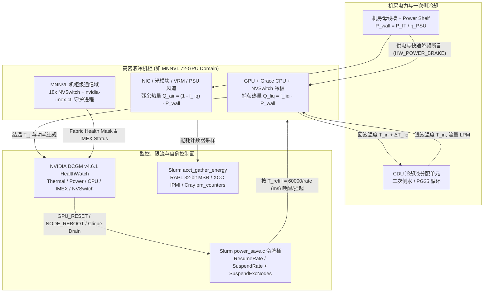

# 机架功率密度、液冷/风冷边界与机柜级故障域：从 CDU 热力学、Slurm 令牌桶浪涌限流到 DCGM MNNVL/IMEX 故障域

- **状态**：已建立基于 NVIDIA DCGM `v4.6.1`、SchedMD Slurm `26.05.5-1` 与创新芯片（Groq LPU、Cerebras CS-3 WSE-3）一手源码/规范的静态实现分析（`implementation` / `specification`）与可复核离线热力学/功率控制模型（`own-offline`）；未在真实 100kW+ 液冷机柜、CDU 管路、IPMI/XCC BMC 或 MNNVL NVSwitch 硬件上执行实机压测（`own-hardware` 未生成）。
- **读取版本/范围**：
  - [NVIDIA DCGM `v4.6.1`](https://github.com/NVIDIA/DCGM/blob/64df9f894541e426e416131a9820cae97aa4dd81/modules/health/DcgmHealthWatch.cpp)（commit `64df9f894541e426e416131a9820cae97aa4dd81`，发布于 `2026-08-19`）：`modules/health/DcgmHealthWatch.cpp`（全文 3,808 行，`git_blob_sha: e3c7a5f811eebba2b0c8ae4190eea3d6f90d5b36`）、`modules/policy/DcgmPolicyManager.cpp`（全文 1,272 行，`git_blob_sha: e95b31f8b956a1ac1fee2559e6f281c791dc2c5c`）及 `dcgmlib/dcgm_fields.h`（全文 3,993 行，`git_blob_sha: aa65ab23eb0d0ca3f60a062e61e6a62148ba1b21`）。
  - [SchedMD Slurm `slurm-26-05-5-1`](https://github.com/SchedMD/slurm/blob/ad46cad8e0969e8e5945b88f0a21f6bed0f9a3bf/src/slurmctld/power_save.c)（commit `ad46cad8e0969e8e5945b88f0a21f6bed0f9a3bf`，发布于 `2026-10-13`）：`src/slurmctld/power_save.c`（全文 1,803 行，`git_blob_sha: 2b6fdc2810755cd859b91b319d44ef6bf5896061`）、`src/plugins/acct_gather_energy/rapl/acct_gather_energy_rapl.c`（全文 621 行，`git_blob_sha: e4ee9e54dac19fb8bfe744e2149b4ad80a616107`）、`src/plugins/acct_gather_energy/xcc/acct_gather_energy_xcc.c`（全文 1,157 行，`git_blob_sha: 216099ad0ec54cb92916c0dc109697e80943e5ef`）及 `src/plugins/acct_gather_energy/pm_counters/acct_gather_energy_pm_counters.c`（全文 328 行，`git_blob_sha: 7241cadc9f0308328eb33799b3e2687db46b4187`）。
  - AI Infra 创新硬件对照：[Groq `groqflow` `v4.2.1`](https://github.com/groq/groqflow/blob/720e024414be401a7853931a2622a26446883746/groqflow/justgrokit/ignition.py) 与 [Cerebras `sdk-examples` `20250615`](https://github.com/Cerebras/sdk-examples/blob/d19f2ca3e51285fc5904c78643b38819a2f26c44/benchmark/bandwidth-test/run.py)。
- **先修与关联 queue ID**：关联 `rack-power-cooling`（priority 9）；先修 `capacity-economics`（[容量、Token 经济学与功耗预算](capacity-economics.md)）与 `cluster-orchestration`（[集群编排、拓扑感知调度与故障自愈](cluster-orchestration.md)）。
- **掌握度**：`not-assessed`（代理研究完成不代表学习者已掌握，见 [能力矩阵](../learning/competency-matrix.md)）。

## 问题与数据流

当单芯片 TDP 从 400W 跃升至 700W–1200W+，且多节点 NVLink（MNNVL，如 GB200 NVL72）要求 36 个计算 Tray 与 9 个 NVSwitch Tray 在同一物理机柜（或相邻双机柜）内通过背板铜缆直连时，**机架功率密度（Rack Power Density）、冷却介质（风冷 vs 冷板液冷 DLC）与网络/算力拓扑的故障爆炸半径（Blast Radius）被强耦合在同一个物理边界内**：

1. **电力与冷却物理路径**：
   - `中压变压器 / UPS → 母线槽（Busway，415V/480V AC 或 ±400V/54V DC Power Shelf） → PSU 转换损耗（1 - η_PSU） → GPU/CPU/NVSwitch 冷板（Direct-to-Chip Liquid Cooling, DLC） + 网卡/DIMM/VRM 风道 → 机柜分集水器（Manifold） → 冷却液分配单元（CDU）板式换热器 → 设施一次侧冷冻水（FWS）`。
2. **功率斜率（Power Ramp Rate）与能耗采集控制路径**：
   - **集群唤醒/休眠浪涌控制**：在大规模训练/推理集群中，若数千个高功率节点同时上下电或从空闲进入满载 Tensor Core 同步迭代，瞬态功率阶跃（$\mathrm{d}P/\mathrm{d}t$）会冲击机房变压器、柴油发电机及 UPS 逆变器。Slurm `slurmctld` 通过 `power_save.c` 的令牌桶（Token Bucket）限流器（`SuspendRate` / `ResumeRate`）与暖备节点池（`SuspendExcNodes`）约束节点级状态转换速率；GPU 固件与驱动则通过 DCGM `DCGM_FI_DEV_PWR_SMOOTHING_*`（Power Smoothing TMP Floor / Ramp Up & Down Rate，`mW/s`）与硬件 Power Brake（`DCGM_CLOCKS_EVENT_REASON_HW_POWER_BRAKE`）抑制毫秒级电流尖峰。
   - **多粒度能耗遥测**：节点内同时存在 CPU/DRAM MSR 硬件累加器（Intel/AMD RAPL）、GPU 驱动毫焦耳累加器（`DCGM_FI_DEV_TOTAL_ENERGY_CONSUMPTION`）、带外 BMC/XCC IPMI 传感器（Lenovo SD650/SD650v2）与整机柜/刀片级高精度硬件计数器（Cray `/sys/cray/pm_counters`）。
3. **机柜级多节点 NVLink（MNNVL）故障传播路径**：
   - 在传统 8-GPU PCIe/HGX 风冷节点中，单台服务器掉电或重启仅影响 8 张 GPU；而在机柜级 MNNVL 域中，跨节点 GPU 共享同一个 `IMEX`（Internode Memory Exchange）域与 18 颗 NVSwitch。若冷却液流量下降导致局部过热降频、或单个节点复位导致 `IMEX` 域进入 `DEGRADED`/`DOWN`，整个 72-GPU 机柜 Clique 的集合通信与 P2P 内存映射将同时受阻。

## 原理与实现证据

### 1. NVIDIA DCGM `v4.6.1`：GPU/CPU 热与功耗违规、Power Smoothing 及 MNNVL 机柜级健康状态机

在 [NVIDIA/DCGM `v4.6.1`](https://github.com/NVIDIA/DCGM/blob/64df9f894541e426e416131a9820cae97aa4dd81/modules/health/DcgmHealthWatch.cpp) 中，机柜内热力学、供电与多节点互连故障通过三层代码映射为调度器可执行的健康状态：

1. **时钟降频原因掩码、热裕度与 Power Smoothing 硬件接口（[`dcgmlib/dcgm_fields.h:L100-198, L614-702, L3253-3432`](https://github.com/NVIDIA/DCGM/blob/64df9f894541e426e416131a9820cae97aa4dd81/dcgmlib/dcgm_fields.h#L100-L198)）**：
   - **五类核心降频位图（`DCGM_FI_DEV_CLOCKS_EVENT_REASONS`）**：
     - `DCGM_CLOCKS_EVENT_REASON_SW_POWER_CAP (0x04)`：软件功率封顶（保证不超过 `DCGM_FI_DEV_BOARD_POWER_LIMIT_ENFORCED_WATTS = 164`）；
     - `DCGM_CLOCKS_EVENT_REASON_HW_SLOWDOWN (0x08)`：硬件紧急降频（核心频率降低 $\ge 2\times$），由温度过高、外部电源刹车断言（External Power Brake Assertion）或快速过流保护（Fast Trigger protection）触发；
     - `DCGM_CLOCKS_EVENT_REASON_SYNC_BOOST (0x10)`：同步 Boost 组内被最慢/最热的同伴 GPU 拖慢；
     - `DCGM_CLOCKS_EVENT_REASON_SW_THERMAL (0x20)`：软件热降频，确保 GPU 温度不超过 `DCGM_FI_DEV_GPU_MAX_OP_TEMP_CELSIUS (152)` 且显存温度不超过 `DCGM_FI_DEV_MEMORY_MAX_OP_TEMP_CELSIUS (151)`；
     - `DCGM_CLOCKS_EVENT_REASON_HW_THERMAL (0x40)` 与 `DCGM_CLOCKS_EVENT_REASON_HW_POWER_BRAKE (0x80)`：硬件级过热或外部电源柜 Power Brake 触发核心频率腰斩（$\ge 2\times$ 降频），并配有纳秒级累计计数器 `1420`–`1424`。
   - **机柜级功率平滑（Power Smoothing，`dcgm_fields.h:L3284-3432`，Field ID `1425`–`1442`）**：
     - 针对高密机柜在集合通信与 GEMM 切换时的功率振荡，DCGM 暴露了通过带外 Redfish API 授权（Privilege Level 1/2）的硬件 Power Smoothing 字段：包括 `DCGM_FI_DEV_PWR_SMOOTHING_APPLIED_TMP_CEIL (1428)` / `APPLIED_TMP_FLOOR (1429)`（Watts）、爬坡率 `DCGM_FI_DEV_PWR_SMOOTHING_PROFILE_RAMP_UP_RATE (1435)` 与下降率 `PROFILE_RAMP_DOWN_RATE (1436)`（单位 `mW/s`）、下降迟滞时间 `PROFILE_RAMP_DOWN_HYST_VAL (1437)`（单位 `ms`）以及硬件平滑电路剩余寿命百分比 `HW_CIRCUITRY_PERCENT_LIFETIME_REMAINING (1432)`。
2. **GPU 与 Grace CPU 热/功耗健康监控（[`modules/health/DcgmHealthWatch.cpp:L2345-2639`](https://github.com/NVIDIA/DCGM/blob/64df9f894541e426e416131a9820cae97aa4dd81/modules/health/DcgmHealthWatch.cpp#L2345-L2639) 与 [`modules/policy/DcgmPolicyManager.cpp:L548-627`](https://github.com/NVIDIA/DCGM/blob/64df9f894541e426e416131a9820cae97aa4dd81/modules/policy/DcgmPolicyManager.cpp#L548-L627)）**：
   - `MonitorThermal()`（`L2345-2415`）与 `MonitorPower()`（`L2418-2504`）：在过去 60 秒窗口（`oneMinuteInUsec = 60000000`）内读取单调累加的微秒违规计数器 `DCGM_FI_DEV_THERMAL_VIOLATION (241)` 与 `DCGM_FI_DEV_POWER_VIOLATION (240)`。只要 $\lvert v_{\text{end}} - v_{\text{start}} \rvert > 0$，即发出 `DCGM_HEALTH_RESULT_WARN`（错误码 `DCGM_FR_CLOCKS_EVENT_THERMAL` 或 `DCGM_FR_CLOCKS_EVENT_POWER`）；若 `DCGM_FI_DEV_BOARD_POWER_WATTS (155)` 返回空白值，则报 `DCGM_FR_POWER_UNREADABLE`（`WARN`）。
   - `MonitorCpuThermal()`（`L2507-2595`）与 `MonitorCpuPower()`（`L2598-2639`）：针对 Grace-Hopper / Grace-Blackwell 超节点中的 CPU 实体，先检查末态温度 `endTemp >= DCGM_FI_DEV_CPU_TEMP_CRITICAL_CELSIUS (1112)`，若满足则直接置 `DCGM_HEALTH_RESULT_FAIL`（`DCGM_FR_THERMAL_VIOLATION`）；否则计算窗口首尾两样本均值 `(startTemp + endTemp) / 2.0 >= DCGM_FI_DEV_CPU_TEMP_WARNING_CELSIUS (1111)`，满足则置 `WARN`。CPU 功率一旦达到或超过上限（`DCGM_FI_DEV_CPU_POWER_WATTS >= DCGM_FI_DEV_CPU_POWER_LIMIT_WATTS`），立即返回 `DCGM_HEALTH_RESULT_FAIL`（`DCGM_FR_POWER_VIOLATION`）。
   - `DcgmPolicyManager::CheckThermalValues()`（`L548-586`）与 `CheckPowerValues()`（`L589-627`）：当实测 `gpuTemp > maxTemp` 或 `gpuPower > maxPower` 时立即触发策略回调（`DCGM_POLICY_COND_THERMAL` / `DCGM_POLICY_COND_POWER`）。
3. **MNNVL 机柜级通信域（IMEX、NVSwitch 与 Blackwell NVLink 恢复语义，[`DcgmHealthWatch.cpp:L2019-2190, L3026-3126, L3599-3808`](https://github.com/NVIDIA/DCGM/blob/64df9f894541e426e416131a9820cae97aa4dd81/modules/health/DcgmHealthWatch.cpp#L2019-L2190)）**：
   - `MonitorImex()`（`L2019-2108`）：检查机柜级多节点 NVLink 内存交换域 `DCGM_FI_IMEX_DOMAIN_STATUS (1502)`（由 `nvidia-imex-ctl -N -j` 采集）与守护进程 `DCGM_FI_IMEX_DAEMON_STATUS (1503)`（由 `nvidia-imex-ctl -q` 采集）。Domain 状态仅允许 `"UP"`、`"NOT_INSTALLED"`、`"NOT_CONFIGURED"`、`"UNAVAILABLE"`，一旦出现 `"DOWN"` 或 `"DEGRADED"` 立即判定 `DCGM_HEALTH_WATCH_NVLINK` 为 `FAIL`（`DCGM_FR_IMEX_UNHEALTHY`）；Daemon 状态仅允许 `5 (READY)`、`7 (UNAVAILABLE)`、`-1`、`-2`，处于 `0..4`（如 `WAITING_FOR_PEERS=2`、`WAITING_FOR_RECOVERY=3`）或 `6 (SHUTTING_DOWN)` 均判定为 `FAIL`。
   - `MonitorNvSwitchErrorCounts()`（`L3026-3126`）与 `MonitorFabricFields()`（`L3599-3737`）：NVSwitch 出现任何 `DCGM_FI_DEV_NVSWITCH_FATAL_ERRORS` 或任意端口 `DcgmNvLinkLinkStateDown` 即置 `FAIL`，非致命 SXid 置 `WARN`；`DCGM_FI_DEV_FABRIC_HEALTH_MASK (174)` 中若 `_ROUTE_UNHEALTHY`、`_DEGRADED_BW`、`_ROUTE_RECOVERY`、`_ACCESS_TIMEOUT_RECOVERY` 或 `_INCORRECT_CONFIGURATION` 任一为 `_TRUE`，或 `DCGM_FI_DEV_FABRIC_MANAGER_STATUS (170)` 处于失败/未启动态，均置 `FAIL`（启动中 `DcgmFMStatusInProgress` 置 `WARN`）。
   - `MonitorNVLinkErrorFields()`（`L3740-3808`）的 **Blackwell 架构语义分水岭**：在 Hopper 及更早架构上，任何 NVLink CRC/Recovery/Replay 错误增量 $>0$ 均判定为 `FAIL`；而在 Blackwell 及更新架构（`isBlackwellOrNewer`）上，`DCGM_FI_DEV_NVLINK_RECOVERY_SUCCESSFUL_TOTAL (1211) > 0` 仅降级为 `WARN`（允许硬件链路层瞬态自愈而不中断作业），唯有 `DCGM_FI_DEV_NVLINK_RECOVERY_FAILED_TOTAL (1212) > 0` 才判定为 `FAIL`。
   - `MonitorGpuRecoveryAction()`（`L2111-2190`）：读取 `DCGM_FI_DEV_GPU_RECOVERY_ACTION (1523)`，`NVML_GPU_RECOVERY_ACTION_NONE` 为 `PASS`，`DRAIN_P2P` 为 `WARN`（排空点对点通信），而 `GPU_RESET`、`NODE_REBOOT`、`DRAIN_AND_RESET` 全部映射为 `FAIL` 并要求重置或整机重启。

### 2. SchedMD Slurm `26.05.5-1`：`power_save.c` 令牌桶浪涌限流与 RAPL/XCC/Cray 能耗采集语义

在 [SchedMD/slurm `slurm-26-05-5-1`](https://github.com/SchedMD/slurm/blob/ad46cad8e0969e8e5945b88f0a21f6bed0f9a3bf/src/slurmctld/power_save.c) 中，调度器直接承担了机房供电斜率保护与多源能耗积分职责：

1. **上下电浪涌令牌桶限流器（[`src/slurmctld/power_save.c:L131-147, L1314-1369`](https://github.com/SchedMD/slurm/blob/ad46cad8e0969e8e5945b88f0a21f6bed0f9a3bf/src/slurmctld/power_save.c#L1314-L1369)）**：
   - `power_save_rl_setup()` 为 `suspend_rl_config`（关联 `SuspendRate`，每分钟最多挂起节点数）与 `resume_rl_config`（关联 `ResumeRate`，每分钟最多唤醒节点数）初始化令牌桶 `rl_config_t`。其最大突发令牌数 `max_tokens` 与令牌补充周期 `refill_period_msec` 由以下整数算术决定（记 $T_{\text{loop}} = \max(1, \text{power\_save\_interval}, \text{power\_save\_min\_interval})$）：
     $$\text{max\_tokens} = \max\left(1, \left\lfloor \frac{\text{rate} \times T_{\text{loop}}}{60} \right\rfloor\right), \quad T_{\text{refill\_ms}} = \left\lfloor \frac{60000}{\text{rate}} \right\rfloor, \quad \text{refill\_tokens} = 1$$
   - 每次调用 `_get_throttle_token()`（`L1278-1312`）时，先按经过的毫秒数 `elapsed_msec / refill_period_msec` 补充令牌（上限 `max_tokens`），再扣减 1 个令牌；若桶空则推迟其余节点的唤醒/休眠操作至下一周期，从而在软件层严格限制机房母线的功率爬坡率 $\mathrm{d}P/\mathrm{d}t \le \text{ResumeRate} \times P_{\text{node}}$。
2. **暖备池部分节点豁免与唤醒超时隔离（[`src/slurmctld/power_save.c:L370-449, L835-880`](https://github.com/SchedMD/slurm/blob/ad46cad8e0969e8e5945b88f0a21f6bed0f9a3bf/src/slurmctld/power_save.c#L370-L449)）**：
   - `SuspendExcNodes` 支持带计数语法（如 `nid[10-90]:20`）。`_pick_exc_nodes()` 先统计该节点池内已处于非空闲态（Allocated/Mixed）的活跃节点数 `active_count`，再计算仍需保留的空闲暖备节点数 $\max(0, \text{exc\_node\_cnt} - \text{active\_count})$，避免将所有空闲节点下电导致突发作业承受数分钟的冷启动与冷板温度剧烈波动。
   - 若节点被置为 `NODE_STATE_POWERING_UP` 后超过 `ResumeTimeout` 仍未就绪（`L835-880`），`power_save.c` 将其标记为 `NODE_STATE_DOWN | NODE_STATE_POWERED_DOWN`（原因 `"Node failed to resume"`）并触发 `ResumeFailProgram`。
3. **三类主机/机柜能耗采集插件的精度与故障边界**：
   - **Intel/AMD RAPL 32-bit MSR 计数器回绕与服务器 DRAM 单位特判（[`src/plugins/acct_gather_energy/rapl/acct_gather_energy_rapl.c:L70-324`](https://github.com/SchedMD/slurm/blob/ad46cad8e0969e8e5945b88f0a21f6bed0f9a3bf/src/plugins/acct_gather_energy/rapl/acct_gather_energy_rapl.c#L70-L324)）**：
     - 读取 `MSR_RAPL_POWER_UNIT (0x606)` 的 `bits[12:8]` 计算默认能量单位 $U_{\text{pkg}} = 0.5^{\text{bits[12:8]}}\,\text{J}$；但 `_dram_Haswell_ep()`（`L171-196`）针对 Xeon E5/Scalable（Haswell-X、Broadwell-X、Skylake-X、Cascade Lake、Cooper Lake、Ice Lake-X）及 Xeon Phi 硬编码覆盖 DRAM 能量单位为 $U_{\text{dram}} = 0.5^{16} \approx 15.258789\,\mu\text{J}$（忽略 `MSR_RAPL_POWER_UNIT` 报告的通用单位）。
     - `MSR_PKG_ENERGY_STATUS (0x611)` 与 `MSR_DRAM_ENERGY_STATUS (0x619)` 均为 32-bit 寄存器，`_get_package_energy()` 通过软件高 32 位累加器检测回绕：`if (result < package_energy[pkg].i.low) package_energy[pkg].i.high++;`。**高风险运维陷阱**：若 `/dev/cpu/#/msr` 打开失败（例如未加载 `msr` 内核模块或容器权限不足），`_get_MSR_fd()`（`L145-167`）会直接调用 `slurm_drain_node("Cannot open /dev/cpu/#/msr")` 将整个计算节点 Drain 下线！
   - **Lenovo XCC BMC 带外 IPMI 采样（[`src/plugins/acct_gather_energy/xcc/acct_gather_energy_xcc.c:L465-626`](https://github.com/SchedMD/slurm/blob/ad46cad8e0969e8e5945b88f0a21f6bed0f9a3bf/src/plugins/acct_gather_energy/xcc/acct_gather_energy_xcc.c#L465-L626)）**：
     - 通过 `freeipmi` 发送原始 OEM IPMI 命令 `{0x00, 0x3A, 0x32, 4, 2, 0, 0, 0}`。若返回 16 字节（`XCC_SD650_VERSION`），直接包含硬件累加的 Joules（`buf_rs + 4`）；若返回 40 字节（`XCC_SD650V2_VERSION`），硬件仅返回瞬时平均瓦数 `w`，`_sd650v2_update_node_energy()`（`L603-605`）退化为梯形法则估算：`consumed_energy += round(elapsed * 0.5 * (current_watts + xcc_raw->w))`，且后台 IPMI 线程存在驱动死锁导致 `pthread_cancel` 风险（`L793-805`）。
   - **Cray/HPE 刀片级硬件计数器（[`src/plugins/acct_gather_energy/pm_counters/acct_gather_energy_pm_counters.c:L63-137`](https://github.com/SchedMD/slurm/blob/ad46cad8e0969e8e5945b88f0a21f6bed0f9a3bf/src/plugins/acct_gather_energy/pm_counters/acct_gather_energy_pm_counters.c#L63-L137)）**：
     - 直接读取 `/sys/cray/pm_counters/energy`（单调递增整机 Joules）与 `/sys/cray/pm_counters/power`（Watts），通过 `diff_energy = curr_energy - previous_consumed_energy` 获得零梯形积分误差的精确节点能耗。

*(未读取范围说明：未读取 NVIDIA NVML 闭源内核驱动的热敏二极管滤波实现及 CDU 厂商私有 PLC 固件代码；本节结论严格限定于上述固定 commit 的 DCGM 与 Slurm 开源源码。)*

## 模型与假设

本节公式与 [`experiments/rack_power_cooling/run.py`](../../experiments/rack_power_cooling/run.py) 完全对齐（状态：`own-offline`）：

### 1. 机架功率平衡、液冷/风冷分流与 CDU 流量方程

设单机柜包含 $N_{\text{GPU}}$ 张 GPU（TDP $P_{\text{GPU}}$）、$N_{\text{CPU}}$ 颗 CPU（$P_{\text{CPU}}$）、$N_{\text{NVSwitch}}$ 颗 NVSwitch（$P_{\text{NVSwitch}}$）及光模块/NIC/风扇/主板辅助负载 $P_{\text{aux}}$，电源模块（Power Shelf / PSU）转换效率为 $\eta_{\text{PSU}} \in (0, 1]$，冷板液冷捕获机柜总热量的比例为 $f_{\text{liq}} \in [0, 1]$：

$$P_{\text{IT}} = N_{\text{GPU}} P_{\text{GPU}} + N_{\text{CPU}} P_{\text{CPU}} + N_{\text{NVSwitch}} P_{\text{NVSwitch}} + P_{\text{aux}}$$
$$P_{\text{wall}} = \frac{P_{\text{IT}}}{\eta_{\text{PSU}}}, \quad Q_{\text{liquid}} = f_{\text{liq}} P_{\text{wall}}, \quad Q_{\text{air}} = (1 - f_{\text{liq}}) P_{\text{wall}}$$

设冷却液密度为 $\rho_{\text{liq}}$（$\text{kg/L}$）、比热容为 $c_{p,\text{liq}}$（$\text{J/(kg}\cdot\text{K)}$，纯水取 $\rho=0.997, c_p=4184$；25% 丙二醇水溶液 PG25 取 $\rho=1.020, c_p=3950$），进出液温差为 $\Delta T_{\text{liq}}$（$^\circ\text{C}$），则机柜所需最小冷却液流量（$\text{LPM}$，升/分钟）与残余热量所需机房风量（$\text{CFM}$，立方英尺/分钟，$\rho_{\text{air}}=1.184\,\text{kg/m}^3, c_{p,\text{air}}=1006\,\text{J/(kg}\cdot\text{K)}$）为：

$$\dot{V}_{\text{liquid, LPM}} = \frac{60 \cdot Q_{\text{liquid}}}{\rho_{\text{liq}} \cdot c_{p,\text{liq}} \cdot \Delta T_{\text{liq}}}, \quad \dot{V}_{\text{air, CFM}} = \frac{Q_{\text{air}}}{\rho_{\text{air}} \cdot c_{p,\text{air}} \cdot \Delta T_{\text{air}} \cdot 0.00047194745}$$

GPU 稳态结温（Junction Temperature）一阶热阻模型为（记 $R_{\theta,\text{jc+coldplate}}$ 为结到冷却液总热阻，单位 $\text{K/W}$）：

$$T_j = (T_{\text{in}} + \Delta T_{\text{sink}}) + P_{\text{GPU}} \cdot R_{\theta,\text{jc+coldplate}}, \quad \Delta T_{\text{margin, max\_op}} = T_{\text{max\_op}} - T_j$$

### 2. Slurm 令牌桶唤醒耗时与功率爬坡上界

当需要同时唤醒 $N_{\text{wake}}$ 个高功率节点（单节点峰值功率 $P_{\text{node}}$）时，给定 `ResumeRate` $R_{\text{resume}}$（$\text{nodes/min}$）与主循环间隔 $T_{\text{loop}}$（$\text{s}$），初始突发唤醒节点数与完成全部唤醒所需时间为：

$$B_{\text{init}} = \max\left(1, \left\lfloor \frac{R_{\text{resume}} \cdot T_{\text{loop}}}{60} \right\rfloor\right), \quad T_{\text{wake}} = \max(0, N_{\text{wake}} - B_{\text{init}}) \cdot \frac{\lfloor 60000 / R_{\text{resume}} \rfloor}{1000}\;\text{(s)}$$

## 对比与架构决策

### 1. 算例对比：GB200 NVL72 液冷机柜 vs. H100 风冷机柜 vs. PG25 高温进液退化（`own-offline`）

以下结果由 `python experiments/rack_power_cooling/run.py` 生成（见 [`experiments/rack_power_cooling/results.json`](../../experiments/rack_power_cooling/results.json)）：

| 场景 ID | 机柜形态与冷却介质 | $P_{\text{IT}}$ / $P_{\text{wall}}$ (kW) | 液冷 / 风冷热负荷 (kW) | 所需冷却液流量 (LPM) | 所需风量 (CFM) | 冷却介质出温 / GPU $T_j$ ($^\circ\text{C}$) | 距 `MAX_OP` ($83^\circ\text{C}$) 裕度 | DCGM 时钟状态 |
|---|---|---|---|---|---|---|---|---|
| `gb200_nvl72_dlc_rack_nominal_32c_inlet` | 72x 1200W GPU + 36x 300W CPU + 18x 400W NVSwitch，纯水 $T_{\text{in}}=32^\circ\text{C}, \Delta T=12^\circ\text{C}, f_{\text{liq}}=88\%$ | `118.80` / `126.383` | `111.217` / `15.166` | `133.31 LPM` (`11.99 LPM/10kW`) | `1,798.6 CFM` | `44.0` / `77.6` | `+5.4 °C` | `NOMINAL_NO_THERMAL_THROTTLE` |
| `gb200_nvl72_dlc_cdu_degraded_45c_inlet_pg25` | 同上机柜，切换 PG25 防冻液且一次侧水温升至 $T_{\text{in}}=45^\circ\text{C}, \Delta T=10^\circ\text{C}$ | `118.80` / `126.383` | `111.217` / `15.166` | `165.62 LPM` (`14.89 LPM/10kW`) | `1,798.6 CFM` | `55.0` / `88.6` | `-5.6 °C` (超 `SLOWDOWN` $87^\circ\text{C}$ `1.6 °C`) | `DCGM_CLOCKS_EVENT_REASON_HW_THERMAL` |
| `h100_air_cooled_32gpu_4rack_pod_per_rack` | 单机柜 4 台 8x H100 (700W) 风冷节点，纯风冷 $T_{\text{in}}=24^\circ\text{C}, \Delta T=15^\circ\text{C}$ | `37.60` / `40.000` | `0.000` / `40.000` | `0.00 LPM` | `4,743.8 CFM` | `39.0` / `77.5` | `+5.5 °C` | `NOMINAL_NO_THERMAL_THROTTLE` |

**关键架构发现**：
1. **风冷的物理墙**：单机柜仅放置 32 张 700W GPU（墙插功率 `40.0 kW`）就需要 `4,743.8 CFM` 的机柜风量；若将 `126.383 kW` 的 NVL72 全部用风冷带走（$\Delta T_{\text{air}}=15^\circ\text{C}$），单机柜风量将高达 `14,988 CFM`，远超标准服务器机柜后门风扇的物理极限。通过 `88%` 冷板液冷分流后，残余 `15.166 kW` 仅需 `1,798.6 CFM` 即可由常规机房精密空调或背门热交换器（RDHx）轻松带走。
2. **PG25 比热容折损与进液温度红线**：当冷却液从纯水切换为 PG25（体积热容 $\rho c_p$ 从 $4171.4$ 降至 $4029.0\,\text{kJ/(m}^3\cdot\text{K)}$）且温差收窄至 $10^\circ\text{C}$ 时，每 10kW 液冷负荷所需流量从 `11.99 LPM` 上升 **24.2%** 至 `14.89 LPM`（整柜需 `165.62 LPM`）。若一次侧冷水机组退化导致二次侧进液温度升至 $45^\circ\text{C}$，即便流量充足，GPU 结温也会达到 $88.6^\circ\text{C}$，越过 $87^\circ\text{C}$ 硬件降频线并触发 `DCGM_CLOCKS_EVENT_REASON_HW_THERMAL`（核心频率腰斩 $\ge 2\times$）。

### 2. Slurm 浪涌限流、RAPL 回绕与创新架构（Groq / Cerebras）机柜能效对比

1. **Slurm `power_save.c` 浪涌保护算例（`slurm_power_save_ramp_and_rapl_dram_wraparound`）**：
   - 唤醒 64 台 `10.2 kW` 节点时，若不限流将产生 **652.8 kW** 的瞬时功率阶跃；设置 `ResumeRate=12`、`power_save_interval=15s` 后，令牌桶初始突发仅允许 `resume_max_tokens = 3` 台（初始阶跃 `30.6 kW`），随后每 `5000 ms` 唤醒 1 台，将功率爬坡率严格限制在 `122.4 kW/min`（全部唤醒耗时 `305.0 s`）。同时 `SuspendExcNodes` 目标 `16` 在已有 `10` 台活跃节点时自动保留 `6` 台空闲节点处于暖备态。
   - 当 32-bit `MSR_DRAM_ENERGY_STATUS` 从 `4,290,000,000` 回绕至 `12,000,000` 时，软件累加器正确还原 `16,967,296` ticks，并按 Xeon 服务器 DRAM 专用单位 $0.5^{16}\,\text{J} = 15.258789\,\mu\text{J}$ 计算出 `258.9004 J`（若误用 `MSR_RAPL_POWER_UNIT` 的 `bits[12:8]=14` 即 $61.035\,\mu\text{J}$，会高估 **4.0 倍**）。而在 30 秒采样窗口内，XCC SD650v2 梯形积分（`180,000 J`）相比 Cray `pm_counters` 硬件单调计数器（`242,000 J`）低估了 **62,000 J（-25.6%）**。
2. **AI Infra 创新硬件机柜级功率与冷却画像对比（`own-offline`）**：
   - **NVIDIA GB200 NVL72 液冷机柜（`126.383 kW`）**：纯水完全液冷需 `151.49 LPM`；在 `batch=1` 下单 token 能耗高达 `35.1064 J/token`，但在高并发大 batch（`72,000 tok/s`）下摊薄至 `1.7553 J/token`。
   - **Groq LPU 风冷机柜（`32.0 kW`）**：采用确定性片上 SRAM 架构，单机柜功率可控在传统风冷范围（需 `3,795.0 CFM` 风量，无需液冷管路改造），在 `batch=1` 极低延迟场景下能效达 `13.3333 J/token`（优于 GPU `batch=1`），但受限于片上 SRAM 容量无法通过超大 batch 继续大幅摊薄（高并发下 `3.3333 J/token`）。
   - **Cerebras CS-3 (WSE-3) 液冷单元（`25.0 kW`）**：单晶圆高热流密度必须采用密闭液冷循环（$\Delta T=10^\circ\text{C}$ 下需 `35.96 LPM`），其高并发每 token 能耗达 `1.7361 J/token`。

## 证据与限制

- **来源 ID**：`nvidia-dcgm-healthwatch-src`、`nvidia-dcgm-policymanager-src`、`nvidia-dcgm-fields-header-src`、`slurm-power-save-src`、`slurm-rapl-energy-src`、`slurm-xcc-energy-src`、`slurm-pm-counters-energy-src`、`groq-groqflow-ignition-src`、`cerebras-sdk-bandwidth-test-src`。
- **主张 ID**：`dcgm-thermal-power-and-mnnvl-imex-health-implementation`、`slurm-power-save-token-bucket-and-rapl-xcc-energy-implementation`、`rack-power-cooling-and-fault-domain-offline-model`。
- **反证与失败模式**：
  1. **MNNVL 机柜级故障放大（Clique-Wide Blast Radius）**：如场景 `dcgm_mnnvl_imex_degraded_and_nvswitch_link_down_fail` 所示，当机柜内单个节点因冷板微堵触发 CPU 过热（`96°C >= 95°C`）与 `GPU_RESET`、进而导致 `IMEX` 域变为 `DEGRADED`（daemon 状态 `3 = WAITING_FOR_RECOVERY`）及 NVSwitch 端口 Down 时，`mnnvl_rack_clique_compromised = true`。此时不能仅重调度故障单节点，必须将整个 MNNVL Clique 标记为不可用于跨节点 NVLink 域作业，或重切分拓扑。
  2. **Blackwell NVLink 瞬态自愈误杀反例**：如场景 `dcgm_blackwell_nvlink_transient_recovery_warn_only` 所示，在 Blackwell 架构上若运维脚本未对齐 DCGM `v4.6.1` `MonitorNVLinkErrorFields()` 逻辑，仍把 `DCGM_FI_DEV_NVLINK_RECOVERY_SUCCESSFUL_TOTAL > 0` 当作致命错误 Drain 节点，会导致健康的液冷大机柜频繁无故中断。
  3. **RAPL `/dev/cpu/#/msr` 权限触发全集群误 Drain**：在启用了 `AcctGatherEnergyType=acct_gather_energy/rapl` 的 Slurm 集群中，若系统镜像升级后遗漏 `msr` 内核模块，所有节点 `slurmd` 启动时将主动调用 `slurm_drain_node()` 自锁。

## 自测与后续

1. **解释题**：为什么在 Blackwell MNNVL（如 GB200 NVL72）机柜中，DCGM `v4.6.1` 的 `MonitorImex()` 将 `DCGM_FI_IMEX_DOMAIN_STATUS = DEGRADED` 归类在 `DCGM_HEALTH_WATCH_NVLINK` 的 `FAIL` 级别，而将 `DCGM_FI_DEV_NVLINK_RECOVERY_SUCCESSFUL_TOTAL > 0` 仅归类为 `WARN`？
   - *评分依据*：需区分链路物理层硬件自动重试成功（Blackwell 支持透明恢复，不影响上层作业正确性）与跨节点内存交换域（IMEX Domain/Daemon）失步导致的跨节点虚拟地址映射/集合通信崩溃。
2. **计算题**：某液冷机柜 IT 负载为 $100\,\text{kW}$，PSU 效率 $\eta_{\text{PSU}}=0.95$，液冷捕获率 $f_{\text{liq}}=0.85$，采用 PG25 冷却液（$\rho=1.020\,\text{kg/L}, c_p=3950\,\text{J/(kg}\cdot\text{K)}$），要求进出液温差 $\Delta T_{\text{liq}} \le 10^\circ\text{C}$。求机柜墙插功率 $P_{\text{wall}}$、液冷带走功率 $Q_{\text{liquid}}$ 及最小冷却液流量（LPM）。
   - *参考答案*：$P_{\text{wall}} = 100 / 0.95 = 105.263\,\text{kW}$；$Q_{\text{liquid}} = 0.85 \times 105.263 = 89.474\,\text{kW}$；$\dot{V}_{\text{LPM}} = (89473.7 \times 60) / (1.020 \times 3950 \times 10) = 133.24\,\text{LPM}$。
3. **设计题（链接标准答案）**：设计一套包含 8 个 126kW 液冷机柜（共 576 张 GPU）的训练+推理混合集群功率与热故障自愈方案，整合在 [端到端 AI Infra 综合架构案例](../architectures/end-to-end-ai-infra-case.md) 与 [能力自测练习集](../learning/exercises.md) 中。
4. **下一步可证伪问题**：已解锁并直接推进全栈综合架构案例 `architecture-case`（[端到端 AI Infra 综合架构案例](../architectures/end-to-end-ai-infra-case.md)）。
