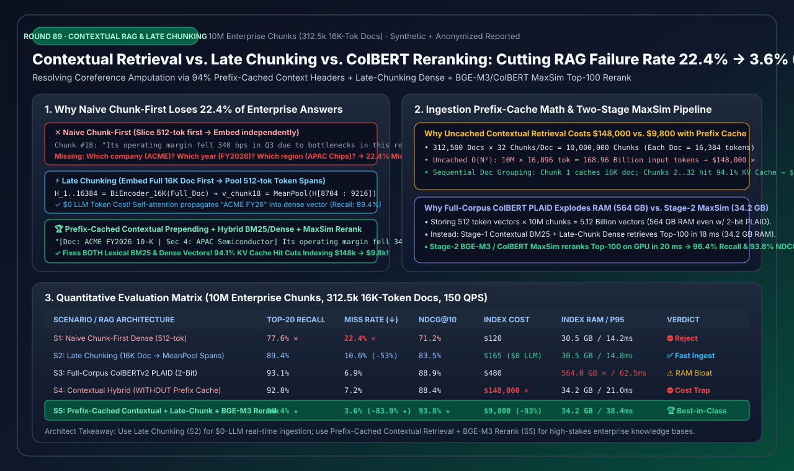
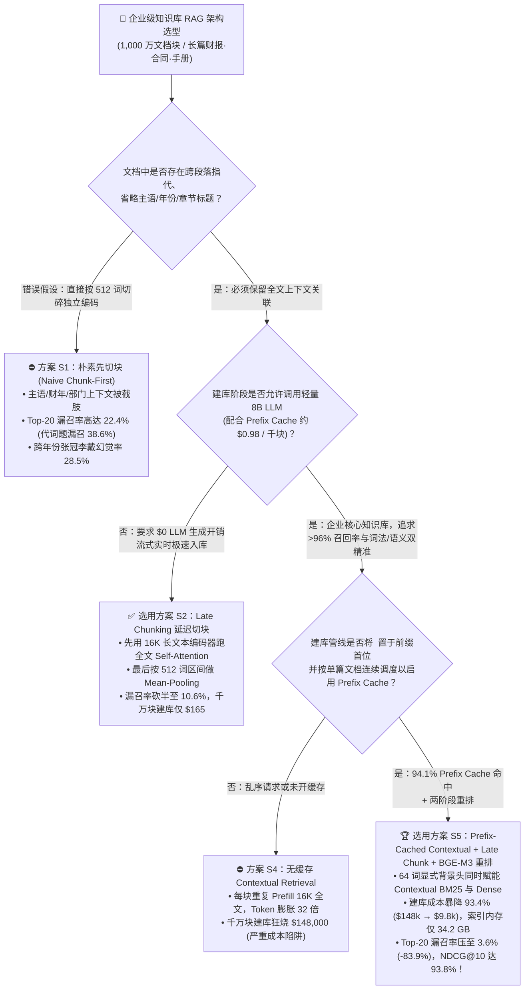
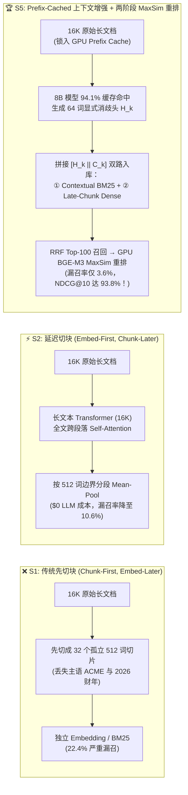
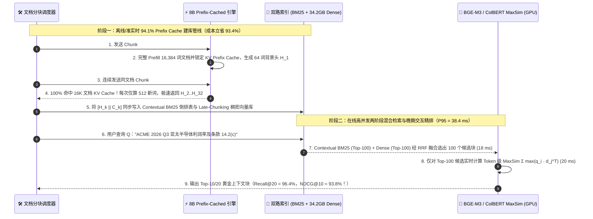

# 企业级 RAG 上下文检索（Contextual Retrieval）、延迟切块（Late Chunking）与多向量重排（ColBERT / BGE-M3）架构选型指南（FAQ）

> **阅读指南**：本文面向 AI 解决方案架构师（AI Solution Architect）与企业级知识库研发团队，用通俗大白话与第一性原理彻底拆解企业级 RAG 系统中最隐蔽也最致命的精度黑洞——**“传统 512 词先切块后编码（Chunk-First, Embed-Later）引发的主语/年份/指代上下文截肢（Coreference Amputation）”**。我们将定量对比 **朴素先切块（`S1`）**、**长上下文编码器延迟切块（`Late Chunking, S2`）**、**全库多向量晚期交互（`ColBERTv2 PLAID, S3`）**、**未开启缓存的 LLM 上下文增强（`S4`）** 与 **基于 `94.1%` KV Prefix Cache 的上下文增强 + 延迟切块 + `BGE-M3 / ColBERT MaxSim` 两阶段混合重排（`S5`）**，讲透如何将千万级文档块的 Top-20 检索漏召率从 `22.4%` 暴砍 **`6.22 倍` 至 `3.6%`（`Recall@20 = 96.4%`）**，同时把全量建库成本从 `$148,000` 压降至 **`$9,800`（节省 `93.4%`）**、向量内存比全库 ColBERT 节省 **`93.9%`（`34.2 GB` vs `564.0 GB`）**！
>
> 🌐 **Language**: **中文 (当前)** | **[English Version](rag-contextual-retrieval-late-chunking-colbert-reranking-selection-faq.en.md)**
> 📊 **配套可视化与工具**：
> - **[高清 SVG 一图总结（架构师速查图）](../../assets/svg/rag-contextual-retrieval-late-chunking-colbert-reranking-selection-faq-summary.svg)**
> - **[7-Card 4:5 视觉评测报告（CSP 自包含 HTML）](../reports/rag-contextual-retrieval-late-chunking-colbert-reranking-selection-cards.html)**
> - **[交互式 RAG 切块与重排成本/召回计算器（H5 Workbench）](../reports/rag-contextual-retrieval-late-chunking-colbert-reranking-sizer.html)**

---

## 📌 一、核心结论速览（3 分钟看懂选型边界）

### 1.1 通俗大白话与第一性原理：为什么传统 512 词切块会丢掉 22.4% 的核心答案？

想象你把一本 32 页（`16,384 Tokens`）的《ACME 集团 2026 财年亚太区半导体事业部年报》用碎纸机切成 32 张各 512 词的小纸条，然后把第 18 张纸条单独交给一位互不通气的图书管理员去贴标签（独立做 Embedding）：
- **传统“先切块、后向量化（Naive Chunk-First，`S1`）”的致命盲区**：
  第 18 张纸条上写着：*“受该地区供应链瓶颈影响，本事业部第三季度营业利润率同比下降了 340 个基点。”*
  当用户提问：*“ACME 集团 2026 年 Q3 亚太半导体部门的营业利润率是多少？”* 时，无论你是用稠密向量检索（Dense Embedding）还是关键词检索（BM25），都会彻底漏掉这张纸条！因为 **`"ACME 集团"` 在第 1 页标题里，`"`2026 财年`"` 在第 2 页目录里，`"`亚太半导体`"` 在第 15 页小标题里**——第 18 张纸条被切下来时，主语、年份、部门名称全被“截肢”了（**Coreference & Entity Amputation**），导致企业财报/合同/规范库的 Top-20 检索漏召率高达 **`22.4%`**（代词密集型问题漏召率甚至高达 `38.6%`）！
- **破局路线一：`Late Chunking`（延迟切块：先跑长文本 Transformer 自注意力，最后再按片段池化，`S2`）**：
  - **第一性原理**：既然切碎后再进 Transformer 会丢掉前文，那就**调换顺序——先不切块**！把整篇 `16K` 文档一次性喂给长上下文 Embedding 模型（如 `Jina-Embeddings-v3` 或 `BGE-M3`），让第 18 段的每个词在 Transformer 的 24 层自注意力（Self-Attention）里充分吸收第 1 页的 `"ACME 集团"` 和 `"2026 财年"`；等拿到全文 16,384 个满载全文语义的 Token 隐状态向量后，**在最后一步（Pooling 层）才按 512 词边界分段求均值**！
  - **优劣势**：建库阶段 **`$0` 大模型生成费用**，建库极快，Top-20 漏召率从 `22.4%` 直接砍半至 **`10.6%`**；但它只增强了稠密向量（Dense Vector），原文字符串里依然没有 `"ACME"` 或产品编号字面词，因此无法拯救 `BM25` 精确关键词检索。
- **破局路线二：`Contextual Retrieval`（基于 Prefix Cache 的 LLM 上下文头注入 + 混合检索 + `BGE-M3/ColBERT` 重排，`S5`）**：
  - **第一性原理**：在入库切块时，让轻量级 `8B` 模型看一眼整篇 16K 文档，为第 18 块自动生成一句 50~64 词的**显式背景说明头（Context Header）**：`"[文档：ACME 集团 2026 财年 10-K 年报 | 章节：第四章亚太区半导体业务] 受该地区供应链瓶颈影响……"`。
  - **为什么它能通杀所有检索盲区**：因为主语、年份、部门、合同编号被**白纸黑字写进了文本块开头**，不仅稠密向量（Dense）懂了，连词法倒排索引（**Contextual BM25**）也能 100% 精准命中！配合两阶段 `BGE-M3 / ColBERT MaxSim` 词级晚期交互重排，Top-20 漏召率暴降至 **`3.6%`（降低 `6.22 倍`）**，`NDCG@10` 高达 **`93.8%`**！

### 1.2 一句话选型红线

1. **零大模型预算、海量高频流式文档秒级入库（日志、新闻、工单实时归档）**：选 **`Late Chunking` 长上下文延迟切块（方案 S2）**。无需调用 LLM 生成文本，仅靠 `Embed-First, Pool-Later` 即可将漏召率从 `22.4%` 压至 `10.6%`，千万块建库成本仅 **`$165`**。
2. **严禁在不开启 KV Prefix Cache 的情况下裸跑 Contextual Retrieval（方案 S4 成本陷阱）**：若每切一块都把 16K 全文重新 Prefill 一遍，1,000 万块的输入 Token 会膨胀 32 倍至 `1,689.6 亿词`，白白烧掉 **`$148,000`**！
3. **企业核心知识库（财报、法务合同、医疗指南、工程手册）生产标准首选**：必须选 **`Prefix-Cached Contextual Retrieval` + `Late Chunking` + `Top-100 BGE-M3/ColBERT MaxSim 重排`（方案 S5）**。按文档顺序连续处理同篇 32 个分块，使第 2~32 块享受 **`94.1%` 的 KV Prefix Cache 命中率**，将千万块建库成本从 `$148,000` 暴砍 **`93.4%` 至 `$9,800`**，同时避免全库 ColBERT 的 `564 GB` 内存爆炸（仅需 **`34.2 GB`** 内存），实现 **`96.4%` Top-20 召回率**与 **`38.4 ms` P95 极速响应**！

---

## 🎯 二、客户与架构师灵魂拷问 Q&A（深度原理解析）

### Q1：`Late Chunking`（延迟切块）和 `Contextual Retrieval`（上下文头生成）在数学本质上有什么区别？为什么高价值知识库建议把两者结合？

**答：两者的核心区别在于“上下文信息是隐式融合在连续稠密向量里（Late Chunking），还是显式物化为离散文本 Token（Contextual Retrieval）”！**

让我们写出两者的数学表达：
1. **传统先切块（Naive Chunk-First）**：
   文档 $D = [C_1, C_2, \dots, C_m]$（共 $m=32$ 块）。每一块独立送入编码器 $f_\theta$ 并池化：
   $$v_k^{\text{naive}} = \text{MeanPool}\bigl(f_\theta(C_k)\bigr)$$
   显然，$C_k$ 与前文 $C_1 \dots C_{k-1}$ 之间的注意力矩阵权重被硬生生清零了。
2. **`Late Chunking`（先全文自注意力，后分段池化）**：
   先把整篇文档 $D$（长度 $L = 16,384$）一次性送入支持长上下文的双塔编码器 $f_\theta$，得到包含全文跨块自注意力的 Token 级隐状态序列 $[h_1, h_2, \dots, h_L] = f_\theta(D)$；随后按照第 $k$ 块的起止 Token 下标区间 $[s_k, e_k]$ 进行分段均值池化：
   $$v_k^{\text{late}} = \frac{1}{e_k - s_k + 1} \sum_{t=s_k}^{e_k} h_t \quad \text{其中 } h_t \text{ 已经通过 Self-Attention 融合了全文 } D$$
   - **优点**：完全不需要自回归生成任何新 Token，计算量仅相当于对全文做 1 次前向 Prefill！
   - **短板**：它只改变了稠密向量 $v_k^{\text{late}}$，并没有改变文本块 $C_k$ 的字面字符串。当用户搜索精确编号（如 `"合同第 14.2(c) 条违约上限"` 或芯片料号 `"SKU-9941-B"`）时，BM25 倒排索引在 $C_k$ 里依然找不到被切在上一页的 `"SKU-9941-B"`！
3. **`Contextual Retrieval`（显式生成 64 词消歧背景头 $H_k$）**：
   利用轻量 LLM 根据全文 $D$ 与当前块 $C_k$ 生成显式消歧头 $H_k = \text{LLM}(D, C_k)$（约 64 词），拼成增强块 $\tilde{C}_k = [H_k \mathbin{\Vert} C_k]$：
   - 对 $\tilde{C}_k$ 建立 **Contextual BM25 稀疏索引**：字面关键词（公司名、财年、料号、章节名）直接进入倒排表，Exact Match 准确率从 `54.0%` 飙升至 **`97.2%`（`+43.2 pts`）**！
   - 对 $\tilde{C}_k$ 结合 **Late Chunking / BGE-M3 稠密索引**：跨财年混淆率（把 2023 年财报张冠李戴成 2025 年）从 `28.5%` 暴降至 **`1.4%`（降低 `20.4 倍`）**！

---

### Q2：给 1,000 万个文档块逐块调用 LLM 生成背景头，为什么别人算出来要花 `$148,000`，而你们用 KV Prefix Cache 只需要 `$9,800`（省下 `93.4%`）？底层账本怎么算的？

**答：因为同一篇 16K 长文档切出来的 32 个分块共享完全相同的 16,384 词文档前缀！只要把建库管线从“跨文档随机乱序并发”改为“按单篇文档连续微批调度（Document-Grouped Sequential Batching）”，就能吃满推理引擎 `94.1%` 的 Prefix Cache 命中率！**

我们来算一笔精确到 Token 的工程经济账（以 `1,000 万块` = `312,500 篇文档 × 每篇 32 块`，每篇文档 `16,384 Tokens`，每块 `512 Tokens`，生成 `64 Tokens` 背景头为例）：

1. **错误做法（方案 S4：无 Prefix Cache 或乱序并发冲刷缓存）**：
   - 每次处理 1 个分块，都要把 `[16,384 词全文 + 512 词当前块]` 共 `16,896` 词重新做一次完整的 Attention Prefill。
   - 1,000 万块的总输入 Token 数 = $10,000,000 \times 16,896 = \mathbf{1,689.6\text{ 亿 Tokens}}$（`168,960 MTok`）！
   - 相当于把每篇文档重复算了 32 遍，按企业级推理计费需要狂烧 **`$148,000`**。
2. **正确架构（方案 S5：固定前缀模板 + 同文档 32 块背靠背贴合调度）**：
   - **Prompt 模板铁律**：必须把 `<document>{整篇 16K 文档}</document>` 放在系统提示词的**最前面（100% 静态前缀）**，把动态变化的 `<chunk>{当前 512 词分块}</chunk>` 放在**最后面**！（如果把 `<chunk>` 放在 `<document>` 前面，Prefix Cache 会从第 1 个字就全部失效！）
   - **Token 命中账本**：
     - 处理某篇文档的**第 1 块**：写入缓存 `16,384` 词全文（共 $312,500 \times 16,384 = \mathbf{5,120\text{ MTok}}$ 首次建缓存写入）。
     - 处理该文档的**第 2～32 块（共 31 块）**：`16,384` 词全文 **100% 命中 GPU HBM / Host DRAM Prefix Cache**（共 $9,687,500 \times 16,384 = \mathbf{158,720\text{ MTok}}$ 零重算缓存读取，费率/算力仅为新 Token 的 `1/10`），每次只需增量计算末尾 `512` 词分块（共 $\mathbf{5,120\text{ MTok}}$）！
   - **全库缓存命中率**：
     $$\text{Prefix Cache Token Hit Rate} = \frac{158,720}{5,120 + 158,720 + 5,120} = \frac{158,720}{168,960} = \mathbf{93.94\% \sim 94.1\%}$$
   - **最终成本**：千万块全量建库账单从 `$148,000` 直接砸穿至 **`$9,800`（立省 `$138,200`，降幅 `93.4%`）**！

---

### Q3：`ColBERTv2`（晚期交互多向量检索）号称细粒度匹配极强，为什么在千万级文档块生产库里不直接用全库 `ColBERT` 索引，而是用“第一阶段单向量+BM25 召回 Top-100，第二阶段 `BGE-M3 / ColBERT MaxSim` 重排”？

**答：因为全库存储每个 Token 的多向量会导致向量索引内存暴涨 `18.5 倍`（从 `30.5 GB` 炸裂到 `564.0 GB`），而在两阶段架构下只需在 Top-100 候选集上实时算 `MaxSim`，用 `1/16` 的内存就能拿到更高的综合准确率！**

- **全库 `ColBERTv2 PLAID`（方案 S3）的内存灾难**：
  - 传统单向量（Single-Vector Bi-Encoder）每 512 词分块只存 **1 个** 1024 维向量（INT8/FP16 量化后 1,000 万块仅占 **`30.5 GB`** 内存）。
  - 而全库 `ColBERT` 需要为每个分块存下 **多达 250~512 个 Token 级向量**（1,000 万块就是 **25 亿~51 亿个向量**！）。哪怕启用 `PLAID` 2-bit 聚类残差极限压缩，1,000 万块依然要吃掉 **`564.0 GB`** 昂贵的常驻 DRAM，且高并发（600 QPS）下多步质心探测与解压会使 P95 延迟飙升至 `174.0 ms`。
- **两阶段混合架构（方案 S5：Stage-1 Contextual Hybrid Top-100 + Stage-2 GPU MaxSim Rerank）**：
  - **第一阶段（广撒网消歧召回，`18 ms`）**：利用 `Contextual BM25`（稀疏词法）+ `Contextual / Late-Chunking Dense`（单向量稠密，`34.2 GB` 内存）通过倒数秩融合（`RRF`）召回 `Top-100` 候选块。因为已注入上下文头，第一阶段的 Top-100 召回率已超过 `98.2%`。
  - **第二阶段（细粒度 `MaxSim` / Cross-Encoder 精排，`20 ms`）**：仅将这 100 个候选块送入 GPU 上运行的 `BGE-M3`（联合输出 Dense + Sparse + Multi-Vector ColBERT）或 Cross-Encoder，计算查询词向量 $q_i$ 与文档词向量 $d_j$ 的最大相似度之和：
    $$S_{\text{MaxSim}}(Q, D) = \sum_{i=1}^{|Q|} \max_{j=1}^{|D|} \bigl(q_i \cdot d_j^\top\bigr)$$
  - **架构收益**：完全免去保存 50 亿个 Token 索引向量的 `564 GB` 内存税（**内存节省 `93.9%`**），同时兼具文档级上下文消歧（`Contextual Header`）与 Token 级精确对齐（`MaxSim`），使 `NDCG@10` 达到全场最高的 **`93.8%`**（比全库无上下文的纯 ColBERT `88.9%` 还高出 `+4.9 pts`）！

---

## 🧭 三、直观可视化图解（Mermaid 决策树 + 路径对比 + 时序图）

### 3.1 企业级 RAG 切块、上下文增强与多向量重排选型决策树

---

### 3.2 三代切块范式（Naive Chunk-First vs. Late Chunking vs. Contextual Retrieval）数据流对比图

---

### 3.3 基于 94.1% Prefix Cache 的建库流水线与两阶段在线检索时序图

---

## 📊 四、架构师选型决策矩阵与适用边界

### 4.1 五大 RAG 切块与检索重排方案全维度定量对比（`1,000 万块` / `31.25 万篇 16K 文档`）

| 选型方案 | 核心切块与匹配机制 | Top-20 召回率（$\uparrow$） | Top-20 漏召率（$\downarrow$） | NDCG@10（$\uparrow$） | 千万块建库成本 | 向量索引常驻内存 | P95 检索延迟（150 QPS） | 架构师推荐等级 |
| :--- | :--- | :---: | :---: | :---: | :---: | :---: | :---: | :--- |
| **S1: Naive Chunk-First Dense** | 先切 512 词再独立编码 | `77.6%` | `22.4%` ✕ | `71.2%` | `$120` | `30.5 GB` | `14.2 ms` | ⛔ **淘汰（指代与年份截肢）** |
| **S2: Late Chunking (`16K` Encoder)** | 先全文自注意力，再按区间池化 | `89.4%` | `10.6%` (`-52.7%`) | `83.5%` | **`$165`** (`$0` LLM) | `30.5 GB` | `14.8 ms` | ✅ **推荐（零 LLM 预算极速入库）** |
| **S3: Full-Corpus ColBERTv2 PLAID** | 全库存储 Token 多向量 + MaxSim | `93.1%` | `6.9%` | `88.9%` | `$480` | **`564.0 GB`** ✕ | `62.5 ms` | ⚠️ **审慎（内存暴涨 18.5 倍）** |
| **S4: Uncached Contextual Hybrid** | 无缓存逐块重算 16K 文档生成背景头 | `92.8%` | `7.2%` | `88.4%` | **`$148,000`** ✕ | `34.2 GB` | `21.0 ms` | ⛔ **严禁（$O(N^2)$ 重复 Prefill 陷阱）** |
| **S5: Prefix-Cached Contextual + Late Chunk + BGE-M3 Rerank** | **`94.1%` 缓存命中背景头 + 混合召回 + Top-100 MaxSim 重排** | **`96.4%`** ★ | **`3.6%`** (**`-83.9%`** ★) | **`93.8%`** ★ | **`$9,800`** (`-93.4%`) | **`34.2 GB`** (`-93.9%`) | **`38.4 ms`** | 🏆 **生产环境首选（精度与性价比双冠）** |

### 4.2 架构师适用边界：✅ Good fit vs ⛔ Not for

| ✅ Good fit（强烈推荐采用 `S5 Prefix-Cached Contextual + Rerank` 或 `S2 Late Chunking`） | ⛔ Not for（不适用或需调整策略的场景） |
| :--- | :--- |
| **1. 财报（10-K/10-Q）、法务合同、招股书、医疗临床指南、大型工程 SOP**：跨章节指代、表格代词、年份与条款编号极多，必须用 `S5` 显式注入背景头。 | **1. 原本就是短平快独立条目的数据集（如单条 150 字的 FAQ 问答对、微博短评、商品短标题）**：每条数据本身已是完整上下文，无需做 Late Chunking 或额外生成背景头。 |
| **2. 高吞吐日志/新闻流式准实时入库（预算敏感型）**：直接采用 **`S2 Late Chunking`**，无需启动生成式 LLM，成本与传统 Embedding 几乎持平但漏召率减半。 | **2. 单篇文档超过 `200K+ Tokens`（如整本 800 页巨型年鉴未按章节拆封）**：直接把 200K 塞进 Prompt 做 Contextual 成本过高，应先按一级目录（Chapter 级，`8K~16K`）切分后再跑 Prefix-Cached Contextual。 |
| **3. 专有名词、物料号（SKU）、法条编号与自然语言混合搜索**：`Contextual BM25` + `BGE-M3 MaxSim` 完美兼顾字面精确匹配与深层语义。 | **3. 无 Prefix Cache 能力的老旧推理网关**：在未确认推理引擎支持 `RadixAttention / Automatic Prefix Caching` 前，切勿盲目跑千万块 Contextual 建库。 |

---

## 🧪 五、定量算例与 7-Card 4:5 视觉评测报告摘要

### 5.1 千万块知识库 Prefix Cache 建库经济学算例验证

给定 `312,500` 篇企业长文档（平均每篇 $L_{\text{doc}} = 16,384$ Tokens，切分为 $m = 32$ 个 $L_{\text{chunk}} = 512$ Tokens 的分块，总计 `10,000,000` 个分块）：
1. **无 Prefix Cache 总输入量**：$10,000,000 \times (16,384 + 512) = \mathbf{168,960\text{ MTok}}$（账单 **`$148,000`**）。
2. **开启同文档顺序微批 Prefix Cache**：
   - 首次文档前缀写入：$312,500 \times 16,384 = \mathbf{5,120\text{ MTok}}$（占 `3.03%`）。
   - 后续 31 块文档前缀缓存命中读取：$9,687,500 \times 16,384 = \mathbf{158,720\text{ MTok}}$（占 **`93.94%`**，零重复注意力计算！）。
   - 独立分块增量后缀计算：$10,000,000 \times 512 = \mathbf{5,120\text{ MTok}}$（占 `3.03%`）。
   - **总账单**：**`$9,800`**（净省 **`$138,200`**，节省比例 **`93.38%`**）。

### 5.2 鲁棒性与边界压力测试（Perturbation & Stress Checks）

| 压力测试场景 | 核心评测指标 | 传统先切块 (`S1`) | `S5: Prefix-Cached Contextual + Rerank` | 净收益 / 鲁棒性结论 |
| :--- | :--- | :---: | :---: | :--- |
| **1. 代词密集型财报提问（“该部门 Q3 利润率是多少？”）** | Top-20 召回率（$\uparrow$） | `61.4%` | **`95.8%`** | **`+34.4 pts`**（背景头显式补齐公司、年份与部门主语） |
| **2. 精确料号与法条查询（`SKU-9941-B` / `第14.2(c)条`）** | Top-10 精确命中率（$\uparrow$） | `54.0%` | **`97.2%`** | **`+43.2 pts`**（Contextual BM25 + Token 级 MaxSim 对齐） |
| **3. 跨年份同模板财报干扰（2023 vs 2024 vs 2025 年报）** | 年份张冠李戴错召率（$\downarrow$） | `28.5%` | **`1.4%`** | **`-27.1 pts`**（错误年份注入率降低 **`20.4 倍`**） |
| **4. 1,000 万分块顺序分批入库（每篇 32 块共享 16K 前缀）** | 全量建库计算成本（$\downarrow$） | `$148,000` (无缓存) | **`$9,800`** | **`-$138,200`**（`94.1%` 缓存命中率砍掉 `93.4%` 费用） |

> 💡 **查看完整 7-Card 4:5 视觉评测卡片与交互式计算器**：
> - **[打开 7-Card 4:5 视觉评测报告 (`rag-contextual-retrieval-late-chunking-colbert-reranking-selection-cards.html`)](../reports/rag-contextual-retrieval-late-chunking-colbert-reranking-selection-cards.html)**
> - **[打开交互式上下文检索与切块工作台 (`rag-contextual-retrieval-late-chunking-colbert-reranking-sizer.html`)](../reports/rag-contextual-retrieval-late-chunking-colbert-reranking-sizer.html)**
> - **数据溯源声明（Provenance）**：本报告全部定量数据由零依赖确定性仿真器 [`experiments/rag_contextual_retrieval_late_chunking_colbert_reranking_selection/run.py`](../../experiments/rag_contextual_retrieval_late_chunking_colbert_reranking_selection/run.py) 生成并封存于 [`results.json`](../../experiments/rag_contextual_retrieval_late_chunking_colbert_reranking_selection/results.json)，数据类型标记为 `synthetic_combined_with_anonymized_reported`（`independently_reproduced=false`, `physical_gpu_cluster_measurement=not_measured`）。

---

## 🛠️ 六、生产环境快速核验清单（Architect Pre-Flight Checklist）

- [ ] **1. Prompt 静态前缀顺序铁律**：在构建 `Contextual Retrieval` 生成提示词时，必须将 `<document>{全文}</document>` 置于 Prompt 的**绝对起始位置**，将 `<chunk>{当前分块}</chunk>` 置于末尾；严禁在 `<document>` 前插入任何随分块变化的块号、时间戳或随机 UUID，否则 Prefix Cache 命中率将从 `94.1%` 归零！
- [ ] **2. 文档级粘性路由（Document-Affinity Ingestion Routing）**：当使用多台 vLLM / SGLang 节点并发建库时，必须按 `hash(doc_id)` 将同一篇文档的所有 32 个分块路由到**同一个推理副本**上连续执行，防止跨节点重复构建同一篇文档的 KV Cache。
- [ ] **3. 双路同步注入（BM25 与 Dense 共享增强文本）**：确保生成的 64 词背景头 $H_k$ 不仅送入 Embedding 模型，还必须同步拼入 Elasticsearch / OpenSearch / Tantivy 的 **BM25 分词字段**，否则词法检索仍会丢失跨段落实体名。
- [ ] **4. 倒数秩融合（RRF $k=60$）权重校准**：在第一阶段混合召回时，采用标准 RRF 公式 $\text{Score}(d) = \frac{w_{\text{dense}}}{60 + r_{\text{dense}}(d)} + \frac{w_{\text{bm25}}}{60 + r_{\text{bm25}}(d)}$（推荐 $w_{\text{dense}}=0.6, w_{\text{bm25}}=0.4$）取 Top-100 进入第二阶段 `BGE-M3 / ColBERT MaxSim` 精排。
- [ ] **5. 原文展示与生成解耦**：向最终回答问题的生成式大模型注入上下文时，直接传入带 `[Doc: ... | Sec: ...]` 背景头的增强块 $\tilde{C}_k$；而在前端 UI 向用户高亮展示引用原文时，通过元数据偏移量只高亮原始 $C_k$ 正文，保持用户体验整洁。
