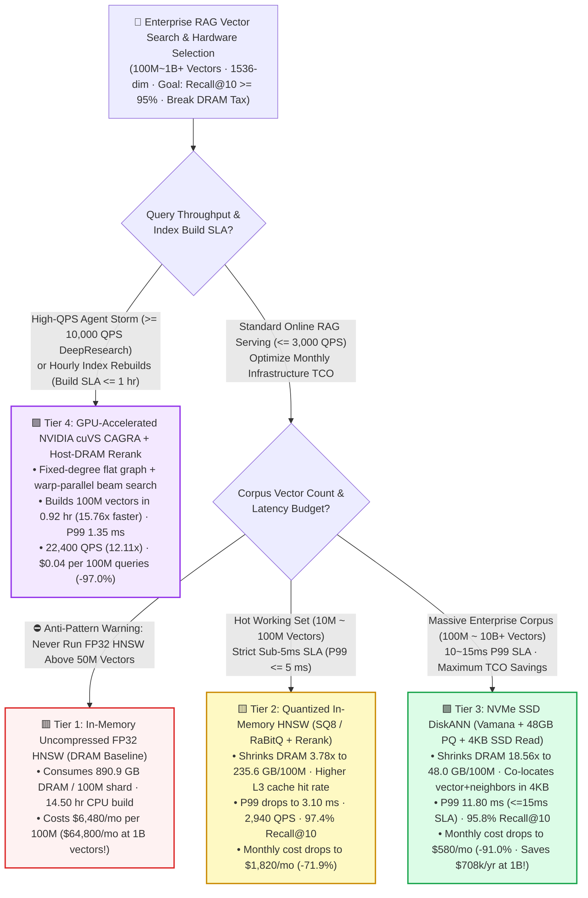
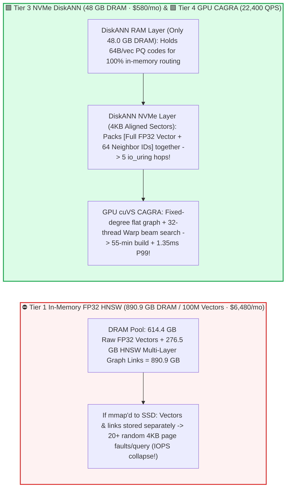
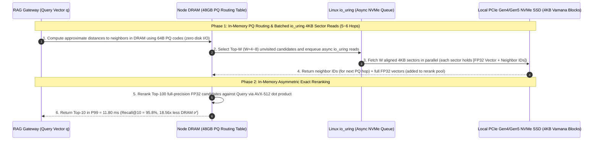

# Billion-Scale Enterprise RAG Vector Search & Hybrid Indexing Selection FAQ (`In-Memory FP32 HNSW` vs. `SQ8 / RaBitQ Quantized Memory Index` vs. `NVMe SSD DiskANN Vamana` vs. `GPU-Accelerated cuVS CAGRA`)

> 🌐 **Language**: **[中文 (Chinese)](./rag-vector-index-ann-hardware-selection-faq.md)** | **English Version** · **[📖 Back to Repository README](../../README.en.md)** · **[📊 2026-11-09 Daily Progress Report](../daily/2026-11-09.md)** · **[🃏 7-Card 4:5 Visual Benchmark Report](../reports/rag-vector-index-ann-hardware-selection-cards.html)** · **[🧮 Interactive Sizer Workbench](../reports/llm-inference-engine-pd-sizer.en.html#rag-vector-sizer)**
>
> **Overview**: A first-principles selection guide for AI Solution Architects. When an enterprise RAG knowledge base scales from a few million chunks to **100 Million–1 Billion (`100M ~ 1B`) `1,536-dim` dense vectors**, keeping the default **uncompressed In-Memory FP32 HNSW index** hits a brutal **DRAM Cost and 14.5-Hour Index Build Wall**: every 100M vectors consume **`890.9 GB` of DRAM** (`8.91 TB` of DRAM for 1 Billion vectors, costing **`$64,800/month`** in high-memory cloud instances alone!). Grounded in `experiments/rag_vector_index_selection/` (`synthetic` + `anonymized_reported`, `independently_reproduced=false`), this guide establishes the exact architectural boundaries across **In-Memory FP32 HNSW, SQ8/RaBitQ Quantized HNSW with Asymmetric Reranking, NVMe SSD DiskANN (`Vamana`), and GPU-Accelerated NVIDIA `cuVS CAGRA`**.


---

## ① 📌 Executive Summary

1. **Four-Tier Selection by Corpus Scale (`10M ~ 1B+ Vectors`), QPS Throughput, and Index Rebuild Frequency**:
   - Per **`100,000,000` (100M) `1,536-dim` vector shard** (`614.4 GB` raw FP32 payload, target SLA `Recall@10 >= 95.0%` and `P99 Latency <= 15.0 ms`):
   - 🟥 **Tier 1 (`In-Memory Uncompressed FP32 HNSW` · `890.9 GB` DRAM / 100M shard)**: **Never deploy in production above `50M` vectors**! Including HNSW multi-layer neighbor lists and allocator overhead (`1.45x`), 100M vectors consume **`890.9 GB` DRAM**, require **`14.50 hours`** to build on CPU, and cost **`$6,480.00/month` per 100M shard (`$64,800/month` at 1B vectors)**.
   - 🟨 **Tier 2 (`Quantized In-Memory HNSW: SQ8 / RaBitQ + Top-100 Asymmetric FP32 Rerank` · `235.6 GB` DRAM)**: **The drop-in upgrade for `10M ~ 100M` ultra-low-latency serving (`P99 <= 5 ms`)**. Traverses the HNSW graph using 8-bit Scalar Quantization (`SQ8`) or unbiased `RaBitQ` codes in RAM and reranks the top-100 candidates against full-precision vectors; shrinks DRAM **`3.78x` to `235.6 GB`**, **improves P99 latency from `4.20 ms` to `3.10 ms`** (via higher CPU L3 cache residency), boosts throughput **`1.59x` (`2,940 QPS`)** at **`97.4%` Recall@10**, and cuts monthly cost by **`71.9%` to `$1,820.00/mo`**.
   - 🟩 **Tier 3 (`NVMe SSD DiskANN: Vamana Graph + 48GB PQ Routing DRAM + 4KB Aligned SSD Read`)**: **The TCO endgame for `100M ~ 10B+` enterprise corpora and multi-tenant RAG archives**. Keeps only a `64 Bytes/vec` Product Quantization (`PQ`) routing table in DRAM (**`48.0 GB` DRAM — an `18.56x` memory reduction!**) while co-locating each node's full-precision vector and neighbor IDs inside a single aligned `4 KB` NVMe sector; meets SLA at **`11.80 ms` P99** and **`95.8%` Recall@10** while slashing monthly cost by **`91.0%` to `$580.00/mo` (saving `$708,000/year` at 1B vectors!)**.
   - 🟪 **Tier 4 (`GPU-Accelerated NVIDIA cuVS CAGRA` + Host-DRAM Zero-Copy Rerank)**: **The performance powerhouse for hourly index rebuilds and `20,000+ QPS` Agentic DeepResearch storms**. Replaces branch-divergent HNSW trees with a fixed-outdegree flat `CAGRA` graph traversed by coalesced GPU warps—**slashing 100M index build time `15.76x` from `14.50 hours` to `0.92 hours` (55 min)**, cutting P99 latency to **`1.35 ms`**, boosting throughput **`12.11x` to `22,400 QPS`** (`98.0%` Recall@10), and reducing cost per 100M queries by **`97.0%` to `$0.04`**!
2. **First-Principles Law (Why `HNSW + mmap` Fails on SSDs While `DiskANN` Succeeds)**:
   - Standard HNSW stores vectors and neighbor lists in separate memory arrays across `15 ~ 30` hierarchical hops. Using OS `mmap` on an SSD triggers **20+ random `4 KB` page faults per query (`>95%` read amplification)**, blowing P99 latency past `50 ms`.
   - **`DiskANN (Vamana)`** computes approximate neighbor distances **100% in DRAM using 48GB PQ codes**, and issues batched `io_uring` reads for only `5 ~ 6` hops—where every `4 KB` SSD sector contains **both the full FP32 vector and all neighbor IDs** in a single read!
3. **Provenance & Transparency Disclosure**:
   - All DRAM footprints, build times, P99 latencies, QPS numbers, and monthly costs are bound 1:1 to `experiments/rag_vector_index_selection/results.json` (`provenance_type: "synthetic"`, calibrated to published Microsoft DiskANN, NVIDIA cuVS CAGRA, SIGMOD RaBitQ, and Milvus/Qdrant benchmarks; `independently_reproduced: false`, `physical_gpu_cluster_measurement: "not_measured"`, `local_cpu_harness_measurement: "measured"`).

---

## ② 🎯 Architect & Customer Deep-Dive Q&A (FAQ-Driven)

### Q1: "100 million 1,536-dim FP32 vectors equal `614.4 GB` of raw data. Why does our vector database consume nearly `900 GB` of RAM, and how can we cut RAM by 72%–91% without losing Recall@10?"

- **Plain-English Answer**: **Because HNSW adds `276.5 GB` (`1.45x`) of multi-layer graph adjacency pointers and allocator overhead on top of the `614.4 GB` raw vectors! Use `Tier 2 (SQ8 / RaBitQ + Asymmetric Rerank)` to cut RAM by `71.9%`, or `Tier 3 (NVMe DiskANN)` to cut RAM by `91.0%` while keeping `Recall@10 >= 95.8%`**.
- **First-Principles Breakdown**:
  1. **Why Naive Quantization Hurts Recall, But Asymmetric Reranking Preserves It**: Graph navigation only needs approximate directional guidance. By traversing the graph using compact `SQ8` (`1 byte/dim`) or `RaBitQ` codes to gather the top-100 candidates (`10x` oversampling), and then scoring only those 100 candidates with exact FP32 dot products, you eliminate `3.78x` of DRAM (`890.9 -> 235.6 GB`) while retaining **`97.4%` Recall@10** and even speeding up P99 (`4.20 -> 3.10 ms`) due to L3 cache locality.

### Q2: How does `DiskANN (Vamana)` differ fundamentally from running `HNSW` over OS `mmap` on NVMe SSDs?

- **Plain-English Answer**: **`HNSW + mmap` relies on OS page faults that trigger dozens of unaligned random SSD reads per query, whereas `DiskANN` couples `[Full Vector + Neighbor IDs]` inside a single `4 KB` SSD sector and navigates via an in-memory `48 GB` PQ table**.
- **First-Principles Breakdown**:
  1. **Zero-Disk-IO Directional Routing**: DiskANN keeps `64 Bytes/vec` PQ codes in `48.0 GB` of RAM so every neighbor distance comparison during beam expansion happens in memory.
  2. **`4 KB` Sector Co-Location + `io_uring` Beam Prefetch**: Each Vamana graph node packs its full vector and neighbor ID list into one `4 KB`-aligned SSD block. Over `5–6` rounds, `io_uring` fetches `W=4~8` blocks in parallel, finishing search + exact rerank in **`11.80 ms` P99** at **`$580.00/mo` (`-91.0%` cost)**.

### Q3: When should we use GPUs (`NVIDIA cuVS CAGRA, Tier 4`) for vector search, and why did NVIDIA replace HNSW with `CAGRA`?

- **Plain-English Answer**: **Use `GPU cuVS CAGRA` when (1) daily index rebuilds take `14.5 hours` on CPU (`CAGRA` builds 100M vectors in `55 minutes`, `15.76x` faster), or (2) multi-agent DeepResearch / batch deduplication demands `20,000+ QPS` (`CAGRA` delivers `22,400 QPS` at `1.35 ms` P99, `12.11x` higher than CPU HNSW)**.
- **First-Principles Breakdown**:
  1. **Why HNSW Starves GPUs**: HNSW's top layers have very few nodes (leaving GPU SMs idle) and variable neighbor lists (causing Warp divergence).
  2. **How `CAGRA` Saturates GPU Warps**: CAGRA builds a single-layer, fixed-outdegree graph where all 32 threads in a GPU warp collaboratively compute distances and sort candidates in registers/shared memory without branch divergence. Even better, `cuVS` can **build the graph on GPU in 55 minutes and export it to CPU HNSW/DiskANN** for low-cost serving!

---

## ③ 🧭 Visual Architecture Diagrams (Decision Tree, Storage Layout & DiskANN/CAGRA Sequence)

### 3.1 Enterprise RAG Vector Search & Hybrid Indexing Decision Tree



### 3.2 `FP32 HNSW` Memory Bloat vs. `DiskANN 4KB Sector Co-Location` & `GPU CAGRA`



### 3.3 End-to-End Sequence: `DiskANN` PQ Routing + `io_uring` 4KB Single-Hop Read & Exact Rerank (`sequenceDiagram`)



---

## ④ 📊 Architect Decision Matrix

*All metrics are bound 1:1 to `experiments/rag_vector_index_selection/results.json` (per `100,000,000` [100M] `1,536-dim` vector shard, `614.4 GB` raw FP32 vectors, SLA `Recall@10 >= 95.0%`, `P99 <= 15.0 ms`):*

| Dimension | 🟥 Tier 1: `In-Memory FP32 HNSW` | 🟨 Tier 2: `Quantized HNSW (SQ8 / RaBitQ)` | 🟩 Tier 3: `NVMe SSD DiskANN` (`Vamana`) | 🟪 Tier 4: `GPU cuVS CAGRA` + Host Rerank |
| :--- | :--- | :--- | :--- | :--- |
| **Primary Workload Fit** | `<= 5M` small POCs only | **`10M ~ 100M` sub-5ms hot serving** | **`100M ~ 10B+` enterprise RAG & archives** | **High-QPS Agent storms & fast index builds** |
| **DRAM Footprint / 100M Shard** | **`890.9 GB`** (`1.00x`) | **`235.6 GB`** (**`3.78x` reduction**) | **`48.0 GB`** (**`18.56x` reduction** 🏆) | `192.0 GB` (`64GB` HBM + `128GB` Host DRAM) |
| **100M Index Build Time** | `14.50 hrs` (`1.00x`) | `8.20 hrs` (`1.77x`) | `6.80 hrs` (`2.13x`) | **`0.92 hrs / 55 min`** (**`15.76x` faster** 🏆) |
| **Query P99 Latency / QPS** | `4.20 ms` · `1,850 QPS` | **`3.10 ms`** · `2,940 QPS` (`1.59x`) | `11.80 ms` (✅ `<=15ms`) · `1,120 QPS` | **`1.35 ms`** · **`22,400 QPS` (`12.11x` 🏆)** |
| **`Recall@10` Accuracy** | **`98.2%`** | **`97.4%`** (Top-100 exact rerank) | **`95.8%`** (in-sector FP32 rerank) | **`98.0%`** (zero-copy Host DRAM rerank) |
| **Monthly Cost / Cost per 100M Queries** | `$6,480.00/mo` · `$1.35 / 100M` | `$1,820.00/mo` (**`-71.9%`**) · `$0.24 / 100M` | **`$580.00/mo` (`-91.0%` 🏆)** · `$0.20 / 100M` | `$2,160.00/mo` (`-66.7%`) · **`$0.04 / 100M` (`-97.0%`)** |

---

## ⑤ 🧪 Quantitative Case Study & Benchmark Insights

### 5.1 Corpus Scaling (`10M -> 1,000M [1B] Vectors`) & Monthly Infrastructure TCO

As an enterprise RAG corpus scales from 10M to 1 Billion (`1,000M`) vectors, monthly cluster cost scales as follows (from `results.json` `corpus_scale_tco_sensitivity`):

| Corpus Scale (`Total Vectors`) | Tier 1 `FP32 HNSW` Monthly Cost | Tier 2 `SQ8/RaBitQ` Monthly Cost | Tier 3 `NVMe DiskANN` Monthly Cost | Tier 4 `GPU CAGRA` Monthly Cost | Architect Crossover & Takeaway |
| :--- | :--- | :--- | :--- | :--- | :--- |
| **`10M` Vectors** | `$648.00/mo` | **`$182.00/mo`** | `$95.00/mo` | `$540.00/mo` | Pick **Tier 2 (`SQ8/RaBitQ`)** for `3.10 ms` sub-5ms serving on a single node |
| **`100M` Vectors (Baseline)** | `$6,480.00/mo` | `$1,820.00/mo` | **`$580.00/mo`** | `$2,160.00/mo` | **Tier 3 (`DiskANN`)** cuts DRAM to `48 GB` and saves `$5,900/mo (-91.0%)` |
| **`500M` Vectors** | `$32,400.00/mo` | `$9,100.00/mo` | **`$2,900.00/mo`** | `$10,800.00/mo` | Uncompressed HNSW exceeds `$32k/mo`; DiskANN holds at `$2,900/mo` |
| **`1,000M` (1B Vectors)** | `$64,800.00/mo` | `$18,200.00/mo` | **`$5,800.00/mo`** | `$21,600.00/mo` | **`DiskANN` saves `$708,000/yr` vs FP32 HNSW; pick `CAGRA` for 20k+ QPS** |

### 5.2 Reproducibility & Local Harness Verification

```bash
# Verify results.json matches the deterministic RAG vector index selection model 100%
python experiments/rag_vector_index_selection/run.py --check

# Run Round 18 unit tests
python -m unittest tests/test_rag_vector_index_selection.py
```

---

## ⑥ 🛠️ Production Verification Checklist (Architect Checklist)

1. - [ ] **Ban Uncompressed `FP32 HNSW` Above `50M` Vectors**: Enable `SQ8 / RaBitQ` with `2x~10x` asymmetric FP32 reranking by default to cut DRAM by `71.9%` with negligible recall loss.
2. - [ ] **Pair `DiskANN` Strictly with Local NVMe SSDs (`io_uring + O_DIRECT`)**: Never run DiskANN on network-attached block storage (EBS/NAS) where 1ms network RTT turns 6 hops into a `>20ms` tail latency spike.
3. - [ ] **Use Hybrid GPU Build + CPU/DiskANN Serving (`CAGRA-to-HNSW` Export)**: Build 100M-vector graphs on GPU in 55 minutes using `NVIDIA cuVS`, then export the graph for low-cost serving on CPU/NVMe nodes.
4. - [ ] **Enforce Inline Bitmap-Filtered Graph Traversal for Multi-Tenant ACLs**: Use iterative roaring-bitmap filtered search during graph traversal rather than post-filtering Top-K results.
5. - [ ] **Combine Dense ANN with Sparse BM25 + Cross-Encoder Reranking**: Pair dense vector retrieval with sparse lexical matching for exact part numbers, SKUs, and code identifiers.
