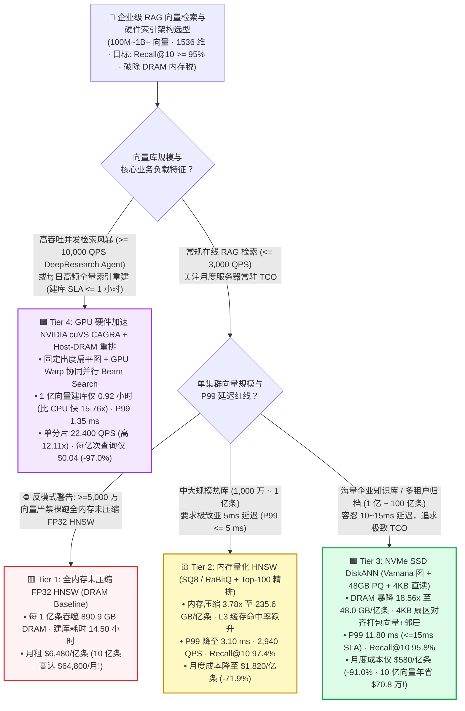
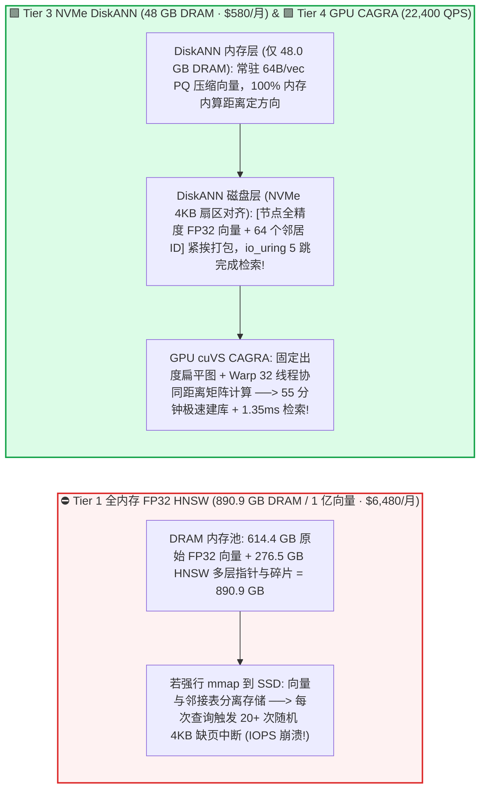
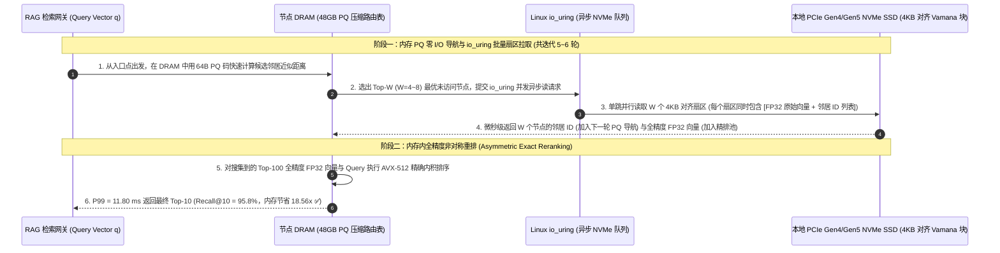

# 十亿级企业 RAG 向量检索与混合索引硬件架构选型指南（`全内存 FP32 HNSW` vs. `SQ8 / RaBitQ 量化内存索引` vs. `NVMe SSD DiskANN (Vamana)` vs. `GPU cuVS CAGRA 硬件加速索引`）

> 🌐 **Language**: **中文 (Chinese)** | **[English Version](./rag-vector-index-ann-hardware-selection-faq.en.md)** · **[📖 返回仓库根目录 README](../../README.md)** · **[📊 2026-11-09 每日进展日报](../daily/2026-11-09.md)** · **[🃏 7-Card 4:5 视觉评测报告](../reports/rag-vector-index-ann-hardware-selection-cards.html)** · **[🧮 交互式定容工作台](../reports/llm-inference-engine-pd-sizer.html#rag-vector-sizer)**
>
> **导读**：面向 AI Solution Architect 的第一性原理实战选型指南。当企业 RAG 知识库从百万级扩展到 **1 亿～10 亿条（100M ~ 1B）1,536 维向量** 时，直接沿用 POC 阶段的默认 **全内存未压缩 FP32 HNSW 索引** 会撞上一堵令人窒息的“**DRAM 内存成本与 14.5 小时建库墙**”：每 1 亿条向量需消耗 **`890.9 GB` 纯内存**（10 亿条需 **`8.91 TB` DRAM**，仅云端高内存服务器月租就高达 **`$64,800/月`**，甚至比跑大模型的 GPU 还要贵！）。本文基于 `experiments/rag_vector_index_selection/` 封存的确定性模型（`synthetic` + `anonymized_reported`，`independently_reproduced=false`），系统拆解 **全内存 FP32 HNSW、SQ8/RaBitQ 内存量化重排、NVMe SSD DiskANN (Vamana 扇区对齐图) 与 GPU cuVS CAGRA 硬件加速图索引** 的四档架构选型边界。


---

## ① 📌 核心结论速览（Executive Summary）

1. **按向量库规模（`10M ~ 1B+ Vectors`）、并发 QPS 与索引重建频率四档精准选型**：
   - 在单分片 **`100,000,000`（1 亿）条 `1,536` 维稠密向量**（原始 FP32 净荷 `614.4 GB`，SLA 要求 `Recall@10 >= 95.0%` 且 `P99 延迟 <= 15.0 ms`）基准下：
   - 🟥 **Tier 1（全内存未压缩 `FP32 HNSW` · `890.9 GB` DRAM/亿条）**：**严禁用于 `>= 5,000 万` 规模的生产环境**！加上 HNSW 多层邻接表与内存分配器开销（`1.45x`），每 1 亿条向量吞噬 **`890.9 GB` DRAM**，CPU 建库耗时长达 **`14.50 小时`**，单分片月度成本高达 **`$6,480.00/月`（10 亿条达 `$64,800/月`）**。
   - 🟨 **Tier 2（内存量化 `HNSW: SQ8 / RaBitQ + Top-100 异步精排` · `235.6 GB` DRAM/亿条）**：**千万至亿级低延迟在线检索（`P99 <= 5 ms`）的无痛升级首选**。在内存中使用 8-bit 标量量化（`SQ8`）或带随机正交旋转的极低比特 `RaBitQ` 进行图遍历，仅对最终候选 Top-100 拉取原始向量精确重排；内存占用缩减 **`3.78x` 至 `235.6 GB`**，且因 CPU L3 Cache 命中率大幅提升，**P99 延迟反而从 `4.20 ms` 降至 `3.10 ms`**，QPS 提升 **`1.59x`（`2,940 QPS`）**，Recall@10 保持 **`97.4%`**，月度成本降至 **`$1,820.00/月`（立省 `71.9%`）**。
   - 🟩 **Tier 3（`NVMe SSD DiskANN: Vamana 单层图 + 48GB PQ 内存路由 + 4KB 扇区单跳直读`）**：**亿级至百亿级企业文档库、合规日志与多租户冷热归档的降本终局方案**。内存中仅保留 `64 Bytes/vec` 的乘积量化（PQ）路由表（**仅需 `48.0 GB` DRAM，内存暴降 `18.56x`！**），将全精度向量与邻居 ID 列表按 `4 KB` 扇区对齐紧凑打包在本地 NVMe SSD 上；P99 延迟 **`11.80 ms`（稳守 `<=15ms` SLA）**，Recall@10 **`95.8%`**，月度成本骤降至 **`$580.00/月`（比全内存 HNSW 暴降 `91.0%`；10 亿条每年省下 `$708,000`！）**。
   - 🟪 **Tier 4（`GPU 硬件加速 NVIDIA cuVS CAGRA` + Host-DRAM 零拷贝重排）**：**高频全量/增量索引构建与万级 QPS Agentic DeepResearch 并发检索风暴的性能王者**。用专为 GPU Warp 协同并行搜索设计的固定出度扁平图 `CAGRA` 替代分支发散的 HNSW，**将 1 亿向量建库时间从 `14.50 小时` 压缩 `15.76x` 至 `0.92 小时`（55 分钟）**，P99 延迟压至 **`1.35 ms`**，单分片吞吐飙升 **`12.11x` 至 `22,400 QPS`**（Recall@10 **`98.0%`**），每亿次查询成本从 `$1.35` 跌至 **`$0.04`（降幅 `97.0%`）**！
2. **第一性原理定性（为什么不能直接把 HNSW 放到 SSD 上跑？）**：
   - 传统 HNSW 是分层小世界图，每次搜索需要走 `15 ~ 30` 跳，且每一跳只读几十字节的邻居列表——如果直接把 HNSW `mmap` 到 SSD 上，一次查询会触发 **20+ 次随机 `4 KB` 磁盘 I/O（读放大高达 95%+）**，延迟直接劣化到 `30 ~ 80 ms` 并瞬间打爆 SSD IOPS！
   - **`DiskANN (Vamana)` 的破局核心**是：内存中用极小的 PQ 向量算距离定方向，每次跳跃通过 `io_uring` 并发预取 `Beam Width (W=4~8)` 个候选节点的 `4 KB` 磁盘块——而每个 `4 KB` 块里**同时塞进了该节点的完整 FP32 向量（6KB/4KB 对齐）与所有邻居 ID**，把磁盘随机跳数压到 **`<= 5~6` 轮**！
3. **证据口径与透明性声明**：
   - 本指南所有内存占用、建库耗时、P99 延迟、QPS 与月度 TCO 均绑定 `experiments/rag_vector_index_selection/results.json`（`provenance_type: "synthetic"`，基于 Microsoft DiskANN、NVIDIA cuVS CAGRA、SIGMOD RaBitQ 及 Milvus/Qdrant 公开基准校准的确定性算例，`independently_reproduced: false`，未在物理十亿级分布式集群执行实机压测 `physical_gpu_cluster_measurement: "not_measured"`；本机 Python 单测与校验为 `local_cpu_harness_measurement: "measured"`）。

---

## ② 🎯 客户与架构师灵魂拷问 Q&A（FAQ-Driven）

### Q1：客户问：“我们存 1 亿条 1,536 维的向量，按数学乘法 `100M × 1536 × 4B` 明明只有 `614.4 GB`，为什么放到 Milvus / Qdrant / Elasticsearch 里建完 HNSW 索引后，机器内存飙到了近 `900 GB`？怎么在不掉召回率的前提下把内存砍掉 70%～90%？”

- **直白结论**：**因为全内存 HNSW 除了存原始向量，还要为每个节点维护多层双向图边列表（`M=32` 时每条向量额外多出 256~512 字节指针）以及内存分配器预留空间（合计膨胀 `1.45x` 达 `890.9 GB`）！想砍掉 72% 内存选 `Tier 2 (SQ8 / RaBitQ + 异步重排)`；想砍掉 91% 内存直接选 `Tier 3 (NVMe DiskANN)`！**
- **第一性原理拆解（为什么量化导航 + 原始向量重排 `Rerank` 能做到“既省内存又几乎零损召回”？）**：
  1. **直接砍维或纯 PQ 量化为什么会掉精度？** 如果只保留压缩后的 `PQ` 或 `INT4` 向量，余弦距离的量化截断误差会让 Top-10 的真实第 1 名和第 15 名顺序颠倒，`Recall@10` 往往跌破 `85%`。
  2. **非对称重排（Asymmetric Reranking / Oversampling）的魔法**：在图搜索的“寻路阶段”，我们只需要大致知道哪个方向离目标更近——用 `SQ8`（1 字节/维）或 `RaBitQ`（带理论无偏估计保证的极低比特量化）驻留内存完成图遍历，先召回一个稍大的候选集（例如 `Top-100`，Oversampling 系数 `10x`），最后只针对这 `100` 个候选向量从高速 NVMe 或紧凑缓存中读取全精度 FP32/FP16 向量重算一次精确内积！这样既把常驻 DRAM 压到了 **`235.6 GB`（Tier 2）** 甚至 **`48.0 GB`（Tier 3 DiskANN）**，又把 `Recall@10` 牢牢锁在 **`95.8% ~ 97.4%`**！

### Q2：什么是 `DiskANN (Vamana 图)`？它和把普通 `HNSW` 通过操作系统的 `mmap` 映射到 SSD 磁盘有什么本质区别？

- **直白结论**：**`HNSW + mmap` 是“向操作系统交出控制权的随机小碎读灾难”，而 `DiskANN (Vamana)` 是“专为 NVMe SSD 4KB 物理扇区与 `io_uring` 定制的磁盘原生算法”！**
- **第一性原理拆解（`HNSW + mmap` vs. `DiskANN Vamana` 的底层 I/O 机制对比）**：
  1. **为什么 `HNSW + mmap` 在 SSD 上必崩？** HNSW 在内存中把“向量数组”和“多层图邻接表”分开存放。当内存不足触发 OS 缺页中断（Page Fault）时，算一次距离读一个 `4 KB` 页（只用了其中几百字节），查一次邻居列表又读另一个不连续的 `4 KB` 页，且 OS 内核态同步阻塞线程无法发挥 NVMe SSD 多队列并发能力，P99 延迟动辄飙至 `50~200 ms`。
  2. **`DiskANN` 的三大架构巧思**：
     - **内存 PQ 导航（零磁盘读定方向）**：`48.0 GB` DRAM 中常驻全部 1 亿条向量的 PQ 压缩码。从当前节点看它的 64 个邻居谁离 Query 最近时，**完全在内存中计算 PQ 近似距离，零磁盘 I/O**！
     - **节点向量 + 邻居表 `4 KB` 扇区耦合布局**：在 NVMe SSD 上，每个节点的**全精度原始向量**和它的**所有出边邻居 ID**被紧挨着打包在同一个对齐的 `4 KB`（或 `8 KB`）物理扇区里。
     - **长程边剪枝（$\alpha$-RNG Vamana 图）+ `io_uring` 批量单跳**：Vamana 图通过参数 $\alpha > 1.2$ 保留跨区域长程捷径边，将搜索直径压缩在 `5~6` 轮以内；每轮用 Linux `io_uring` 一次性并发发出 `W=4~8` 个 `4 KB` 扇区读取请求，在 **`11.80 ms` P99** 内即可完成全精度精排并把月成本从 `$6,480` 砍到 **`$580.00 (-91.0%)`**！

### Q3：什么时候值得用昂贵的 GPU 跑向量检索（`NVIDIA cuVS CAGRA，Tier 4`）？为什么 GPU 不直接跑 HNSW，而是要发明 `CAGRA`？

- **直白结论**：**在两大场景下 GPU `cuVS CAGRA` 拥有统治级 ROI：① 每天需要高频全量/大批量重建百亿向量索引（CPU HNSW 建库要 `14.5 小时`，GPU CAGRA 只需 `55 分钟`，快 `15.76x`）；② DeepResearch 多智能体并发检索或大规模去重/聚类（需要 `10,000 ~ 20,000+ QPS`，GPU 单分片可达 `22,400 QPS`，是 CPU 的 `12.11 倍`）！**
- **第一性原理拆解（为什么 CPU 神器 `HNSW` 到了 GPU 上会水土不服，而 `CAGRA` 能跑满带宽？）**：
  1. **HNSW 的树状串行与度数不均扼杀了 GPU Warp**：HNSW 自顶向下逐层搜索时，高层候选集只有 1～2 个节点，GPU 的 32 线程 Warp 和上百个 SM 完全处于饥饿状态；且不同节点的邻居数量不固定，导致严重的线程束分支发散（Warp Divergence）。
  2. **`CAGRA`（CUDA ANN Graph-based）的硬件协同设计**：
     - **无层级扁平图 + 严格固定出度（如固定 `32` 或 `64` 个邻居）**：彻底砍掉顶层稀疏树，每次扩展由一个完整的 GPU Warp（32 线程）协同负责一个候选节点，32 个线程对齐读取连续显存并调用 Tensor Core 并发算出全部邻居距离；
     - **GPU 建库 + CPU/Disk Serving 混合范式**：工程上最聪明的玩法是——**用 GPU `cuVS` 在 55 分钟内极速构建好图索引，然后一键导出（Export）为 CPU HNSW 或 DiskANN 格式交给廉价的 CPU/NVMe 节点做日常低频在线检索**，兼得 GPU 的 `15.8x` 建库速度与 DiskANN 的 `-91%` 常驻成本！

---

## ③ 🧭 直观可视化图解（选型决策树 + 内存/磁盘布局对比 + DiskANN/CAGRA 检索时序图）

### 3.1 十亿级企业 RAG 向量检索与混合索引架构选型决策树



### 3.2 全内存 `FP32 HNSW` 内存爆炸 vs. `DiskANN 4KB 扇区耦合布局` + `GPU CAGRA` 架构对比图



### 3.3 `DiskANN` 内存 PQ 导航 + `io_uring` 4KB 单跳读取与非对称精排时序图（`sequenceDiagram`）



---

## ④ 📊 架构师选型决策矩阵（Architect Decision Matrix）

*数据完全绑定 `experiments/rag_vector_index_selection/results.json`（单分片 `100,000,000` [1 亿] 条 `1,536` 维向量，原始 FP32 体积 `614.4 GB`，SLA `Recall@10 >= 95.0%`、`P99 <= 15.0 ms`）：*

| 选型维度 | 🟥 Tier 1：全内存未压缩 `FP32 HNSW` | 🟨 Tier 2：内存量化 `HNSW (SQ8 / RaBitQ + 重排)` | 🟩 Tier 3：`NVMe SSD DiskANN`（Vamana + 48GB PQ） | 🟪 Tier 4：`GPU cuVS CAGRA` + Host-DRAM 重排 |
| :--- | :--- | :--- | :--- | :--- |
| **核心适用场景** | 仅限 `<= 500 万` 小规模 POC | **`1,000 万 ~ 1 亿` 低延迟热库（`P99 <= 5ms`）** | **`1 亿 ~ 100 亿` 企业知识库与高性价比常驻归档** | **万级 QPS DeepResearch Agent 风暴 & 小时级高频建库** |
| **单亿条向量常驻 DRAM 占用** | **`890.9 GB`** (`1.00x`) | **`235.6 GB`** (**缩减 `3.78x`**) | **`48.0 GB`** (**缩减 `18.56x`** · 极省内存!) | `192.0 GB`（`64GB` HBM + `128GB` Host DRAM） |
| **1 亿向量索引构建耗时** | `14.50 小时` (`1.00x`) | `8.20 小时` (`1.77x`) | `6.80 小时` (`2.13x`) | **`0.92 小时 / 55 分钟`** (**提速 `15.76x`** 🏆) |
| **检索 P99 延迟 / 单分片 QPS** | `4.20 ms` · `1,850 QPS` | **`3.10 ms`** · `2,940 QPS` (`1.59x`) | `11.80 ms` (✅ `<=15ms`) · `1,120 QPS` | **`1.35 ms`** · **`22,400 QPS` (`12.11x` 🏆)** |
| **`Recall@10` 召回精度** | **`98.2%`** | **`97.4%`**（Top-100 非对称精排） | **`95.8%`**（4KB 块内全精度精排） | **`98.0%`**（Host DRAM 零拷贝精排） |
| **单亿条月度成本 / 每亿次查询成本** | `$6,480.00/月` · `$1.35 / 100M` | `$1,820.00/月` (**`-71.9%`**) · `$0.24 / 100M` | **`$580.00/月` (`-91.0%` 🏆)** · `$0.20 / 100M` | `$2,160.00/月` (`-66.7%`) · **`$0.04 / 100M` (`-97.0%`)** |

---

## ⑤ 🧪 简明定量算例与 Benchmark 洞察

### 5.1 向量库规模从 `1,000 万 -> 10 亿条 (1B)` 扩展下的月度基础设施账单对比

当企业多租户 RAG 平台管理的向量总数从 `1,000 万` 增长至 `10 亿条（1,000M）` 时，四档索引架构的月度服务器成本如下（源自 `results.json` `corpus_scale_tco_sensitivity`）：

| 向量总规模 (`Total Vectors`) | Tier 1 `FP32 HNSW` 月成本 | Tier 2 `SQ8/RaBitQ` 月成本 | Tier 3 `NVMe DiskANN` 月成本 | Tier 4 `GPU CAGRA` 月成本 | 架构师核心拐点解读 |
| :--- | :--- | :--- | :--- | :--- | :--- |
| **`10M`（1,000 万条）** | `$648.00/月` | **`$182.00/月`** | `$95.00/月` | `$540.00/月` | 千万级规模优先选 **Tier 2 (`SQ8/RaBitQ`)**，单机内存轻松容纳且延迟仅 `3.1ms` |
| **`100M`（1 亿条基线）** | `$6,480.00/月` | `$1,820.00/月` | **`$580.00/月`** | `$2,160.00/月` | 亿级规模 **Tier 3 (`DiskANN`)** 将 DRAM 压至 `48GB`，月省 `$5,900 (-91.0%)` |
| **`500M`（5 亿条知识库）** | `$32,400.00/月` | `$9,100.00/月` | **`$2,900.00/月`** | `$10,800.00/月` | 全内存 HNSW 月账单突破 3.2 万美元；DiskANN 控制在 `$2,900/月` |
| **`1,000M`（10 亿条全量库）** | `$64,800.00/月` | `$18,200.00/月` | **`$5,800.00/月`** | `$21,600.00/月` | **10 亿级下 `DiskANN` 每年比 `FP32 HNSW` 净省 `$708,000`；高并发选 `CAGRA`** |

### 5.2 复现命令与本地校验（Local CPU Harness Check）

```bash
# 校验封存算例 JSON 与确定性 RAG 向量索引模型 100% 一致
python experiments/rag_vector_index_selection/run.py --check

# 运行 Round 18 单元测试
python -m unittest tests/test_rag_vector_index_selection.py
```

---

## ⑥ 🛠️ 附录：生产环境企业级 RAG 向量检索核验清单（Architect Checklist）

1. - [ ] **彻底关闭 `>= 5,000 万` 向量表上的未压缩 `FP32 HNSW`**：默认启用 `SQ8 / RaBitQ` 量化导航 + `Oversampling (2x~10x)` 原始向量精排，立省 `70%+` 内存且不掉召回率。
2. - [ ] **`DiskANN` 必须挂载本地直连 NVMe SSD（严禁走云端限速网盘 EBS/NAS）**：DiskANN 依赖单查询 `20~40` 次微秒级 `4 KB` 随机读，必须使用本地 NVMe 实例盘（Local NVMe Instance Store）并开启 Linux `io_uring + O_DIRECT` 绕过 OS 页缓存污染。
3. - [ ] **采用“GPU 极速建库 + CPU/DiskANN 在线服务”混合流水线**：利用 `NVIDIA cuVS CAGRA-to-HNSW` 转换能力，在夜间用空闲 GPU 55 分钟完成亿级向量建库，随后导出至廉价 CPU/NVMe 节点提供全天候检索。
4. - [ ] **标量过滤（Metadata Filtering）开启“位图预过滤 + 迭代式图遍历”**：在多租户权限过滤（如 `tenant_id = X AND date >= Y`）下，严禁使用“先搜 Top-K 再过滤（Post-Filtering）”导致结果集被清空，必须启用引擎原生的 **Roaring Bitmap 边遍历内联过滤（Iterative Filtered Search）**。
5. - [ ] **结合稀疏 BM25 + 稠密向量混合检索（Hybrid Search + RRF/Reranker）**：对专有名词、零件编号、代码符号等精确匹配场景，单靠稠密向量召回率不足，应在引擎层开启 `Sparse-Dense Hybrid + Cross-Encoder Reranker`。
