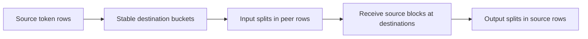
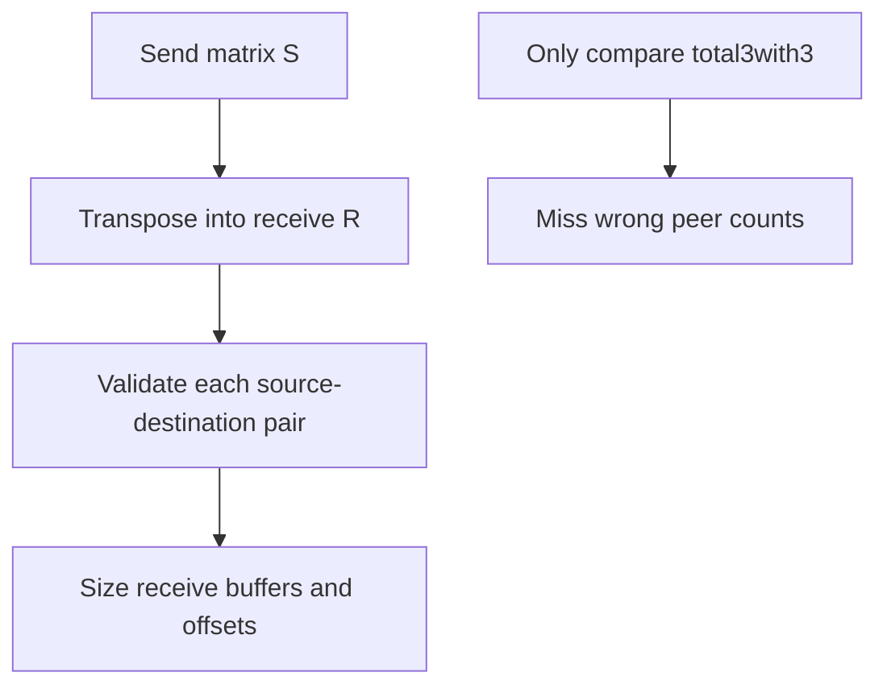
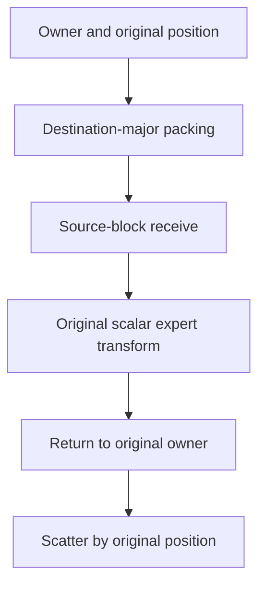

# AI Infra collective FAQ: ragged all-to-all split matrices, zero-receive ranks and token inverses

> **Language**: English | [中文](ragged-all-to-all-split-matrix-token-inverse-selection-faq.md)  
> **Round 144 · 2026-11-14 daytime**: expert-token transport shape/identity contracts—not MoE routing, expert capacity or NCCL performance.

**Executive finding:** Send matrix`S[source][destination]`must match`R[destination][source]=S[source][destination]`. **Matching each rank's total is insufficient**. In the original four-rank/eight-token case, correct and wrong rank0receive rows both total3but disagree on peers; rank1receives zero while sending two. Appending destination-return buckets matches only4/8positions; owner/original-position metadata restores order.

**Artifacts**: [H5 workbench](../reports/ragged-all-to-all-split-matrix-token-inverse-sizer.html) · [seven cards](../reports/ragged-all-to-all-split-matrix-token-inverse-selection-cards.html) · [1600px SVG](../../assets/svg/ragged-all-to-all-split-matrix-token-inverse-selection-faq-summary.svg) · [sealed report](../../experiments/ragged_alltoall_contract_selection/report.json)

## Q1: What units do all_to_all_single split sizes use?

The pinned implementation/documentation specifies **dimension0rows**. For`[rows,features]`, do not use`rows×features`as split counts. Omitted or empty split lists require the respective input/output dim0to divide evenly by world size. Scalar model tokens represent rows, not executed feature tensors.



Ranks are group-relative0..N−1, not arbitrary global rank/GPU identifiers. The API remains experimental; backend-specific config, device and dtype support need deployment checks.

## Q2: Why can equal output totals still mismatch?

Original sends, with source rows and destination columns:

```text
S = [[1,0,2,0],
     [1,0,0,1],
     [0,0,1,0],
     [1,0,0,1]]
```

Rank0must receive column0=`[1,1,0,1]`. Wrong`[0,1,1,1]`also totals3but substitutes a source2row for a source0row. Four ranks impose16pairwise direction counts, not merely four totals.



H5 accepts an optional declared receive matrix and rejects mismatches pairwise. It has global model inputs; real preflight needs a separate metadata exchange. Local PyTorch dtype/shape checks do not automatically prove global peer agreement. Backend error/hang behavior under mismatches was not executed.

## Q3: Can a rank with zero received rows skip the step?

Original rank1receives`[0,0,0,0]`but sends`[1,0,0,1]`: two rows still leave for other ranks. Skipping the entire rank because its receive bucket is empty loses its sends and participation protocol.

Zero input/output is allowed by this original logical policy, **not certified for every PyTorch/NCCL/Gloo version**. No distributed process or GPU was started. Verify backend shape, dtype, empty-tensor and group-participation contracts; unsupported cases must be handled explicitly rather than letting ranks choose inconsistent execution paths.

## Q4: Why are payload values and return arrival order insufficient identity?

Rank0values`[10,11,12]`target`[2,0,2]`. After the original toy transform`2×value+100×destination`, correct order is`[220,22,224]`; appending destination-return buckets gives`[22,220,224]`. Only4/8positions match across the complete case.



The model rejects duplicate, missing and out-of-bounds identities. Duplicate payload values remain distinct. Reversing **local response-processing traversal** preserves all eight results; it does not claim native collective outputs randomly reorder source blocks. Single-destination, no-replication/no-drop tokens are prerequisites, not top-k-copy or weighted-combine certification.

## Q5: How should splits, feature payloads and CPU timing be budgeted separately?

The selected budget uses8tokens×4features×2B=64B one-way feature payload,128B round trip. Explicit int64send/receive split arrays across four ranks total`2×4²×8=256B`. Explicit two-int64owner/position tags add128B per direction. Other designs can infer identities or encode them differently: these are not fixed NCCL wire overhead, Python-list heap size or GPU peak memory.

| Original inverse-lookup tokens | Prebuilt ID dictionary (ms) | Repeated list.index (ms) |
| ---: | ---: | ---: |
| 64 | 0.004333 | 0.019000 |
| 256 | 0.018133 | 0.247800 |
| 1024 | 0.079167 | 4.115867 |
| 4096 | 0.331200 | 70.881333 |

Both produce the same original-order values; dictionary/packing construction is excluded. Two warmups, seven alternating repeats and three operations per sample yield median repeat means. This is original CPU identity lookup, excluding PyTorch, NCCL/MPI, GPUs, network, experts and collective latency—not an all-to-all communication speedup.

## Q6: How can the study be reproduced and current capabilities checked?

```powershell
python -m unittest discover -s tests -p test_ragged_alltoall_contract_selection.py -q
python -m experiments.ragged_alltoall_contract_selection.run --check
# --measure deliberately replaces original local CPU samples.
```

Eight tests cover24independent direct-owner cases, transpose/same-total-wrong-peer validation, zero receive with nonzero send, duplicate payloads/reversed traversal, missing/duplicate/bad-rank errors, selected payloads, Node/Python dispatch and invalid-preflight parity, and sealed records. H5 displays errors. Prior browser refusal remains respected; visual browser inspection was not performed.

Sources: [pinned all_to_all_single implementation/examples](https://github.com/pytorch/pytorch/blob/0a95a45a42fbec1ab15a5c8ad9b6f03ac2e225ef/torch/distributed/distributed_c10d.py), [NCCL test entry](https://github.com/pytorch/pytorch/blob/0a95a45a42fbec1ab15a5c8ad9b6f03ac2e225ef/test/distributed/test_c10d_nccl.py), [LICENSE](https://github.com/pytorch/pytorch/blob/0a95a45a42fbec1ab15a5c8ad9b6f03ac2e225ef/LICENSE). PyTorch BSD-style source rights are preserved; no implementation is mirrored.

The pinned Nov14tree adds an nccl2PSK transport capability, not a new ragged-split algorithm. No keys, encryption or communicators were configured. Backend-specific config and dtype checks remain separate from shape-protocol correctness.

Production needs group-rank mapping, peer counts, feature shapes/dtypes/contiguity, empty-tensor support, count exchange, async work/stream/buffer lifetimes and real transport baselines. Provenance is `synthetic`, `independently_reproduced=false`; original CPU records are separately `measured`. Native zero-receive support, collective latency, wire bytes and GPU peak remain unknown/null.
