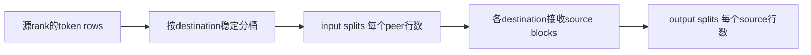
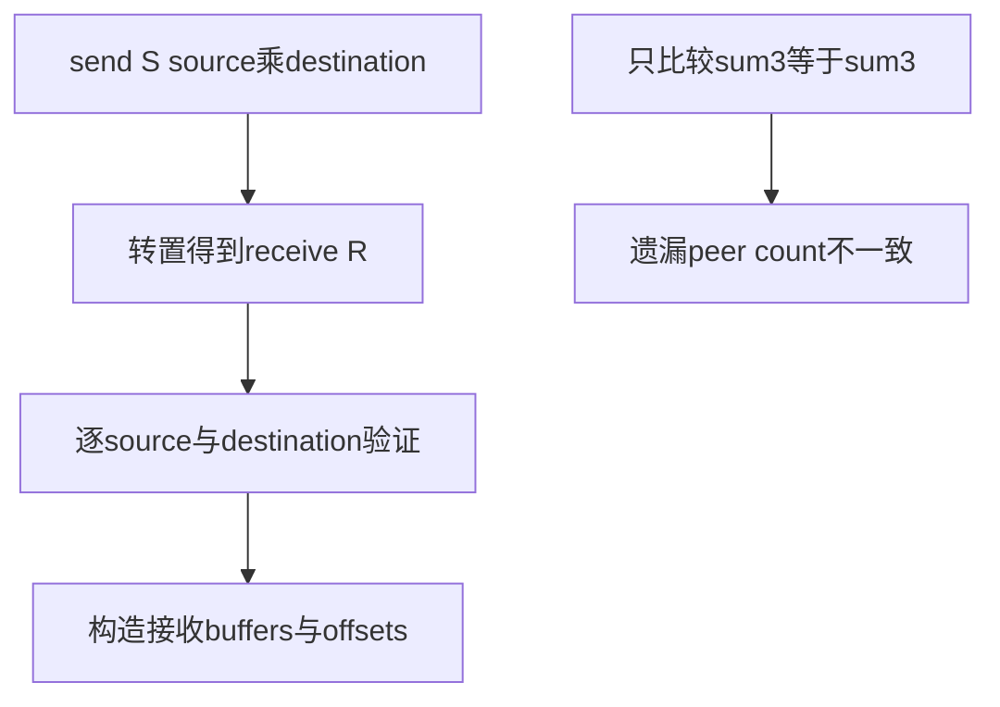
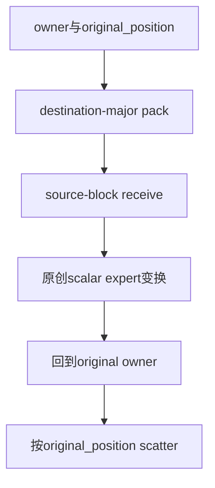

# AI Infra 集体通信 FAQ：Ragged All-to-All Split 矩阵、零接收 Rank 与 Token 逆排列

> **语言**：中文 | [English](ragged-all-to-all-split-matrix-token-inverse-selection-faq.en.md)  
> **Round 144 · 2026-11-14 白班**：专家token transport的shape/identity契约；不是MoE router、expert capacity或NCCL性能评测。

**结论速览**：发送矩阵`S[source][destination]`必须与接收矩阵满足`R[destination][source]=S[source][destination]`。**只检查每rank总数不够**。原创4rank/8token中，rank0正确与错误receive row都合计3，但peer counts不同；rank1接收0仍发送2。按destination回程直接append仅4/8位置正确，使用owner/original-position元数据才能恢复输入顺序。

**交付**：[H5工作台](../reports/ragged-all-to-all-split-matrix-token-inverse-sizer.html) · [7-Card](../reports/ragged-all-to-all-split-matrix-token-inverse-selection-cards.html) · [1600px SVG](../../assets/svg/ragged-all-to-all-split-matrix-token-inverse-selection-faq-summary.svg) · [封存数据](../../experiments/ragged_alltoall_contract_selection/report.json)

## Q1：all_to_all_single 的split_sizes究竟是什么单位？

固定PyTorch实现/文档明确：input/output split sizes是**dim0的row数**。对于`[rows,features]`，不能把`rows×features`误当split count。未指定或空split list时，input/output各自dim0须能被world size均分。原型scalar token仅代表一行，不执行真实feature tensor。



使用group-relative rank0..N−1，不把任意global rank/GPU编号当作组内index。API仍标experimental，backend-specific config及设备/dtype支持必须按实际部署核验。

## Q2：总行数相同，为什么通信仍可能不匹配？

原创发送矩阵如下；每行source，每列destination：

```text
S = [[1,0,2,0],
     [1,0,0,1],
     [0,0,1,0],
     [1,0,0,1]]
```

rank0接收row应为列0，即`[1,1,0,1]`。错误row`[0,1,1,1]`仍sum3，却把source0的一行错认成source2的一行。world4有16个peer方向count契约，而不是四个总数。



H5接受可选declared receive matrix，逐pair显式拒绝不一致。它拥有全局输入，因此能够做全局preflight；真实部署要另行交换count metadata，不能宣称PyTorch本地dtype/shape校验会自动证明跨rank全部一致。原型也不实测不匹配时的backend错误/hang行为。

## Q3：某个rank接收0，是否可以不参加这一步？

原创rank1的接收row为`[0,0,0,0]`，但发送row为`[1,0,0,1]`，仍有两行发往其他rank。只因receive bucket为空就跳过整个rank，会遗漏其发送与collective protocol。

零输入/零输出属于本原型允许的逻辑策略，**不等于已认证任意PyTorch/NCCL/Gloo版本的零长度支持**。本轮没有启动distributed processes或GPU。生产须核验所选backend的shape、dtype、空tensor和group participation约定；不支持的case要显式处理，不能让各rank自行分歧执行路径。

## Q4：为什么payload值和回程到达顺序不能代替token identity？

源rank0原始值`[10,11,12]`的destinations为`[2,0,2]`。原创expert变换`2×value+100×destination`后，原顺序应为`[220,22,224]`；按destination回程append却是`[22,220,224]`。全例只有4/8位置碰巧一致。



model会拒绝duplicate/missing/out-of-bounds身份，重复payload值也不会丢失身份。反转**本地response处理遍历**仍恢复全部8个结果；这不是声称native collective会随机改变source-block输出顺序。单destination、无token复制/丢弃是本原型前提，不能直接推广到top-k副本与加权combine。

## Q5：split metadata、feature payload与CPU时延应如何分别计量？

独立预算选8tokens×4features×2B：单向feature payload64B，往返128B。若显式保存4rank各自send/recv的int64 split arrays，共`2×4²×8=256B`；若显式携带两个int64 owner/position，每方向另128B identity payload。身份可以在其他设计中隐式恢复或使用其他编码，这不是NCCL固定wire overhead，也不是Python list真实堆占用或GPU peak。

| 原创inverse lookup tokens | 预建ID字典（ms） | repeated list.index（ms） |
| ---: | ---: | ---: |
| 64 | 0.004333 | 0.019000 |
| 256 | 0.018133 | 0.247800 |
| 1024 | 0.079167 | 4.115867 |
| 4096 | 0.331200 | 70.881333 |

两路输出相同原顺序values，字典/packing构造排除；2warmups、7轮交替repeat、每样本3操作，取中位数。这是原创CPU身份查找，不含PyTorch、NCCL/MPI、GPU、network、expert compute或collective latency；不能把查找差距宣传为all-to-all通信加速。

## Q6：如何复现、跟踪当日能力并设置生产边界？

```powershell
python -m unittest discover -s tests -p test_ragged_alltoall_contract_selection.py -q
python -m experiments.ragged_alltoall_contract_selection.run --check
# --measure 主动替换本机原创 CPU samples
```

八项测试覆盖24组独立direct-owner oracle、矩阵转置/同sum错peer、零receive但有send、重复payload/逆处理顺序、duplicate/missing/坏rank、selected payload、Node/Python dispatch与错误preflight parity及封存CPU记录。H5显示显式错误；此前浏览器拒绝仍受尊重，未执行视觉浏览器检查。

来源：[固定all_to_all_single实现和例子](https://github.com/pytorch/pytorch/blob/0a95a45a42fbec1ab15a5c8ad9b6f03ac2e225ef/torch/distributed/distributed_c10d.py)、[NCCL测试入口](https://github.com/pytorch/pytorch/blob/0a95a45a42fbec1ab15a5c8ad9b6f03ac2e225ef/test/distributed/test_c10d_nccl.py)、[LICENSE](https://github.com/pytorch/pytorch/blob/0a95a45a42fbec1ab15a5c8ad9b6f03ac2e225ef/LICENSE)。PyTorch BSD-style source权利保留；无实现镜像。

11月14日所固定tree的近期变化是nccl2 PSK transport capability，不是新发明ragged-split语义；未配置任何密钥、网络加密或communicator。source仍明确区分backend-specific config及dtype检查，不能把transport新能力当作shape协议自动正确。

生产还须核验group ranks、每peer split、feature shape/dtype/contiguity、backend空tensor支持、count exchange、async work/stream/buffer lifetime与真实通信基线。主报告`synthetic`、`independently_reproduced=false`；原创CPU单独`measured`。native zero-receive支持、collective latency、wire bytes与GPU peak均未知/null。
