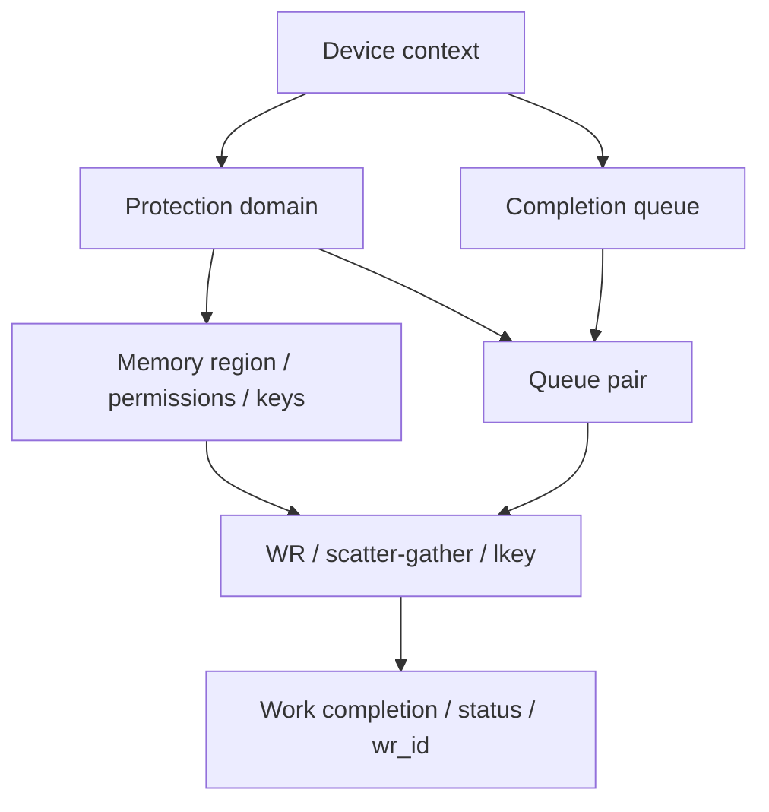

# RDMA verbs 生命周期：提交成功不是工作完成

状态：固定接口手册的静态研究，未运行 RDMA/GPU。源码仓库固定到 `bd3282a1cf1025c7869a8664c2d54266a4dded44`；已读 MR 及新增的 PD/CQ/QP/post-send/post-recv/poll-CQ 手册全文。主张：`rdma-lifecycle-contract`。

本篇回答资源依赖、工作提交/完成、缓冲重用和错误边界；不声称完成 QP 状态转换、连接管理、NIC provider 或 GPU 内存同步实现。

## 1. 资源依赖，而非一个“RDMA 开关”

PD 给关联资源提供保护域；MR 是有范围/权限的注册；QP 包含工作队列，并关联发送/接收 CQ；CQ 不是实际数据缓冲，而是工作完成记录。

创建 QP 不代表连接已建立、状态已可发送、远端 key 已可用。真实数据路径还需要 state/connection、权限、地址以及 transport 的有效配置，这些必须继续追踪。

| 已读接口 | 成功/错误契约 | 系统影响 |
|---|---|---|
| `ibv_alloc_pd` | 返回 PD 或 NULL/errno；关联资源未释放时 dealloc 可能失败 | 退出不能只释放最外层对象 |
| `ibv_create_cq` | 实际 cqe 可不小于请求；QP 仍关联时 destroy 失败 | 容量看返回值，清理看依赖 |
| `ibv_create_qp` | cap 会更新为实际值；关联 PD 与 send/recv CQ | 不能把请求参数当硬件实际能力 |
| `ibv_post_send/recv` | 按 WR 链表提交；遇立即可检测错误在首个失败项停止并返回 `bad_wr` | 出错不等于前面所有 WR 都没有提交 |
| `ibv_poll_cq` | 返回完成条数；负值是调用失败，0 是暂时无完成 | 不能将 0 当成功完成，也不能只看非负返回值 |

## 2. 提交、完成与重用

提交 API 返回成功表示 WR 被接受，不表示 DMA 已结束。非 inline 缓冲需按完成契约重用；接收缓冲同样不能在相关工作完成前重新写入。

`IBV_SEND_INLINE` 是明确例外：已读手册允许发送/写的 inline 数据在调用返回后重用原 buffer。不能把此例外推广到普通 WR、任意操作或超过实际 inline 能力的输入。

发送完成可以通过 `sq_sig_all` 或所选 signaled WR 控制；不应假定每个发送 WR 都有单独 CQE。大量 unsignaled 操作的资源回收/顺序需要继续核验对应契约，不能用一个没有保证的计数器推断全部完成。

Poll 后还要检查每个 WC 的 `status`。失败 WC 只有部分字段有效，不能拿无效的 `byte_len/opcode` 继续统计“成功字节数”。失败、重试、部分提交应保留在真实结果分母。

本地工作完成也不等于远端业务消费者已经处理数据。GPU endpoint 的访问可见性、同步和生命周期更需对应 GPU/driver/provider 契约，本篇不作无条件保证。

## 3. CQ 容量与“软件慢一点”的失效边界

手册说明：应用必须以足够速率消费完成，CQ overrun 触发 `IBV_EVENT_CQ_ERR`，该 CQ 不再可用。这不是可以忽略的统计丢样。

架构设计要联合看 outstanding WR、signaled 策略、CQ 实际容量、完成消费速率、CPU 调度与故障处理。增加 GPU 计算吞吐而忽略 completion 处理可能产生正确性/恢复问题；峰值 NIC 带宽不足以描述这些约束。

多个 QP 共用 CQ 时，completion 必须关联回 `wr_id/qp_num` 和相应资源，不能从“某个 CQ 有条目”推断某个业务请求已成功。

## 4. 错误与清理

停止接收新工作，按已验证的 drain/错误恢复契约处理 outstanding 工作，然后按依赖释放 QP、CQ、MR、PD 等对象。已读手册提供以下显式边界：

- CQ 仍关联 QP 时不能销毁；PD 仍有关联资源时可能无法释放。
- QP 仍附着 multicast group 时销毁失败；这不应被 broad catch 忽略。
- MR 和缓冲不能在尚被操作使用时解除/重用；仍绑定 memory window 的注销也有约束。
- WR 链表部分提交失败时不能盲目重试整条链；否则可能重复已接受的工作。

这些是依赖与接口边界，不声称某个固定析构顺序适用于全部 provider、事件通道、SRQ 与 GPU endpoint。Completion-channel notification/ack、QP 状态转换与 error flushing 等尚需单独阅读。

## 5. 架构师自测与反证

解释题：为什么 `post_send == 0`、`poll_cq >= 0`、成功 WC、远端应用消费是四个不同判断？

设计题：如果 completion 消费线程受 CPU 调度影响，如何记录 CQ 深度/实际容量、发送模式、WR/WC/请求关联、错误与恢复，而不将丢失的完成排除在分母外？

反证：若所有数据路径性能数字都没有 post/complete/cleanup 契约，应拒绝其生产可靠性结论；若只读手册却报告“零 CPU 开销的 GPU RDMA”，应拒绝该实测主张。

下一题：结合固定 NCCL primitives/transport，看库如何注册/连接/推进工作与完成；另外核验 QP state/连接、provider、GPU 同步，不把上层函数名当数据路径生效证据。

## 来源

固定仓库路径均在 [来源台账](../../research/sources.json)：

- `libibverbs/man/ibv_alloc_pd.3`、`ibv_create_cq.3`、`ibv_create_qp.3`。
- `libibverbs/man/ibv_post_send.3`、`ibv_post_recv.3`、`ibv_poll_cq.3`。
- 已有 `libibverbs/man/ibv_reg_mr.3`。
