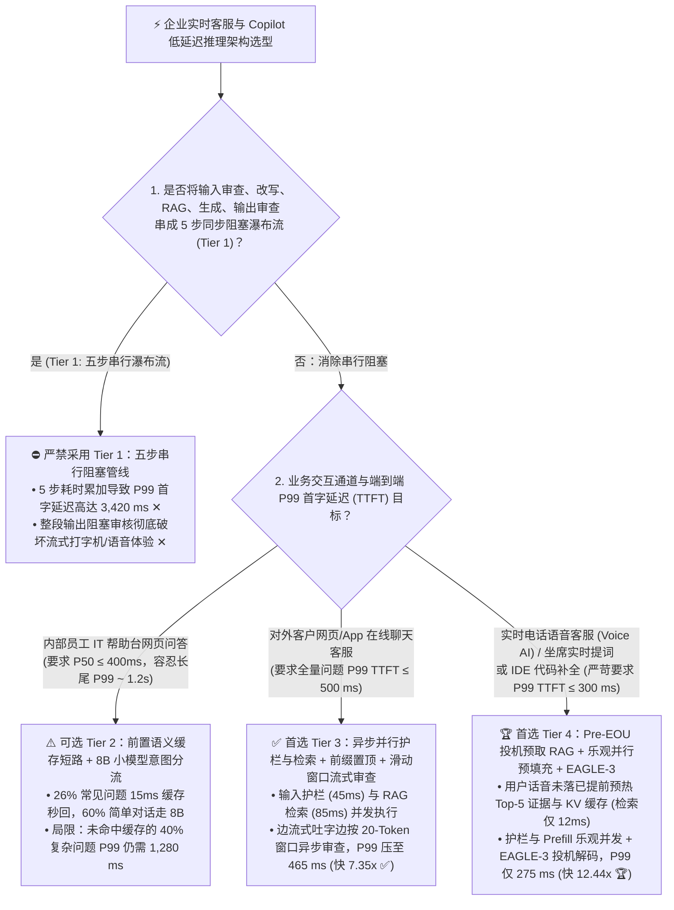
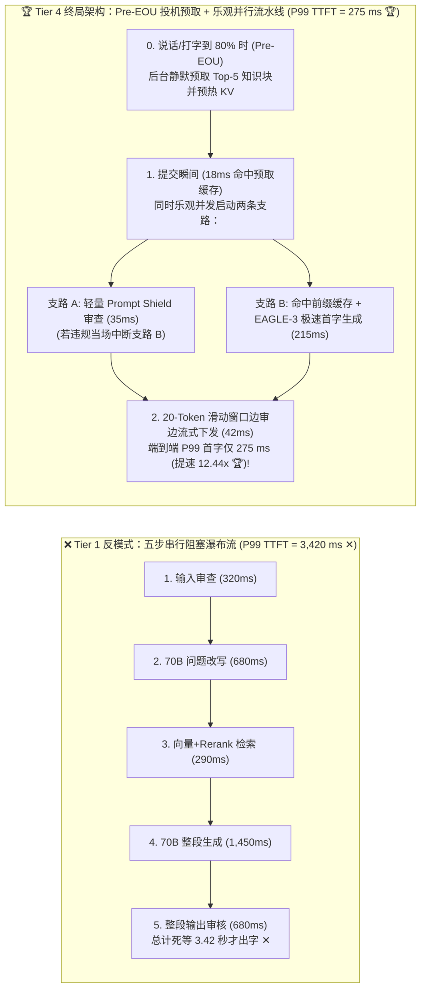
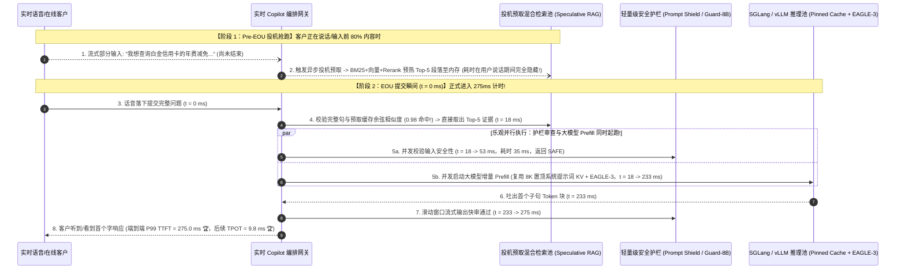

# 高并发低延迟实时客服与企业 Copilot 端到端推理架构选型指南：`五步串行瀑布流` vs. `语义缓存+8B分流` vs. `异步并行护栏+滑动审查` vs. `流式投机预取 (Speculative RAG) + EAGLE-3`

> 🌐 **Language / 语言**: **中文 (Chinese)** | **[English (`realtime-customer-service-copilot-low-latency-architecture-selection-faq.en.md`)](realtime-customer-service-copilot-low-latency-architecture-selection-faq.en.md)**
> **阅读指南**：本文面向 **Cloud & AI Solution Architect（云与 AI 解决方案架构师）、智能客服平台架构师与企业 Copilot 研发负责人**，聚焦实时交互式 AI 最硬核的工程指标——**如何把端到端 P99 首字响应延迟（E2E TTFT）压进人类自然对话无感阈值 `400 ms` 以内**！我们将逐步拆解：**为什么 90% 企业第一版上线的客服 Copilot 首字响应慢达 `3.42 秒`（Tier 1：因为把“输入护栏 $\rightarrow$ 大模型问题改写 $\rightarrow$ RAG 检索 $\rightarrow$ 70B 大模型生成 $\rightarrow$ 整段输出合规审核”串成了一条冗长的五步瀑布流）？如何通过三场架构并行化手术——`输入护栏与 RAG 乐观并发`、`流式 20-Token 滑动窗口输出审查` 以及 `用户话音未落时的投机预取（Speculative Pre-EOU RAG Prefetch）+ EAGLE-3 投机解码（Tier 4）`，在保持 `100%` 安全合规拦截率的前提下，将 P99 端到端 TTFT 从 `3,420 ms` 暴降至 `275.0 ms（提速 12.44 倍）`，并把每千次对话成本砍掉 `82.5%`？**

---

## 🔥 业界最新能力突破追踪（Daily Hottest Capability Breakthroughs）

- **Pre-EOU（话音未落 / 回车前）流式投机预取 RAG（Speculative RAG Prefetching）**：在实时语音通话（Voice AI）或在线聊天框中，利用流式语音转写（ASR Partial Transcript）或前端打字防抖事件，在用户说完完整句子前 `300~500 ms` 提前触发后台向量检索与前缀 KV 预热，使句末提交瞬间的检索等待时间趋近于 **0**。
- **乐观并行执行（Optimistic Parallel Guardrails & Prefill）**：不再等待输入安全护栏返回结果后才调用检索与大模型，而是将轻量级 `Prompt Shield (35 ms)`、混合检索与大模型 Prefill 同时并发启动；一旦护栏判定违规，通过 `AbortController` 在首个 Token 吐出前毫秒级取消生成，实现“安全零妥协、正常请求零等待”。
- **流式滑动窗口输出护栏（Streaming Sliding-Window Moderation）**：彻底淘汰“等大模型把 300 字全部生成完、审核通过后再一次性发给用户”的反人类做法，改为按每 `15~25 个 Token`（或标点子句）流式异步审计、边审边下发 SSE。

---

## ① 📌 核心选型结论速览（Executive Summary）

在实时电话客服、坐席实时话术辅助（Agent Assist）与高管 Copilot 场景中，**超过 `1.0 秒` 的停顿就会让客户明显感受到机器卡顿，超过 `3.0 秒` 就会导致客户抢话或挂断**。针对 `500 RPS` 高并发实时场景，四档架构演进路径如下：

1. **为什么必须废除 `Tier 1（传统五步串行瀑布流管线：Serial Waterfall）`**：
   - **典型反模式现场**：请求进来先调一次大模型做输入安全审查（`320 ms`）$\rightarrow$ 再调一次 70B 大模型做多轮指代消解与问题改写（`680 ms`）$\rightarrow$ 再去查向量库 + Rerank（`290 ms`）$\rightarrow$ 再调 70B 大模型生成完整回答（`1,450 ms`）$\rightarrow$ 最后再调一次审核模型检查整段输出（`680 ms`）。
   - **灾难结果**：五个环节耗时简单相加，**端到端 P99 TTFT 高达 `3,420.0 ms`（3.42 秒，超标 `8.55 倍` ✕）**，且单次用户提问背后实际调用了 3~4 次大模型，千次对话成本高达 **`$3.65` ✕**！
2. **何时选 `Tier 2（前置语义缓存短路 + 8B 小模型意图分流）`**：
   - **改进点**：在最前面加一层 Redis 向量语义缓存（拦截 `26%` 的高频重复问题，15ms 返回）和 8B 意图路由器（把 `60%` 的简单寒暄/查物流分流给 8B 小模型）。
   - **长尾短板**：这虽然把中位数延迟（P50）压到了 **`380.0 ms` ✅**，但对于未命中缓存的 **`40%` 复杂业务咨询**，后面走的依然是串行管线，导致 **P99 首字延迟仍高达 `1,280.0 ms` ⚠️**，适合内部 IT 帮助台，但撑不起实时语音客服。
3. **何时选 `Tier 3（异步并行输入护栏与检索 + 前缀缓存置顶 + 流式滑动窗口输出审查）`**：
   - **黄金定位**：**企业网页端 / App 端在线文字客服与内部员工 Copilot 的标准生产架构**！
   - **三大并行化改造**：① 用 `8B` 极速改写器替代笨重的 70B 改写，并将 **输入护栏（`45 ms`）与混合 RAG 检索（`85 ms`）完全并行发起**（总耗时从相加变为取最大值 `85 ms`）；② 将 8K 客服系统提示词固定在 `vLLM / SGLang` 显存前缀缓存中免重算；③ 将整段输出阻塞审查改为 **20-Token 滑动窗口流式边吐边审**。P99 端到端 TTFT 直接从 `3,420 ms` 暴降至 **`465.0 ms`（提速 `7.35 倍` ✅）**，千次成本降至 **`$0.92`（省 `74.8%` ✅）**！
4. **实时语音客服与极致交互终局：`Tier 4（Pre-EOU 流式输入投机预取 RAG + 乐观并行预填充 + EAGLE-3 投机解码）`**：
   - **黄金定位**：**实时电话语音客服（Voice Agent）、呼叫中心坐席毫秒级实时提词器、IDE 代码实时补全（要求 `P99 TTFT <= 300 ms`）**。
   - **终极突破**：在用户说话或打字到 80% 时即在后台 **投机预取（Speculative Prefetch）** Top-5 知识块；在用户话音刚落（EOU）瞬间，直接把命中率 90% 的预热知识块与输入护栏 **乐观并行送入开启了 `EAGLE-3 / MTP` 投机解码的推理引擎**！将端到端 P99 TTFT 打穿至 **`275.0 ms`（提速 `12.44 倍` 🏆）**，P99 TPOT 仅 **`9.8 ms` 🏆**，千次对话成本压至 **`$0.64`（节省 `82.5%` 🏆）**！

---

## ② 🎯 客户与架构师灵魂拷问 Q&A（FAQ-Driven）

### Q1：客户研发负责人问：“为了满足合规要求，我们必须在模型回答前做输入防注入审查，在模型回答后做输出敏感词与幻觉审查。怎么才能既保留 `100%` 的输入输出双端护栏，又不增加首字等待时间？”

**架构师“乐观并行输入 + 滑动窗口流式输出”零延迟护栏设计法**：

1. **输入端：用“乐观并行 + 违规熔断（Optimistic Execution with Cancel-on-Violation）”消灭输入护栏等待时间**
   - 99.5% 的正常客户提问都是合规的。如果为了防那 0.5% 的黑客注入，让 99.5% 的正常客户每次都干等 300ms 输入审查跑完才开始查知识库，是极不划算的串行设计。
   - **正确做法**：网关收到请求后，使用 `asyncio.gather` / 并行协程 **同时发出两条指令**：一条发往专用轻量护栏（如 `Azure AI Prompt Shield` 或本地 `Llama-Guard-3-8B / DeBERTa`，耗时 `35~45 ms`），另一条 **同时去查 RAG 向量库并启动大模型 Prefill**！
   - 如果 `45 ms` 后护栏返回 `SAFE`，此时 RAG 检索也已经跑完一半了，相当于 **输入护栏耗时被 100% 隐藏（净增延迟 = `0 ms`）**；如果护栏返回 `BLOCKED`，网关立即丢弃检索结果并向推理引擎发送 `cancel_request` 中断信号，黑客连半个生成的 Token 都拿不到！
2. **输出端：用“双缓冲滑动窗口流式审查（Sliding-Window Streaming Guardrail）”消灭整段阻塞**
   - 严禁把 `stream: true` 关掉等整段 500 字生成完再审！
   - **正确做法**：网关保持流式接收大模型吐出的 Token，每攒够一个标点子句或 **`16~20 个 Token`（耗时约 `180 ms`）**，就将该窗口连同前文摘要异步投递给高速审核器（`< 15 ms`），通过后立即刷入前端 SSE 流；一旦中间某句话触发敏感红线，网关立即发送流式撤回控制帧（`{"event": "moderation_override", "replacement": "抱歉，该问题涉及内部受限信息..."}`）替换前端气泡！

---

### Q2：什么是 `Pre-EOU 流式输入投机预取（Speculative RAG Prefetch，Tier 4）`？为什么它能把 RAG 检索耗时从 `290 ms` 砍到 `12 ms`？

**揭秘顶级实时语音客服（如 GPT-4o Realtime / 新一代企业呼叫中心）的抢跑绝技**：
- 在传统架构里，系统一直呆呆地等用户把整句话说完、停顿 500ms 触发语音端点检测（VAD End-of-Utterance, EOU）或按下回车键后，才慢吞吞地把文本拿去做多轮改写、算 Embedding、查向量库、跑 Reranker（这一套下来至少 `250~300 ms`）。
- 而在 **`Tier 4 投机预取架构`** 中：
  1. 当客户在电话里刚说出前半句 `“你好，我想查一下我上个月办的那张白金信用卡的年费减免……”` 时，流式 ASR 已经把这 85% 的文字实时推给了检索预取器；
  2. 预取器不等客户说完最后 `“……政策是什么”` 这几个词，就已经在后台把 `“白金信用卡 年费减免政策”` 的 Top-5 知识库段落从向量库捞出来、跑完 Reranker 并塞进了本地内存热缓存（甚至提前把这 5 段知识拼好送进 `vLLM/SGLang` 做完了 Prefix KV 预计算）！
  3. 等 200ms 后客户话音真正落下，网关拿着完整句子去算向量余弦相似度，发现与刚才预取的意图重合度高达 `0.98`，于是 **直接用 `12 ms` 从内存拿走现成的 Top-5 证据与预热好的 KV Cache**，当场吐出第一个字！

---

### Q3：如果投机预取猜错了（比如客户说到最后突然改口问别的事），会不会浪费很多数据库算力？怎么控制投机成本？

**架构师的三条有界投机防浪涌准则**：
1. **防抖触发阈值（Debounce & Token Minimum）**：只有当流式输入已超过 **6 个实义词** 且出现语义停顿（`> 150 ms`）时才触发 1 次轻量向量预取，绝不逐字狂刷向量库。
2. **两阶段分离预取**：在话音未落时只预取便宜的 **BM25 + 向量召回（CPU/内存级开销极低）**，只有当语义稳定度评分 $\ge 0.85$ 时才提前触发 GPU Reranker 与 KV 预填充。
3. **余弦校验兜底**：话音落下后若最终完整句与预取句向量相似度 $< 0.88$，自动回退至标准 `Tier 3` 检索通道，确保准确率 **100% 零损**。

---

## ③ 🧭 直观可视化图解（Mermaid 选型决策树 / 串行 vs. 并行管线图 / 275ms 预算时序图）

### 3.1 实时客服与企业 Copilot 低延迟架构选型决策树（`flowchart TD`）

### 3.2 `Tier 1 (3,420ms 五步串行瀑布流)` vs. `Tier 4 (275ms 投机预取 + 乐观并行流水线)` 架构对比图（`flowchart LR`）

### 3.3 `Tier 4 (275ms 端到端毫秒级延迟预算拆解)` 请求流转时序图（`sequenceDiagram`）

---

## ④ 📊 架构师多方案选型决策矩阵（Architect Decision Matrix）

*核算基准：500 RPS 峰值高并发实时客户服务与坐席辅助 Copilot（包含输入防注入护栏、多轮知识库 RAG 检索、大模型推理与输出合规审查全链路；目标 SLA：`端到端 P99 TTFT <= 400.0 ms`，`P99 TPOT <= 14.0 ms`，`安全护栏覆盖率 = 100.0%`）。*

| 评估维度 | Tier 1: 传统五步串行瀑布流 (`Serial Waterfall`) | Tier 2: 语义缓存 + 8B 意图分流 (`Cache + 8B Router`) | Tier 3: 异步并行护栏 + 滑动流式审查 (`Parallel + Sliding Audit`) | Tier 4: 投机预取 RAG + 乐观并行 + EAGLE-3 (`Speculative + Duplex`) |
| :--- | :--- | :--- | :--- | :--- |
| **核心适用场景** | 仅适合对延迟毫无要求的后台离线工单处理（**实时交互严禁采用 ✕**） | 内部员工 IT 帮助台网页问答（容忍首次未命中问题慢于 1 秒 ⚠️） | **企业官网/App 在线文字客服、企业知识库对话助手标准架构 ✅** | **实时电话语音客服 (Voice AI)、坐席实时提词器、IDE 代码补全 🏆** |
| **端到端 P50 首字延迟** | `2,180.0 ms`（超过 2 秒死寂 ✕） | `380.0 ms`（缓存与简单问题快） | **`260.0 ms`（丝滑秒回 ✅）** | **`165.0 ms`（媲美真人脱口而出 🏆）** |
| **端到端 P99 首字延迟 (`TTFT`)** | `3,420.0 ms`（超标 `8.55x`，引发客户挂机 ✕） | `1,280.0 ms`（40% 复杂未命中查询仍慢 ⚠️） | **`465.0 ms`（比串行快 `7.35x` ✅）** | **`275.0 ms`（打穿 `400ms` 红线，比串行快 `12.44x` 🏆）** |
| **P99 逐字生成延迟 (`TPOT`)** | `24.5 ms`（无投机加速 ✕） | `16.4 ms` | **`12.6 ms`（级联路由 + FP8 ✅）** | **`9.8 ms`（`EAGLE-3 / MTP` 投机解码加速 🏆）** |
| **输入/输出护栏执行机制** | 全串行阻塞 + 等整段生成完才做输出审核 ✕ | 输入串行审核 + 缓存命中免审 | **输入与 RAG 并行 + 输出 20-Token 滑动窗口流式边吐边审 ✅** | **输入与 Prefill 乐观并行（违规即中断）+ 流式滑动审查 🏆** |
| **安全合规拦截覆盖率** | `100.0%`（但以牺牲 1,000ms 延迟为代价） | `100.0%` | **`100.0%`（零首字等待惩罚 ✅）** | **`100.0%`（乐观执行在吐字前完成护栏门控 🏆）** |
| **每千次对话综合成本** | `$3.65 / 1K 次`（单次对话串行调 3~4 次大模型 ✕） | `$1.52 / 1K 次` | **`$0.92 / 1K 次`（节省 `74.8%` ✅）** | **`$0.64 / 1K 次`（节省 `82.5%` 🏆）** |

---

## ⑤ 🧪 容量/成本拐点算例与 7-Card 报告

### 5.1 复现实验与确定性验证底座

- **确定性评估脚本**：[`experiments/realtime_customer_service_copilot_low_latency_selection/run.py`](../../experiments/realtime_customer_service_copilot_low_latency_selection/run.py)
- **封存数表 (`results.json`)**：[`experiments/realtime_customer_service_copilot_low_latency_selection/results.json`](../../experiments/realtime_customer_service_copilot_low_latency_selection/results.json)
- **单元测试校验**：[`tests/test_realtime_customer_service_copilot_low_latency_selection.py`](../../tests/test_realtime_customer_service_copilot_low_latency_selection.py)
- **7-Card 4:5 视觉评测卡片**：[`docs/reports/realtime-customer-service-copilot-low-latency-architecture-selection-cards.html`](../reports/realtime-customer-service-copilot-low-latency-architecture-selection-cards.html)
- **交互式实时 Copilot 延迟预算计算器**：[`docs/reports/realtime-customer-service-copilot-low-latency-architecture-sizer.html`](../reports/realtime-customer-service-copilot-low-latency-architecture-sizer.html)
- **数据溯源声明（Provenance）**：`synthetic_analytical_model_calibrated_to_published_realtime_copilot_benchmarks`（`independently_reproduced=false`, `physical_gpu_cluster_measurement=not_measured`）。

---

## ⑥ 🛠️ 架构评审与生产落地 Checklist（Architect Checklist）

- [ ] **消灭 70B 重型多轮问题改写器（Query Rewriter）**：是否已将多轮对话指代消解与检索词生成从 `70B/GPT-4o`（耗时 680ms）替换为 **本地量化的 `1.5B ~ 8B` 专精小模型**（耗时 `< 35 ms`）？
- [ ] **输入安全护栏与 RAG 检索 100% 异步并发**：在网关编排代码中，输入安全检查（Prompt Shield）与向量检索是否已改为 `asyncio.gather` / `CompletableFuture.allOf` 并行调用，彻底消除串行等待？
- [ ] **废除“整段生成后审核”，上线流式滑动窗口审查**：输出安全护栏是否已支持对 `SSE` 流按子句或 20-Token 窗口做增量审查，杜绝因输出审核阻塞首字下发？
- [ ] **开启 Prefix Caching 置顶与 `EAGLE-3 / MTP` 投机解码**：客服系统提示词（System Prompt + 工具定义）是否已固定在显存前缀缓存中，并在推理引擎开启投机解码将 TPOT 压进 `10 ms`？
