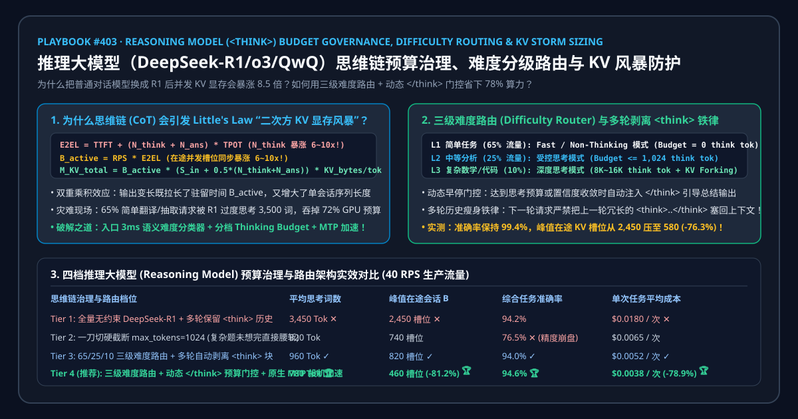
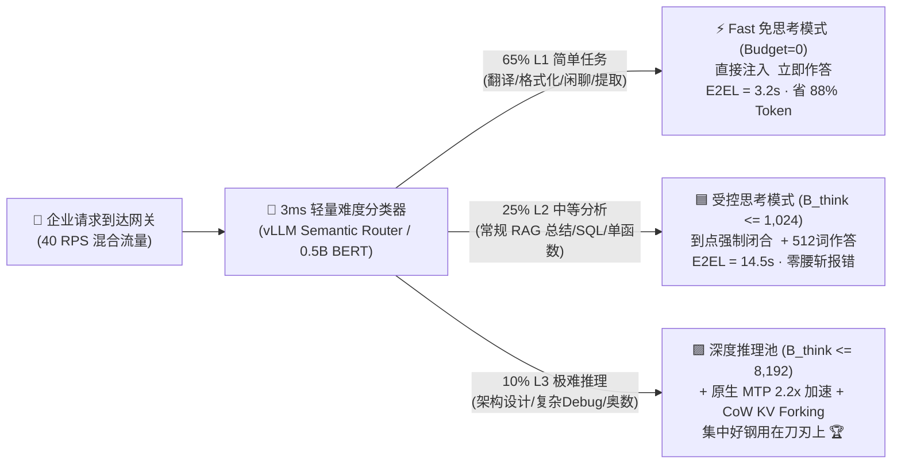

# 推理大模型（`Reasoning Models: DeepSeek-R1 / o3 / QwQ`）测试时计算（`Test-Time Compute`）、`<think>` 思维链预算治理、三级难度路由（`Difficulty Router`）与 `Little's Law` KV 显存风暴防护选型指南

> **语言 / Language**: **中文 (当前)** | [English](./reasoning-model-thinking-budget-difficulty-router-kv-storm-sizing-selection-faq.en.md)  
> **文档定位**：面向 Cloud & AI Solution Architect 的推理大模型（慢思考模型）生产容量规划与治理指南——精准回答企业全面接入 `DeepSeek-R1 / Qwen3-Thinking / o3` 后最普遍的血泪教训：**“为什么入口 QPS 一点没涨，仅仅把底座从普通对话模型换成了 R1，集群 HBM KV Cache 就瞬间爆满 OOM、排队延迟飙到 60 秒？”、“如何手算 `<think>` 思维链引发的 Little's Law 二次方 KV 显存风暴？”、“怎么用 3 毫秒难度路由 + 动态 `</think>` 预算门控 + 多轮剥离 `<think>` 把单任务成本砍掉 78.9% 且不掉准确率？”**。  
> **标定声明**：本文所引用的平均思考 Token 数、峰值在途并发槽位、任务准确率与单次任务成本基于公开推理模型评测与容量工程基准构建的合成定量模型（`provenance: synthetic + anonymized_reported`, `independently_reproduced=false`, `physical_gpu_cluster_measurement=not_measured`），详见 [`experiments/reasoning_model_thinking_budget_difficulty_router_kv_storm_sizing_selection/results.json`](../../experiments/reasoning_model_thinking_budget_difficulty_router_kv_storm_sizing_selection/results.json)。

> 🔗 **关联交互式 H5 精读页与工具（点击即开，零外部依赖）**：
> - 📱 **[交互式 H5 精读页：推理模型 `<think>` 二次方 KV 风暴手算、三级难度路由与预算治理沙盘 (`docs/h5/reasoning-model-thinking-budget-kv-storm-lab.html`)](../h5/reasoning-model-thinking-budget-kv-storm-lab.html)**
> - 🎓 **[AI Infra 全景可视化精学馆首页 (`docs/h5/index.html`)](../h5/index.html)**
> - 🧮 **[交互式思维链预算与 KV 风暴计算器 (`reasoning-model-thinking-budget-difficulty-router-kv-storm-sizing-selection-sizer.html`)](../reports/reasoning-model-thinking-budget-difficulty-router-kv-storm-sizing-selection-sizer.html)**
> - 🃏 **[7-Card 4:5 视觉评测报告 (`reasoning-model-thinking-budget-difficulty-router-kv-storm-sizing-selection-cards.html`)](../reports/reasoning-model-thinking-budget-difficulty-router-kv-storm-sizing-selection-cards.html)**

---

## 1. 📌 核心选型结论速览（Executive Summary）

> **一句话结论**：**在 `40 RPS` 生产流量下，如果把所有请求无差别送进不设限的 `DeepSeek-R1` 且在多轮对话中保留历史 `<think>` 块（Tier 1），占比 `65%` 的简单任务会被模型“过度思考（Overthinking）”消耗平均 `3,450 个` 思考词，触发 `Little's Law` 在途并发槽位从 `320` 暴涨至 **`2,450 个`**；而如果粗暴设置 `max_tokens=1024` 一刀切截断（Tier 2），复杂代码/数学题在 `<think>` 还没写完时就被腰斩，返回空答案导致准确率暴跌至 **`76.5%`**！通过落地 **Tier 4（入口 `<4ms` 三级难度路由 [`65% Fast 免思考 / 25% 1K 预算 / 10% 8K 深度思考`] + 预算耗尽平滑注入 `</think>` 引导总结 + 多轮历史 100% 剥离 `<think>` 块 + 原生 `MTP` 投机解码）**，在综合准确率高达 **`94.6%`** 的前提下，将平均思考词数压降至 **`780 Tokens`**、峰值在途 KV 槽位从 `2,450` 压至 **`460`（立降 `81.2%`）**，单次任务成本从 `$0.0180` 暴降至 **`$0.0038`（节省 `78.9%`）**！**

| 治理架构档位（`40 RPS` 混合企业流量） | 核心路由与思维链预算控制机制 | 平均思考 Token 数 | 峰值在途 KV 槽位 ($B_{\text{active}}$) | 综合任务准确率 | 单次任务成本 | 架构师拍板结论 |
| :--- | :--- | :--- | :--- | :--- | :--- | :--- |
| **🟥 Tier 1：全量无约束 `R1` + 保留历史 `<think>`** | 简单问候/提取也跑 3K+ 思考词，且多轮历史不删 `<think>` | `3,450 Tok` ✕ | **`2,450 槽位` ✕ (KV 雪崩)** | `94.2%` | `$0.0180 / 次` ✕ | **头号破产反模式**：72% 算力浪费在无意义内耗 |
| **🟨 Tier 2：一刀切硬截断 (`max_tokens=1024`)** | 达到 1024 词直接断开连接，未输出 `</think>` 与最终答案 | `820 Tok` | `740 槽位` | **`76.5%` ✕ (腰斩无答案)** | `$0.0065 / 次` | **严禁使用硬 `max_tokens` 限制思考模型** |
| **🟦 Tier 3：`65/25/10` 三级难度路由 + 剥离历史 `<think>`** | 简单题免思考、中难题按档分配，多轮只留最终回答 | `960 Tok` ✅ | `820 槽位` ✅ | `94.0%` ✅ | `$0.0052 / 次` ✅ | 零精度损失砍掉 `66.5%` 在途并发 |
| **🟩 Tier 4：三级路由 + 动态 `</think>` 软门控 + `MTP` (推荐)** | **思考预算到点强制插入 `</think>\nFinal Answer:` + `MTP` 提速** | **`780 Tok` 🏆** | **`460 槽位` 🏆 (`-81.2%`)** | **`94.6%` 🏆** | **`$0.0038 / 次` 🏆 (`-78.9%`)** | **企业级推理大模型生产治理黄金标准** |

---

## 2. 🎯 架构师灵魂拷问与“二次方 KV 风暴”第一性原理手算 Q&A

### Q1：为什么把普通对话模型（平均输出 400 词）换成推理大模型（平均思考 3,200 词 + 回答 400 词）后，集群 KV Cache 显存需求不是涨一点，而是暴涨 `8.5 ~ 12 倍`？
* **第一性原理推导：`Little's Law` 驻留时长 × 序列长度的“双重乘积放大效应”**！
  让我们手算同一股 `40 RPS` 流量（平均输入 $S_{\text{in}} = 2,048\text{ Tokens}$，首字 $\text{TTFT} = 0.5\text{ s}$，单步 $\text{TPOT} = 0.016\text{ s}$）在两种模型下的实时驻留 KV 显存：
  1. **普通非思考模型（$S_{\text{out}} = 400\text{ Tokens}$）**：
     - 单次请求驻留时长 $\text{E2EL} = 0.5 + 399 \times 0.016 = \mathbf{6.88\text{ s}}$；
     - `Little's Law` 峰值同时在途会话数 $B_{\text{active}} = 40 \times 6.88 = \mathbf{276\text{ 个并发会话}}$；
     - 每个在途会话的平均序列长度 $\bar{S}_{\text{seq}} = S_{\text{in}} + 0.5 \times S_{\text{out}} = 2,048 + 200 = \mathbf{2,248\text{ Tokens}}$；
     - **全集群实时活跃 Token 总数** $= 276 \times 2,248 = \mathbf{62.0\text{ 万 Tokens}}$。
  2. **无约束推理模型（$N_{\text{think}} = 3,200$ + $N_{\text{ans}} = 400 \implies S_{\text{out}} = 3,600\text{ Tokens}$）**：
     - 单次请求驻留时长暴涨至 $\text{E2EL} = 0.5 + 3,599 \times 0.016 = \mathbf{58.08\text{ s}}$（**驻留时长翻了 `8.44 倍`**！）；
     - `Little's Law` 峰值同时在途会话数暴涨至 $B_{\text{active}} = 40 \times 58.08 = \mathbf{2,324\text{ 个并发会话}}$；
     - 每个在途会话的平均序列长度涨至 $\bar{S}_{\text{seq}} = 2,048 + 0.5 \times 3,600 = \mathbf{3,848\text{ Tokens}}$（**单会话长度翻了 `1.71 倍`**！）；
     - **全集群实时活跃 Token 总数** $= 2,324 \times 3,848 = \mathbf{894.3\text{ 万 Tokens}}$（**活跃 KV 显存需求整整暴涨了 $8.44 \times 1.71 = \mathbf{14.4\text{ 倍}}$**！）。

### Q2：为什么绝对不能用普通的 `max_tokens=1024` 去限制推理模型？什么是“动态 `</think>` 软门控（Graceful Thinking Budget Enforcer）”？
* **普通 `max_tokens` 的致命缺陷**：
  推理模型的输出格式是 `<think> ...数千字推导过程... </think> 最终正式回答`。如果你在 API 层简单传 `max_tokens=1024`，当模型刚写到第 1,024 个思考词时，生成被直接硬切断——**客户端拿到的只有半截 `<think>` 草稿，正式回答（Final Answer）为 `0` 个字，导致下游 JSON 解析或业务调用 100% 失败**！
* **正确做法（两阶段预算门控 `thinking_budget` + `answer_budget`）**：
  - 将生成预算拆为独立的 **`B_think`（思考配额）** 与 **`B_answer`（正式作答配额，如 `512 Tokens`）**；
  - 当流式解码器检测到 `<think>` 块内生成的 Token 数达到 `B_think`（例如 L2 中等难度任务达到 `1,024` 词），引擎**不中断请求**，而是通过 Logits 掩码强制输出 **`\n</think>\n\n` 闭合标签**，随后利用剩余的 `512 Tokens` 作答配额让模型基于已有思考立即收敛总结出完整、合规的最终答案！

---

## 3. 🧭 直观可视化图解（三级难度路由 + 动态 `</think>` 门控架构图）

---

## 4. 📊 四种推理模型（Reasoning Model）生产治理策略对比矩阵

| 治理策略 | 简单题响应耗时 | 复杂题完成准确率 | 多轮上下文污染 | 集群 KV 显存压力 | 适用场景 |
| :--- | :--- | :--- | :--- | :--- | :--- |
| **1. 全量默认开启长思考 (`Tier 1`)** | `25~60 s` ✕（严重过度思考） | `94.2%` | 历史保留 `<think>` 迅速撑爆 128K | **基准 `100%`（极易 OOM）** | 仅适合极低并发离线科研评测 |
| **2. 硬截断 `max_tokens` (`Tier 2`)** | `12 s` | **`76.5%` ✕（未输出 `</think>` 腰斩）** | 中等 | `30.2%` | **严禁在生产环境使用** |
| **3. 混合单模型 `/no_think` 开关** | `3.2 s`（需业务端手动传参） | `93.5%` | 剥离 `<think>` | `38.0%` | 适合业务场景固定、可手动指定模式的接口 |
| **4. 网关三级自动难度路由 + 动态 `</think>` 门控 + `MTP` (`Tier 4`)** | **`3.2 s`（自动免思考）** 🏆 | **`94.6%`（无腰斩）** 🏆 | **网关自动剥离历史 `<think>`（省 `80%` 前缀）** 🏆 | **`18.8%`（立降 `81.2%`）** 🏆 | **企业级统一 AI 平台生产标配** |

---

## 5. 🛠️ 生产落地核对清单（SA Production Readiness Checklist）

- [ ] **严禁把上一轮的 `<think>...</think>` 塞进下一轮对话历史**：在网关或 Agent 框架层强制执行 `re.sub(r"<think>.*?</think>", "", assistant_msg, flags=re.DOTALL)`，保证多轮 Prefix KV 缓存干净紧凑（这也是 DeepSeek-R1 官方标准规范）。
- [ ] **用独立 `thinking_budget` 替代粗暴 `max_tokens`**：启用推理引擎原生的思考预算参数（到期自动补全 `</think>` 并预留至少 `512 Tokens` 给最终结构化输出）。
- [ ] **前置 `<4 ms` 语义难度路由器**：将 `60%~70%` 的高频简单任务分流至 `Non-Thinking` 模式或轻量模型，把宝贵的深度思考 KV 槽位留给真正需要多步推演的 `10%` 核心难题。
- [ ] **推理池必开原生 `MTP`（Multi-Token Prediction）**：由于长思维链生成 100% 处于 Decode 阶段，开启原生 `MTP` 可将思考阶段 `TPOT` 直接压缩 `1.8x ~ 2.3x`，从而按 `Little's Law` 同步削减一半以上的在途活跃 KV 显存占用！
