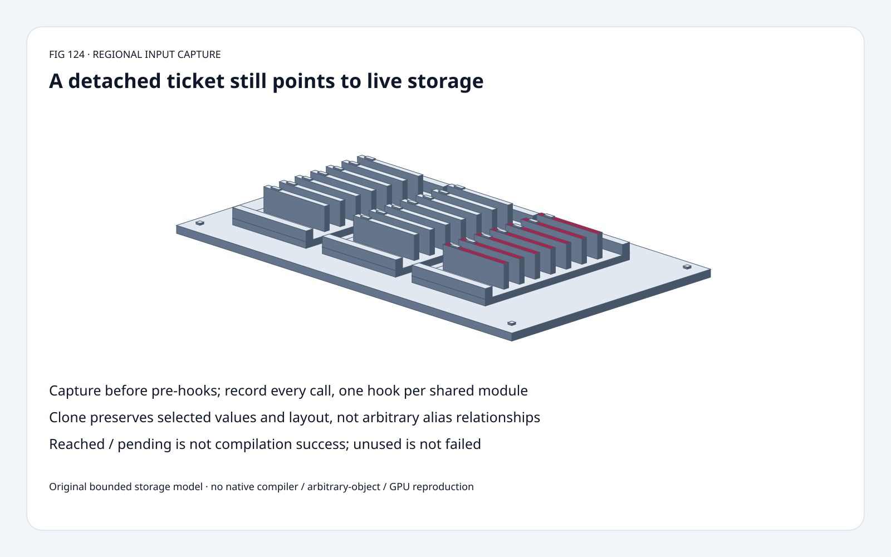
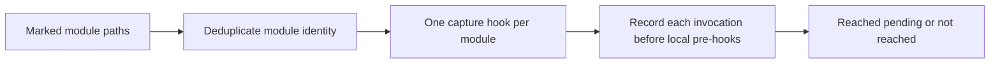
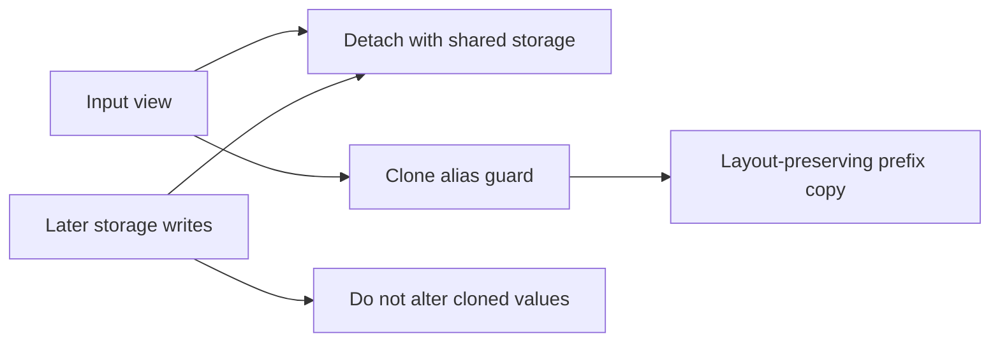
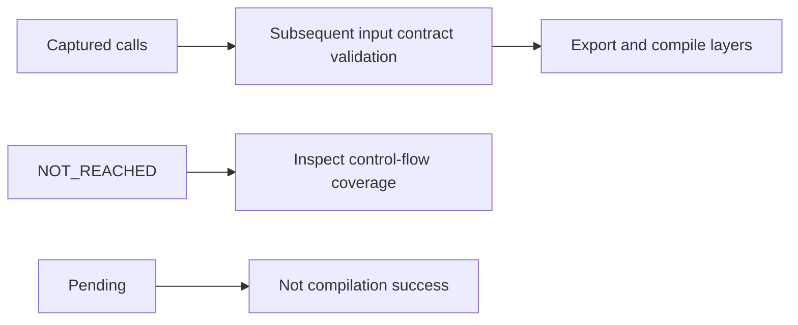

# Regional AOTI capture FAQ: detached live storage versus cloned layout snapshots

> **Language**: [中文](regional-aoti-capture-detach-clone-storage-contract-selection-faq.md) | English
>
> **Round 124 · 2026-11-14 · Day round 1** · [SVG](../../assets/svg/regional-aoti-capture-detach-clone-storage-contract-selection-faq-summary.svg) · [H5](../reports/regional-aoti-capture-detach-clone-storage-contract-sizer.html) · [7 cards](../reports/regional-aoti-capture-detach-clone-storage-contract-selection-cards.html) · [Data](../../experiments/regional_capture_snapshot_selection/report.json)
>
> **Synthetic, `independently_reproduced=false`.** Original bounded Python storage/view/event model, independent index-value oracles and separately measured CPU samples. No PyTorch capture, AOT compilation, GPU or arbitrary-object reproduction.



## 1. Executive summary: detach does not freeze regional example values

PyTorch's **November 14, 00:44:56 UTC** regional AOTI change introduces
module-boundary input capture. It observes one eager forward,
captures before a selected region's own pre-hooks and records every invocation.
This is a current upstream capability update, not proof of popularity
or a stable public API commitment.

Our original strided view `[3,5,7,9]` becomes `[3,50,7,9]` after mutation.
A live-detached capture preserves **3/4** initial coordinates;
a cloned layout snapshot preserves **4/4**.
These are deterministic fixture equality counts, not accuracy or confidence.

Selected offset3, length4, stride2, float32 width: logical bytes **16**,
layout-preserving prefix buffer **40**. A copy need not be compact.

## 2. Architect Q&A: ownership, aliasing and capture boundaries

### Q1: What exactly does the new capture layer do?

`capture_region_inputs` runs one eager forward under `torch.no_grad()`.
One pre-hook per marked module instance captures its positional and
keyword inputs; aliased module paths share the invocation list.
The capture hook is prepended before other local forward pre-hooks,
so replaying an example through the module applies those hooks once.

Reached regions have **pending `status=None`**; regions not called
remain `NOT_REACHED`. Neither means compilation success/failure.
The pinned commit explicitly says input-contract validation is
subsequent work. One execution cannot establish all branch/input coverage.
`no_grad()` is not `eval()`: state mutations and training-mode behavior
can still matter.

### Q2: Does “detached” mean immutable or `requires_grad=False`?

No. The default capture's detached tensors share backing storage.
Later in-place writes can change recorded values.
The inspected helper restores input `requires_grad` flags where
appropriate; the enclosing eager run is under `no_grad`.
Do not conflate graph detachment, gradient flags and ownership.

Non-tensor objects held both by input and region state may remain live
in non-cloning capture so their identity relationships are not broken.
The native object walker includes nested/unregistered objects and
excludes traversal into Python module namespaces/classes/functions.
Our original model handles only acyclic list/tuple/string-keyed dict
containers, finite scalar-backed 1-D views and primitives. It does
not reproduce native object walkers, parameters, autograd or subclasses.

### Q3: Why does clone reject some aliases rather than silently copy?

The pinned clone path distinguishes **the same tensor object repeated**
from **distinct tensor views sharing storage**.
Memoization can preserve the former; the inspected strided-clone path
rejects the latter rather than break their alias relationship.

An input sharing an object/storage with region state is also rejected
when cloning cannot preserve that relationship.
Wrapper tensor subclasses are rejected. Native sparse layouts and
ordinary tensor subclasses have additional handling that our bounded
model does not execute.

Our original tests independently exercise repeated `View` identity,
distinct shared-storage view rejection, and a selected state-storage
alias guard. This is not a native compatibility certificate.

### Q4: Why can four float32 values need a 40-byte clone buffer?

For the original nonempty positive-length, nonnegative-stride 1-D model:

```text
logical_bytes = length * element_bytes
prefix_elements = offset + 1 + (length-1)*stride
layout_preserving_buffer_bytes = prefix_elements * element_bytes
```

Offset3/length4/stride2 addresses indices `[3,5,7,9]`.
Preserving its offset and stride requires a selected prefix through
index9, **10 elements**, not just four packed values.
This agrees with the inspected nonempty strided-layout allocation rule,
but is not allocator alignment, all-live-buffer total or measured peak HBM.
Native empty tensors have a separate rule; our model explicitly excludes them.

Zero-stride original views are allowed: one source write can change
every logical coordinate. Negative strides are rejected.
The Python backing lists store boxed scalars, so their real allocation
is not the selected float32 byte budget.

### Q5: Why capture before a pre-hook, and why record multiple calls?

Original event control: one selected hook adds 1 to each unique addressed
storage index. Two calls via `left`/`right` aliases of the same module
produce cloned pre-hook records **[1,2,3]** and **[2,3,4]**.
After both writes, both live capture records read **[3,4,5]**.

Registering one hook per alias would double-log calls; capturing after
the hook and replaying through that hook could apply transformation twice.
The event model illustrates those boundaries without running nn.Module.

Capture is observation, not rollback or transactional isolation.
Native cleanup removes temporary hooks in a `finally` block, but
does not undo eager-model state changes.

## 3. Visual architecture: discovery, snapshot ownership and downstream validation







## 4. Selection matrix: choose storage semantics before treating captures as examples

| Choice | Good fit | Gate |
| :--- | :--- | :--- |
| Live detached capture | Observe compatible live input/state relationships | Later mutations remain visible |
| Cloned input | Freeze selected values and strided metadata | Reject unsupported alias/state relationships |
| Compact logical copy | Value-only independent application | May lose original offset/stride contract |
| One module hook | Shared module aliases | Every invocation still recorded |
| Pending status | Capture reached module | Not validated/exported/compiled |
| NOT_REACHED | Inspect execution coverage | Not automatically a compilation error |

## 5. Hands-on evidence: mutation, repeated identity and exact layout budgets

```powershell
python -m experiments.regional_capture_snapshot_selection.run --check
python -m unittest discover -s tests -p test_regional_capture_snapshot_selection.py -q
```

Eight tests cover independent index reads, repeated nested identity,
distinct-view rejection, state-storage guards, pre-hook/multiple-call
semantics, unreached regions, invalid/cyclic input, Node parity and sealed medians.

| Logical elements | Original live detach (ms) | Original prefix clone (ms) |
| :--- | ---: | ---: |
| 64 | 0.019180 | 0.019600 |
| 256 | 0.067020 | 0.069600 |
| 1,024 | 0.254000 | 0.264360 |
| 4,096 | 1.042700 | 1.110780 |

Two warmups, seven alternating repeats, five operations/sample,
median repeat means. Original finite backing validation included;
ownership semantics differ. No native tensor/hook/compile/GPU speedup claim.
H5 has bounded layout/mutation controls and visible errors;
native arbitrary-object capture is not reproduced.
Browser visual inspection was not performed.

## 6. Sources, provenance and readiness

- [November 14 change](https://github.com/pytorch/pytorch/commit/7bbc31dd45f4e43a5e3899e7e328aedfd967f2ff): actual regional capture capability and scope.
- [Pinned implementation](https://github.com/pytorch/pytorch/blob/7bbc31dd45f4e43a5e3899e7e328aedfd967f2ff/torch/_inductor/regional_aoti.py): clone/layout/alias guards, flags, capture hooks, statuses and cleanup.
- [Pinned upstream tests](https://github.com/pytorch/pytorch/blob/7bbc31dd45f4e43a5e3899e7e328aedfd967f2ff/test/inductor/test_regional_aoti.py): source analysis, not rerun here.
- [BSD-style license](https://github.com/pytorch/pytorch/blob/7bbc31dd45f4e43a5e3899e7e328aedfd967f2ff/LICENSE): upstream rights retained.
- [Original experiment](../../experiments/regional_capture_snapshot_selection/README.md): sealed data, original CPU model, limitations.

No upstream implementation copied. Native compilation/capture latency,
arbitrary-object behavior and peak HBM remain unmeasured or null.
