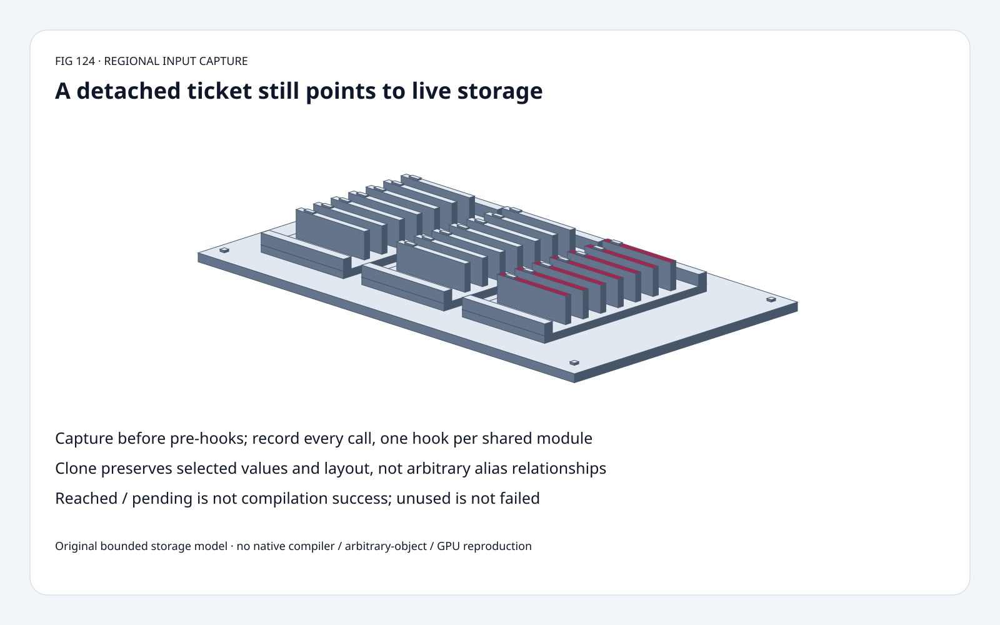
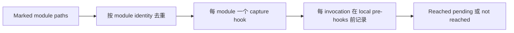
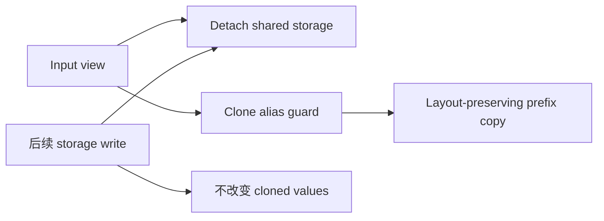
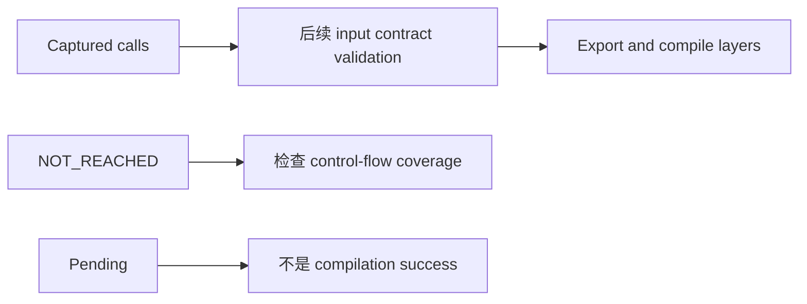

# Regional AOTI Capture FAQ：Detached Live Storage 与 Cloned Layout Snapshot

> **语言**：中文 | [English](regional-aoti-capture-detach-clone-storage-contract-selection-faq.en.md)
>
> **Round 124 · 2026-11-14 · 白班第 1 轮** · [SVG](../../assets/svg/regional-aoti-capture-detach-clone-storage-contract-selection-faq-summary.svg) · [H5](../reports/regional-aoti-capture-detach-clone-storage-contract-sizer.html) · [七卡](../reports/regional-aoti-capture-detach-clone-storage-contract-selection-cards.html) · [Data](../../experiments/regional_capture_snapshot_selection/report.json)
>
> **Synthetic，`independently_reproduced=false`。** 原创 bounded Python storage/view/event
> model、独立 index oracle、单独 CPU samples；不复现 PyTorch capture、
> AOT compilation、GPU 或 arbitrary-object behavior。



## 一、结论速览：Detach 不代表 Frozen Regional Examples

PyTorch **11 月 14 日 00:44:56 UTC** 更新 regional AOTI
module-boundary capture：观察一次 eager forward，
在 region 自有 pre-hooks 前记录每次 invocation。
这是当前 upstream capability，不据此宣称最热门或稳定公共 API。

原创 strided view `[3,5,7,9]` 因 mutation 变 `[3,50,7,9]`；
live detach 保留 **3/4** 原坐标，clone 保留 **4/4**。
是 fixture equality count，非 accuracy/confidence。

选定 offset3/length4/stride2/float32：
logical **16 bytes**，layout-preserving prefix **40 bytes**。
Copy 不一定 compact。

## 二、架构师 Q&A：Ownership、Alias 与 Capture Boundary

### Q1：新 Capture Layer 到底做什么？

`capture_region_inputs` 在 `torch.no_grad()` 下跑一次 eager forward，
每 marked module instance 一个 pre-hook，捕获 args/kwargs；
同 module 的 alias paths 共享 call list。
Capture hook prepend 到 local forward pre-hooks 前，
replay through module 时原 hooks 只作用一次。

Reached 是 **pending `status=None`**，
没走到是 `NOT_REACHED`，均不是编译成功/失败。
此 pin 明确说 input-contract validation 是下一 commit 工作；
一次执行不覆盖全部 input/branch。
`no_grad()` 不等于 `eval()`，training behavior/state mutation 仍可能发生。

### Q2：Detached 是 Immutable 或 `requires_grad=False` 吗？

不是。Default detached tensor 仍 share backing storage，
后续 in-place write 可改变 recorded values。
所读 helper 会适当恢复原 `requires_grad` flag；
外围 eager run 用 no_grad。
Graph detachment、gradient flag、ownership 是不同概念。

输入与 region state 都持有的 non-tensor objects，
在 non-clone capture 中可能保持 live identity。
Native walker 遍历 nested/unregistered objects，
不进入 Python modules/classes/functions 的 namespaces。

原创只处理 acyclic list/tuple/string-keyed dict、
finite scalar-backed 1-D View 和 primitives；
不复现 arbitrary objects、parameters、autograd、subclasses。

### Q3：为什么 Clone 拒绝部分 Alias，而不是悄悄 Copy？

**同 tensor object 重复出现**与**不同 tensor views 共 storage**
不是一回事。Memoization 保留前者；
所读 strided clone path 拒绝后者，避免静默破坏 alias。

Input 与 region state 共享 object/storage、clone 无法维持关系时也拒绝。
Wrapper tensor subclasses 不支持；
native sparse layout/plain subclasses 有额外分支，原创未执行。

原创测试独立覆盖 repeated View identity、
distinct shared-storage views rejection、selected state-storage guard；
不是 native compatibility certificate。

### Q4：四个 Float32 为什么要 40-byte Buffer？

原创 nonempty、nonnegative-stride 1-D：

```text
logical_bytes = length * element_bytes
prefix_elements = offset + 1 + (length-1)*stride
layout_preserving_buffer_bytes = prefix_elements * element_bytes
```

Offset3/length4/stride2 地址 `[3,5,7,9]`，
保留 offset/stride 需覆盖 index9，共 **10 elements**，
而非 packed 四元素。
与所读 native nonempty strided allocation rule 一致，
但非 allocator alignment、全部 live buffers 或 peak HBM。
Native empty tensor 另有规则，原创明确排除。

Zero-stride 可使一次 write 改多个 logical coordinates；
negative stride 拒绝。
Python boxed scalar list 实际 allocation 不是选定 float32 budget。

### Q5：为何在 Pre-hook 前记录，而且保存全部 Calls？

原创 event hook 对每个 unique addressed storage index 加1。
同 module 的 left/right aliases 两次调用，
clone pre-hook snapshots 是 **[1,2,3]**、**[2,3,4]**；
两次 mutation 后，live records 都读到 **[3,4,5]**。

每 alias 注册 hook 会重复记录；
hook 后捕获再 replay through hook 可能重复变换。
原创 event model 只解释 boundary，未运行 nn.Module。

Capture 不是 rollback/transactional isolation。
Native finally 会移除 temporary hooks，
不会撤回 eager model 已产生的 state changes。

## 三、三张架构图：Discovery、Snapshot Ownership、后续 Validation







## 四、选型矩阵：先选 Storage Semantics，再信任 Example

| 选择 | 适合 | Gate |
| :--- | :--- | :--- |
| Live detach | 保持 live input/state relationships | 后续 mutation 可见 |
| Clone input | 冻结 selected values/layout | Alias/state guard |
| Compact copy | 仅 value-oriented application | 可能丢 offset/stride |
| One module hook | Shared module aliases | 仍记录所有 invocations |
| Pending | 已 capture reached module | 非 validated/exported/compiled |
| NOT_REACHED | 检查 execution coverage | 非自动编译失败 |

## 五、动手证据：Mutation、Repeated Identity、Layout Budget

```powershell
python -m experiments.regional_capture_snapshot_selection.run --check
python -m unittest discover -s tests -p test_regional_capture_snapshot_selection.py -q
```

8 tests：独立 index reads、nested repeated identity、
distinct view/state guards、pre-hook/multiple calls、
unreached、invalid/cyclic input、Node parity、sealed medians。

| Logical Elements | Original Live Detach（ms） | Original Prefix Clone（ms） |
| :--- | ---: | ---: |
| 64 | 0.019180 | 0.019600 |
| 256 | 0.067020 | 0.069600 |
| 1,024 | 0.254000 | 0.264360 |
| 4,096 | 1.042700 | 1.110780 |

2 warmups、7 alternating repeats、5 ops/sample，
median repeat means；包含原创 finite backing validation，
两路径 ownership semantics 不同；
不宣称 native tensor/hook/compile/GPU speedup。
H5 有 bounded layout/mutation controls、可见 error，
未做浏览器视觉验收。

## 六、来源、许可、溯源与 Readiness

- [11 月 14 日 change](https://github.com/pytorch/pytorch/commit/7bbc31dd45f4e43a5e3899e7e328aedfd967f2ff)：实际 capture capability/scope。
- [固定 implementation](https://github.com/pytorch/pytorch/blob/7bbc31dd45f4e43a5e3899e7e328aedfd967f2ff/torch/_inductor/regional_aoti.py)：clone/layout/alias guards、flags、hook/status/cleanup。
- [固定 upstream tests](https://github.com/pytorch/pytorch/blob/7bbc31dd45f4e43a5e3899e7e328aedfd967f2ff/test/inductor/test_regional_aoti.py)：source analysis，未本机运行。
- [BSD-style LICENSE](https://github.com/pytorch/pytorch/blob/7bbc31dd45f4e43a5e3899e7e328aedfd967f2ff/LICENSE)：上游权利保留。
- [原创实验](../../experiments/regional_capture_snapshot_selection/README.md)：sealed data、CPU model、limitations。

未复制 upstream implementation；
native compilation/capture latency、arbitrary-object behavior、
peak HBM 保持未测或 null。
