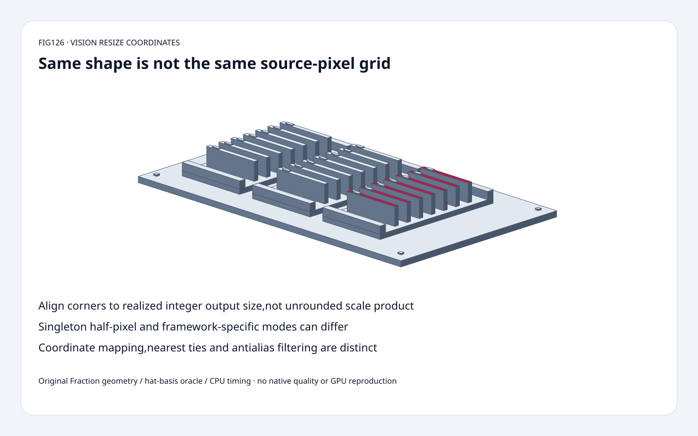
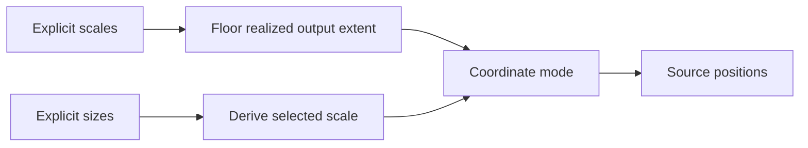
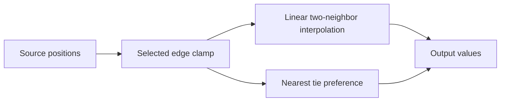
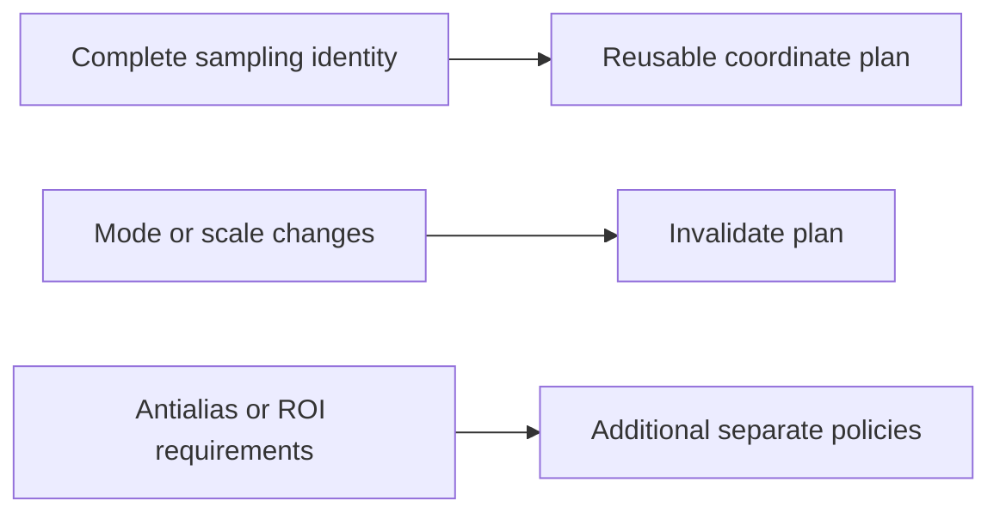

# Vision resize FAQ: realized integer size, half-pixel grids and corner alignment

> **Language**: [中文](resize-integer-size-half-pixel-align-corners-selection-faq.md) | English
>
> **Round126 · 2026-11-14 · Day round3** · [SVG](../../assets/svg/resize-integer-size-half-pixel-align-corners-selection-faq-summary.svg) · [H5](../reports/resize-integer-size-half-pixel-align-corners-sizer.html) · [7 cards](../reports/resize-integer-size-half-pixel-align-corners-selection-cards.html) · [Data](../../experiments/resize_coordinate_contract_selection/report.json)
>
> **Synthetic, `independently_reproduced=false`.** Original exact rational 1-D coordinate/interpolation model, independent triangular hat-basis oracle and separately measured original CPU float grid reuse. No native ONNX, GPU or vision-quality reproduction.



## 1. Executive summary: output shape is not the source sampling grid

Selected input `[1,2,3,4]`, exact scale **3/5**:
unrounded output width **12/5**, actual width **2**.
`align_corners` uses actual width2 and returns **[1,4]**.
The old unrounded-denominator control returns **[1,22/7]**,
retaining only **1/2** corner values.

For four inputs resized to one output, `half_pixel` gives **5/2**,
while `pytorch_half_pixel` gives **1**.
Nearest tie preference separately changes the middle of `[0,0,10]`
to `[0,10,10]` in the selected two-to-three fixture.

The inspected **September30 ONNX reference fix** addresses the integer-
size corner rule. Its November12 pinned tree is not a new interpolation
algorithm announcement or proof of popularity.

## 2. Architect Q&A: sizes, scales, coordinate modes and rounding

### Q1: Why not use `N*scale-1` for align_corners?

Realized output extent for selected positive exact scales is
`M=floor(N*scale)`. Corner alignment spans the realized sample lattice:

```text
M == 1: source_position = 0
otherwise: source_position = j*(N-1)/(M-1)
```

For N4/scale3/5, using unrounded12/5 gives the last coordinate15/7,
not the last source coordinate3. Interpolated value is22/7, not4.
The pinned fix changes scalar and vectorized paths to use integer
output width, including the singleton case.

Our original Fraction fixture uses exact3/5. Native floating scale
representation, shape inference and kernels are not executed.
Positive scales producing zero-length outputs are explicitly excluded.

### Q2: Are explicit output sizes equivalent to an arbitrary scale giving that size?

Not for all coordinate modes. In original sizes mode, scale=M/N.
An explicit scale3/5 and a sizes-derived scale2/4 both produce width2,
but their half-pixel coordinates differ.

`align_corners` depends on realized N/M and therefore agrees for that
pair. Other modes can preserve the original selected scale:

```text
half_pixel: (j+1/2)/scale - 1/2
asymmetric: j/scale
pytorch_half_pixel: M==1 ? 0 : half_pixel
```

The H5 intentionally uses sizes mode; the separate sealed regression
uses scale3/5. Do not silently substitute one input contract for another.

### Q3: Why does a singleton output make a difference?

For `[1,2,3,4]` and explicit size1, sizes-derived scale1/4:
half-pixel samples coordinate1.5, yielding5/2.
`pytorch_half_pixel` and `align_corners` select coordinate0, yielding1.

`pytorch_half_pixel` is an explicit ONNX transformation-mode name;
it is not a claim that every PyTorch resize operation uses it.
Mode defaults and export paths must be checked for the actual operator.
The currently pinned reference also uses integer singleton width
in these branches; the September fix message alone is not a description
of every later code path.

### Q4: Is nearest rounding part of the coordinate transform?

It is a separate choice after the source position is computed.
For `[0,10]` resized to three with half-pixel, middle position is
exactly1/2. `round_prefer_floor` selects0; `round_prefer_ceil` selects10.

Our original nearest model supports only those two tie policies.
It clamps source positions to the valid input interval; linear samples
use edge replication and two neighbors.
An independent oracle sums triangular hat weights over every input
value after clamping, rather than sharing the two-neighbor implementation.

This is not cubic interpolation, `exclude_outside` renormalization,
ROI/tf_crop_and_resize extrapolation, dtype rounding or antialiasing.
Linear downsampling alone does not establish anti-alias behavior.

### Q5: Can coordinate grids be reused, and what is the memory budget?

Reuse only while the whole sampling contract is unchanged:
input/output extent, explicit scale versus sizes, coordinate mode,
boundary and arithmetic representation.
Shape-only cache identity can reuse the wrong coordinates.

Default square-image payload assumes selected float32,224×224 input,
336×336 output, three channels:
**602,112 input bytes**, **1,354,752 output bytes**.
Separately storing two one-dimensional float64 coordinate axes is
**5,376 bytes**, not a full dense pixel grid.

These are logical buffers, not measured peak HBM, allocator alignment,
native kernel workspace or required actual implementation layout.
The original CPU timing is eight 1-D channels, not a2-D image pipeline.

## 3. Visual architecture: extent, geometry, interpolation and downstream values







## 4. Selection matrix: preserve preprocessing semantics across exports

| Choice | Good fit | Gate |
| :--- | :--- | :--- |
| align_corners | Explicit endpoint-lattice contract | Realized integer output length |
| half_pixel | Pixel-center sampling contract | Original selected scale and clamp |
| pytorch_half_pixel | Operator explicitly declares it | Singleton differs; do not infer framework default |
| asymmetric | Explicit origin-aligned grid | Not interchangeable with centered sampling |
| Nearest tie modes | Discrete sample selection | Independent rounding preference |
| Cached grid | Unchanged full sampling contract | Shape alone insufficient |

## 5. Hands-on evidence: corner regression, singleton and tie controls

```powershell
python -m experiments.resize_coordinate_contract_selection.run --check
python -m unittest discover -s tests -p test_resize_coordinate_contract_selection.py -q
```

Eight tests cover the integer-width regression, independent hat-basis
oracle over multiple sizes/modes, singleton differences, scales/sizes,
nearest ties/clamping, invalid inputs/budget, Node parity and sealed medians.

| Original 1-D input width | Cached grid,8 channels (ms) | Recompute grid per channel (ms) |
| :--- | ---: | ---: |
| 16 | 0.043567 | 0.087400 |
| 64 | 0.172367 | 0.347767 |
| 256 | 0.687100 | 1.525567 |
| 1,024 | 3.066100 | 6.313233 |

Output width is1.5×input, half-pixel linear, original Python float
paths checked for exact same outputs. Initial cached-grid setup excluded;
two warmups,seven alternating repeats,three operations/sample,
median repeat means. No native ONNX/GPU/2-D/antialias/quality timing.
Browser visual inspection not performed.

## 6. Sources, provenance and readiness

- [September30 integer-size fix](https://github.com/onnx/onnx/commit/a95e28ea0cf151cedefba7f94f2f22e7bf7febec): actual corner-regression chronology, not a November invention.
- [Pinned Resize reference](https://github.com/onnx/onnx/blob/3c41120b9c69657a1dd13407b080bd451ed06c9c/onnx/reference/ops/op_resize.py): coordinate modes, singleton branches, nearest coefficients and boundaries.
- [Apache-2.0 license](https://github.com/onnx/onnx/blob/3c41120b9c69657a1dd13407b080bd451ed06c9c/LICENSE): upstream rights retained.
- [Original experiment](../../experiments/resize_coordinate_contract_selection/README.md): exact geometry/oracle,CPU records and exclusions.

Original implementation/oracle/art; no upstream implementation copied.
Native latency,vision-model accuracy and peak HBM remain null.
