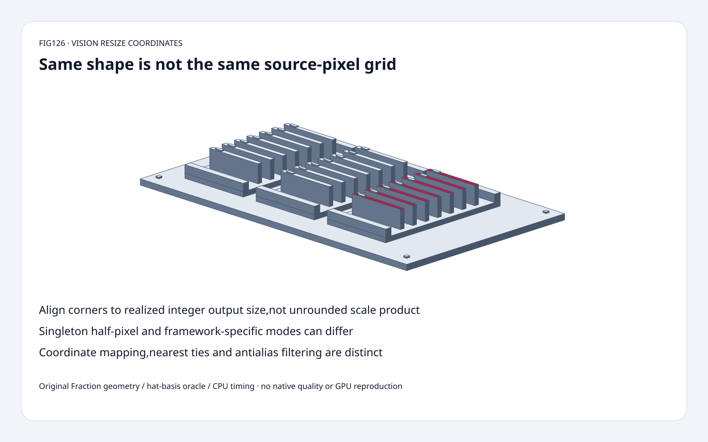
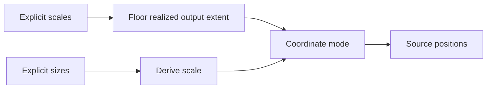
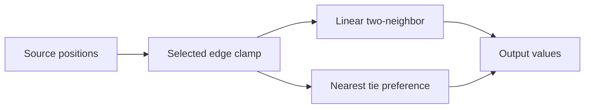
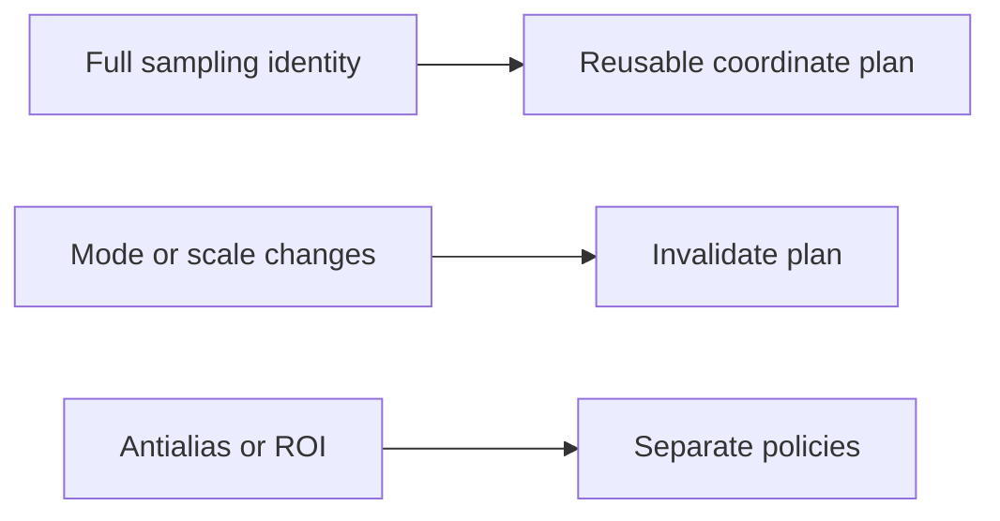

# Vision Resize FAQ：Integer Output Size、Half-pixel Grid 与 Align Corners

> **语言**：中文 | [English](resize-integer-size-half-pixel-align-corners-selection-faq.en.md)
>
> **Round126 · 2026-11-14 · 白班第3轮** · [SVG](../../assets/svg/resize-integer-size-half-pixel-align-corners-selection-faq-summary.svg) · [H5](../reports/resize-integer-size-half-pixel-align-corners-sizer.html) · [七卡](../reports/resize-integer-size-half-pixel-align-corners-selection-cards.html) · [Data](../../experiments/resize_coordinate_contract_selection/report.json)
>
> **Synthetic，`independently_reproduced=false`。** 原创 exact rational1-D
> coordinate/interpolation、独立 triangular hat-basis oracle、
> 单独 CPU float grid reuse；不复现 native ONNX/GPU/vision quality。



## 一、结论速览：Output Shape 不等于 Source Sampling Grid

选定 input`[1,2,3,4]`、exact scale **3/5**，
unrounded output width **12/5**，realized width **2**。
`align_corners` 用 actual2 得 **[1,4]**；
旧 unrounded denominator control 得 **[1,22/7]**，
只保留 **1/2** corners。

四输入缩到一输出，
`half_pixel` 给 **5/2**，
`pytorch_half_pixel` 给 **1**。
Nearest tie preference 独立将 two-to-three fixture
`[0,0,10]` 的中值改成 `[0,10,10]`。

所读 **9月30日 ONNX reference fix**修复 integer-size rule；
11月12日 pinned tree 不代表11月新算法或最热门证明。

## 二、架构师 Q&A：Sizes、Scales、Mode 与 Rounding

### Q1：Align Corners 为什么不能用 `N*scale-1`？

选定 positive exact scales 的 realized extent 是
`M=floor(N*scale)`，corner alignment 应跨实际 lattice：

```text
M == 1: source_position = 0
otherwise: source_position = j*(N-1)/(M-1)
```

N4/scale3/5，用 unrounded12/5 后 last coordinate15/7，
不是 source last3；interpolated value22/7而非4。
固定修复将 scalar/vectorized paths 改为 integer output width，
包括 singleton。

原创 Fraction exact3/5，不执行 native float scale/shape inference/kernels；
positive scale 导致 zero output 的情形明确排除。

### Q2：Explicit Size 等于所有能产生该 Size 的 Scale 吗？

不是。原创 sizes-mode scale=M/N；
explicit3/5 与 sizes-derived2/4 都得到 width2，
但 half-pixel coordinates 不同。
`align_corners` 只看 realized N/M，所以这组相同。

```text
half_pixel: (j+1/2)/scale - 1/2
asymmetric: j/scale
pytorch_half_pixel: M==1 ? 0 : half_pixel
```

H5 明确 sizes-mode，
sealed regression 单独用 scale3/5，
不能静默互换 contract。

### Q3：Singleton Output 为什么特别？

`[1,2,3,4]` size1，derived scale1/4：
half-pixel coordinate1.5、值5/2；
`pytorch_half_pixel`/`align_corners` 选 coordinate0、值1。

`pytorch_half_pixel` 是明确 ONNX mode name，
不意味着所有 PyTorch resize 都采用它；
实际 operator defaults/export path 需单独核验。
当前 pinned reference 对这些分支也用 integer singleton width；
不能只用9月 commit message 描述后来全部代码路径。

### Q4：Nearest Rounding 是 Coordinate Mode 一部分吗？

是 coordinate 之后的独立选择。
`[0,10]` half-pixel resize到3，middle source position=1/2；
prefer_floor选0，prefer_ceil选10。

原创只支持这两种 nearest tie policy，
source coordinate clamp到合法区间；
linear 则 edge replication/two neighbors。
独立 oracle 对所有 input 求 triangular hat basis sum，
不共享 two-neighbor value implementation。

未覆盖 cubic、exclude_outside renormalization、
ROI/tf_crop_and_resize extrapolation、dtype rounding、antialias。
Linear downsampling 本身不证明 anti-alias。

### Q5：Grid 能复用吗？Memory 多少？

仅 full sampling contract 不变时：
input/output extent、scale-vs-size、coordinate mode、
boundary、arithmetic representation。
Shape-only cache key 可能误复用 wrong grid。

选定 float32，224²输入、336²输出、3channels：
**602,112 input bytes**，
**1,354,752 output bytes**；
两个1-D float64 coordinate axes 独立存储 **5,376 bytes**，
不是 dense full-pixel grid。

均 logical buffers，非 peak HBM/alignment/workspace 或必需 native layout。
CPU timing 是8个1-D channels，非2-D image pipeline。

## 三、三张架构图：Extent、Geometry、Interpolation、Values







## 四、选型矩阵：跨 Export 保留 Preprocessing Semantics

| 选择 | 适合 | Gate |
| :--- | :--- | :--- |
| align_corners | Endpoint-lattice contract | Realized integer output |
| half_pixel | Pixel-center sampling | 原 scale/clamp |
| pytorch_half_pixel | 明确 operator 声明 | Singleton不同、非所有框架默认 |
| asymmetric | Origin-aligned grid | 非 centered |
| Nearest tie modes | 离散选择 | 独立 rounding |
| Cached grid | 完整 contract 不变 | 非 shape-only |

## 五、动手证据：Corner Regression、Singleton、Tie Controls

```powershell
python -m experiments.resize_coordinate_contract_selection.run --check
python -m unittest discover -s tests -p test_resize_coordinate_contract_selection.py -q
```

8 tests：integer width regression、多sizes/modes独立hat oracle、
singleton、scale-vs-size、nearest/clamp、
invalid/budget、Node parity、sealed medians。

| 1-D Input Width | Cached Grid，8 Channels（ms） | Recompute per Channel（ms） |
| :--- | ---: | ---: |
| 16 | 0.043567 | 0.087400 |
| 64 | 0.172367 | 0.347767 |
| 256 | 0.687100 | 1.525567 |
| 1,024 | 3.066100 | 6.313233 |

Output1.5×input、half-pixel linear，
原创 Python float paths 检查 equal outputs；
initial cached plan 不计，2 warmups、7 alternating repeats、
3ops/sample，median repeat means。
非 nativeONNX/GPU/2-D/antialias/quality timing；
未做浏览器视觉验收。

## 六、来源、许可、溯源与 Readiness

- [9月30日 integer-size fix](https://github.com/onnx/onnx/commit/a95e28ea0cf151cedefba7f94f2f22e7bf7febec)：实际 regression chronology，非11月新发明。
- [固定 Resize reference](https://github.com/onnx/onnx/blob/3c41120b9c69657a1dd13407b080bd451ed06c9c/onnx/reference/ops/op_resize.py)：mode/singleton/nearest/boundary。
- [Apache-2.0 LICENSE](https://github.com/onnx/onnx/blob/3c41120b9c69657a1dd13407b080bd451ed06c9c/LICENSE)：上游权利保留。
- [原创实验](../../experiments/resize_coordinate_contract_selection/README.md)：exact geometry/oracle、CPU records与排除项。

实现/oracle/视觉原创，未复制 upstream；
native latency、vision quality、peak HBM 保持 null。
