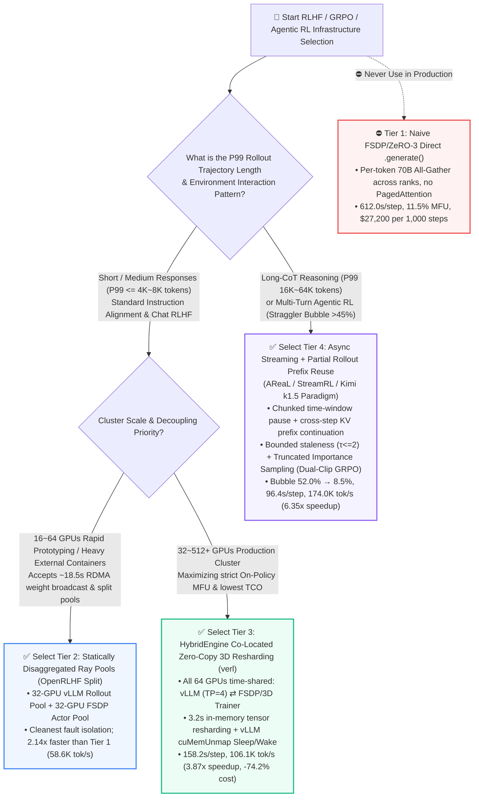
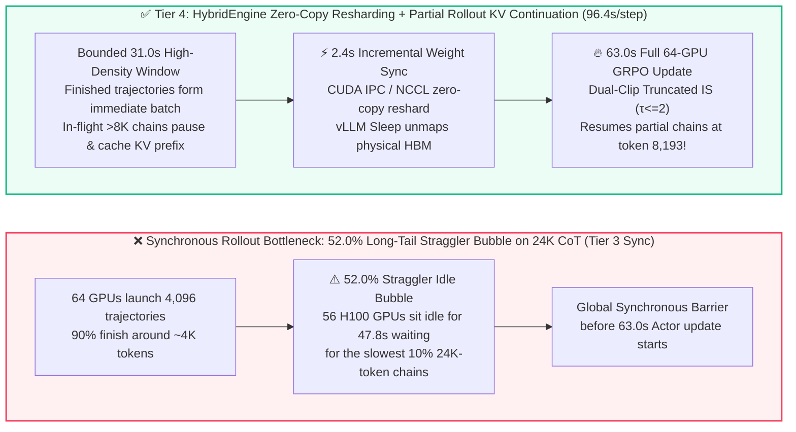

# LLM RLHF / GRPO Post-Training Infrastructure Selection & First-Principles FAQ: Naive FSDP Rollout vs. Statically Disaggregated Ray Pools vs. HybridEngine Zero-Copy 3D Resharding (`verl`) vs. Asynchronous Partial-Rollout Streaming (`AReaL / StreamRL / Kimi k1.5`)

> **Document Scope**: Written for AI Solution Architects and LLM Post-Training Infrastructure Leads, this single-decision guide addresses the #1 cluster utilization bottleneck in **DeepSeek-R1-style GRPO reasoning post-training, long Chain-of-Thought (Long-CoT) RL, and multi-turn Agentic RL**: **"How do we eliminate the 75%–85% autoregressive rollout bottleneck, cross-topology weight resharding overhead, and the 24K+ token long-tail straggler bubble?"** Following the 6-part standard of `ib-vs-ethernet-roce-selection-faq.md`, it combines plain-language first principles, 3 Mermaid diagrams, a 6-dimensional decision matrix, and sealed deterministic model results ([`experiments/rlhf_post_training_infra_selection/`](../../experiments/rlhf_post_training_infra_selection/results.json)).  
> **Language Versions**: [中文版 (`rlhf-post-training-infra-selection-faq.md`)](./rlhf-post-training-infra-selection-faq.md) | [English Version (`rlhf-post-training-infra-selection-faq.en.md`)](./rlhf-post-training-infra-selection-faq.en.md)  
> **Companion Deliverables**: [7-Card 4:5 Visual Benchmark Report (`rlhf-post-training-infra-selection-cards.html`)](../reports/rlhf-post-training-infra-selection-cards.html) | [Interactive RLHF/GRPO Bubble & Throughput Sizer (`rlhf-post-training-sizer.html`)](../reports/rlhf-post-training-sizer.html) | [One-Page Visual Summary SVG (`rlhf-post-training-infra-selection-faq-summary.svg`)](../../assets/svg/rlhf-post-training-infra-selection-faq-summary.svg)

---

## ① 📌 Executive Summary

1. **Why can't RLHF / GRPO post-training reuse a standard pre-training pipeline? Because every single RL step alternates between two fundamentally incompatible hardware regimes**:
   - In a standard **GRPO (Group Relative Policy Optimization)** step on a `70B` policy model (`512 prompts/step` $\times$ group size $G=8$ = `4,096 trajectories/step`, mean response length `4,096 tokens` = `16,777,216 generated tokens/step`), the cluster must first execute **autoregressive rollout generation (Memory-Bandwidth Bound)** and then execute **policy forward/backward updates (Compute Bound)**.
   - **Rule 1 (Never run autoregressive generation directly inside FSDP/ZeRO-3 training shards)**: On a `64 × H100 80GB` cluster, `Tier 1 Naive FSDP Generate` all-gathers 70B parameters across ranks on every single generated token, inflating rollout time to **`548.0 s`** (`612.0 s` total step time, **`27,413.8 tok/s`**, **`11.5%` effective cluster MFU**, and **`$27,200.00` per 1,000 GRPO steps**).
2. **For Short-to-Medium CoT ($\le 4\text{K}\sim 8\text{K}$ tokens): Standardize on `Tier 3 HybridEngine Co-Located Zero-Copy 3D Weight Resharding (verl / HybridFlow paradigm)`**:
   - While `Tier 2 Statically Disaggregated Ray Pools (OpenRLHF split mode: 32 GPUs on vLLM Rollout + 32 GPUs on FSDP Actor)` introduces PagedAttention to cut step time to **`286.5 s` (`58,559.2 tok/s`, `2.14x` speedup)**, it suffers from a **50% static pool idle bubble** plus **`18.5 s`** of cross-pool RDMA weight broadcast overhead.
   - **`Tier 3 HybridEngine (ByteDance/HKU verl)`** time-multiplexes all **64 H100 GPUs** as `16 × TP=4` vLLM/SGLang engines during rollout and transitions in-place to `64-GPU FSDP/3D Parallelism` via **in-memory CUDA IPC / NCCL All-to-All zero-copy 3D tensor resharding (`3.2 s`)** with CUDA Virtual Memory (`cuMemUnmap`) sleep/wake and CPU optimizer offload, cutting step time to **`158.2 s` (`106,050.7 tok/s`, `3.87x` faster than Tier 1, `$7,030.40` per 1,000 steps)**.
3. **For Long-CoT Reasoning (`16K–64K tokens`, DeepSeek-R1 style) & Multi-Turn Agentic RL: Upgrade to `Tier 4 Asynchronous Streaming + Partial Rollout Prefix Reuse (AReaL / StreamRL / Kimi k1.5 paradigm)`**:
   - In Long-CoT GRPO, 90% of trajectories finish around `~3,500 tokens`, whereas the hardest 10% reasoning chains run up to **`24,576 tokens` (`6.0x` the mean)**. Even under synchronous `Tier 3 HybridEngine`, **`52.0%` of the 92.0-second rollout phase (~47.8 seconds) is wasted with 56+ H100 GPUs sitting idle waiting for the longest stragglers**!
   - **`Tier 4 Asynchronous Partial Rollout`** pauses unfinished ultra-long trajectories at the step window boundary, caches their KV prefixes to resume seamlessly at token $k+1$ in step $t+1$, and applies **bounded-staleness truncated importance sampling (Dual-Clip GRPO with max staleness $\tau \le 2$ steps)**. This slashes the rollout straggler bubble from **`52.0%` down to `8.5%`**, compressing step time to **`96.4 s`**, boosting throughput to **`174,037.5 tok/s` (`6.35x` vs. Tier 1, `1.64x` vs. synchronous Tier 3)**, raising effective cluster MFU to **`73.0%`**, and lowering 1,000-step cost to **`$4,284.80` (saving `$22,915.20` / `-84.2%` vs. Tier 1)**.

> **Provenance & Reproducibility Disclosure**: All step times, straggler bubble ratios, and 1,000-step TCO figures cited in this FAQ, the 7-Card report, and the interactive sizer come from our deterministic post-training infrastructure model [`experiments/rlhf_post_training_infra_selection/run.py`](../../experiments/rlhf_post_training_infra_selection/run.py) (`provenance_type: "synthetic"`, `independently_reproduced: false`, `physical_gpu_cluster_measurement: "not_measured"`), calibrated against published open-source RLHF systems (`anonymized_reported`: `verl / HybridFlow` EuroSys 2025, `OpenRLHF` Ray+vLLM architecture, and `Kimi k1.5` / `AReaL` / `StreamRL` partial-rollout reports).

---

## ② 🎯 Architect & Customer First-Principles Q&A

### Q1: Why does calling native training `.generate()` cripple a 64-GPU H100 cluster, and when should architects pick `Static Disaggregation` vs. `HybridEngine Co-Location`?

**First-Principles Memory & Parallelism Mismatch**:
1. **Why `Tier 1 Naive FSDP / ZeRO-3 Rollout` fails in production**:
   - Training a `70B BF16` model requires storing weights (`140 GB`), gradients (`140 GB`), and FP32 Adam optimizer states (`560 GB`), forcing `FSDP / ZeRO-3` to shard weights across all 64 GPUs.
   - During dense training, large-batch GEMMs hide cross-GPU `All-Gather` latency. During **autoregressive rollout decoding**, however, each sequence generates 1 token at a time: keeping ZeRO-3 sharding forces the cluster to **re-broadcast 140 GB of weights across the network on every generated token** without PagedAttention or Continuous Batching (`612.0 s` per step).
2. **When to choose `Tier 2 Statically Disaggregated Ray Pools (OpenRLHF split mode)`**:
   - **Mechanism**: Physically partitions the 64 GPUs into `32 GPUs` running persistent `vLLM / SGLang` (`TP=4`) and `32 GPUs` running `FSDP` Actor training, syncing updated weights via `NCCL Broadcast / RDMA` (`18.5 s`).
   - **Sweet Spot**: Cleanest process isolation and easiest integration with heavy external agent sandboxes on `16–64 GPU` clusters (`2.14x` faster than Tier 1 at `58,559.2 tok/s`), but suffers from a static pipeline bubble when running synchronous on-policy RL.
3. **When to choose `Tier 3 HybridEngine Co-Located Zero-Copy 3D Resharding (verl / HybridFlow)`**:
   - **Mechanism**: Eliminates static pool partitioning by having **all 64 GPUs switch roles in-place**:
     - During **Rollout**, Adam optimizer states are offloaded to CPU DRAM while all 64 GPUs operate as `16 × TP=4` vLLM instances.
     - During **Weight Resharding**, `HybridEngine` executes **in-memory CUDA IPC / subgroup All-to-All tensor resharding in `3.2 s`** (zero disk or CPU round-trip) and uses **vLLM `Sleep / Wake` (`cuMemUnmap`)** to release physical KV Cache pages without destroying captured CUDA Graphs.
   - **Sweet Spot**: The production gold standard for strict on-policy RLHF/GRPO when response lengths are $\le 4\text{K}\sim 8\text{K}$ tokens (`158.2 s/step`, `106,050.7 tok/s`, `1.81x` faster than Tier 2).

---

### Q2: Why does Long-CoT Reasoning (`16K–64K tokens`) create a `52%` idle bubble even inside `HybridEngine`, and how do `Partial Rollout` and `Bounded-Staleness Async RL` solve it?

**First-Principles Power-Law Tail vs. Synchronous Barriers**:
1. **The Long-CoT Straggler Wall**:
   - In DeepSeek-R1-style reasoning GRPO, 90% of prompts finish thinking within `~3,500 tokens`, while the hardest 10% math/coding trajectories run up to **`24,576 tokens` (`6.0x` the mean)**.
   - Under synchronous `Tier 3 HybridEngine`, the training backward pass cannot start until all `4,096` trajectories finish. Consequently, **for `52.0%` of the 92.0-second rollout window (~47.8 seconds), 56 of the 64 H100 GPUs sit idle waiting for the final few 24K-token trajectories**!
2. **How `Tier 4 Asynchronous Partial Rollout (AReaL / StreamRL / Kimi k1.5)` breaks the barrier**:
   - **Mechanism 1 — Partial Rollout Segmentation & KV Prefix Reuse**: Sets a bounded rollout window (`31.0 s` or `8,192 tokens/chunk`). Completed trajectories immediately form a training batch; in-flight ultra-long trajectories are paused with their KV Cache prefixes preserved and **resumed from token `8,193` in step $t+1$** after the `2.4 s` incremental weight sync—never discarding partial work.
   - **Mechanism 2 — Bounded-Staleness Truncated Importance Sampling (Dual-Clip GRPO)**: Because a segmented `24K` trajectory spans policy versions $\pi_{\theta_{t-1}}$ and $\pi_{\theta_t}$ (bounded staleness $\tau \le 2$ steps), the trainer multiplies token advantages by truncated importance ratios $\min\left(\frac{\pi_\theta(a|s)}{\pi_{\theta_{\text{old}}}(a|s)}, c_{\text{clip}}\right)$ and enforces `max_staleness_steps = 2`. This preserves on-policy convergence accuracy while cutting the straggler bubble from **`52.0%` to `8.5%`** and delivering a **`1.64x` speedup at 24K tail (`2.38x` at 64K tail)**!

---

### Q3: In co-located `HybridEngine` deployments, how do we prevent `vLLM KV Cache` and `FSDP Optimizer / Activations` from triggering `CUDA OutOfMemoryError`?

1. **vLLM `Sleep Mode` via CUDA Virtual Memory (`cuMemUnmap`)**: Calling `sleep(level=1)` at the end of Rollout unmaps physical HBM pages backing the KV Cache pool and inference weights in milliseconds while preserving virtual address pointers and captured CUDA Graphs (`wake_up()` remaps pages before the next rollout, avoiding `30–60 s` of CUDA Graph recapture).
2. **Asynchronous CPU DRAM Optimizer Offload**: Offloads the `560 GB` FP32 Adam states over PCIe Gen5 / NVLink-C2C during Rollout so vLLM can claim `75%+` of each 80GB HBM for PagedAttention.
3. **Fused On-the-Fly `BF16 -> FP8 (E4M3)` Weight Cast**: Casts BF16 training weights into FP8 during the `3.2 s` resharding step, accelerating memory-bound decoding by `1.5x–1.7x`.

---

## ③ 🧭 Visual Architecture Diagrams (Decision Tree + Dataflow + Sequence)

### 3.1 RLHF / GRPO Post-Training Architecture Selection Decision Tree (`flowchart TD`)



### 3.2 Synchronous Straggler Bubble vs. HybridEngine + Partial Rollout Continuation (`flowchart LR`)



### 3.3 HybridEngine 3D Weight Resharding & Partial Rollout Cross-Step Continuation (`sequenceDiagram`)

```mermaid
sequenceDiagram
    autonumber
    participant Buf as Rollout Buffer & KV Prefix Pool
    participant VLLM as 64-GPU vLLM/SGLang Rollout Engine (16×TP4)
    participant Reshard as HybridEngine 3D Tensor Resharder (CUDA IPC/NCCL)
    participant Actor as 64-GPU FSDP/Megatron Actor & Ref Trainer

    Note over Buf,VLLM: Step t Rollout Phase (31.0s bounded window, 8.5% bubble)
    Buf->>VLLM: Inject new prompts + paused Partial Rollout KV prefixes from Step t-1 (τ=1)
    VLLM->>VLLM: PagedAttention + FP8 continuous batching across all 64 GPUs
    VLLM->>Buf: Emit 4,096 completed trajectories; checkpoint unfinished >8K KV prefixes

    Note over VLLM,Actor: Millisecond Virtual Memory Transition (cuMemUnmap Sleep)
    VLLM->>VLLM: sleep(level=1) unmaps physical KV Cache pages while keeping CUDA Graph addresses
    Actor->>Actor: Prefetch Adam optimizer shards from host DDR5

    Note over Actor: Step t Policy Update Phase (63.0s, 73.0% Effective Cluster MFU)
    Buf->>Actor: Dispatch 16.78M-token batch tagged with policy versions (θ_{t-1}, θ_t)
    Actor->>Actor: Compute Reference LogProbs + Dual-Clip Truncated IS GRPO update (θ_t → θ_{t+1})

    Note over Reshard,VLLM: Zero-Copy 3D Weight Resharding & Wake-Up (2.4s ~ 3.2s)
    Actor->>Reshard: Expose updated FSDP shards θ_{t+1} in HBM (zero disk/CPU copy)
    Reshard->>VLLM: wake_up() remaps physical pages + subgroup All-to-All reshard & fused FP8 cast
```

---

## ④ 📊 Architect Decision Matrix

| Evaluation Dimension | Tier 1: Naive FSDP/ZeRO-3 Co-Located Generate | Tier 2: Statically Disaggregated Ray Pools (`OpenRLHF` Split) | Tier 3: `HybridEngine` Co-Located 3D Resharding (`verl` Sync) | Tier 4: Async Streaming + `Partial Rollout` (`AReaL / Kimi k1.5`) |
| :--- | :--- | :--- | :--- | :--- |
| **Primary Use Case** | Toy models (`<3B`) only; **strictly prohibited for 70B+ production** | `16–64 GPU` medium-context RLHF or heavy external container sandboxes | **Production standard for short/medium CoT ($\le 4\text{K}\sim 8\text{K}$)** requiring strict synchronous on-policy updates | **Long-CoT Reasoning (`16K–64K tokens`) & multi-turn Agentic RL** |
| **Step Latency & Throughput** (`64×H100`, `70B`, `16.78M tok/step`) | **`612.0 s`** (`548.0s` rollout + `64.0s` train)<br/>Throughput: **`27,413.8 tok/s`** (`1.00x`) | **`286.5 s`** (`196.0s` rollout + `18.5s` sync + `72.0s` train)<br/>Throughput: **`58,559.2 tok/s`** (**`2.14x`**) | **`158.2 s`** (`92.0s` rollout + `3.2s` reshard + `63.0s` train)<br/>Throughput: **`106,050.7 tok/s`** (**`3.87x`**) | **`96.4 s`** (`31.0s` window + `2.4s` sync + `63.0s` train)<br/>Throughput: **`174,037.5 tok/s`** (**`6.35x`**) |
| **Core Mechanism** | Per-token cross-GPU `All-Gather` on ZeRO-3 shards; no PagedAttention | 32 GPUs on vLLM + 32 GPUs on FSDP; Ray + NCCL Broadcast weight sync | All 64 GPUs time-shared; in-memory `CUDA IPC / All-to-All` 3D reshard + `vLLM Sleep/Wake` | Chunked trajectory pause/resume with KV prefix cache + bounded-staleness ($\tau \le 2$) Dual-Clip IS |
| **Straggler Bubble & Effective MFU** | Bubble: **`62.0%`**<br/>Effective MFU: **`11.5%`** | Bubble: **`48.0%`** (pool wait + tail)<br/>Effective MFU: **`24.6%`** | Bubble: **`52.0%`** (24K CoT tail wait)<br/>Effective MFU: **`44.5%`** | Bubble: **`8.5%`** (tail wait eliminated)<br/>Effective MFU: **`73.0%`** |
| **Algorithmic Stability & Fault Boundary** | Strictly on-policy, but unusable throughput | Strictly on-policy; process isolation between rollout and trainer pools | Strictly on-policy; requires `cuMemUnmap` sleep mode to prevent HBM OOM | Bounded off-policy; **must cap staleness at $\tau \le 2$ with Dual-Clip IS** ($\tau \ge 5$ risks KL spike) |
| **Cost per 1,000 GRPO Steps** (`$160/hr` cluster rate) | **`$27,200.00`** (`170.00 hrs`) | **`$12,732.80`** (`79.58 hrs`, `-53.2%`) | **`$7,030.40`** (`43.94 hrs`, `-74.2%`) | **`$4,284.80`** (`26.78 hrs`, **saves `$22,915.20` / `-84.2%` vs. Tier 1; saves `$2,745.60` vs. Tier 3**) |

---

## ⑤ 🧪 Quantitative Case Study & Benchmark Insights

All metrics below are deterministically generated and verified by [`experiments/rlhf_post_training_infra_selection/run.py`](../../experiments/rlhf_post_training_infra_selection/run.py) and sealed in [`results.json`](../../experiments/rlhf_post_training_infra_selection/results.json) (`python experiments/rlhf_post_training_infra_selection/run.py --check`; `provenance_type: "synthetic"`, `independently_reproduced: false`, `physical_gpu_cluster_measurement: "not_measured"`).

### 5.1 Quantitative Comparison Table (`70B GRPO`, `64 × H100 80GB`, `16.78M tokens/step`)

| Architecture Tier | Rollout Phase (s) | Weight Sync / Reshard (s) | Actor/Ref Train (s) | Total Step Time (s) | Throughput (tok/s) | Rollout Straggler Bubble | Hours / 1,000 Steps | Cost / 1,000 Steps (USD) |
| :--- | :---: | :---: | :---: | :---: | :---: | :---: | :---: | :---: |
| **Tier 1: Naive FSDP Co-Located Rollout** | `548.0 s` | `0.0 s` | `64.0 s` | **`612.0 s`** | `27,413.8` (`1.00x`) | `62.0%` | `170.00 h` | **`$27,200.00`** |
| **Tier 2: Static Disaggregated Ray (`32+32`)** | `196.0 s` | `18.5 s` | `72.0 s` | **`286.5 s`** | `58,559.2` (`2.14x`) | `48.0%` | `79.58 h` | **`$12,732.80`** |
| **Tier 3: `HybridEngine` Co-Located (`verl`)** | `92.0 s` | **`3.2 s`** | `63.0 s` | **`158.2 s`** | `106,050.7` (`3.87x`) | `52.0%` | `43.94 h` | **`$7,030.40`** |
| **Tier 4: Async Streaming + `Partial Rollout`** | **`31.0 s`** | **`2.4 s`** | `63.0 s` | **`96.4 s`** | **`174,037.5` (`6.35x`)** | **`8.5%`** | **`26.78 h`** | **`$4,284.80`** |

### 5.2 Key Quantitative Inflection Points
1. **Inflection Point 1 — Zero-Copy 3D Weight Resharding (`3.2 s` vs. `18.5 s`) + Full-Cluster Time-Sharing cuts step time by `44.8%`** (`Tier 3` `158.2 s` vs. `Tier 2` `286.5 s`).
2. **Inflection Point 2 — Tail-Length Scaling (`2K -> 24K -> 64K`)**: At `2K` P99 tail length, `Tier 4` is only **`1.12x`** faster than synchronous `Tier 3`; at **`24K` Long-CoT tail**, `Tier 4` reaches **`1.64x`** speedup; at **`64K` multi-turn Agentic RL tail**, `Tier 4` achieves a **`2.38x`** speedup over synchronous `HybridEngine`.
3. **Inflection Point 3 — Staleness Safety Ceiling ($\tau_{\max} = 2$)**: Allowing policy staleness to exceed `5 steps` without truncated importance sampling triggers KL divergence spikes and reward collapse; production schedulers must enforce `max_staleness_steps <= 2`.

---

## ⑥ 🛠️ Appendix: Production Verification & Presales Checklist

- [ ] **1. Eliminate Training-Sharded `.generate()`**: Verify that Rollout runs inside a resharded `vLLM` or `SGLang` topology (`TP=2/4/8` with PagedAttention) rather than raw `FSDP / ZeRO-3` shards.
- [ ] **2. Enable `vLLM Sleep / Wake` (`cuMemUnmap`)**: In co-located `HybridEngine` deployments, verify `enable_sleep_mode=True` so KV Cache physical HBM pages are unmapped before backward passes without losing CUDA Graphs.
- [ ] **3. Measure the Rollout P99 / P50 Length Ratio**: Whenever `P99 / P50 response tokens > 3.0x` (e.g., `24K` vs. `4K`) and GPU SM utilization drops below `30%` during the second half of Rollout, enable **Partial Rollout segmentation with KV prefix reuse**.
- [ ] **4. Enforce `max_staleness_steps <= 2` & Dual-Clip Importance Sampling**: In asynchronous streaming RL, tag every token segment with its generating policy version $\theta_{\text{version}}$ and apply truncated importance ratios.
- [ ] **5. Enable On-the-Fly `BF16 -> FP8 (E4M3)` Rollout Cast**: On `H100 / B200 / MI300X`, fuse `FP8` weight casting into the `3.2 s` resharding step to maximize rollout decoding bandwidth.
- [ ] **6. Decouple CPU-Heavy Code/Math Reward Verifiers**: Run sandboxed unit-test execution and formal math verifiers in an asynchronous elastic CPU worker pool so reward evaluation never blocks the GPU training loop.
