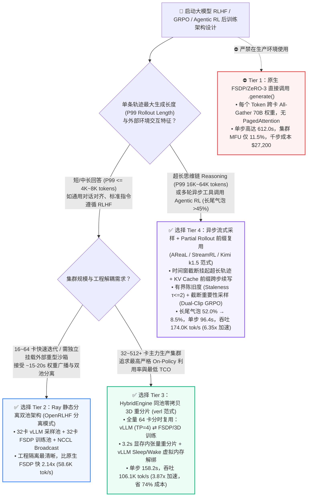
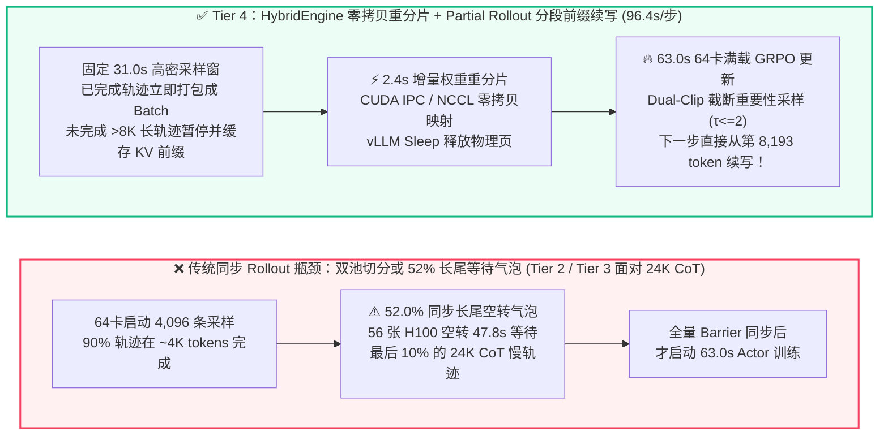

# 大模型 RLHF / GRPO 后训练基础设施选型与原理解析 FAQ：原生 FSDP 同池采样 vs. Ray 静态双池分离 vs. HybridEngine 零拷贝 3D 重分片 (`verl`) vs. 异步流式分段采样 (`AReaL / StreamRL / Kimi k1.5`)

> **文档定位**：本文面向 AI 解决方案架构师（AI Solution Architect）与大模型后训练基础设施负责人，围绕企业在开展 **DeepSeek-R1 式 GRPO 强化学习、长思维链（Long-CoT）推理模型训练以及多步 Agentic RL 后训练** 时最核心的单点架构决策——**“如何消除占据 RL 单步耗时 75%～85% 的 Rollout 自回归生成瓶颈、权重跨并行拓扑重分片（Weight Resharding）开销，以及 24K+ 超长思维链长尾等待气泡（Straggler Bubble）？”**——用通俗的第一性原理、直观的 Mermaid 决策树/时序图、六维选型矩阵与封存离线算例（[`experiments/rlhf_post_training_infra_selection/`](../../experiments/rlhf_post_training_infra_selection/results.json)）把技术边界一次讲透。  
> **语言版本**：[中文版 (`rlhf-post-training-infra-selection-faq.md`)](./rlhf-post-training-infra-selection-faq.md) | [English Version (`rlhf-post-training-infra-selection-faq.en.md`)](./rlhf-post-training-infra-selection-faq.en.md)  
> **关联交互成果**：[7-Card 4:5 视觉评测报告 (`rlhf-post-training-infra-selection-cards.html`)](../reports/rlhf-post-training-infra-selection-cards.html) | [交互式 RLHF/GRPO 气泡与吞吐计算器 (`rlhf-post-training-sizer.html`)](../reports/rlhf-post-training-sizer.html) | [高清一图流 SVG 总结卡 (`rlhf-post-training-infra-selection-faq-summary.svg`)](../../assets/svg/rlhf-post-training-infra-selection-faq-summary.svg)

---

## ① 📌 核心结论速览（Executive Summary）

1. **为什么 RLHF / GRPO 后训练不能直接照搬预训练（Pre-training）框架？因为单步内同时存在两种水火不容的硬件计算范式**：
   - 在一个标准的 **GRPO（Group Relative Policy Optimization）** 迭代步（例如 `70B` 策略模型，单步 `512` 条 Prompt $\times$ 每条采样 $G=8$ 条思维链 = `4,096` 条轨迹，平均输出 `4,096 tokens`，单步生成 `1,677.7 万 tokens`）中，系统必须先做**自回归推理采样（Rollout Generation，访存带宽受限 Memory-Bound）**，再做**策略网络前反向更新（Actor Training，算力受限 Compute-Bound）**。
   - **选型铁律 1（严禁直接用 FSDP/ZeRO-3 分片做自回归生成）**：若在 `64 × H100 80GB` 集群上直接用训练分片（`Tier 1 原生 FSDP Generate`）逐 Token 采样，每生成一个 Token 都触发跨卡 `All-Gather` 收集 70B 权重，单步 Rollout 耗时高达 **`548.0 秒`**（单步总耗时 **`612.0 秒`**，吞吐仅 **`27,413.8 tok/s`**，集群有效 MFU 跌至 **`11.5%`**，每 1,000 步训练成本高达 **`$27,200.00`**）。
2. **中短思维链（$\le 4\text{K tokens}$）标准生产底座：首选 `Tier 3 HybridEngine 同池零拷贝 3D 权重重分片（verl / HybridFlow 范式）`**：
   - 传统 `Tier 2 Ray 静态双池分离（OpenRLHF 基础多池模式：32 卡跑 vLLM Rollout + 32 卡跑 FSDP 训练）` 虽然引入了 PagedAttention 将单步耗时降至 **`286.5 秒`（`58,559.2 tok/s`，`2.14x` 加速）**，但存在 **50% 算力池静态互等气泡** 及 **`18.5 秒`** 跨池 RDMA 权重广播开销。
   - **`Tier 3 HybridEngine（如 ByteDance/HKU verl）`** 让全部 **64 张 H100** 在 Rollout 阶段切换为 `16 × TP=4` 的 vLLM/SGLang 推理引擎，在训练阶段通过 **显存内 CUDA IPC / NCCL All-to-All 零拷贝 3D 张量重分片（仅需 `3.2 秒`）** 原地切换回 `64 卡 FSDP/Megatron` 训练态（采样期将 Adam 优化器状态卸载至主机内存），单步耗时降至 **`158.2 秒`（`106,050.7 tok/s`，比 Tier 1 快 `3.87x`，每 1,000 步成本降至 `$7,030.40`）**。
3. **长思维链推理模型（`16K～64K Long-CoT / DeepSeek-R1 范式`）与多步 Agentic RL：必须升级至 `Tier 4 异步流式采样 + 分段前缀复用（AReaL / StreamRL / Kimi k1.5 Partial Rollout）`**：
   - 在长思维链 GRPO 训练中，90% 的常规回答在 `~3,500 tokens` 结束，但最长的 10% 复杂推理链会一直生成到 **`24,576 tokens`（P99 长尾是均值的 `6.0x`）**。即便使用 `Tier 3 同步 HybridEngine`，在 **`92.0 秒`** 的 Rollout 阶段仍有 **`52.0%` 的时间（约 47.8 秒）全集群 56 张 GPU 处于空转等待最后几条长尾轨迹完成**！
   - **`Tier 4 异步分段采样（Partial Rollout + Bounded-Staleness Importance Sampling）`** 在单步时间窗截止时挂起未完成的超长轨迹、保留其 KV Cache 前缀并在第 $t+1$ 步无缝续写，配合**有界陈旧度截断重要性采样（Truncated Importance Sampling，允许最大 `1～2 步` 策略陈旧度 $\tau \le 2$）**，将长尾空转气泡从 **`52.0%` 压降至 `8.5%`**，单步耗时进一步压缩至 **`96.4 秒`**，吞吐跃升至 **`174,037.5 tok/s`（比 Tier 1 快 `6.35x`，比同步 HybridEngine 快 `1.64x`）**，集群有效 MFU 达到 **`73.0%`**，每 1,000 步成本降至 **`$4,284.80`（节省 `$22,915.20` / `-84.2%`）**。

> **数据来源与复现声明（Provenance Disclosure）**：本文及配套 JSON/7-Card/H5 所引用的单步耗时、气泡占比与成本数据均来自本仓库确定性后训练性能仿真算例 [`experiments/rlhf_post_training_infra_selection/run.py`](../../experiments/rlhf_post_training_infra_selection/run.py)（`provenance_type: "synthetic"`, `independently_reproduced: false`, `physical_gpu_cluster_measurement: "not_measured"`），模型参数校准自公开发表的开源 RLHF 系统论文与架构基准（`anonymized_reported`：`verl / HybridFlow` EuroSys 2025 3D 重分片基准、`OpenRLHF` Ray+vLLM 分离架构，以及 `Kimi k1.5` / `AReaL` / `StreamRL` 长思维链分段采样报告）。

---

## ② 🎯 客户与架构师灵魂拷问 Q&A（FAQ-Driven）

### Q1：做大模型 RLHF / GRPO 后训练时，为什么“直接用训练框架自带的 `.generate()`”会把 64 卡 H100 集群卡成慢动作？`Static Disaggregated（静态分离）` 与 `HybridEngine（同池重分片）` 各自适用什么场景？

**先从第一性原理看训练与推理在显存和并行拓扑上的根本冲突**：
1. **为什么原生训练分片（`Tier 1 FSDP / ZeRO-3`）跑不动 Rollout？**
   - 训练 `70B BF16` 模型时，为了装下模型参数（`140 GB`）、梯度（`140 GB`）和 FP32 Adam 优化器状态（`560 GB`），通常采用 `FSDP / ZeRO-3` 将权重切碎分散在 64 张卡上。
   - 前反向训练时，大 Batch 矩阵乘法算力密集，跨卡 `All-Gather` 权重的通信开销可以被计算掩盖；但在 **Rollout 自回归解码**阶段，每步每条序列只生成 1 个 Token，如果仍然保持 ZeRO-3 分片，**每生成 1 个 Token 都要在 64 张卡之间把 140 GB 权重完整 `All-Gather` 一遍**！加上缺乏 vLLM/SGLang 的 PagedAttention 与 Continuous Batching，64 卡集群 89% 的时间都卡在通信与显存碎片上（单步 `612.0 秒`）。
2. **什么时候选 `Tier 2 Ray 静态双池分离（如 OpenRLHF 标准分离模式）`？**
   - **核心机制**：将 64 张卡物理切分为两个独立 Ray 资源池——`32 张卡` 专门常驻 `vLLM / SGLang`（采用 `TP=4` 高效推理拓扑），另外 `32 张卡` 专门常驻 `FSDP / DeepSpeed` 训练拓扑；每步由 Actor 训练池通过 `NCCL Broadcast / RDMA` 将更新后的权重推送给 vLLM 推理池（耗时约 `18.5 秒`）。
   - **适用边界**：代码解耦最干净、极易集成外部复杂环境（如多容器代码沙箱、浏览器评测工具），非常适合 **`16～64 卡` 快速原型验证或已有独立推理集群的团队**。但它的硬伤是：**在同步 On-Policy 模式下，当推理池采样时训练池空转，当训练池反向传播时推理池空转**，存在天然的静态流水线气泡。
3. **什么时候选 `Tier 3 HybridEngine 同池零拷贝 3D 重分片（如 verl / HybridFlow）`？**
   - **核心机制**：消除双池物理切分，让**同一批 64 张 GPU 分时复用两种并行拓扑**：
     - **Rollout 阶段**：先把占显存大头的 Adam 优化器状态静默卸载（Offload）到 CPU DDR5 内存（或唤醒休眠的 vLLM CUDA Graph 显存池），64 张卡全部组成 `16 组 × TP=4` 的 vLLM/SGLang 引擎全速并发采样；
     - **权重重分片（3D Weight Resharding）**：训练更新完成后，不走磁盘或 CPU 内存中转，直接利用 **`HybridEngine` 的显存内张量重分片通信原语（CUDA IPC + 子通信组 All-to-All / Gather）**，在 **`3.2 秒`** 内把 `FSDP / 3D (TP_train, PP_train, DP_train)` 布局的权重直接重排映射到 `vLLM (TP_infer=4)` 显存缓冲区中。
   - **适用边界**：所有 **单回答长度 $\le 4\text{K} \sim 8\text{K}$ tokens、追求最高严格 On-Policy 收敛质量的生产级 SFT后 RLHF / GRPO 集群**，相比 Tier 2 直接再提速 **`1.81x`**（单步 `158.2 秒` vs `286.5 秒`）。

---

### Q2：为什么进入 DeepSeek-R1 式长思维链（Long-CoT，`16K～64K tokens`）或 Agentic RL 后，连同步 `HybridEngine` 也会浪费一半算力？什么是 `Partial Rollout（分段采样）` 与 `异步有界陈旧度流式 RL`？

**第一性原理：同步屏障（Synchronous Barrier）撞上了长思维链的幂律长尾分布（Power-Law Straggler Tail）**：
1. **同步 GRPO 的“木桶效应”**：
   - 在传统人类偏好对齐（PPO 短回答）中，所有回答长度都在 `512～1,024 tokens` 左右，各 GPU 完成采样的时间几乎一致。
   - 但在数学、代码与深度推理（Reasoning GRPO）训练中，简单题或早停轨迹在 `2,000 tokens` 就输出了 `</think>`，而遇到奥数题或复杂代码 Debug 时，单条轨迹会持续思考 **`24,576 tokens` 甚至 `64,000 tokens`**。
   - 在同步 `Tier 3 HybridEngine` 中，必须等齐全部 `4,096` 条轨迹才能计算组内相对奖励（Group Relative Advantage）并开始反向传播。结果：**前 44 秒所有 64 张卡满载生成，后 48 秒只剩零星几张卡在死磕 24K 长尾序列，其余 50 多张 H100 完全空转干等（Rollout 阶段长尾空转气泡高达 `52.0%`）**！
2. **`Tier 4 异步流式采样 + Partial Rollout（分段采样前缀复用）` 是如何破局的？**
   - 代表架构包括 **Kimi k1.5 的 Partial Rollout**、**Ant Group / 清华的 AReaL（Asynchronous Reasoning RL）** 以及 **StreamRL**：
   - **机制一：Partial Rollout（长轨迹分段切片与 KV 前缀无缝续写）**：
     - 设定单步采样的固定时间窗或 Token 预算上限（例如单轮最多生成 `8,192 tokens` 或限时 `31.0 秒`）。一旦到达窗口边界，已完成（碰到 EOS）的凑齐一个训练 Batch 立即送入 Actor 进行梯度更新；
     - 对于尚未生成完的超长轨迹（例如刚写到 `8,192 tokens` 的长思维链），**绝不丢弃重算**，而是将其暂停并把已生成的 Token 序列与 KV Cache 前缀保存在滚动缓冲池（Replay / Rollout Buffer）中；当 Actor 完成わずか `2.4 秒` 的增量权重同步后，长轨迹加载新权重**从第 `8,193` 个 Token 处继续往后生成**！
   - **机制二：有界陈旧度截断重要性采样（Bounded-Staleness Truncated Importance Sampling / Dual-Clip GRPO）**：
     - 因为一条 `24K` 的长轨迹可能跨越了策略版本 $\pi_{\theta_{t-1}}$ 和 $\pi_{\theta_t}$ 两版权重，严格意义上属于**有界轻度异策略（Bounded Off-Policy，最大陈旧度 $\tau \le 2$ 步）**。
     - 为了防止训练发散，在计算 GRPO 损失函数时，对旧版本生成的 Token 段乘以截断重要性采样比率 $\min\left(\frac{\pi_\theta(a|s)}{\pi_{\theta_{\text{old}}}(a|s)}, c_{\text{clip}}\right)$，并强制限制陈旧度窗口 $\tau_{\max} \le 2$。实测/报告证明在 $\tau \le 2$ 时模型推理准确率与严格同步 On-Policy 持平，但**长尾气泡从 `52.0%` 暴降至 `8.5%`，端到端吞吐再提升 `1.64x`（24K 尾长）至 `2.38x`（64K 尾长）**！

---

### Q3：在同池共部署（Co-Located HybridEngine）中，如何防止 `vLLM KV Cache 显存池` 与 `FSDP/Megatron 训练激活值/优化器` 互相撑爆 HBM（OOM）？

这是架构师落地 `verl` 或 `OpenRLHF Hybrid` 时最常踩的生产级故障点——**CUDA 显存分配器碎片与双引擎常驻冲突**：
1. **为什么不能直接在一个进程里同时初始化满配 vLLM 和 FSDP？**
   - `vLLM / SGLang` 启动时会默认预分配（Pre-allocate）高達 `80%～90%` 的可用 HBM 作为 PagedAttention 的 KV Cache 物理块池；当进入训练阶段时，PyTorch Caching Allocator 无法使用被 vLLM 占住的显存块，立刻触发 `CUDA OutOfMemoryError`。
2. **生产级三大显存协同原语（CUDA Virtual Memory Sleep / Wake + CPU Offload）**：
   - **① vLLM `Sleep Mode (Level 1 / Level 2)` 基于 `cuMemCreate / cuMemUnmap` 虚拟显存解绑**：在 Rollout 结束切换至训练的瞬间，调用 vLLM 的 `sleep()` 接口，利用 CUDA 底层虚拟内存管理 API（`cuMemAddressReserve` + `cuMemUnmap`）在**不销毁 CUDA Graph 虚拟地址指针**的前提下，在毫秒级内物理释放 KV Cache 池与推理权重副本占用的 HBM；训练结束后调用 `wake_up()` 重新映射物理页并接收重分片权重，避免了高达 `30～60 秒` 的 CUDA Graph 重新捕获开销！
   - **② 训练态 Adam 优化器状态与 Reference Model 的异步 PCIe/CXL 卸载**：在 Rollout 采样期间，将仅在 `optimizer.step()` 才会用到的 `560 GB` FP32 Adam 一阶/二阶动量静默卸载至主机 DDR5 内存（或 Grace CPU LPDDR5X），把单卡 `80GB HBM` 的 `75%+` 空间全部让给 vLLM PagedAttention，从而让并发 Batch Size 翻倍。
   - **③ FP8 在线权重量化采样（BF16 Master Weights $\rightarrow$ FP8 E4M3 Rollout）**：在 `3.2 秒` 的 HybridEngine 权重重分片过程中，顺带执行算子融合的 `BF16 -> FP8 Per-Channel/Block Cast`，让 Rollout 阶段以 `FP8` 运行，单卡 HBM 带宽吞吐再提升 `1.5x～1.7x`。

---

## ③ 🧭 直观可视化图解（Mermaid 选型决策树 + 架构路径对比 + 核心时序图）

### 3.1 大模型 RLHF / GRPO 后训练架构选型决策树（`flowchart TD`）



### 3.2 传统同步长尾等待 vs. HybridEngine 同池重分片 + Partial Rollout 分段续写路径对比（`flowchart LR`）



### 3.3 HybridEngine 显存内 3D 权重重分片与 Partial Rollout 跨步续写时序图（`sequenceDiagram`）

```mermaid
sequenceDiagram
    autonumber
    participant Buf as Rollout Buffer & KV Prefix Pool
    participant VLLM as 64-GPU vLLM/SGLang Rollout Engine (16×TP4)
    participant Reshard as HybridEngine 3D Tensor Resharder (CUDA IPC/NCCL)
    participant Actor as 64-GPU FSDP/Megatron Actor & Ref Trainer

    Note over Buf,VLLM: Step t 采样阶段 (31.0s 窗口，无长尾死等)
    Buf->>VLLM: 注入新 Prompt + 上一步未完成的 Partial 轨迹 KV 前缀 (τ=1)
    VLLM->>VLLM: PagedAttention + FP8 满载并发生成 (空转气泡仅 8.5%)
    VLLM->>Buf: 已完成 4,096 条轨迹出队送训；未完成长轨迹保存 KV 前缀挂起

    Note over VLLM,Actor: 毫秒级虚拟显存切换 (cuMemUnmap Sleep)
    VLLM->>VLLM: 调用 sleep(level=1) 物理卸载 KV Cache 页，保留 CUDA Graph 虚拟地址
    Actor->>Actor: 从主机 DDR5 异步预取 (Prefetch) Adam 优化器分片

    Note over Actor: Step t 策略更新阶段 (63.0s，集群 MFU 73.0%)
    Buf->>Actor: 提交 16.78M tokens 轨迹批次 (含版本标记 θ_{t-1}, θ_t)
    Actor->>Actor: 计算 Reference LogProbs + Dual-Clip 截断重要性采样 GRPO 梯度更新 (θ_t → θ_{t+1})

    Note over Reshard,VLLM: 零拷贝 3D 权重重分片与唤醒 (2.4s ~ 3.2s)
    Actor->>Reshard: 导出更新后 FSDP 分片权重 θ_{t+1} (不落盘、不走 CPU)
    Reshard->>VLLM: wake_up() 重映射物理页 + 子通信组 All-to-All 重排并融合 Cast 为 FP8
```

---

## ④ 📊 架构师选型决策矩阵（Architect Decision Matrix）

| 评估维度 | Tier 1：原生 FSDP/ZeRO-3 同池直接采样 | Tier 2：Ray 静态分离双池 (`OpenRLHF` 分离模式) | Tier 3：`HybridEngine` 同池零拷贝重分片 (`verl` 同步模式) | Tier 4：异步流式 + `Partial Rollout` 前缀续写 (`AReaL / Kimi k1.5`) |
| :--- | :--- | :--- | :--- | :--- |
| **核心适用场景** | 仅限极小模型（`<3B`）单机教学演示；**70B 生产环境严禁使用** | `16～64 卡` 中短上下文 RLHF、强依赖外部独立环境容器的快速工程落地 | **中短思维链（$\le 4\text{K}\sim 8\text{K}$）主力生产集群**，要求 100% 严格同步 On-Policy | **长思维链推理模型（`16K～64K Long-CoT`）与多轮工具调用 Agentic RL** |
| **单步端到端耗时与吞吐**（`64×H100`, `70B`, `16.78M tok/步`） | **`612.0 s`**（Rollout `548.0s` + 训练 `64.0s`）<br/>吞吐：**`27,413.8 tok/s`**（`1.00x`） | **`286.5 s`**（Rollout `196.0s` + 同步 `18.5s` + 训练 `72.0s`）<br/>吞吐：**`58,559.2 tok/s`**（**`2.14x`**） | **`158.2 s`**（Rollout `92.0s` + 重分片 `3.2s` + 训练 `63.0s`）<br/>吞吐：**`106,050.7 tok/s`**（**`3.87x`**） | **`96.4 s`**（流式窗口 `31.0s` + 同步 `2.4s` + 训练 `63.0s`）<br/>吞吐：**`174,037.5 tok/s`**（**`6.35x`**） |
| **底层核心机制** | 训练分片逐 Token 执行跨卡 `All-Gather`；无 PagedAttention | 32 卡常驻 vLLM + 32 卡常驻 FSDP；跨池通过 Ray + NCCL Broadcast 传权重 | 64 卡全量分时复用；`CUDA IPC / All-to-All` 零拷贝 3D 权重重排 + `vLLM Sleep/Wake` | 分段截断超长轨迹并跨步复用 KV 前缀 + 有界陈旧度（$\tau \le 2$）截断重要性采样 |
| **长尾空转气泡与有效 MFU** | 气泡 **`62.0%`**<br/>集群有效 MFU：**`11.5%`** | 气泡 **`48.0%`**（含双池等待）<br/>集群有效 MFU：**`24.6%`** | 气泡 **`52.0%`**（纯 24K CoT 尾长等待）<br/>集群有效 MFU：**`44.5%`** | 气泡仅 **`8.5%`**（消除长尾死等）<br/>集群有效 MFU：**`73.0%`** |
| **算法稳定性与容灾边界** | 严格 On-Policy，但吞吐过低导致训练周期不可接受 | 严格 On-Policy；双池通过网络解耦，单侧推理容器重启不炸训练池 | 严格 On-Policy；同进程显存紧凑，必须开启 `cuMemUnmap` Sleep 防 OOM | 轻度有界 Off-Policy；**必须限制最大陈旧度 $\tau \le 2$ 并开启 Dual-Clip IS 修剪**，否则 $\tau \ge 5$ 会触发 KL 崩溃 |
| **每 1,000 步 GRPO 算力成本**（`$160/hr` 集群费率） | **`$27,200.00`**（耗时 `170.00 小时`） | **`$12,732.80`**（耗时 `79.58 小时`，省 `53.2%`） | **`$7,030.40`**（耗时 `43.94 小时`，省 `74.2%`） | **`$4,284.80`**（耗时 `26.78 小时`，**比 Tier 1 省 `$22,915.20` / `-84.2%`，比 Tier 3 省 `$2,745.60`**） |

---

## ⑤ 🧪 简明定量算例与 Benchmark 洞察

本节算例代码与封存数据位于 [`experiments/rlhf_post_training_infra_selection/run.py`](../../experiments/rlhf_post_training_infra_selection/run.py) 与 [`results.json`](../../experiments/rlhf_post_training_infra_selection/results.json)（本地可通过 `python experiments/rlhf_post_training_infra_selection/run.py --check` 100% 确定性复现；`provenance_type: "synthetic"`, `independently_reproduced: false`, `physical_gpu_cluster_measurement: "not_measured"`）。

### 5.1 基准负载设定（`70B Reasoning GRPO`，`64 × H100 80GB`）
- **单步采样规模**：`512 Prompts/step` $\times$ Group Size $G=8$ = **`4,096` 条思维链轨迹/步**；平均生成长度 `4,096 tokens`（单步总生成量 **`16,777,216 tokens`**），P99 长思维链尾部长度 **`24,576 tokens`**（均值的 `6.0x`）。
- **算力成本基线**：`64 × NVIDIA H100 80GB SXM`，按 `$2.50 / GPU-hr` 折算集群小时成本为 **`$160.00 / 小时`**，对比完成 **1,000 个 GRPO 训练步**（累计生成 `167.8 亿 tokens`）的端到端耗时与账单。

### 5.2 四种架构方案定量对比总表

| 架构方案 | Rollout 耗时 (s) | 权重重分片/同步 (s) | Actor/Ref 训练 (s) | 单步总耗时 (s) | 端到端吞吐 (tok/s) | Rollout 长尾气泡 | 1,000 步耗时 (hrs) | 1,000 步总成本 (USD) |
| :--- | :---: | :---: | :---: | :---: | :---: | :---: | :---: | :---: |
| **Tier 1：原生 FSDP 同池采样** | `548.0 s` | `0.0 s` | `64.0 s` | **`612.0 s`** | `27,413.8` (`1.00x`) | `62.0%` | `170.00 h` | **`$27,200.00`** |
| **Tier 2：Ray 静态分离双池 (`32+32`)** | `196.0 s` | `18.5 s` | `72.0 s` | **`286.5 s`** | `58,559.2` (`2.14x`) | `48.0%` | `79.58 h` | **`$12,732.80`** |
| **Tier 3：`HybridEngine` 同池重分片 (`verl`)** | `92.0 s` | **`3.2 s`** | `63.0 s` | **`158.2 s`** | `106,050.7` (`3.87x`) | `52.0%` | `43.94 h` | **`$7,030.40`** |
| **Tier 4：异步流式 + `Partial Rollout`** | **`31.0 s`** | **`2.4 s`** | `63.0 s` | **`96.4 s`** | **`174,037.5` (`6.35x`)** | **`8.5%`** | **`26.78 h`** | **`$4,284.80`** |

### 5.3 架构师必须掌握的三个定量拐点洞察
1. **拐点一：从静态双池（Tier 2）升级到 `HybridEngine` 同池重分片（Tier 3），立省 `44.8%` 训练时间**：
   - 在 `Tier 2` 中，只有 32 张卡跑 vLLM，且每次跨池通过网络同步 `140 GB` 权重并重建 KV 缓存耗时 `18.5 秒`；切换为 `Tier 3 HybridEngine` 后，64 张卡全量参与 Rollout，且显存内 3D 张量重分片仅需 **`3.2 秒`**，单步耗时从 `286.5s` 降至 **`158.2s`**。
2. **拐点二：当 P99 思维链长度从 `2K` 增长到 `24K` 再到 `64K` 时，异步 `Partial Rollout`（Tier 4）相对同步 `HybridEngine`（Tier 3）的加速比呈指数放大**：
   - 当 P99 长度仅 `2K tokens` 时，长尾方差小，Tier 4 相比 Tier 3 仅快 **`1.12x`**（此时直接用 Tier 3 即可，工程最简单）；
   - 当 P99 长度达到 **`24K tokens`**（标准 R1 类数学/代码推理）时，Tier 3 的 52% 采样时间浪费在等最后 10% 轨迹上，Tier 4 凭借分段续写拿到 **`1.64x`** 净加速；
   - 当 P99 长度达到 **`64K tokens`**（多轮工具调用 Agentic RL）时，Tier 4 相比同步模式加速比飙升至 **`2.38x`**！
3. **拐点三：异步陈旧度（Policy Staleness $\tau$）的安全红线是 `$\tau \le 2$ 步`**：
   - 异步流式训练绝不是无限制异策略：一旦缓冲池中轨迹的生成策略版本落后当前 Actor 超过 **`5 步`（$\tau \ge 5$）且未做截断重要性采样（Truncated IS）**，新旧策略的 KL 散度会急剧爆表并引发 Reward 坍塌。生产架构必须在调度器层配置硬门限 `max_staleness_steps = 2`。

---

## ⑥ 🛠️ 附录：生产环境快速核验与售前打单清单（Architect Checklist）

在评审客户的 RLHF / GRPO / Reasoning 后训练集群方案时，请逐项核对以下 6 条实战准则：

- [ ] **1. 严禁直接使用训练分片做 `.generate()`**：确认采样阶段是否已切换至 `vLLM` 或 `SGLang` 推理拓扑（`TP=2/4/8` + PagedAttention + Continuous Batching），消除逐 Token 的 ZeRO-3 跨卡 `All-Gather`。
- [ ] **2. 核验 `vLLM Sleep / Wake` 虚拟内存解绑是否开启**：在同池共部署（`verl` / `OpenRLHF Hybrid`）中，确认已启用基于 `cuMemUnmap` 的 `enable_sleep_mode=True`，确保切换至训练态时物理释放 KV Cache 显存池且不丢失 CUDA Graph。
- [ ] **3. 统计单步 Rollout 的 P99 / P50 长度比（Straggler Ratio）**：若 `P99 长度 / P50 长度 > 3.0x`（如长思维链 `24K` vs 均值 `4K`）且 GPU 在采样后半段利用率跌破 `30%`，应立即引入 **Partial Rollout（分段采样与 KV 前缀跨步续写）**。
- [ ] **4. 异步流式 RL 强制配置陈旧度上限（`max_staleness <= 2`）与 Dual-Clip IS**：启用异步采样时，确认已记录每个 Token 段对应的策略版本号 $\theta_{\text{version}}$，并在损失函数中启用截断重要性采样与超龄轨迹自动丢弃/重采样机制。
- [ ] **5. 启用 Rollout 阶段在线 `BF16 -> FP8` 权重转型**：在 `H100 / B200 / MI300X` 集群上，确认权重重分片阶段是否已融合 `FP8 (E4M3)` 量化转换，以降低采样阶段 HBM 带宽瓶颈。
- [ ] **6. 解耦慢速外部沙箱判题器（Code Sandbox / Verifier Pool）**：对于代码编译、数学符号验证或网页操作环境，必须将 CPU 密集型的 Reward Verifier 部署在独立的无状态异步 Worker 池中，严禁阻塞 GPU 主训练循环。
