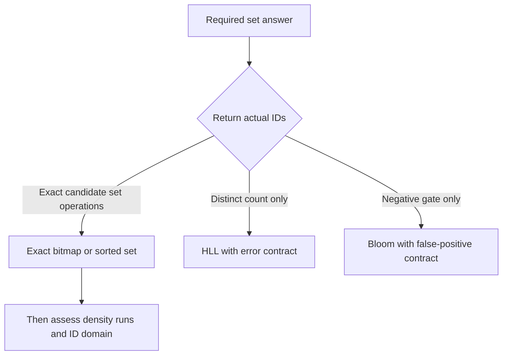
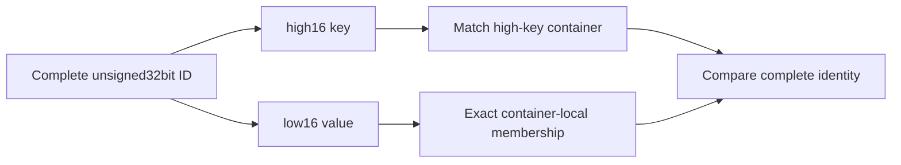
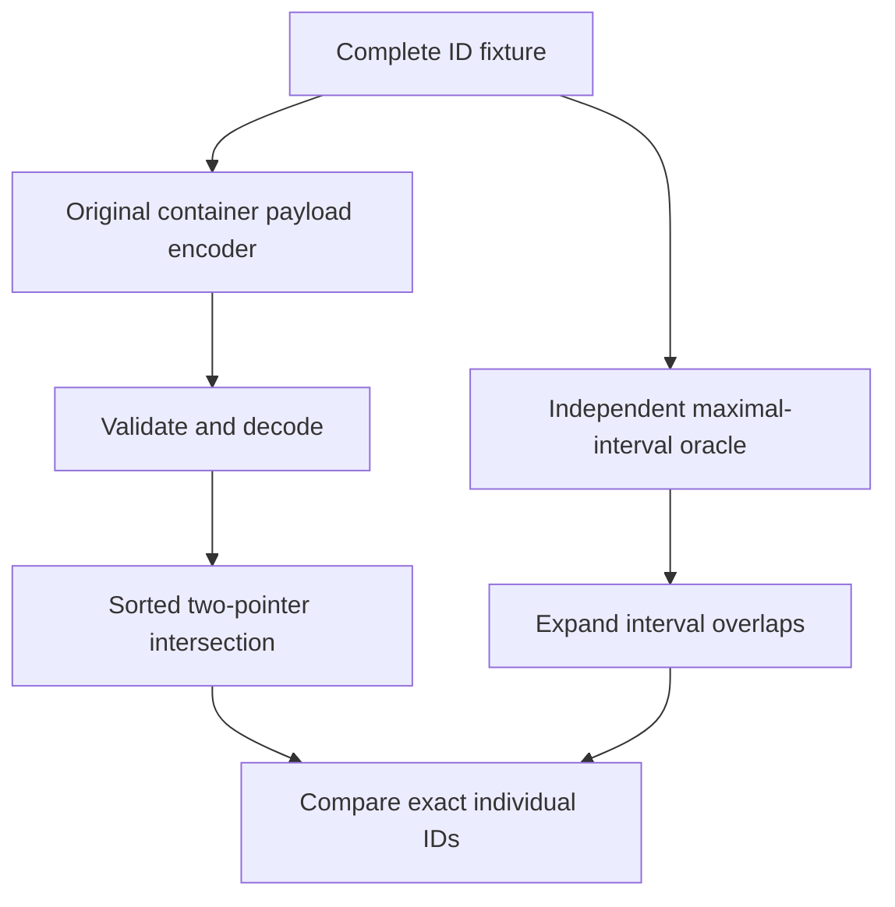

# AI Infra compressed-bitmap FAQ: Roaring array/bitset/run payloads, the 4096 boundary and high-key identity

> **Language**: English | [中文](roaring-array-bitset-run-container-payload-selection-faq.md)  
> **Round 137 · 2026-11-14 daytime**: underlying representations for metadata candidate sets, training-sample IDs and exact set operations.  
> **Related**: [HLL distinct counts and register union](hll-register-max-union-cardinality-estimator-selection-faq.en.md) · [Bloom negative gates](bloom-negative-gate-layer-budget-safe-deletion-selection-faq.en.md)

**Executive finding:** Roaring's exact-set semantics differ from Bloom negative gates and HLL approximate cardinality. A uint32 ID splits into **high16 key + low16 value**. Non-run containers use arrays through cardinality 4096 and fixed 8192B bitsets above it. But **contiguity changes the decision**: 4097 consecutive lows need only a 6B original run payload, while 4097 isolated lows still select bitset. These are container payloads, not whole files, native allocations or ACL latency.

**Artifacts**: [workbench](../reports/roaring-array-bitset-run-container-payload-sizer.html) · [seven cards](../reports/roaring-array-bitset-run-container-payload-selection-cards.html) · [1600px SVG](../../assets/svg/roaring-array-bitset-run-container-payload-selection-faq-summary.svg) · [sealed report](../../experiments/roaring_container_contract_selection/report.json)

## Q1: Should an AI data plane choose an exact bitmap, Bloom filter or HLL?

Consider exact bitmap intersection/union/difference when the answer is “which document/sample IDs satisfy these predicates?” No probabilistic membership error is required. HLL instead fits approximate distinct cardinality with an explicit error contract. Bloom structures fit fast negative screening with permitted false positives. They are not interchangeable compression encodings.



This study is independent of the repository's broad RAG/ACL architecture work: it does not inherit scale, recall, latency or revocation figures, only investigates **container representation and identity**. Exact sets alone do not ensure permission freshness, propagation or database snapshot consistency; those remain application protocols.

## Q2: Why preserve high16/low16 identity, and where does 4096 come from?

An unsigned32bit ID's high 16 bits select a container; its low 16 bits lie in `[0,65535]`. IDs 7 and 65543 both have low value 7 but different high keys 0/1, so their true intersection is empty. Matching lows globally creates one false hit. Signed-int32 order also does not represent the full unsigned domain.

The pinned portable format identifies non-run containers by cardinality: `c≤4096` means a sorted uint16 array with payload `2c`; `c>4096` means an 8192B bitset. At the equality boundary the array also consumes 8192B, but that does not make its descriptor a bitset. Low value `j` corresponds to bit `j` in little-endian 64-bit words; our bytewise encoding yields those bit positions.



Our encoder deduplicates and sorts IDs numerically. Duplicates/reordering do not increase cardinality. Empty sets have no containers, rather than a fake cardinality-zero container. The original input bound is 65536 IDs, not Roaring's complete real capacity.

## Q3: How are runs encoded, and why is density alone insufficient?

Each run stores `(start, length_minus_one)` as two uint16 values, preceded by a uint16 run count, so payload is `2+4r`. The full interval `[0,65535]` has length-minus-one 65535 and represents all 65536 lows. Treating that field as length loses the final identity.

| Original low-ID input | Without runs: type / payload | Original run-enabled policy | Finding |
| :--- | :--- | :--- | :--- |
| 4096 isolated lows | array / 8192B | array / 8192B | Equality belongs to array |
| 4097 isolated lows | bitset / 8192B | bitset / 8192B | Fragmented runs do not save bytes |
| 4097 consecutive lows | bitset / 8192B | run / 6B | Contiguity matters beyond cardinality |
| Full 65536-low domain | bitset / 8192B | run / 6B | Inclusive endpoints must not lose one |

Our explicit teaching policy chooses run only when its payload is **strictly smaller** than the default array/bitset payload. Ties retain non-run: three consecutive values cost 6B either way. This does **not reproduce native `runOptimize` allocation, capacity or whole-file decisions**.

Runs must be increasing, nonoverlapping and satisfy `start+length_minus_one≤65535`. The toy checks payload lengths and cardinality rather than silently truncating corrupt intervals. A whole portable file additionally contains cookies, run flags, key/cardinality fields and sometimes offsets; container payload cannot stand in for its full size.

## Q4: How are full-ID intersections and an independent oracle checked?

Default A contains 103 IDs: key0 lows `5,9,13` plus key1 lows `[100,199]`. B contains 102: key0 `9,13` plus key1 `[150,249]`. A's payload is `6+6=12B`, or `6+200=206B` without runs. B's payload is `4+6=10B`. Their exact intersection contains 52 IDs and union 153.

The original encoder emits actual little-endian container payload bytes. Its decoder reconstructs complete IDs using explicit key/type/cardinality metadata, followed by a sorted two-pointer intersection. The independent oracle forms maximal inclusive intervals of complete IDs and enumerates interval overlaps without invoking the decoder or two-pointer routine.



Tests cover 24 fixed-seed input pairs, high-key boundaries, maximum uint32, duplicates/reordering, all three payload round-trips, cardinality mismatches, truncated payloads, unsorted arrays and run overflow. No complete portable-file reader/writer, native cross-container dispatch or general secure untrusted-byte parser is implemented.

## Q5: Which byte and throughput figures can be used, and which cannot be generalized?

A's selected run-enabled payload is 12B versus no-run 206B and original uint32 identity payload 412B. A flat bitmap spanning ID0 through its maximum selected ID would use 8217B. This is not a native-memory comparison of complete equivalent objects. Different identity mappings/local rebasing change that flat-bitmap span, so it is not the unique valid baseline.

| Prebuilt IDs per set | Python integer AND+bit_count (ms) | Original sorted intersection list+len (ms) |
| ---: | ---: | ---: |
| 64 | 0.000133 | 0.013233 |
| 256 | 0.000167 | 0.053567 |
| 1024 | 0.000367 | 0.242867 |
| 4096 | 0.000733 | 0.917267 |

These timings do **unequal work**: C-backed bigint cardinality versus Python intersection-list materialization followed by length. They show this toy's language/output boundary, not SIMD/native Roaring speedup. Inputs are prebuilt; construction, codec, container dispatch, CRoaring, ANN and ACL are excluded. Two warmups, seven alternating repeats, three operations per sample; medians come from sealed raw samples.

For production intersection cardinality, check whether the engine has a native API avoiding ID materialization. If actual IDs are needed, cardinality-only cost is not the right capacity estimate. Native latency/memory and revocation latency remain unknown/null.

## Q6: What recent capability, licensing and production checks matter?

This round tracked **Nov 9, 2026 CRoaring Roaring64 C++ additions for rank/select and set-operation cardinality** and read the actual method patch: `select` starts with index 0; `rank(x)` counts values `≤x`; `getIndex` distinguishes an absent identity. Those native64bit capabilities were **not executed**, and this uint32 container toy is not their benchmark. The Nov 10 format-spec website-generation change did not invent the 4096 boundary either.

Sources: [pinned format specification](https://github.com/RoaringBitmap/RoaringFormatSpec/blob/188a7c75a9cea6b2b6d31efb604fab621e6a1b28/README.md), whose pinned LICENSE was checked as Apache-2.0, and [CRoaring capability change](https://github.com/RoaringBitmap/CRoaring/commit/ef50ca287eb6e775a4e90f012e1e089d193b610c). Facts, payload implementation and visuals are original, with no mirrored upstream examples or figures.

```powershell
python -m unittest discover -s tests -p test_roaring_container_contract_selection.py -q
python -m experiments.roaring_container_contract_selection.run --check
# --measure deliberately replaces original local CPU samples.
```

Eight tests include Node/Python workbench parity; six-section FAQs, three Mermaid figures, XML SVG, seven cards and strict CSP are locally checked. Prior browser refusal remains respected; visual browser inspection was not performed. The workbench exposes explicit errors for uint32 bounds and malformed JSON.

Production needs separate checks for ID namespaces/mapping, snapshot/epoch, authorization synchronization, native version, formal validation of untrusted serialized input and observed array/run/bitset distributions. Provenance is `synthetic`, `independently_reproduced=false`; original CPU records are separately `measured`. Neither 12B of payload nor exact-set semantics establishes production authorization safety.
